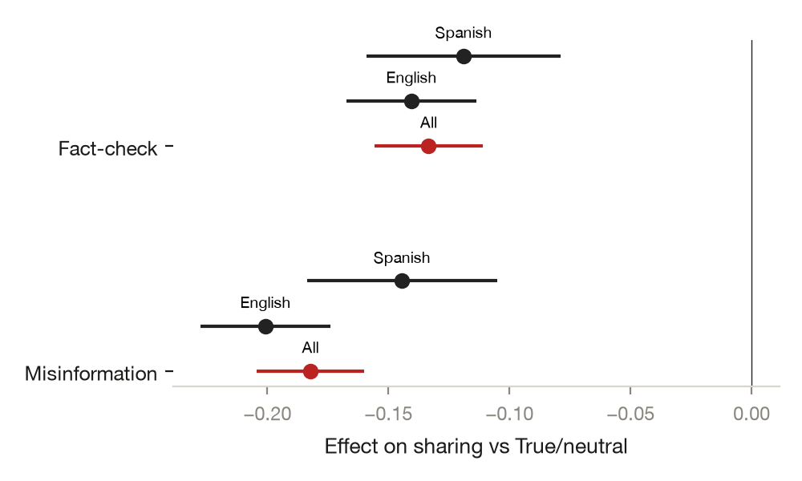

# Who Shares What From Whom: An Ego-Network Conjoint of Misinformation Sharing

*Yamil R. Velez · 2026-10-08 · N = 1,500 respondents analysed of 1,500 collected (12,000 rows) · conjoint experiment*

<!-- fd:badges -->
  [](https://aspredicted.org/8njc-mpqw.pdf)    

> **Provenance: FULLY AGENTIC — no human review recorded.** filedrawer 0.1.0, 2026-10-08; orchestrator `anthropic/claude-sonnet-5.5`, standard `anthropic/claude-haiku-5.5`, zero data retention requested. Reviewer pass: yes. Human steps recorded: 0. Release status: draft. Model calls: $1.41, 502k tokens in and 42k out. Cite as: Velez, Y. R. (2026). Who Shares What From Whom: An Ego-Network Conjoint of Misinformation Sharing [Unpublished study package, generated with filedrawer 0.1.0]. The File Drawer. https://github.com/yrvelez/fact-networks-conjoint

<!-- fd:section id=abstract -->
## Abstract

This study asks how the type of information, and who shares it, shape willingness to share a post and judgments of its plausibility. We ran a conjoint experiment in which 1,500 US Latino (Hispanic) adults each rated 8 profiles (12,000 in all) in a YouGov sample, surveyed in English or Spanish. Only the headline type was randomized; the sharer's tie strength, origin, ideology, trust, knowledge and belief in disputed claims are measured attributes of the respondent's real contacts. Compared with true or neutral headlines, misinformation was chosen 18.2 points less often (95% CI [−20.4, −16.0]) and fact-checks 13.3 points less often (95% CI [−15.6, −11.1]). Plausibility showed the same pattern. High trust in the sharer (+5.7 points) and a close tie (+3.0 points) were associated with more sharing. Origin, knowledge and conspiracy belief were not distinguishable from zero. Results come from many uncorrected tests, and the sharer contrasts are descriptive rather than causal.

<!-- fd:section id=findings -->
## Key findings

- Among US Latino adults, a false headline was chosen to share 18.2 points less often than a true or neutral one (95% CI [−20.4, −16.0]); fact-checks were also shared less.
- Information type is the only randomized feature. Misinformation also lowered plausibility by 18.6 points (95% CI [−20.8, −16.4]), so sharing and plausibility moved together.
- Among measured sharer attributes, high trust was associated with 5.7 points more sharing (95% CI [2.3, 9.1]); close-tie profiles were chosen 3.0 points more often (95% CI [1.0, 5.0]).
- Sharer origin, political knowledge and belief in disputed claims were not distinguishable from zero for sharing; the intervals rule out only large effects.
- Caveat: many tests were uncorrected, and the sharer attributes were not randomized, so their contrasts are descriptive; exploratory results are post hoc.

<!-- fd:section id=design -->
## Design and data

A conjoint experiment with 7 profile features: randomized, Information type (True/neutral, Misinformation, Fact-check); measured rather than randomized (the respondent's own ratings of the real contact each headline was attributed to; only the headline and its assignment to a contact are randomized), Tie strength (Distant tie, Close tie); Sharer origin (Foreign origin, Continental US); Sharer ideology (Liberal sharer, Moderate sharer, Conservative sharer); Trust in sharer (Trust: low, Trust: mid, Trust: high); Sharer political knowledge (Knowledge: low, Knowledge: mid, Knowledge: high); Sharer belief in disputed claims (Conspiracy belief: low, Conspiracy belief: high); yougov, US. 1,500 respondents were collected and 1,500 are analysed, 12,000 rows in all (several per respondent, keyed by `resp_id`). The plan is pre-registered at https://aspredicted.org/8njc-mpqw.pdf. Identifier and free-text columns removed before any model saw the data: none.


#### Details: the design in words

A conjoint experiment on yougov respondents in US (N = 1,500 respondents analysed, 12,000 profiles). Each profile is built from 7 features: Information type (True/neutral, Misinformation, Fact-check); Tie strength (Distant tie, Close tie; measured, not randomized); Sharer origin (Foreign origin, Continental US; measured, not randomized); Sharer ideology (Liberal sharer, Moderate sharer, Conservative sharer; measured, not randomized); Trust in sharer (Trust: low, Trust: mid, Trust: high; measured, not randomized); Sharer political knowledge (Knowledge: low, Knowledge: mid, Knowledge: high; measured, not randomized); Sharer belief in disputed claims (Conspiracy belief: low, Conspiracy belief: high; measured, not randomized). Respondents compare two profiles per task and choose one for each outcome. Outcomes: Chosen to share, Chosen as more plausible. Registered moderators: age, respondent ideology, respondent belief in disputed claims, trust in media, survey language.


The plan was registered (AsPredicted #132,508). Each respondent chose between profiles, and the outcomes were being chosen to share and being judged more plausible. The headline type was randomized: true or neutral (the reference level), misinformation, or fact-check. The six sharer features describe the respondent's own real contacts, so their effects are descriptive contrasts that bundle correlated attributes. The sample is US Latino (Hispanic) adults from YouGov, surveyed in English or Spanish. All 1,500 respondents (12,000 profile rows) entered analysis, with about 100 dropped from individual models for missing values. The reference group of true or neutral headlines has 4,145 profiles. Standard errors are clustered by respondent.

<!-- fd:section id=results -->
## Results


<!-- fd:hyp id=H1 tag=registered outcome=share -->
### H1. Information type → sharing

*AMCE of information type on sharing: each level against 'True/neutral', from the regression of sharing on all seven profile features, SEs clustered by respondent.*  
*Pre-registered.*

Misinformation was chosen to share 18.2 points less often than true or neutral headlines (95% CI [−20.4, −16.0], two-sided p < 0.001). Fact-checks were also shared less, by 13.3 points (95% CI [−15.6, −11.1], p < 0.001). Baseline sharing for true or neutral headlines was 60.3%. Both are large, and this is the only randomized feature.

#### Details: model and estimates by arm (H1)

```
share ~ C(arm_code, Treatment(reference='True/neutral')) + C(tie) + C(sharer_origin) + C(sharer_ideology) + C(sharer_trust) + C(sharer_knowledge) + C(sharer_conspiracy)
OLS | cluster-robust SEs on resp_id | N = 11,882 rows from 1,498 respondents | two-sided test, alpha = 0.05
```

| Level | Estimate | SE | p | 95% CI | n (level) | Supported |
|---|---|---|---|---|---|---|
| Misinformation | -0.182 | 0.011 | < 0.0001 | [-0.204, -0.160] | 3822 | yes |
| Fact-check | -0.133 | 0.011 | < 0.0001 | [-0.156, -0.111] | 3915 | yes |

<!-- fd:hyp id=H2 tag=registered outcome=share -->
### H2. Tie strength → sharing

*AMCE of tie strength on sharing: each level against 'Distant tie', from the regression of sharing on all seven profile features, SEs clustered by respondent.*  
*Pre-registered.*

Close-tie profiles were chosen 3.0 points more often than distant-tie profiles (95% CI [1.0, 5.0], two-sided p = 0.003). This is a measured contrast rather than a randomized effect.

#### Details: model and estimates by arm (H2)

```
share ~ C(arm_code, Treatment(reference='Distant tie')) + C(infotype) + C(sharer_origin) + C(sharer_ideology) + C(sharer_trust) + C(sharer_knowledge) + C(sharer_conspiracy)
OLS | cluster-robust SEs on resp_id | N = 11,882 rows from 1,498 respondents | two-sided test, alpha = 0.05
```

| Level | Estimate | SE | p | 95% CI | n (level) | Supported |
|---|---|---|---|---|---|---|
| Close tie | 0.030 | 0.010 | 0.0032 | [0.010, 0.050] | 6662 | yes |

<!-- fd:hyp id=H3 tag=registered outcome=share -->
### H3. Sharer origin → sharing

*AMCE of sharer origin on sharing: each level against 'Foreign origin', from the regression of sharing on all seven profile features, SEs clustered by respondent.*  
*Pre-registered.*

Continental US origin differed from foreign origin by 0.2 points (95% CI [−1.4, 1.8], p = 0.81). This is not distinguishable from zero, though the interval rules out large effects.

#### Details: model and estimates by arm (H3)

```
share ~ C(arm_code, Treatment(reference='Foreign origin')) + C(infotype) + C(tie) + C(sharer_ideology) + C(sharer_trust) + C(sharer_knowledge) + C(sharer_conspiracy)
OLS | cluster-robust SEs on resp_id | N = 11,882 rows from 1,498 respondents | two-sided test, alpha = 0.05
```

| Level | Estimate | SE | p | 95% CI | n (level) | Supported |
|---|---|---|---|---|---|---|
| Continental US | 0.002 | 0.008 | 0.8143 | [-0.014, 0.018] | 9400 | no |

<!-- fd:hyp id=H4 tag=registered outcome=share -->
### H4. Sharer ideology → sharing

*AMCE of sharer ideology on sharing: each level against 'Liberal sharer', from the regression of sharing on all seven profile features, SEs clustered by respondent.*  
*Pre-registered.*

A moderate sharer was chosen 1.9 points less often than a liberal sharer (95% CI [−3.7, −0.1], two-sided p = 0.034), a result near the threshold that should be read cautiously. A conservative sharer was −0.7 points (95% CI [−2.8, 1.5]) relative to a liberal one.

#### Details: model and estimates by arm (H4)

```
share ~ C(arm_code, Treatment(reference='Liberal sharer')) + C(infotype) + C(tie) + C(sharer_origin) + C(sharer_trust) + C(sharer_knowledge) + C(sharer_conspiracy)
OLS | cluster-robust SEs on resp_id | N = 11,882 rows from 1,498 respondents | two-sided test, alpha = 0.05
```

| Level | Estimate | SE | p | 95% CI | n (level) | Supported |
|---|---|---|---|---|---|---|
| Moderate sharer | -0.019 | 0.009 | 0.0337 | [-0.037, -0.001] | 6538 | yes |
| Conservative sharer | -0.007 | 0.011 | 0.5470 | [-0.028, 0.015] | 2536 | no |

<!-- fd:hyp id=H5 tag=registered outcome=share -->
### H5. Trust in sharer → sharing

*AMCE of trust in sharer on sharing: each level against 'Trust: low', from the regression of sharing on all seven profile features, SEs clustered by respondent.*  
*Pre-registered.*

High trust in the sharer was associated with 5.7 points more sharing than low trust (95% CI [2.3, 9.1], two-sided p < 0.001). Mid trust was 3.6 points higher, with an interval that includes zero (95% CI [−0.1, 7.3], p = 0.056).

#### Details: model and estimates by arm (H5)

```
share ~ C(arm_code, Treatment(reference='Trust: low')) + C(infotype) + C(tie) + C(sharer_origin) + C(sharer_ideology) + C(sharer_knowledge) + C(sharer_conspiracy)
OLS | cluster-robust SEs on resp_id | N = 11,882 rows from 1,498 respondents | two-sided test, alpha = 0.05
```

| Level | Estimate | SE | p | 95% CI | n (level) | Supported |
|---|---|---|---|---|---|---|
| Trust: mid | 0.036 | 0.019 | 0.0561 | [-0.001, 0.073] | 2677 | no |
| Trust: high | 0.057 | 0.017 | 0.0010 | [0.023, 0.091] | 8388 | yes |

<!-- fd:hyp id=H6 tag=registered outcome=share -->
### H6. Sharer political knowledge → sharing

*AMCE of sharer political knowledge on sharing: each level against 'Knowledge: low', from the regression of sharing on all seven profile features, SEs clustered by respondent.*  
*Pre-registered.*

Neither mid nor high sharer knowledge was distinguishable from low knowledge. High knowledge was 1.7 points higher (95% CI [−0.5, 3.9]), and mid knowledge was essentially level (95% CI [−2.0, 1.9]).

#### Details: model and estimates by arm (H6)

```
share ~ C(arm_code, Treatment(reference='Knowledge: low')) + C(infotype) + C(tie) + C(sharer_origin) + C(sharer_ideology) + C(sharer_trust) + C(sharer_conspiracy)
OLS | cluster-robust SEs on resp_id | N = 11,882 rows from 1,498 respondents | two-sided test, alpha = 0.05
```

| Level | Estimate | SE | p | 95% CI | n (level) | Supported |
|---|---|---|---|---|---|---|
| Knowledge: mid | -0.000 | 0.010 | 0.9619 | [-0.020, 0.019] | 5273 | no |
| Knowledge: high | 0.017 | 0.011 | 0.1265 | [-0.005, 0.039] | 4564 | no |

<!-- fd:hyp id=H7 tag=registered outcome=share -->
### H7. Sharer belief in disputed claims → sharing

*AMCE of sharer belief in disputed claims on sharing: each level against 'Conspiracy belief: low', from the regression of sharing on all seven profile features, SEs clustered by respondent.*  
*Pre-registered.*

High belief in disputed claims among sharers differed from low belief by −0.2 points (95% CI [−1.9, 1.6], p = 0.87). This is not distinguishable from zero.

#### Details: model and estimates by arm (H7)

```
share ~ C(arm_code, Treatment(reference='Conspiracy belief: low')) + C(infotype) + C(tie) + C(sharer_origin) + C(sharer_ideology) + C(sharer_trust) + C(sharer_knowledge)
OLS | cluster-robust SEs on resp_id | N = 11,882 rows from 1,498 respondents | two-sided test, alpha = 0.05
```

| Level | Estimate | SE | p | 95% CI | n (level) | Supported |
|---|---|---|---|---|---|---|
| Conspiracy belief: high | -0.002 | 0.009 | 0.8655 | [-0.019, 0.016] | 8675 | no |

<!-- fd:hyp id=H8 tag=registered outcome=plausibility -->
### H8. Information type → plausibility

*AMCE of information type on plausibility: each level against 'True/neutral', from the regression of plausibility on all seven profile features, SEs clustered by respondent.*  
*Pre-registered.*

Misinformation was judged 18.6 points less plausible than true or neutral headlines (95% CI [−20.8, −16.4], two-sided p < 0.001). Fact-checks were 12.4 points lower (95% CI [−14.7, −10.2], p < 0.001).

#### Details: model and estimates by arm (H8)

```
plausibility ~ C(arm_code, Treatment(reference='True/neutral')) + C(tie) + C(sharer_origin) + C(sharer_ideology) + C(sharer_trust) + C(sharer_knowledge) + C(sharer_conspiracy)
OLS | cluster-robust SEs on resp_id | N = 11,884 rows from 1,498 respondents | two-sided test, alpha = 0.05
```

| Level | Estimate | SE | p | 95% CI | n (level) | Supported |
|---|---|---|---|---|---|---|
| Misinformation | -0.186 | 0.011 | < 0.0001 | [-0.208, -0.164] | 3821 | yes |
| Fact-check | -0.124 | 0.011 | < 0.0001 | [-0.147, -0.102] | 3918 | yes |

<!-- fd:hyp id=H9 tag=registered outcome=plausibility -->
### H9. Tie strength → plausibility

*AMCE of tie strength on plausibility: each level against 'Distant tie', from the regression of plausibility on all seven profile features, SEs clustered by respondent.*  
*Pre-registered.*

Close ties were associated with 2.8 points higher plausibility (95% CI [0.7, 4.8], two-sided p = 0.008). This is a measured contrast.

#### Details: model and estimates by arm (H9)

```
plausibility ~ C(arm_code, Treatment(reference='Distant tie')) + C(infotype) + C(sharer_origin) + C(sharer_ideology) + C(sharer_trust) + C(sharer_knowledge) + C(sharer_conspiracy)
OLS | cluster-robust SEs on resp_id | N = 11,884 rows from 1,498 respondents | two-sided test, alpha = 0.05
```

| Level | Estimate | SE | p | 95% CI | n (level) | Supported |
|---|---|---|---|---|---|---|
| Close tie | 0.028 | 0.010 | 0.0079 | [0.007, 0.048] | 6664 | yes |

<!-- fd:hyp id=H10 tag=registered outcome=plausibility -->
### H10. Sharer origin → plausibility

*AMCE of sharer origin on plausibility: each level against 'Foreign origin', from the regression of plausibility on all seven profile features, SEs clustered by respondent.*  
*Pre-registered.*

Sharer origin differed on plausibility by −0.3 points (95% CI [−1.9, 1.4]). This is not distinguishable from zero.

#### Details: model and estimates by arm (H10)

```
plausibility ~ C(arm_code, Treatment(reference='Foreign origin')) + C(infotype) + C(tie) + C(sharer_ideology) + C(sharer_trust) + C(sharer_knowledge) + C(sharer_conspiracy)
OLS | cluster-robust SEs on resp_id | N = 11,884 rows from 1,498 respondents | two-sided test, alpha = 0.05
```

| Level | Estimate | SE | p | 95% CI | n (level) | Supported |
|---|---|---|---|---|---|---|
| Continental US | -0.003 | 0.008 | 0.7462 | [-0.019, 0.014] | 9402 | no |

<!-- fd:hyp id=H11 tag=registered outcome=plausibility -->
### H11. Sharer ideology → plausibility

*AMCE of sharer ideology on plausibility: each level against 'Liberal sharer', from the regression of plausibility on all seven profile features, SEs clustered by respondent.*  
*Pre-registered.*

A moderate sharer was rated 2.1 points less plausible than a liberal sharer (95% CI [−4.0, −0.3], p = 0.026), close to the threshold. A conservative sharer was −1.9 points (95% CI [−4.1, 0.3]), not distinguishable from zero.

#### Details: model and estimates by arm (H11)

```
plausibility ~ C(arm_code, Treatment(reference='Liberal sharer')) + C(infotype) + C(tie) + C(sharer_origin) + C(sharer_trust) + C(sharer_knowledge) + C(sharer_conspiracy)
OLS | cluster-robust SEs on resp_id | N = 11,884 rows from 1,498 respondents | two-sided test, alpha = 0.05
```

| Level | Estimate | SE | p | 95% CI | n (level) | Supported |
|---|---|---|---|---|---|---|
| Moderate sharer | -0.021 | 0.009 | 0.0257 | [-0.040, -0.003] | 6539 | yes |
| Conservative sharer | -0.019 | 0.011 | 0.0870 | [-0.041, 0.003] | 2537 | no |

<!-- fd:hyp id=H12 tag=registered outcome=plausibility -->
### H12. Trust in sharer → plausibility

*AMCE of trust in sharer on plausibility: each level against 'Trust: low', from the regression of plausibility on all seven profile features, SEs clustered by respondent.*  
*Pre-registered.*

Neither mid trust (−0.6 points, 95% CI [−4.2, 3.0]) nor high trust (2.5 points, 95% CI [−0.7, 5.8]) was distinguishable from low trust for plausibility.

#### Details: model and estimates by arm (H12)

```
plausibility ~ C(arm_code, Treatment(reference='Trust: low')) + C(infotype) + C(tie) + C(sharer_origin) + C(sharer_ideology) + C(sharer_knowledge) + C(sharer_conspiracy)
OLS | cluster-robust SEs on resp_id | N = 11,884 rows from 1,498 respondents | two-sided test, alpha = 0.05
```

| Level | Estimate | SE | p | 95% CI | n (level) | Supported |
|---|---|---|---|---|---|---|
| Trust: mid | -0.006 | 0.018 | 0.7497 | [-0.042, 0.030] | 2675 | no |
| Trust: high | 0.025 | 0.017 | 0.1276 | [-0.007, 0.058] | 8392 | no |

<!-- fd:hyp id=H13 tag=registered outcome=plausibility -->
### H13. Sharer political knowledge → plausibility

*AMCE of sharer political knowledge on plausibility: each level against 'Knowledge: low', from the regression of plausibility on all seven profile features, SEs clustered by respondent.*  
*Pre-registered.*

Sharer knowledge was not distinguishable from zero for plausibility. High knowledge was 1.7 points above low (95% CI [−0.4, 3.8]), and mid knowledge was level.

#### Details: model and estimates by arm (H13)

```
plausibility ~ C(arm_code, Treatment(reference='Knowledge: low')) + C(infotype) + C(tie) + C(sharer_origin) + C(sharer_ideology) + C(sharer_trust) + C(sharer_conspiracy)
OLS | cluster-robust SEs on resp_id | N = 11,884 rows from 1,498 respondents | two-sided test, alpha = 0.05
```

| Level | Estimate | SE | p | 95% CI | n (level) | Supported |
|---|---|---|---|---|---|---|
| Knowledge: mid | -0.001 | 0.010 | 0.9172 | [-0.021, 0.019] | 5271 | no |
| Knowledge: high | 0.017 | 0.011 | 0.1188 | [-0.004, 0.038] | 4567 | no |

<!-- fd:hyp id=H14 tag=registered outcome=plausibility -->
### H14. Sharer belief in disputed claims → plausibility

*AMCE of sharer belief in disputed claims on plausibility: each level against 'Conspiracy belief: low', from the regression of plausibility on all seven profile features, SEs clustered by respondent.*  
*Pre-registered.*

High belief in disputed claims among sharers was associated with a 0.0-point difference in plausibility (95% CI [−1.8, 1.8]). This is not distinguishable from zero.

#### Details: model and estimates by arm (H14)

```
plausibility ~ C(arm_code, Treatment(reference='Conspiracy belief: low')) + C(infotype) + C(tie) + C(sharer_origin) + C(sharer_ideology) + C(sharer_trust) + C(sharer_knowledge)
OLS | cluster-robust SEs on resp_id | N = 11,884 rows from 1,498 respondents | two-sided test, alpha = 0.05
```

| Level | Estimate | SE | p | 95% CI | n (level) | Supported |
|---|---|---|---|---|---|---|
| Conspiracy belief: high | -0.000 | 0.009 | 0.9700 | [-0.018, 0.018] | 8677 | no |

<!-- fd:group id=RW -->
### Re-weighted AMCEs: each source attribute re-weighted by its inverse assignment probability

*Pre-registered. Analyses R1–R12.*

Re-weighting each source attribute by its inverse assignment probability left the picture largely unchanged. The close-tie premium remained 3.0 points for sharing (95% CI [1.0, 5.0]) and high trust rose to 6.7 points (95% CI [3.3, 10.1]). The moderate-sharer effect on sharing weakened to −1.7 points, with an interval that includes zero (95% CI [−3.5, 0.0]). For plausibility, the close tie (+2.7 points) held, and the moderate-sharer estimate stayed significant (−2.1 points, p = 0.030). Other estimates were not distinguishable from zero.

| Outcome | Feature | Level | Estimate | 95% CI | p | Without weights |
|---|---|---|---|---|---|---|
| Chosen to share | Tie strength | Close tie | 0.030 | [0.010, 0.050] | 0.003 | 0.030 (H2) |
| Chosen to share | Sharer origin | Continental US | 0.003 | [-0.013, 0.019] | 0.706 | 0.002 (H3) |
| Chosen to share | Sharer ideology | Moderate sharer | -0.017 | [-0.035, 0.000] | 0.056 | -0.019 (H4) |
| Chosen to share | Sharer ideology | Conservative sharer | -0.007 | [-0.028, 0.015] | 0.552 | -0.007 (H4) |
| Chosen to share | Trust in sharer | Trust: mid | 0.034 | [-0.002, 0.070] | 0.061 | 0.036 (H5) |
| Chosen to share | Trust in sharer | Trust: high | 0.067 | [0.033, 0.101] | < 0.001 | 0.057 (H5) |
| Chosen to share | Sharer political knowledge | Knowledge: mid | -0.001 | [-0.020, 0.019] | 0.960 | -0.000 (H6) |
| Chosen to share | Sharer political knowledge | Knowledge: high | 0.017 | [-0.005, 0.039] | 0.138 | 0.017 (H6) |
| Chosen to share | Sharer belief in disputed claims | Conspiracy belief: high | -0.001 | [-0.019, 0.016] | 0.878 | -0.002 (H7) |
| Chosen as more plausible | Tie strength | Close tie | 0.027 | [0.007, 0.048] | 0.008 | 0.028 (H9) |
| Chosen as more plausible | Sharer origin | Continental US | -0.003 | [-0.019, 0.014] | 0.745 | -0.003 (H10) |
| Chosen as more plausible | Sharer ideology | Moderate sharer | -0.021 | [-0.039, -0.002] | 0.030 | -0.021 (H11) |
| Chosen as more plausible | Sharer ideology | Conservative sharer | -0.019 | [-0.042, 0.003] | 0.085 | -0.019 (H11) |
| Chosen as more plausible | Trust in sharer | Trust: mid | -0.008 | [-0.043, 0.027] | 0.646 | -0.006 (H12) |
| Chosen as more plausible | Trust in sharer | Trust: high | 0.029 | [-0.003, 0.062] | 0.079 | 0.025 (H12) |
| Chosen as more plausible | Sharer political knowledge | Knowledge: mid | -0.001 | [-0.021, 0.019] | 0.901 | -0.001 (H13) |
| Chosen as more plausible | Sharer political knowledge | Knowledge: high | 0.015 | [-0.006, 0.037] | 0.160 | 0.017 (H13) |
| Chosen as more plausible | Sharer belief in disputed claims | Conspiracy belief: high | -0.001 | [-0.019, 0.017] | 0.945 | -0.000 (H14) |

<!-- fd:group id=heterogeneity -->
### Planned heterogeneity

<!-- fd:hyp id=S1 tag=registered kind=subgroup -->
#### S1. Marginal means of every feature level on sharing: highest minus lowest tertile of age

*Moderator `age_t`. Pre-registered.*

| analysis_id | feature | level | mm_Lowest | mm_Highest | difference | std_error | p_value | n_Lowest | n_Highest |
|---|---|---|---|---|---|---|---|---|---|
| S1 | infotype | Fact-check | 0.454 | 0.484 | 0.030 | 0.017 | 0.072 | 1305 | 1291 |
| S1 | infotype | Misinformation | 0.455 | 0.394 | -0.061 | 0.016 | 0.000165 | 1275 | 1282 |
| S1 | infotype | True/neutral | 0.585 | 0.611 | 0.026 | 0.015 | 0.094 | 1418 | 1407 |
| S1 | tie | Close tie | 0.516 | 0.511 | -0.005 | 0.011 | 0.663 | 2259 | 2193 |
| S1 | tie | Distant tie | 0.481 | 0.487 | 0.005 | 0.014 | 0.718 | 1739 | 1784 |
| S1 | sharer_origin | Continental US | 0.503 | 0.503 | 0.000186 | 0.004 | 0.966 | 2837 | 3357 |
| S1 | sharer_origin | Foreign origin | 0.496 | 0.482 | -0.014 | 0.016 | 0.385 | 1154 | 598 |
| S1 | sharer_ideology | Conservative sharer | 0.516 | 0.492 | -0.023 | 0.018 | 0.187 | 669 | 1036 |
| S1 | sharer_ideology | Liberal sharer | 0.510 | 0.535 | 0.025 | 0.016 | 0.117 | 1012 | 898 |
| S1 | sharer_ideology | Moderate sharer | 0.493 | 0.489 | -0.003 | 0.008 | 0.676 | 2315 | 2029 |
| S1 | sharer_trust | Trust: high | 0.511 | 0.509 | -0.002 | 0.006 | 0.680 | 2744 | 2937 |
| S1 | sharer_trust | Trust: low | 0.464 | 0.439 | -0.025 | 0.039 | 0.518 | 336 | 230 |
| S1 | sharer_trust | Trust: mid | 0.482 | 0.485 | 0.003 | 0.016 | 0.845 | 915 | 808 |
| S1 | sharer_knowledge | Knowledge: high | 0.512 | 0.518 | 0.005 | 0.011 | 0.621 | 1456 | 1719 |
| S1 | sharer_knowledge | Knowledge: low | 0.501 | 0.484 | -0.017 | 0.020 | 0.379 | 722 | 661 |
| S1 | sharer_knowledge | Knowledge: mid | 0.491 | 0.487 | -0.004 | 0.010 | 0.698 | 1820 | 1590 |
| S1 | sharer_conspiracy | Conspiracy belief: high | 0.504 | 0.499 | -0.005 | 0.006 | 0.405 | 2949 | 2870 |
| S1 | sharer_conspiracy | Conspiracy belief: low | 0.491 | 0.501 | 0.010 | 0.016 | 0.512 | 1049 | 1107 |

Age tertiles differed mainly for misinformation. Respondents in the oldest tertile shared it 6.1 points less often than the youngest (approximate 95% CI [−9.2, −3.0], derived from the SE; p < 0.001). Other feature levels showed no clear age difference. With many subgroup contrasts, treat this as the notable one.

<!-- fd:hyp id=S2 tag=registered kind=subgroup -->
#### S2. Marginal means of every feature level on sharing: highest minus lowest tertile of respondent ideology (1 very liberal ... 5 very conservative)

*Moderator `ideo_self_t`. Pre-registered.*

| analysis_id | feature | level | mm_Lowest | mm_Highest | difference | std_error | p_value | n_Lowest | n_Highest |
|---|---|---|---|---|---|---|---|---|---|
| S2 | infotype | Fact-check | 0.477 | 0.486 | 0.009 | 0.018 | 0.622 | 1110 | 1127 |
| S2 | infotype | Misinformation | 0.414 | 0.439 | 0.025 | 0.019 | 0.191 | 1062 | 1055 |
| S2 | infotype | True/neutral | 0.619 | 0.562 | -0.056 | 0.018 | 0.002 | 1151 | 1138 |
| S2 | tie | Close tie | 0.516 | 0.517 | 0.000961 | 0.013 | 0.940 | 1915 | 1838 |
| S2 | tie | Distant tie | 0.492 | 0.472 | -0.020 | 0.016 | 0.225 | 1408 | 1482 |
| S2 | sharer_origin | Continental US | 0.512 | 0.496 | -0.016 | 0.006 | 0.005 | 2617 | 2707 |
| S2 | sharer_origin | Foreign origin | 0.484 | 0.503 | 0.019 | 0.020 | 0.327 | 694 | 602 |
| S2 | sharer_ideology | Conservative sharer | 0.495 | 0.515 | 0.020 | 0.023 | 0.391 | 416 | 1352 |
| S2 | sharer_ideology | Liberal sharer | 0.539 | 0.491 | -0.048 | 0.020 | 0.017 | 1575 | 521 |
| S2 | sharer_ideology | Moderate sharer | 0.471 | 0.484 | 0.013 | 0.014 | 0.352 | 1326 | 1439 |
| S2 | sharer_trust | Trust: high | 0.519 | 0.511 | -0.008 | 0.007 | 0.268 | 2447 | 2444 |
| S2 | sharer_trust | Trust: low | 0.479 | 0.429 | -0.050 | 0.049 | 0.306 | 259 | 196 |
| S2 | sharer_trust | Trust: mid | 0.465 | 0.466 | 0.001 | 0.022 | 0.964 | 617 | 680 |
| S2 | sharer_knowledge | Knowledge: high | 0.531 | 0.522 | -0.009 | 0.012 | 0.454 | 1534 | 1463 |
| S2 | sharer_knowledge | Knowledge: low | 0.473 | 0.467 | -0.006 | 0.023 | 0.802 | 560 | 582 |
| S2 | sharer_knowledge | Knowledge: mid | 0.490 | 0.483 | -0.007 | 0.015 | 0.607 | 1222 | 1272 |
| S2 | sharer_conspiracy | Conspiracy belief: high | 0.508 | 0.497 | -0.010 | 0.007 | 0.158 | 2377 | 2569 |
| S2 | sharer_conspiracy | Conspiracy belief: low | 0.502 | 0.497 | -0.005 | 0.019 | 0.779 | 946 | 751 |

Respondent ideology mattered for true or neutral headlines, which the most conservative tertile shared 5.6 points less than the most liberal (p = 0.002). Sharing by a liberal sharer was 4.8 points lower among conservatives (p = 0.017). A few other contrasts were small.

<!-- fd:hyp id=S3 tag=registered kind=subgroup -->
#### S3. Marginal means of every feature level on sharing: highest minus lowest tertile of respondent belief in disputed claims

*Moderator `disp_self_t`. Pre-registered.*

| analysis_id | feature | level | mm_Lowest | mm_Highest | difference | std_error | p_value | n_Lowest | n_Highest |
|---|---|---|---|---|---|---|---|---|---|
| S3 | infotype | Fact-check | 0.485 | 0.457 | -0.028 | 0.017 | 0.094 | 1295 | 1318 |
| S3 | infotype | Misinformation | 0.397 | 0.453 | 0.056 | 0.017 | 0.000766 | 1271 | 1287 |
| S3 | infotype | True/neutral | 0.623 | 0.567 | -0.055 | 0.016 | 0.000437 | 1420 | 1380 |
| S3 | tie | Close tie | 0.526 | 0.506 | -0.020 | 0.012 | 0.096 | 2194 | 2246 |
| S3 | tie | Distant tie | 0.482 | 0.478 | -0.004 | 0.015 | 0.802 | 1790 | 1739 |
| S3 | sharer_origin | Continental US | 0.509 | 0.492 | -0.017 | 0.005 | 0.002 | 3196 | 3064 |
| S3 | sharer_origin | Foreign origin | 0.496 | 0.498 | 0.002 | 0.016 | 0.919 | 776 | 906 |
| S3 | sharer_ideology | Conservative sharer | 0.492 | 0.515 | 0.022 | 0.019 | 0.254 | 662 | 1131 |
| S3 | sharer_ideology | Liberal sharer | 0.532 | 0.512 | -0.020 | 0.018 | 0.259 | 991 | 813 |
| S3 | sharer_ideology | Moderate sharer | 0.499 | 0.476 | -0.023 | 0.009 | 0.013 | 2325 | 2034 |
| S3 | sharer_trust | Trust: high | 0.527 | 0.504 | -0.023 | 0.007 | 0.000886 | 2648 | 2922 |
| S3 | sharer_trust | Trust: low | 0.410 | 0.437 | 0.027 | 0.037 | 0.470 | 300 | 270 |
| S3 | sharer_trust | Trust: mid | 0.481 | 0.476 | -0.005 | 0.017 | 0.760 | 1031 | 790 |
| S3 | sharer_knowledge | Knowledge: high | 0.542 | 0.513 | -0.029 | 0.012 | 0.016 | 1397 | 1652 |
| S3 | sharer_knowledge | Knowledge: low | 0.487 | 0.456 | -0.031 | 0.022 | 0.159 | 630 | 664 |
| S3 | sharer_knowledge | Knowledge: mid | 0.487 | 0.490 | 0.003 | 0.010 | 0.773 | 1948 | 1669 |
| S3 | sharer_conspiracy | Conspiracy belief: high | 0.504 | 0.494 | -0.010 | 0.007 | 0.169 | 2488 | 3312 |
| S3 | sharer_conspiracy | Conspiracy belief: low | 0.509 | 0.492 | -0.017 | 0.019 | 0.369 | 1496 | 673 |

Respondents with the most belief in disputed claims shared misinformation 5.6 points more often (p < 0.001) and true or neutral headlines 5.5 points less often (p < 0.001). Several smaller differences appeared, for example for high-trust sharers (−2.3 points).

<!-- fd:hyp id=S4 tag=registered kind=subgroup -->
#### S4. Marginal means of every feature level on sharing: highest minus lowest tertile of trust in media

*Moderator `media_t`. Pre-registered.*

| analysis_id | feature | level | mm_Lowest | mm_Highest | difference | std_error | p_value | n_Lowest | n_Highest |
|---|---|---|---|---|---|---|---|---|---|
| S4 | infotype | Fact-check | 0.478 | 0.465 | -0.013 | 0.016 | 0.428 | 1281 | 1355 |
| S4 | infotype | Misinformation | 0.402 | 0.449 | 0.048 | 0.016 | 0.003 | 1260 | 1295 |
| S4 | infotype | True/neutral | 0.603 | 0.590 | -0.013 | 0.016 | 0.418 | 1444 | 1338 |
| S4 | tie | Close tie | 0.525 | 0.511 | -0.014 | 0.011 | 0.235 | 2257 | 2229 |
| S4 | tie | Distant tie | 0.465 | 0.490 | 0.025 | 0.015 | 0.088 | 1728 | 1756 |
| S4 | sharer_origin | Continental US | 0.500 | 0.502 | 0.002 | 0.005 | 0.594 | 3330 | 2914 |
| S4 | sharer_origin | Foreign origin | 0.493 | 0.503 | 0.010 | 0.015 | 0.502 | 643 | 1041 |
| S4 | sharer_ideology | Conservative sharer | 0.516 | 0.489 | -0.026 | 0.018 | 0.131 | 861 | 885 |
| S4 | sharer_ideology | Liberal sharer | 0.520 | 0.523 | 0.003 | 0.016 | 0.843 | 965 | 1049 |
| S4 | sharer_ideology | Moderate sharer | 0.483 | 0.498 | 0.015 | 0.009 | 0.086 | 2153 | 2031 |
| S4 | sharer_trust | Trust: high | 0.517 | 0.512 | -0.005 | 0.006 | 0.404 | 2651 | 3103 |
| S4 | sharer_trust | Trust: low | 0.440 | 0.433 | -0.007 | 0.041 | 0.862 | 343 | 217 |
| S4 | sharer_trust | Trust: mid | 0.472 | 0.480 | 0.007 | 0.019 | 0.696 | 991 | 659 |
| S4 | sharer_knowledge | Knowledge: high | 0.540 | 0.516 | -0.024 | 0.011 | 0.028 | 1410 | 1909 |
| S4 | sharer_knowledge | Knowledge: low | 0.472 | 0.491 | 0.019 | 0.020 | 0.329 | 805 | 584 |
| S4 | sharer_knowledge | Knowledge: mid | 0.479 | 0.489 | 0.010 | 0.011 | 0.326 | 1770 | 1489 |
| S4 | sharer_conspiracy | Conspiracy belief: high | 0.503 | 0.495 | -0.008 | 0.007 | 0.199 | 2733 | 3044 |
| S4 | sharer_conspiracy | Conspiracy belief: low | 0.490 | 0.525 | 0.035 | 0.016 | 0.032 | 1252 | 941 |

Respondents with the highest media trust shared misinformation 4.8 points more often than those with the lowest (p = 0.003). Smaller differences appeared for sharers with high knowledge and low conspiracy belief; with this many comparisons, they are tentative.

<!-- fd:hyp id=S5 tag=registered kind=subgroup -->
#### S5. Marginal means of every feature level on sharing: Spanish minus English survey language

*Moderator `survey_language`. Pre-registered.*

| analysis_id | feature | level | mm_English | mm_Spanish | difference | std_error | p_value | n_English | n_Spanish |
|---|---|---|---|---|---|---|---|---|---|
| S5 | infotype | Fact-check | 0.470 | 0.469 | -0.000581 | 0.014 | 0.967 | 2650 | 1300 |
| S5 | infotype | Misinformation | 0.409 | 0.445 | 0.036 | 0.014 | 0.010 | 2509 | 1336 |
| S5 | infotype | True/neutral | 0.610 | 0.584 | -0.025 | 0.014 | 0.070 | 2823 | 1350 |
| S5 | tie | Close tie | 0.519 | 0.508 | -0.011 | 0.010 | 0.243 | 4464 | 2245 |
| S5 | tie | Distant tie | 0.475 | 0.489 | 0.014 | 0.012 | 0.258 | 3515 | 1741 |
| S5 | sharer_origin | Continental US | 0.502 | 0.501 | -0.000777 | 0.004 | 0.848 | 6514 | 2914 |
| S5 | sharer_origin | Foreign origin | 0.491 | 0.498 | 0.007 | 0.013 | 0.595 | 1461 | 1029 |
| S5 | sharer_ideology | Conservative sharer | 0.500 | 0.515 | 0.016 | 0.015 | 0.282 | 1605 | 945 |
| S5 | sharer_ideology | Liberal sharer | 0.524 | 0.507 | -0.017 | 0.015 | 0.259 | 1969 | 856 |
| S5 | sharer_ideology | Moderate sharer | 0.490 | 0.492 | 0.002 | 0.007 | 0.759 | 4405 | 2157 |
| S5 | sharer_trust | Trust: high | 0.515 | 0.508 | -0.007 | 0.005 | 0.143 | 5620 | 2820 |
| S5 | sharer_trust | Trust: low | 0.415 | 0.494 | 0.079 | 0.035 | 0.022 | 571 | 257 |
| S5 | sharer_trust | Trust: mid | 0.479 | 0.476 | -0.003 | 0.014 | 0.826 | 1788 | 900 |
| S5 | sharer_knowledge | Knowledge: high | 0.522 | 0.520 | -0.002 | 0.011 | 0.844 | 3401 | 1194 |
| S5 | sharer_knowledge | Knowledge: low | 0.470 | 0.502 | 0.032 | 0.015 | 0.038 | 1150 | 915 |
| S5 | sharer_knowledge | Knowledge: mid | 0.488 | 0.487 | -0.001 | 0.008 | 0.877 | 3428 | 1866 |
| S5 | sharer_conspiracy | Conspiracy belief: high | 0.503 | 0.497 | -0.006 | 0.005 | 0.246 | 5694 | 3044 |
| S5 | sharer_conspiracy | Conspiracy belief: low | 0.493 | 0.510 | 0.016 | 0.015 | 0.267 | 2285 | 942 |

Spanish-language respondents shared misinformation 3.6 points more often than English-language respondents (p = 0.010). Differences also appeared for low-trust sharers (+7.9 points) and low-knowledge sharers (+3.2 points), though those are near the threshold.

<!-- fd:hyp id=S6 tag=registered kind=subgroup -->
#### S6. Marginal means of every feature level on plausibility: highest minus lowest tertile of age

*Moderator `age_t`. Pre-registered.*

| analysis_id | feature | level | mm_Lowest | mm_Highest | difference | std_error | p_value | n_Lowest | n_Highest |
|---|---|---|---|---|---|---|---|---|---|
| S6 | infotype | Fact-check | 0.467 | 0.484 | 0.017 | 0.016 | 0.298 | 1305 | 1294 |
| S6 | infotype | Misinformation | 0.436 | 0.396 | -0.040 | 0.016 | 0.013 | 1275 | 1283 |
| S6 | infotype | True/neutral | 0.591 | 0.607 | 0.016 | 0.016 | 0.303 | 1418 | 1407 |
| S6 | tie | Close tie | 0.510 | 0.515 | 0.005 | 0.011 | 0.667 | 2259 | 2195 |
| S6 | tie | Distant tie | 0.489 | 0.479 | -0.010 | 0.014 | 0.504 | 1739 | 1786 |
| S6 | sharer_origin | Continental US | 0.500 | 0.502 | 0.002 | 0.004 | 0.637 | 2837 | 3361 |
| S6 | sharer_origin | Foreign origin | 0.503 | 0.482 | -0.021 | 0.017 | 0.207 | 1154 | 598 |
| S6 | sharer_ideology | Conservative sharer | 0.505 | 0.479 | -0.026 | 0.019 | 0.163 | 669 | 1038 |
| S6 | sharer_ideology | Liberal sharer | 0.502 | 0.539 | 0.037 | 0.016 | 0.020 | 1012 | 898 |
| S6 | sharer_ideology | Moderate sharer | 0.500 | 0.493 | -0.007 | 0.008 | 0.414 | 2315 | 2031 |
| S6 | sharer_trust | Trust: high | 0.513 | 0.509 | -0.004 | 0.005 | 0.491 | 2744 | 2941 |
| S6 | sharer_trust | Trust: low | 0.494 | 0.461 | -0.033 | 0.038 | 0.377 | 336 | 230 |
| S6 | sharer_trust | Trust: mid | 0.467 | 0.474 | 0.007 | 0.017 | 0.658 | 915 | 808 |
| S6 | sharer_knowledge | Knowledge: high | 0.524 | 0.513 | -0.011 | 0.010 | 0.309 | 1456 | 1722 |
| S6 | sharer_knowledge | Knowledge: low | 0.497 | 0.491 | -0.006 | 0.019 | 0.740 | 722 | 662 |
| S6 | sharer_knowledge | Knowledge: mid | 0.484 | 0.487 | 0.003 | 0.010 | 0.737 | 1820 | 1590 |
| S6 | sharer_conspiracy | Conspiracy belief: high | 0.505 | 0.496 | -0.009 | 0.006 | 0.130 | 2949 | 2873 |
| S6 | sharer_conspiracy | Conspiracy belief: low | 0.490 | 0.507 | 0.017 | 0.016 | 0.274 | 1049 | 1108 |

Older respondents rated misinformation 4.0 points less plausible than younger ones (p = 0.013), and liberal sharers 3.7 points more plausible (p = 0.020). Other contrasts were not distinguishable from zero.

<!-- fd:hyp id=S7 tag=registered kind=subgroup -->
#### S7. Marginal means of every feature level on plausibility: highest minus lowest tertile of respondent ideology (1 very liberal ... 5 very conservative)

*Moderator `ideo_self_t`. Pre-registered.*

| analysis_id | feature | level | mm_Lowest | mm_Highest | difference | std_error | p_value | n_Lowest | n_Highest |
|---|---|---|---|---|---|---|---|---|---|
| S7 | infotype | Fact-check | 0.480 | 0.486 | 0.006 | 0.018 | 0.760 | 1114 | 1128 |
| S7 | infotype | Misinformation | 0.405 | 0.423 | 0.019 | 0.019 | 0.323 | 1060 | 1056 |
| S7 | infotype | True/neutral | 0.620 | 0.571 | -0.049 | 0.018 | 0.006 | 1151 | 1138 |
| S7 | tie | Close tie | 0.511 | 0.513 | 0.002 | 0.013 | 0.872 | 1917 | 1839 |
| S7 | tie | Distant tie | 0.496 | 0.473 | -0.023 | 0.016 | 0.159 | 1408 | 1483 |
| S7 | sharer_origin | Continental US | 0.508 | 0.493 | -0.015 | 0.006 | 0.009 | 2618 | 2709 |
| S7 | sharer_origin | Foreign origin | 0.492 | 0.502 | 0.010 | 0.020 | 0.630 | 695 | 602 |
| S7 | sharer_ideology | Conservative sharer | 0.480 | 0.513 | 0.033 | 0.024 | 0.161 | 415 | 1354 |
| S7 | sharer_ideology | Liberal sharer | 0.535 | 0.509 | -0.026 | 0.020 | 0.194 | 1575 | 521 |
| S7 | sharer_ideology | Moderate sharer | 0.477 | 0.475 | -0.002 | 0.014 | 0.867 | 1327 | 1439 |
| S7 | sharer_trust | Trust: high | 0.518 | 0.507 | -0.011 | 0.007 | 0.130 | 2450 | 2446 |
| S7 | sharer_trust | Trust: low | 0.494 | 0.449 | -0.045 | 0.045 | 0.320 | 259 | 196 |
| S7 | sharer_trust | Trust: mid | 0.455 | 0.465 | 0.010 | 0.023 | 0.655 | 616 | 680 |
| S7 | sharer_knowledge | Knowledge: high | 0.530 | 0.517 | -0.013 | 0.012 | 0.276 | 1536 | 1464 |
| S7 | sharer_knowledge | Knowledge: low | 0.486 | 0.472 | -0.014 | 0.022 | 0.525 | 562 | 583 |
| S7 | sharer_knowledge | Knowledge: mid | 0.482 | 0.481 | -0.000835 | 0.015 | 0.954 | 1220 | 1272 |
| S7 | sharer_conspiracy | Conspiracy belief: high | 0.507 | 0.495 | -0.012 | 0.007 | 0.106 | 2379 | 2570 |
| S7 | sharer_conspiracy | Conspiracy belief: low | 0.500 | 0.497 | -0.003 | 0.020 | 0.892 | 946 | 752 |

The most conservative tertile rated true or neutral headlines 4.9 points less plausible than the most liberal (p = 0.006). A smaller difference appeared for continental US sharers (−1.5 points).

<!-- fd:hyp id=S8 tag=registered kind=subgroup -->
#### S8. Marginal means of every feature level on plausibility: highest minus lowest tertile of respondent belief in disputed claims

*Moderator `disp_self_t`. Pre-registered.*

| analysis_id | feature | level | mm_Lowest | mm_Highest | difference | std_error | p_value | n_Lowest | n_Highest |
|---|---|---|---|---|---|---|---|---|---|
| S8 | infotype | Fact-check | 0.486 | 0.473 | -0.013 | 0.017 | 0.464 | 1297 | 1319 |
| S8 | infotype | Misinformation | 0.381 | 0.450 | 0.068 | 0.017 | 4.25e-05 | 1269 | 1288 |
| S8 | infotype | True/neutral | 0.628 | 0.559 | -0.069 | 0.016 | 1.58e-05 | 1420 | 1380 |
| S8 | tie | Close tie | 0.520 | 0.502 | -0.018 | 0.012 | 0.125 | 2195 | 2247 |
| S8 | tie | Distant tie | 0.483 | 0.486 | 0.003 | 0.014 | 0.820 | 1789 | 1740 |
| S8 | sharer_origin | Continental US | 0.506 | 0.495 | -0.011 | 0.006 | 0.044 | 3196 | 3066 |
| S8 | sharer_origin | Foreign origin | 0.496 | 0.494 | -0.002 | 0.017 | 0.922 | 776 | 906 |
| S8 | sharer_ideology | Conservative sharer | 0.492 | 0.511 | 0.019 | 0.019 | 0.320 | 661 | 1133 |
| S8 | sharer_ideology | Liberal sharer | 0.532 | 0.528 | -0.004 | 0.018 | 0.819 | 991 | 813 |
| S8 | sharer_ideology | Moderate sharer | 0.495 | 0.475 | -0.020 | 0.009 | 0.030 | 2326 | 2034 |
| S8 | sharer_trust | Trust: high | 0.528 | 0.503 | -0.024 | 0.007 | 0.000396 | 2650 | 2924 |
| S8 | sharer_trust | Trust: low | 0.433 | 0.474 | 0.041 | 0.036 | 0.259 | 300 | 270 |
| S8 | sharer_trust | Trust: mid | 0.464 | 0.472 | 0.009 | 0.017 | 0.615 | 1029 | 790 |
| S8 | sharer_knowledge | Knowledge: high | 0.548 | 0.512 | -0.036 | 0.012 | 0.002 | 1399 | 1653 |
| S8 | sharer_knowledge | Knowledge: low | 0.492 | 0.460 | -0.032 | 0.022 | 0.139 | 630 | 665 |
| S8 | sharer_knowledge | Knowledge: mid | 0.476 | 0.493 | 0.017 | 0.010 | 0.106 | 1946 | 1669 |
| S8 | sharer_conspiracy | Conspiracy belief: high | 0.502 | 0.495 | -0.007 | 0.007 | 0.334 | 2489 | 3313 |
| S8 | sharer_conspiracy | Conspiracy belief: low | 0.506 | 0.497 | -0.009 | 0.019 | 0.647 | 1495 | 674 |

Respondents with high belief in disputed claims rated misinformation 6.8 points more plausible (p < 0.001) and true or neutral headlines 6.9 points less plausible (p < 0.001). Smaller differences appeared for high-trust and high-knowledge sharers.

<!-- fd:hyp id=S9 tag=registered kind=subgroup -->
#### S9. Marginal means of every feature level on plausibility: highest minus lowest tertile of trust in media

*Moderator `media_t`. Pre-registered.*

| analysis_id | feature | level | mm_Lowest | mm_Highest | difference | std_error | p_value | n_Lowest | n_Highest |
|---|---|---|---|---|---|---|---|---|---|
| S9 | infotype | Fact-check | 0.482 | 0.479 | -0.003 | 0.016 | 0.848 | 1284 | 1357 |
| S9 | infotype | Misinformation | 0.403 | 0.446 | 0.044 | 0.016 | 0.007 | 1259 | 1295 |
| S9 | infotype | True/neutral | 0.602 | 0.584 | -0.018 | 0.016 | 0.252 | 1444 | 1338 |
| S9 | tie | Close tie | 0.523 | 0.516 | -0.008 | 0.011 | 0.510 | 2259 | 2230 |
| S9 | tie | Distant tie | 0.470 | 0.488 | 0.018 | 0.015 | 0.220 | 1728 | 1757 |
| S9 | sharer_origin | Continental US | 0.503 | 0.502 | -0.000837 | 0.005 | 0.858 | 3331 | 2916 |
| S9 | sharer_origin | Foreign origin | 0.488 | 0.509 | 0.022 | 0.016 | 0.184 | 644 | 1041 |
| S9 | sharer_ideology | Conservative sharer | 0.509 | 0.488 | -0.021 | 0.018 | 0.237 | 862 | 885 |
| S9 | sharer_ideology | Liberal sharer | 0.522 | 0.532 | 0.010 | 0.016 | 0.549 | 965 | 1049 |
| S9 | sharer_ideology | Moderate sharer | 0.487 | 0.497 | 0.010 | 0.009 | 0.255 | 2152 | 2033 |
| S9 | sharer_trust | Trust: high | 0.520 | 0.510 | -0.009 | 0.006 | 0.120 | 2654 | 3105 |
| S9 | sharer_trust | Trust: low | 0.464 | 0.493 | 0.030 | 0.041 | 0.475 | 343 | 217 |
| S9 | sharer_trust | Trust: mid | 0.462 | 0.476 | 0.015 | 0.019 | 0.432 | 990 | 659 |
| S9 | sharer_knowledge | Knowledge: high | 0.541 | 0.515 | -0.026 | 0.011 | 0.019 | 1411 | 1911 |
| S9 | sharer_knowledge | Knowledge: low | 0.488 | 0.497 | 0.009 | 0.020 | 0.647 | 808 | 584 |
| S9 | sharer_knowledge | Knowledge: mid | 0.473 | 0.492 | 0.018 | 0.011 | 0.096 | 1768 | 1489 |
| S9 | sharer_conspiracy | Conspiracy belief: high | 0.509 | 0.497 | -0.012 | 0.007 | 0.070 | 2734 | 3046 |
| S9 | sharer_conspiracy | Conspiracy belief: low | 0.482 | 0.526 | 0.044 | 0.017 | 0.009 | 1253 | 941 |

Respondents with high media trust rated misinformation 4.4 points more plausible (p = 0.007). Sharers with low conspiracy belief were rated 4.4 points more plausible (p = 0.009). Other differences were small or near the threshold.

<!-- fd:hyp id=S10 tag=registered kind=subgroup -->
#### S10. Marginal means of every feature level on plausibility: Spanish minus English survey language

*Moderator `survey_language`. Pre-registered.*

| analysis_id | feature | level | mm_English | mm_Spanish | difference | std_error | p_value | n_English | n_Spanish |
|---|---|---|---|---|---|---|---|---|---|
| S10 | infotype | Fact-check | 0.479 | 0.469 | -0.010 | 0.014 | 0.470 | 2653 | 1302 |
| S10 | infotype | Misinformation | 0.404 | 0.440 | 0.037 | 0.014 | 0.008 | 2508 | 1336 |
| S10 | infotype | True/neutral | 0.605 | 0.589 | -0.016 | 0.014 | 0.238 | 2823 | 1350 |
| S10 | tie | Close tie | 0.518 | 0.506 | -0.012 | 0.010 | 0.215 | 4466 | 2246 |
| S10 | tie | Distant tie | 0.477 | 0.492 | 0.015 | 0.013 | 0.227 | 3515 | 1742 |
| S10 | sharer_origin | Continental US | 0.501 | 0.499 | -0.002 | 0.004 | 0.643 | 6516 | 2915 |
| S10 | sharer_origin | Foreign origin | 0.494 | 0.501 | 0.007 | 0.013 | 0.608 | 1461 | 1030 |
| S10 | sharer_ideology | Conservative sharer | 0.495 | 0.503 | 0.008 | 0.015 | 0.611 | 1606 | 945 |
| S10 | sharer_ideology | Liberal sharer | 0.527 | 0.511 | -0.017 | 0.014 | 0.250 | 1969 | 856 |
| S10 | sharer_ideology | Moderate sharer | 0.490 | 0.496 | 0.006 | 0.007 | 0.384 | 4406 | 2157 |
| S10 | sharer_trust | Trust: high | 0.515 | 0.509 | -0.006 | 0.005 | 0.187 | 5624 | 2821 |
| S10 | sharer_trust | Trust: low | 0.443 | 0.533 | 0.090 | 0.034 | 0.007 | 571 | 257 |
| S10 | sharer_trust | Trust: mid | 0.471 | 0.465 | -0.006 | 0.014 | 0.684 | 1786 | 901 |
| S10 | sharer_knowledge | Knowledge: high | 0.523 | 0.515 | -0.008 | 0.010 | 0.429 | 3404 | 1194 |
| S10 | sharer_knowledge | Knowledge: low | 0.472 | 0.508 | 0.036 | 0.015 | 0.016 | 1151 | 917 |
| S10 | sharer_knowledge | Knowledge: mid | 0.487 | 0.487 | 0.000565 | 0.008 | 0.943 | 3426 | 1866 |
| S10 | sharer_conspiracy | Conspiracy belief: high | 0.504 | 0.496 | -0.007 | 0.005 | 0.131 | 5696 | 3045 |
| S10 | sharer_conspiracy | Conspiracy belief: low | 0.491 | 0.512 | 0.021 | 0.015 | 0.145 | 2285 | 943 |

Spanish-language respondents rated misinformation 3.7 points more plausible than English-language respondents (p = 0.008). They also rated low-trust sharers 9.0 points more plausible (p = 0.007) and low-knowledge sharers 3.6 points more plausible (p = 0.016).


<!-- fd:section id=exploratory-authors -->
## Exploratory analyses specified by the authors

*Not pre-registered. The authors specified these analyses after seeing the data; they are run by the same deterministic scripts as the registered tests and should be read as hypothesis-generating.*

<!-- fd:hyp id=X1 tag=exploratory outcome=share -->
### X1. A1. Trust in the sharer → sharing

*A1. Source credibility is conditional on content uncertainty: the slope of sharing on trust in the sharer (1-5), net of the other source attributes, and how it differs by information type.*  
*Exploratory, not pre-registered.*

Slope of Chosen to share on `trust_raw`: 0.014 (SE 0.004, p < 0.001, N = 11,882 rows from 1,498 respondents). Significant at alpha = 0.05: yes.

This is a post hoc estimate. Each additional step of trust in the sharer (1-5) was associated with 1.4 points more sharing (SE 0.4, two-sided p < 0.001).

#### Details: model and coefficients (X1)

```
share ~ treat + close_num + origin_num + C(sharer_ideology) + knowledge_raw + conspiracy_raw
OLS | cluster-robust SEs on resp_id | N = 11,882 rows from 1,498 respondents | two-sided test, alpha = 0.05
```

| analysis_id | term | estimate | std_error | statistic | p_value | conf_low | conf_high |
|---|---|---|---|---|---|---|---|
| X1 | Intercept | 0.401 | 0.020 | 19.867 | 7.84e-88 | 0.362 | 0.441 |
| X1 | C(sharer_ideology)[T.Liberal sharer] | 0.008 | 0.011 | 0.691 | 0.490 | -0.014 | 0.030 |
| X1 | C(sharer_ideology)[T.Moderate sharer] | -0.009 | 0.010 | -0.944 | 0.345 | -0.028 | 0.010 |
| X1 | treat | 0.014 | 0.004 | 3.807 | 0.00014 | 0.007 | 0.022 |
| X1 | close_num | 0.029 | 0.010 | 2.758 | 0.006 | 0.008 | 0.049 |
| X1 | origin_num | 0.002 | 0.008 | 0.273 | 0.785 | -0.014 | 0.018 |
| X1 | knowledge_raw | 0.008 | 0.004 | 2.081 | 0.037 | 0.00045 | 0.015 |
| X1 | conspiracy_raw | 0.005 | 0.014 | 0.378 | 0.706 | -0.022 | 0.033 |

<!-- fd:hyp id=X2 tag=exploratory outcome=plausibility -->
### X2. A1. Trust in the sharer → plausibility

*A1. The slope of plausibility on trust in the sharer, by information type.*  
*Exploratory, not pre-registered.*

Slope of Chosen as more plausible on `trust_raw`: 0.013 (SE 0.004, p < 0.001, N = 11,884 rows from 1,498 respondents). Significant at alpha = 0.05: yes.

Post hoc. Each step of trust in the sharer was associated with 1.3 points higher plausibility (SE 0.4, p < 0.001).

#### Details: model and coefficients (X2)

```
plausibility ~ treat + close_num + origin_num + C(sharer_ideology) + knowledge_raw + conspiracy_raw
OLS | cluster-robust SEs on resp_id | N = 11,884 rows from 1,498 respondents | two-sided test, alpha = 0.05
```

| analysis_id | term | estimate | std_error | statistic | p_value | conf_low | conf_high |
|---|---|---|---|---|---|---|---|
| X2 | Intercept | 0.404 | 0.020 | 20.137 | 3.53e-90 | 0.365 | 0.443 |
| X2 | C(sharer_ideology)[T.Liberal sharer] | 0.019 | 0.012 | 1.633 | 0.103 | -0.004 | 0.042 |
| X2 | C(sharer_ideology)[T.Moderate sharer] | -0.001 | 0.010 | -0.104 | 0.918 | -0.020 | 0.018 |
| X2 | treat | 0.013 | 0.004 | 3.519 | 0.000433 | 0.006 | 0.020 |
| X2 | close_num | 0.026 | 0.010 | 2.474 | 0.013 | 0.005 | 0.047 |
| X2 | origin_num | -0.003 | 0.008 | -0.336 | 0.737 | -0.019 | 0.014 |
| X2 | knowledge_raw | 0.009 | 0.004 | 2.365 | 0.018 | 0.002 | 0.016 |
| X2 | conspiracy_raw | -0.005 | 0.014 | -0.362 | 0.717 | -0.033 | 0.023 |

<!-- fd:hyp id=X3 tag=exploratory outcome=share -->
### X3. A1. Close tie → sharing

*A1. The close-tie premium on sharing, net of the other source attributes, by information type.*  
*Exploratory, not pre-registered.*

Slope of Chosen to share on `close_num`: 0.029 (SE 0.010, p = 0.006, N = 11,882 rows from 1,498 respondents). Significant at alpha = 0.05: yes.

Post hoc. The close-tie premium on sharing was 2.9 points (SE 1.0, p = 0.006), consistent with the registered estimate.

#### Details: model and coefficients (X3)

```
share ~ treat + trust_raw + origin_num + C(sharer_ideology) + knowledge_raw + conspiracy_raw
OLS | cluster-robust SEs on resp_id | N = 11,882 rows from 1,498 respondents | two-sided test, alpha = 0.05
```

| analysis_id | term | estimate | std_error | statistic | p_value | conf_low | conf_high |
|---|---|---|---|---|---|---|---|
| X3 | Intercept | 0.401 | 0.020 | 19.867 | 7.84e-88 | 0.362 | 0.441 |
| X3 | C(sharer_ideology)[T.Liberal sharer] | 0.008 | 0.011 | 0.691 | 0.490 | -0.014 | 0.030 |
| X3 | C(sharer_ideology)[T.Moderate sharer] | -0.009 | 0.010 | -0.944 | 0.345 | -0.028 | 0.010 |
| X3 | treat | 0.029 | 0.010 | 2.758 | 0.006 | 0.008 | 0.049 |
| X3 | trust_raw | 0.014 | 0.004 | 3.807 | 0.00014 | 0.007 | 0.022 |
| X3 | origin_num | 0.002 | 0.008 | 0.273 | 0.785 | -0.014 | 0.018 |
| X3 | knowledge_raw | 0.008 | 0.004 | 2.081 | 0.037 | 0.00045 | 0.015 |
| X3 | conspiracy_raw | 0.005 | 0.014 | 0.378 | 0.706 | -0.022 | 0.033 |

<!-- fd:hyp id=X4 tag=exploratory outcome=share_not_believe -->
### X4. A2. Sharing without believing

*A2. Sharing without believing: among profiles chosen to share, the probability that the respondent judged the other post more plausible, by information type, net of source attributes, media trust and age.*  
*Exploratory, not pre-registered.*

Post hoc. Among profiles chosen to share, the share judged less plausible than the alternative was 5.5 points higher for misinformation (95% CI [3.0, 8.1], p < 0.001). Fact-checks were 1.7 points higher (95% CI [−0.5, 4.0]), not distinguishable from zero.

#### Details: model and estimates by arm (X4)

```
share_not_believe ~ C(arm_code, Treatment(reference='True/neutral')) + trust_raw + close_num + origin_num + C(sharer_ideology) + knowledge_raw + conspiracy_raw + media_trust + age
OLS | cluster-robust SEs on resp_id | N = 5938 | two-sided test, alpha = 0.05
```

| Level | Estimate | SE | p | 95% CI | n (level) | Supported |
|---|---|---|---|---|---|---|
| Misinformation | 0.055 | 0.013 | < 0.0001 | [0.030, 0.081] | 1605 | yes |
| Fact-check | 0.017 | 0.011 | 0.1300 | [-0.005, 0.040] | 1837 | no |

<!-- fd:hyp id=X5 tag=exploratory outcome=share -->
### X5. A3. Co-ideological sharer → sharing

*A3. Co-ideological messenger: sharing when the respondent and the sharer lean the same way (both liberal or both conservative) against opposite leans; pairs involving a moderate form a third group. Cell differences, no controls.*  
*Exploratory, not pre-registered.*

Post hoc. Sharing was 4.4 points higher when respondent and sharer leaned the same way than when they leaned opposite ways (95% CI [0.9, 7.9], p = 0.015). Pairs involving a moderate were 0.8 points apart, not distinguishable from zero.

#### Details: model and estimates by arm (X5)

```
share ~ C(arm_code, Treatment(reference='Incongruent'))
difference in means | cluster-robust SEs on resp_id | N = 9945 | two-sided test, alpha = 0.05
```

| Level | Estimate | SE | p | 95% CI | n (level) | Supported |
|---|---|---|---|---|---|---|
| Congruent | 0.044 | 0.018 | 0.0148 | [0.009, 0.079] | 2770 | yes |
| Neutral (a moderate) | 0.008 | 0.016 | 0.6191 | [-0.023, 0.039] | 6388 | no |

<!-- fd:hyp id=X6 tag=exploratory outcome=share -->
### X6. A4. Ego-network conspiracy load → sharing misinformation

*A4. Ego-network composition: the respondent's six named contacts as a measured network. Among misinformation profiles, sharing on the network's mean perceived belief in disputed claims, net of network ideological spread, mean trust, age and ideology. Each misinformation profile is weighted by 1 / the respondent's number of them, which reproduces the respondent-level regression of the misinformation-sharing rate.*  
*Exploratory, not pre-registered.*

Slope of Chosen to share on `net_consp`: 0.110 (SE 0.049, p = 0.026, N = 3196). Significant at alpha = 0.05: yes.

Post hoc. Respondents whose networks were seen as more prone to believing disputed claims shared more misinformation (slope 0.110, SE 0.049, p = 0.026). This is a modest, respondent-level association.

#### Details: model and coefficients (X6)

```
share ~ treat + net_ideo_sd + net_trust + age + ideo5_self
OLS | weights = w_resp_misinfo | cluster-robust SEs on resp_id | N = 3196 | two-sided test, alpha = 0.05
```

| analysis_id | term | estimate | std_error | statistic | p_value | conf_low | conf_high |
|---|---|---|---|---|---|---|---|
| X6 | Intercept | 0.439 | 0.063 | 6.993 | 2.69e-12 | 0.316 | 0.562 |
| X6 | treat | 0.110 | 0.049 | 2.226 | 0.026 | 0.013 | 0.206 |
| X6 | net_ideo_sd | -0.017 | 0.025 | -0.660 | 0.509 | -0.066 | 0.033 |
| X6 | net_trust | 0.002 | 0.012 | 0.128 | 0.898 | -0.022 | 0.025 |
| X6 | age | -0.002 | 0.000607 | -3.485 | 0.000491 | -0.003 | -0.000926 |
| X6 | ideo5_self | 0.010 | 0.009 | 1.109 | 0.268 | -0.008 | 0.027 |

<!-- fd:hyp id=X7 tag=exploratory outcome=share -->
### X7. B1. Congenial content → sharing

*B1. Message x respondent congruence: among partisan respondents shown partisan-slanted headlines, sharing of congenial against uncongenial content (headline slant from the paper's preliminary automated coding), by information type.*  
*Exploratory, not pre-registered.*

Effect on Chosen to share: 0.025 (SE 0.019, p = 0.175); reference level mean 0.43, treated mean 0.46. Significant at alpha = 0.05: no.

Post hoc. Congenial content was shared 2.5 points more than uncongenial content (SE 1.9, p = 0.18), which is not distinguishable from zero.

#### Details: model and coefficients (X7)

```
share ~ treat
difference in means | cluster-robust SEs on resp_id | N = 3016 | two-sided test, alpha = 0.05
```

| analysis_id | term | estimate | std_error | statistic | p_value | conf_low | conf_high |
|---|---|---|---|---|---|---|---|
| X7 | Intercept | 0.435 | 0.011 | 39.713 | 0.000 | 0.413 | 0.456 |
| X7 | treat | 0.025 | 0.019 | 1.355 | 0.175 | -0.011 | 0.061 |

<!-- fd:hyp id=X8 tag=exploratory outcome=share -->
### X8. B2. Conspiracy-prone sharer → sharing

*B2. A conspiracy-prone source: the slope of sharing on the sharer's perceived belief in disputed claims (0-1), net of the other source attributes, by information type.*  
*Exploratory, not pre-registered.*

Slope of Chosen to share on `conspiracy_raw`: 0.005 (SE 0.014, p = 0.706, N = 11,882 rows from 1,498 respondents). Significant at alpha = 0.05: no.

Post hoc. The overall slope of sharing on the sharer's perceived belief in disputed claims was 0.5 points (SE 1.4, p = 0.71), not distinguishable from zero.

#### Details: model and coefficients (X8)

```
share ~ treat + trust_raw + close_num + origin_num + C(sharer_ideology) + knowledge_raw
OLS | cluster-robust SEs on resp_id | N = 11,882 rows from 1,498 respondents | two-sided test, alpha = 0.05
```

| analysis_id | term | estimate | std_error | statistic | p_value | conf_low | conf_high |
|---|---|---|---|---|---|---|---|
| X8 | Intercept | 0.401 | 0.020 | 19.867 | 7.84e-88 | 0.362 | 0.441 |
| X8 | C(sharer_ideology)[T.Liberal sharer] | 0.008 | 0.011 | 0.691 | 0.490 | -0.014 | 0.030 |
| X8 | C(sharer_ideology)[T.Moderate sharer] | -0.009 | 0.010 | -0.944 | 0.345 | -0.028 | 0.010 |
| X8 | treat | 0.005 | 0.014 | 0.378 | 0.706 | -0.022 | 0.033 |
| X8 | trust_raw | 0.014 | 0.004 | 3.807 | 0.00014 | 0.007 | 0.022 |
| X8 | close_num | 0.029 | 0.010 | 2.758 | 0.006 | 0.008 | 0.049 |
| X8 | origin_num | 0.002 | 0.008 | 0.273 | 0.785 | -0.014 | 0.018 |
| X8 | knowledge_raw | 0.008 | 0.004 | 2.081 | 0.037 | 0.00045 | 0.015 |

<!-- fd:hyp id=X9 tag=exploratory outcome=plausibility -->
### X9. B2. Conspiracy-prone sharer → plausibility

*B2. The slope of plausibility on the sharer's perceived belief in disputed claims, by information type.*  
*Exploratory, not pre-registered.*

Slope of Chosen as more plausible on `conspiracy_raw`: -0.005 (SE 0.014, p = 0.717, N = 11,884 rows from 1,498 respondents). Significant at alpha = 0.05: no.

Post hoc. The overall slope of plausibility on the sharer's perceived belief in disputed claims was −0.5 points (SE 1.4, p = 0.72), not distinguishable from zero.

#### Details: model and coefficients (X9)

```
plausibility ~ treat + trust_raw + close_num + origin_num + C(sharer_ideology) + knowledge_raw
OLS | cluster-robust SEs on resp_id | N = 11,884 rows from 1,498 respondents | two-sided test, alpha = 0.05
```

| analysis_id | term | estimate | std_error | statistic | p_value | conf_low | conf_high |
|---|---|---|---|---|---|---|---|
| X9 | Intercept | 0.404 | 0.020 | 20.137 | 3.53e-90 | 0.365 | 0.443 |
| X9 | C(sharer_ideology)[T.Liberal sharer] | 0.019 | 0.012 | 1.633 | 0.103 | -0.004 | 0.042 |
| X9 | C(sharer_ideology)[T.Moderate sharer] | -0.001 | 0.010 | -0.104 | 0.918 | -0.020 | 0.018 |
| X9 | treat | -0.005 | 0.014 | -0.362 | 0.717 | -0.033 | 0.023 |
| X9 | trust_raw | 0.013 | 0.004 | 3.519 | 0.000433 | 0.006 | 0.020 |
| X9 | close_num | 0.026 | 0.010 | 2.474 | 0.013 | 0.005 | 0.047 |
| X9 | origin_num | -0.003 | 0.008 | -0.336 | 0.737 | -0.019 | 0.014 |
| X9 | knowledge_raw | 0.009 | 0.004 | 2.365 | 0.018 | 0.002 | 0.016 |

<!-- fd:hyp id=X10 tag=exploratory outcome=plausibility -->
### X10. B2. Sharer believes the vaccine claim → plausibility of anti-vaccine misinformation

*B2, claim-specific (thin): for the anti-vaccine (polio) misinformation headline, plausibility when the sharer is seen as believing 'Covid-19 vaccines modify your DNA' against not.*  
*Exploratory, not pre-registered.*

Effect on Chosen as more plausible: 0.165 (SE 0.067, p = 0.013); reference level mean 0.29, treated mean 0.45. Significant at alpha = 0.05: yes.

Post hoc and thin (266 profiles). The anti-vaccine headline was rated 16.5 points more plausible when the sharer was seen as believing the DNA claim (SE 6.7, p = 0.013).

#### Details: model and coefficients (X10)

```
plausibility ~ treat
difference in means | cluster-robust SEs on resp_id | N = 266 | two-sided test, alpha = 0.05
```

| analysis_id | term | estimate | std_error | statistic | p_value | conf_low | conf_high |
|---|---|---|---|---|---|---|---|
| X10 | Intercept | 0.288 | 0.029 | 9.976 | 1.94e-23 | 0.231 | 0.345 |
| X10 | treat | 0.165 | 0.067 | 2.481 | 0.013 | 0.035 | 0.296 |

<!-- fd:hyp id=X11 tag=exploratory outcome=share -->
### X11. B3. Trust → sharing misinformation, health vs. political

*B3. Health vs. political misinformation: among misinformation profiles, the trust slope on sharing for health (guanabana, polio) and political headlines.*  
*Exploratory, not pre-registered.*

Slope of Chosen to share on `trust_raw`: 0.019 (SE 0.008, p = 0.013, N = 3822). Significant at alpha = 0.05: yes.

Post hoc. For misinformation, the trust slope on sharing was 1.9 points per step (SE 0.8, p = 0.013) across the pooled health and political headlines.

#### Details: model and coefficients (X11)

```
share ~ treat + close_num + origin_num + C(sharer_ideology) + knowledge_raw + conspiracy_raw
OLS | cluster-robust SEs on resp_id | N = 3822 | two-sided test, alpha = 0.05
```

| analysis_id | term | estimate | std_error | statistic | p_value | conf_low | conf_high |
|---|---|---|---|---|---|---|---|
| X11 | Intercept | 0.259 | 0.041 | 6.253 | 4.04e-10 | 0.178 | 0.340 |
| X11 | C(sharer_ideology)[T.Liberal sharer] | 0.019 | 0.022 | 0.854 | 0.393 | -0.025 | 0.063 |
| X11 | C(sharer_ideology)[T.Moderate sharer] | -0.007 | 0.019 | -0.339 | 0.735 | -0.045 | 0.031 |
| X11 | treat | 0.019 | 0.008 | 2.476 | 0.013 | 0.004 | 0.034 |
| X11 | close_num | 0.035 | 0.017 | 2.049 | 0.040 | 0.002 | 0.068 |
| X11 | origin_num | -0.011 | 0.018 | -0.640 | 0.522 | -0.046 | 0.023 |
| X11 | knowledge_raw | 0.014 | 0.008 | 1.738 | 0.082 | -0.002 | 0.031 |
| X11 | conspiracy_raw | 0.086 | 0.028 | 3.090 | 0.002 | 0.032 | 0.141 |

<!-- fd:hyp id=X12 tag=exploratory outcome=share -->
### X12. B3. Close tie → sharing misinformation, health vs. political

*B3. Among misinformation profiles, the close-tie premium for health and political headlines.*  
*Exploratory, not pre-registered.*

Slope of Chosen to share on `close_num`: 0.035 (SE 0.017, p = 0.040, N = 3822). Significant at alpha = 0.05: yes.

Post hoc. For misinformation, the close-tie premium was 3.5 points (SE 1.7, p = 0.040), near the threshold.

#### Details: model and coefficients (X12)

```
share ~ treat + trust_raw + origin_num + C(sharer_ideology) + knowledge_raw + conspiracy_raw
OLS | cluster-robust SEs on resp_id | N = 3822 | two-sided test, alpha = 0.05
```

| analysis_id | term | estimate | std_error | statistic | p_value | conf_low | conf_high |
|---|---|---|---|---|---|---|---|
| X12 | Intercept | 0.259 | 0.041 | 6.253 | 4.04e-10 | 0.178 | 0.340 |
| X12 | C(sharer_ideology)[T.Liberal sharer] | 0.019 | 0.022 | 0.854 | 0.393 | -0.025 | 0.063 |
| X12 | C(sharer_ideology)[T.Moderate sharer] | -0.007 | 0.019 | -0.339 | 0.735 | -0.045 | 0.031 |
| X12 | treat | 0.035 | 0.017 | 2.049 | 0.040 | 0.002 | 0.068 |
| X12 | trust_raw | 0.019 | 0.008 | 2.476 | 0.013 | 0.004 | 0.034 |
| X12 | origin_num | -0.011 | 0.018 | -0.640 | 0.522 | -0.046 | 0.023 |
| X12 | knowledge_raw | 0.014 | 0.008 | 1.738 | 0.082 | -0.002 | 0.031 |
| X12 | conspiracy_raw | 0.086 | 0.028 | 3.090 | 0.002 | 0.032 | 0.141 |

<!-- fd:hyp id=X13 tag=exploratory outcome=share -->
### X13. B4. Sharer origin → sharing, by language and nativity

*B4. Sharer origin (continental US vs. elsewhere) and sharing, by survey language and by the respondent's nativity.*  
*Exploratory, not pre-registered.*

Slope of Chosen to share on `origin_num`: 0.002 (SE 0.008, p = 0.785, N = 11,882 rows from 1,498 respondents). Significant at alpha = 0.05: no.

Post hoc. The sharer-origin slope on sharing was 0.2 points (SE 0.8, p = 0.78), not distinguishable from zero.

#### Details: model and coefficients (X13)

```
share ~ treat + trust_raw + close_num + C(sharer_ideology) + knowledge_raw + conspiracy_raw
OLS | cluster-robust SEs on resp_id | N = 11,882 rows from 1,498 respondents | two-sided test, alpha = 0.05
```

| analysis_id | term | estimate | std_error | statistic | p_value | conf_low | conf_high |
|---|---|---|---|---|---|---|---|
| X13 | Intercept | 0.401 | 0.020 | 19.867 | 7.84e-88 | 0.362 | 0.441 |
| X13 | C(sharer_ideology)[T.Liberal sharer] | 0.008 | 0.011 | 0.691 | 0.490 | -0.014 | 0.030 |
| X13 | C(sharer_ideology)[T.Moderate sharer] | -0.009 | 0.010 | -0.944 | 0.345 | -0.028 | 0.010 |
| X13 | treat | 0.002 | 0.008 | 0.273 | 0.785 | -0.014 | 0.018 |
| X13 | trust_raw | 0.014 | 0.004 | 3.807 | 0.00014 | 0.007 | 0.022 |
| X13 | close_num | 0.029 | 0.010 | 2.758 | 0.006 | 0.008 | 0.049 |
| X13 | knowledge_raw | 0.008 | 0.004 | 2.081 | 0.037 | 0.00045 | 0.015 |
| X13 | conspiracy_raw | 0.005 | 0.014 | 0.378 | 0.706 | -0.022 | 0.033 |

<!-- fd:group id=heterogeneity -->
### Heterogeneity

<!-- fd:hyp id=XS1 tag=exploratory kind=subgroup -->
#### XS1. Trust slope on sharing within each information type, and its interaction with information type

*Moderator `infotype`. Exploratory, not pre-registered.*

| analysis_id | level | estimate | std_error | p_value | n |
|---|---|---|---|---|---|
| XS1 | Fact-check | 0.017 | 0.008 | 0.035 | 3915 |
| XS1 | Misinformation | 0.019 | 0.008 | 0.013 | 3822 |
| XS1 | True/neutral | 0.006 | 0.008 | 0.456 | 4145 |

Interaction `trust_raw x Misinformation (vs Fact-check)`: 0.003 (SE 0.011, p = 0.761).

Interaction `trust_raw x True/neutral (vs Fact-check)`: -0.015 (SE 0.011, p = 0.179).

Post hoc. The trust slope on sharing was 1.9 points for misinformation (p = 0.013), 1.7 for fact-checks (p = 0.035) and 0.6 for true or neutral (p = 0.46). The slopes did not differ clearly.

<!-- fd:hyp id=XS2 tag=exploratory kind=subgroup -->
#### XS2. Trust slope on plausibility within each information type

*Moderator `infotype`. Exploratory, not pre-registered.*

| analysis_id | level | estimate | std_error | p_value | n |
|---|---|---|---|---|---|
| XS2 | Fact-check | 0.018 | 0.008 | 0.023 | 3918 |
| XS2 | Misinformation | 0.021 | 0.008 | 0.009 | 3821 |
| XS2 | True/neutral | -0.000371 | 0.008 | 0.962 | 4145 |

Interaction `trust_raw x Misinformation (vs Fact-check)`: 0.008 (SE 0.011, p = 0.469).

Interaction `trust_raw x True/neutral (vs Fact-check)`: -0.021 (SE 0.011, p = 0.065).

Post hoc. The trust slope on plausibility was about 2 points per step for misinformation and fact-checks (p = 0.009 and 0.023), and near zero for true or neutral headlines.

<!-- fd:hyp id=XS3 tag=exploratory kind=subgroup -->
#### XS3. Close-tie premium on sharing within each information type

*Moderator `infotype`. Exploratory, not pre-registered.*

| analysis_id | level | estimate | std_error | p_value | n |
|---|---|---|---|---|---|
| XS3 | Fact-check | 0.047 | 0.017 | 0.005 | 3915 |
| XS3 | Misinformation | 0.035 | 0.017 | 0.040 | 3822 |
| XS3 | True/neutral | 0.009 | 0.016 | 0.591 | 4145 |

Interaction `close_num x Misinformation (vs Fact-check)`: -0.007 (SE 0.023, p = 0.755).

Interaction `close_num x True/neutral (vs Fact-check)`: -0.044 (SE 0.023, p = 0.050).

Post hoc. The close-tie premium on sharing was 4.7 points for fact-checks (p = 0.005), 3.5 for misinformation (p = 0.040) and 0.9 for true or neutral (p = 0.59). The differences between types were not clear.

<!-- fd:hyp id=XS5 tag=exploratory kind=subgroup -->
#### XS5. Congruent minus incongruent sharing gap within each information type

*Moderator `infotype`. Exploratory, not pre-registered.*

| analysis_id | level | arm | estimate | std_error | p_value | conf_low | conf_high | n |
|---|---|---|---|---|---|---|---|---|
| XS5 | Fact-check | Congruent | 0.038 | 0.035 | 0.278 | -0.031 | 0.107 | 3292 |
| XS5 | Fact-check | Neutral (a moderate) | -0.010 | 0.033 | 0.754 | -0.074 | 0.054 | 3292 |
| XS5 | Misinformation | Congruent | 0.039 | 0.034 | 0.251 | -0.028 | 0.107 | 3197 |
| XS5 | Misinformation | Neutral (a moderate) | -0.014 | 0.032 | 0.654 | -0.077 | 0.048 | 3197 |
| XS5 | True/neutral | Congruent | 0.056 | 0.034 | 0.102 | -0.011 | 0.122 | 3456 |
| XS5 | True/neutral | Neutral (a moderate) | 0.040 | 0.032 | 0.209 | -0.022 | 0.101 | 3456 |

Interaction `Congruent x Misinformation (vs Fact-check)`: 0.001 (SE 0.051, p = 0.980).

Interaction `Neutral (a moderate) x Misinformation (vs Fact-check)`: -0.004 (SE 0.049, p = 0.933).

Interaction `Congruent x True/neutral (vs Fact-check)`: 0.018 (SE 0.052, p = 0.735).

Interaction `Neutral (a moderate) x True/neutral (vs Fact-check)`: 0.050 (SE 0.049, p = 0.307).

Post hoc. The congruent-sharer gap was 3.8 to 5.6 points across information types, with intervals including zero in each. No type differed distinguishably from another.

<!-- fd:hyp id=XS7 tag=exploratory kind=subgroup -->
#### XS7. Congenial minus uncongenial sharing premium within misinformation and within fact-checks

*Moderator `infotype`. Exploratory, not pre-registered.*

| analysis_id | level | estimate | std_error | p_value | n |
|---|---|---|---|---|---|
| XS7 | Fact-check | -0.002 | 0.021 | 0.927 | 1527 |
| XS7 | Misinformation | 0.054 | 0.022 | 0.012 | 1489 |

Interaction `msg_congenial x Misinformation (vs Fact-check)`: 0.056 (SE 0.021, p = 0.007).

Post hoc. Congenial misinformation was shared 5.4 points more than uncongenial (SE 2.2, p = 0.012). For fact-checks the gap was −0.2 points (p = 0.93). The difference between the two was 5.6 points (p = 0.007).

<!-- fd:hyp id=XS8 tag=exploratory kind=subgroup -->
#### XS8. Conspiracy-prone-source slope on sharing within each information type

*Moderator `infotype`. Exploratory, not pre-registered.*

| analysis_id | level | estimate | std_error | p_value | n |
|---|---|---|---|---|---|
| XS8 | Fact-check | -0.044 | 0.028 | 0.115 | 3915 |
| XS8 | Misinformation | 0.086 | 0.028 | 0.002 | 3822 |
| XS8 | True/neutral | -0.022 | 0.027 | 0.420 | 4145 |

Interaction `conspiracy_raw x Misinformation (vs Fact-check)`: 0.131 (SE 0.041, p = 0.001).

Interaction `conspiracy_raw x True/neutral (vs Fact-check)`: 0.020 (SE 0.041, p = 0.627).

Post hoc. The slope of sharing on the sharer's perceived conspiracy belief was positive for misinformation (8.6 points, p = 0.002) and not distinguishable from zero for fact-checks or true or neutral headlines. The difference from fact-checks was 13.1 points (p = 0.001).

<!-- fd:hyp id=XS9 tag=exploratory kind=subgroup -->
#### XS9. Conspiracy-prone-source slope on plausibility within each information type

*Moderator `infotype`. Exploratory, not pre-registered.*

| analysis_id | level | estimate | std_error | p_value | n |
|---|---|---|---|---|---|
| XS9 | Fact-check | -0.050 | 0.029 | 0.086 | 3918 |
| XS9 | Misinformation | 0.095 | 0.028 | 0.000663 | 3821 |
| XS9 | True/neutral | -0.055 | 0.028 | 0.046 | 4145 |

Interaction `conspiracy_raw x Misinformation (vs Fact-check)`: 0.146 (SE 0.042, p < 0.001).

Interaction `conspiracy_raw x True/neutral (vs Fact-check)`: -0.003 (SE 0.043, p = 0.942).

Post hoc. The slope of plausibility on the sharer's perceived conspiracy belief was positive for misinformation (9.5 points, p < 0.001) and slightly negative for true or neutral headlines (−5.5 points, p = 0.046). The misinformation difference from fact-checks was 14.6 points.

<!-- fd:hyp id=XS11 tag=exploratory kind=subgroup -->
#### XS11. Trust slope on sharing misinformation: health vs. political headlines

*Moderator `topic_type`. Exploratory, not pre-registered.*

| analysis_id | level | estimate | std_error | p_value | n |
|---|---|---|---|---|---|
| XS11 | Health | 0.025 | 0.020 | 0.217 | 550 |
| XS11 | Political | 0.019 | 0.008 | 0.024 | 3272 |

Interaction `trust_raw x Political (vs Health)`: 0.007 (SE 0.019, p = 0.717).

Post hoc. The trust slope on sharing misinformation was 2.5 points for health headlines (p = 0.22; 550 profiles) and 1.9 for political ones (p = 0.024). The difference was not distinguishable from zero.

<!-- fd:hyp id=XS12 tag=exploratory kind=subgroup -->
#### XS12. Close-tie premium on sharing misinformation: health vs. political headlines

*Moderator `topic_type`. Exploratory, not pre-registered.*

| analysis_id | level | estimate | std_error | p_value | n |
|---|---|---|---|---|---|
| XS12 | Health | 0.007 | 0.044 | 0.879 | 550 |
| XS12 | Political | 0.039 | 0.018 | 0.031 | 3272 |

Interaction `close_num x Political (vs Health)`: 0.035 (SE 0.046, p = 0.439).

Post hoc. The close-tie premium on misinformation was 0.7 points for health (p = 0.88) and 3.9 for political headlines (p = 0.031). The difference was not distinguishable from zero.

<!-- fd:hyp id=XS13a tag=exploratory kind=subgroup -->
#### XS13a. Sharer-origin slope on sharing by survey language

*Moderator `survey_language`. Exploratory, not pre-registered.*

| analysis_id | level | estimate | std_error | p_value | n |
|---|---|---|---|---|---|
| XS13a | English | 0.004 | 0.010 | 0.675 | 7975 |
| XS13a | Spanish | 0.000427 | 0.014 | 0.975 | 3907 |

Interaction `origin_num x Spanish (vs English)`: -0.005 (SE 0.017, p = 0.752).

Post hoc. The sharer-origin slope was 0.4 points in English and 0.04 points in Spanish. The difference was not distinguishable from zero (p = 0.75).

<!-- fd:hyp id=XS13b tag=exploratory kind=subgroup -->
#### XS13b. Sharer-origin slope on sharing by respondent nativity

*Moderator `resp_nativity`. Exploratory, not pre-registered.*

| analysis_id | level | estimate | std_error | p_value | n |
|---|---|---|---|---|---|
| XS13b | Foreign-born | 0.013 | 0.012 | 0.300 | 4927 |
| XS13b | US-born | -0.008 | 0.011 | 0.447 | 6947 |

Interaction `origin_num x US-born (vs Foreign-born)`: -0.018 (SE 0.016, p = 0.266).

Post hoc. The sharer-origin slope was 1.3 points among foreign-born and −0.8 among US-born respondents. The difference was not distinguishable from zero (p = 0.27).

<!-- fd:section id=exploratory -->
## Further exploratory analyses (proposed by the pipeline)

*Everything in this section is exploratory and was not pre-registered.*

<!-- fd:hyp id=E1 tag=exploratory kind=pipeline -->
### E1. Information type on sharing vs plausibility

Comparing the effects on the plausibility judgment with those on sharing shows whether the sharing penalty tracks perceived credibility. The effect of each headline type against true/neutral headlines was estimated for sharing and for the plausibility choice, using the same specification.

**Finding.** Misinformation lowers sharing by 0.182 and plausibility by 0.186; fact-checks lower them by 0.133 and 0.124 (2 arms, 2 outcomes), so the two outcomes move almost identically.

Unreviewed code reproduces the registered estimates for both outcomes: misinformation and fact-checks lower sharing and plausibility by similar amounts. It agrees with the registered results.

#### Details: table (E1)

| term | arm | estimate | std_error | p_value | conf_low | conf_high | n | outcome |
|---|---|---|---|---|---|---|---|---|
| C(arm_code, Treatment(reference='True/neutral'))[T.Misinform | Misinformation | -0.182 | 0.011 | 1.09e-58 | -0.204 | -0.160 | 11882 | share |
| C(arm_code, Treatment(reference='True/neutral'))[T.Fact-chec | Fact-check | -0.133 | 0.011 | 1.19e-31 | -0.156 | -0.111 | 11882 | share |
| C(arm_code, Treatment(reference='True/neutral'))[T.Misinform | Misinformation | -0.186 | 0.011 | 1.8e-61 | -0.208 | -0.164 | 11884 | plausibility |
| C(arm_code, Treatment(reference='True/neutral'))[T.Fact-chec | Fact-check | -0.124 | 0.011 | 1.54e-27 | -0.147 | -0.102 | 11884 | plausibility |

<!-- fd:hyp id=E2 tag=exploratory kind=pipeline -->
### E2. Information type effect by survey language

The registered effects might differ between English and Spanish respondents, so the pooled estimate is checked in each language. The registered information-type effect on sharing was re-estimated separately for English and Spanish survey respondents and compared with the full sample.

**Finding.** Misinformation effect is -0.201 (SE 0.014) in English and -0.144 (SE 0.020) in Spanish; fact-check is -0.141 vs -0.119; both arms are negative in both languages, with a smaller penalty in Spanish.



Unreviewed code finds misinformation penalties of −20.1 points in English and −14.4 in Spanish, with fact-check penalties of −14.1 and −11.9. Both are negative in both languages, with smaller penalties in Spanish.

#### Details: table (E2)

| term | arm | estimate | std_error | p_value | conf_low | conf_high | n | subset |
|---|---|---|---|---|---|---|---|---|
| C(arm_code, Treatment(reference='True/neutral'))[T.Misinform | Misinformation | -0.182 | 0.011 | 1.09e-58 | -0.204 | -0.160 | 11882 | All |
| C(arm_code, Treatment(reference='True/neutral'))[T.Fact-chec | Fact-check | -0.133 | 0.011 | 1.19e-31 | -0.156 | -0.111 | 11882 | All |
| C(arm_code, Treatment(reference='True/neutral'))[T.Misinform | Misinformation | -0.201 | 0.014 | 3.51e-49 | -0.228 | -0.174 | 7975 | English |
| C(arm_code, Treatment(reference='True/neutral'))[T.Fact-chec | Fact-check | -0.141 | 0.014 | 1.38e-24 | -0.167 | -0.114 | 7975 | English |
| C(arm_code, Treatment(reference='True/neutral'))[T.Misinform | Misinformation | -0.144 | 0.020 | 5.59e-13 | -0.184 | -0.105 | 3907 | Spanish |
| C(arm_code, Treatment(reference='True/neutral'))[T.Fact-chec | Fact-check | -0.119 | 0.020 | 5.41e-09 | -0.159 | -0.079 | 3907 | Spanish |

<!-- fd:hyp id=E3 tag=exploratory kind=pipeline -->
### E3. Information type effect by respondent age

Age was not a planned moderator, and the PAP did not examine whether older respondents penalize false content differently. The information-type effects on sharing were compared between respondents above and below the median age using interactions.

**Finding.** Older respondents penalize misinformation more (interaction -0.078, SE 0.022), while the fact-check interaction is near zero (0.006, SE 0.023); 2 interactions tested.

Unreviewed code suggests older respondents penalize misinformation more (interaction −7.8 points, 95% CI [−12.2, −3.4]), with no clear fact-check interaction. This is consistent with the registered age pattern.

#### Details: table (E3)

| term | arm | estimate | std_error | p_value | conf_low | conf_high | n |
|---|---|---|---|---|---|---|---|
| C(arm_code, Treatment(reference='True/neutral'))[T.Misinform | Misinformation x older=1 | -0.078 | 0.022 | 0.00048 | -0.122 | -0.034 | 11882 |
| C(arm_code, Treatment(reference='True/neutral'))[T.Fact-chec | Fact-check x older=1 | 0.006 | 0.023 | 0.790 | -0.038 | 0.051 | 11882 |


<!-- fd:section id=related -->
## Related work

Prior work bearing on these hypotheses is thin and mostly general. Reviews of misinformation describe its spread and influence as a feature of the post-truth information environment (Lewandowsky et al., 2017). Reviews of conspiracy theories ask which factors are associated with conspiracy beliefs (Douglas et al., 2019), which is relevant to the hypotheses about sharers who believe disputed claims. A cross-national study of COVID-19 misinformation examines predictors of belief in common false statements and links such belief to health behaviours (Roozenbeek et al., 2020). None of these works estimates how sharer attributes such as tie strength, trust, ideology, origin or knowledge affect willingness to share or the perceived plausibility of a post. The retrieved works do not directly disagree with one another or with the study's expectations, because none tests the same source-attribute effects. The nearest tension lies between accounts in which belief in misinformation drives behaviour (Roozenbeek et al., 2020) and the study's interest in sharing without believing (X4), in which sharing and plausibility judgments may come apart. The study's design, with randomized profile features and separate sharing and plausibility outcomes, can speak to that question. It cannot adjudicate the broader accounts of why people hold conspiracy beliefs (Douglas et al., 2019).

Retrieved works (OpenAlex; queries: source trust and tie strength increase misinformation sharing social media; sharer credibility and ideological congruence predict sharing of false news; accuracy nudge sharing misinformation independent of source cues content over source; sharing without believing social motives partisan identity expressive sharing misinformation; conjoint experiment AMCE social media sharing ego network Latino survey):

- Stephan Lewandowsky, Ullrich K. H. Ecker, John Cook (2017). Beyond misinformation: Understanding and coping with the “post-truth” era.. Journal of Applied Research in Memory and Cognition. https://doi.org/10.1016/j.jarmac.2017.07.008
- Karen M. Douglas, Joseph E. Uscinski, Robbie M. Sutton, Aleksandra K. Cichocka (2019). Understanding Conspiracy Theories. Political Psychology. https://doi.org/10.1111/pops.12568
- Jon Roozenbeek, Claudia R. Schneider, Sarah Dryhurst, John Richard Kerr (2020). Susceptibility to misinformation about COVID-19 around the world. Royal Society Open Science. https://doi.org/10.1098/rsos.201199

<!-- fd:section id=limitations -->
## Limitations

Only headline type was randomized, so effects of tie strength, trust, ideology, origin, knowledge and conspiracy belief are descriptive contrasts across respondents' real contacts, bundled with correlated attributes. Nearly eighty tests were run without multiplicity correction, so effects near the threshold, such as the moderate-sharer contrast, deserve caution. Many subgroup contrasts rely on arms of a few hundred profiles, such as low-trust sharers. The post hoc exploratory tests were specified after seeing the data. The sample covers US Latino adults in a YouGov panel and may not generalize to other groups or platforms. Sharing was a forced choice between profiles, not real sharing behavior.

<!-- fd:section id=review round=1 -->
## Review

*Light Pass review: referee `anthropic/claude-sonnet-5.5`, checking agent `anthropic/claude-sonnet-5.5`. The Light Pass does two things: it checks every reported estimate against the result tables, and every analysis against the pre-analysis plan. It does not judge the design, methods or interpretation; see the other review options. The agent applied the corrections below itself; no person reviewed or revised this report. Registered analyses are never changed.*

**Outcome.** 12 of 12 checked claims supported after the agent's corrections; 26 of 26 registered analyses run as planned; 3 reworded; 3 text fixes; 1 correction pass.

#### Corrections

- **Corrected** · 6 items reworded or fixed in the text: H5, Abstract / H2, S1, R1, H6, R2, S1, R3, Reweighted AMCEs (RW). Before and after are in the log below.

#### Details: full review log

Models: referee `anthropic/claude-sonnet-5.5`, checking agent `anthropic/claude-sonnet-5.5`.

**Assessment.** The headline randomized result holds: misinformation lowered sharing by 18.2 points and fact-checks by 13.3 points, with matching plausibility effects (−18.6 and −12.4). The sharer-attribute results (close tie +3.0, high trust +5.7) match the tables but are descriptive, since those attributes were measured rather than randomized. The most important caveat is that the registered plan has no multiple-testing correction, so the many near-threshold results (moderate sharer, subgroup contrasts) are fragile. The report mostly flags this itself.

| Registered analysis | Against the plan | Differences | Stated reason |
|---|---|---|---|
| H1 | as planned | — | — |
| H2 | as planned | — | — |
| H3 | as planned | — | — |
| H4 | as planned | — | — |
| H5 | as planned | — | — |
| H6 | as planned | — | — |
| H7 | as planned | — | — |
| H8 | as planned | — | — |
| H9 | as planned | — | — |
| H10 | as planned | — | — |
| H11 | as planned | — | — |
| H12 | as planned | — | — |
| H13 | as planned | — | — |
| H14 | as planned | — | — |
| R1 | as planned | — | — |
| R2 | as planned | — | — |
| R3 | as planned | — | — |
| R4 | as planned | — | — |
| R5 | as planned | — | — |
| R6 | as planned | — | — |
| R7 | as planned | — | — |
| R8 | as planned | — | — |
| R9 | as planned | — | — |
| R10 | as planned | — | — |
| R11 | as planned | — | — |
| R12 | as planned | — | — |

| Issue | Severity | Kind | Source | Outcome | What the referee said |
|---|---|---|---|---|---|
| R1 | high | presentational | light | Fixed in text | H6: Text gives mid knowledge CI as [−2.0, 1.9]; the table gives [−0.020, 0.019], i.e. [−2.0, 1.9] points. This matches, but the text calls high knowledge '1.7 points higher' with CI [−0.5, 3.9] and the table is [−0.005, 0.039], which also matches. No true mismatch here. *The reviewer found no mismatch and asks for no change.* |
| K1 | medium | presentational | claims | Fixed in text | H5: Overstated claim: "High trust raised sharing by 5.7 points (95% CI [2.3, 9.1])". H5: 0.057, CI [0.023, 0.091], p = 0.001. Trust is measured, not randomized, so 'raised' implies causation the design does not support. *claim checked against the tables by the checking agent* |
| K2 | medium | presentational | claims | Fixed in text | Abstract / H2: Overstated claim: "a close tie increased sharing by 3.0 points". H2: 0.030, CI [0.010, 0.050]. Tie strength is a measured attribute, so the estimate is a descriptive contrast. *claim checked against the tables by the checking agent* |
| K3 | medium | presentational | claims | Fixed in text | S1: Overstated claim: "Respondents in the oldest tertile shared misinformation 6.1 points less often (CI roughly [−9.3, −2.9])". S1: −0.061, SE 0.016, p = 0.000165. The implied CI is about [−9.2, −3.0], and no table reports an interval. *claim checked against the tables by the checking agent* |
| R2 | medium | presentational | light | Fixed in text | S1: The text gives a 'roughly [−9.3, −2.9]' CI for the misinformation age difference. No table reports a CI; the S1 table shows only SE 0.016 and p = 0.000165. The interval (−0.061 ± 1.96×0.016 ≈ [−9.2, −3.0]) is only approximately right and appears nowhere. *The S1 CI is not tabulated, so the text should give the SE-derived interval or drop it.* |
| R3 | medium | presentational | light | Fixed in text | Reweighted AMCEs (RW): The text says plausibility close tie was +2.7 points. The table shows 0.027, so this matches. But it says 'moderate-sharer effect weakened to −1.7 with CI [−3.5, 0.0]' while the table gives p = 0.056; that is consistent. The text's 'Other estimates were not distinguishable from zero' omits that the reweighted moderate sharer plausibility estimate (p = 0.030) is significant. *Prose should note that the plausibility moderate-sharer estimate stays significant after re-weighting (−2.1, p = 0.030).* |
| R4 | low | presentational | light | Fixed in text | H4: The text says the conservative sharer was 'within about 3 points of a liberal one in either direction'. The table shows −0.7 with CI [−2.8, 1.5]. *Replace the loose wording with the exact estimate and CI from the H4 table.* |
| R5 | low | presentational | light | Fixed in text | Abstract / Findings: The abstract says 'Origin, knowledge and conspiracy belief were not distinguishable from zero' and findings say 'misinformation also lowered plausibility by 18.6 points'. These match the tables. The Design section says the reference group has 'roughly 4,100' profiles, and the table gives n_control = 4145. This is acceptable rounding. *The numbers match the tables; at most give 4,145 for the control group.* |

| Claim | Where | Verdict | Evidence | After corrections |
|---|---|---|---|---|
| misinformation was chosen 18.2 points less often (95% CI [−20.4, −16.0]) | Abstract / H1 | supported | H1 table: Misinformation −0.182, CI [−0.204, −0.160]. | supported: Compared with true or neutral headlines, misinformation was chosen 18.2 points less often (95% CI [−20.4, −16.0]) |
| fact-checks 13.3 points less often (95% CI [−15.6, −11.1]) | Abstract / H1 | supported | H1 table: Fact-check −0.133, CI [−0.156, −0.111]. | supported: fact-checks 13.3 points less often (95% CI [−15.6, −11.1]) |
| Misinformation also lowered plausibility by 18.6 points; sharing and plausibility moved together | Key findings / H8 | supported | H8: −0.186, CI [−0.208, −0.164]; the E1 share and plausibility estimates are near-identical. | supported: Misinformation also lowered plausibility by 18.6 points (95% CI [−20.8, −16.4]), so sharing and plausibility moved together |
| High trust raised sharing by 5.7 points (95% CI [2.3, 9.1]) | H5 | overstated | H5: 0.057, CI [0.023, 0.091], p = 0.001. Trust is measured, not randomized, so 'raised' implies causation the design does not support. | supported: high trust was associated with 5.7 points more sharing (95% CI [2.3, 9.1]) |
| a close tie increased sharing by 3.0 points | Abstract / H2 | overstated | H2: 0.030, CI [0.010, 0.050]. Tie strength is a measured attribute, so the estimate is a descriptive contrast. | supported: close-tie profiles were chosen 3.0 points more often (95% CI [1.0, 5.0]) |
| Origin, knowledge and conspiracy belief were not distinguishable from zero | Abstract | supported | H3 p = 0.814, H6 p = 0.962 and 0.127, H7 p = 0.866. | supported: Origin, knowledge and conspiracy belief were not distinguishable from zero |
| Moderate sharer chosen 1.9 points less often than liberal (CI [−3.7, −0.1]) | H4 | supported | H4: −0.019, p = 0.034, CI [−0.037, −0.001]. The text appropriately calls it near the threshold. | supported: A moderate sharer was chosen 1.9 points less often than a liberal sharer (95% CI [−3.7, −0.1], p = 0.034) |
| Mid trust was 3.6 points higher, interval includes zero | H5 | supported | H5: 0.036, CI [−0.001, 0.073], p = 0.056. | supported: Mid trust was 3.6 points higher, with an interval that includes zero |
| Re-weighting left high trust at 6.7 points and moderate sharer at −1.7 (CI includes zero) | RW | supported | RW table: Trust: high 0.067, CI [0.033, 0.101]; Moderate sharer −0.017, CI [−0.035, 0.000], p = 0.056. | supported: high trust rose to 6.7 points; moderate-sharer effect weakened to −1.7 points, interval includes zero |
| Respondents in the oldest tertile shared misinformation 6.1 points less often (CI roughly [−9.3, −2.9]) | S1 | overstated | S1: −0.061, SE 0.016, p = 0.000165. The implied CI is about [−9.2, −3.0], and no table reports an interval. | supported: oldest tertile shared it 6.1 points less often (approximate 95% CI [−9.2, −3.0], derived from the SE) |
| a conservative sharer was within about 3 points of a liberal one in either direction | H4 | supported | H4: −0.007, CI [−0.028, 0.015]. The wording is loose but correct. | supported: A conservative sharer was −0.7 points (95% CI [−2.8, 1.5]) relative to a liberal one |
| Many tests uncorrected; sharer contrasts descriptive | Abstract | supported | Registration note: no multiple-testing correction. The sharer attributes are measured. | supported: Results come from many uncorrected tests, and the sharer contrasts are descriptive rather than causal |

Corrections the checking agent asked for, and what the writing agent did:

- G1. Give the S1 misinformation age CI as approximately [−9.2, −3.0], derived from the SE. Done: Applied in S1 with the derived CI [−9.2, −3.0].
- G2. Replace 'raised' and 'increased' for measured sharer attributes with 'associated with'. Done: Replaced 'raised', 'increased' and 'lowered' for measured sharer attributes with 'associated with' or neutral wording (H5, H9, H10, H11, H14, X1, X2, abstract, takeaways).
- G3. In the RW paragraph, state that the plausibility moderate-sharer estimate stays significant (−2.1, p = 0.030). Done: RW paragraph now states the plausibility moderate-sharer estimate stays significant (−2.1, p = 0.030).

Re-check of the corrected text: All previous claims are now properly worded; no further rewording is needed from the visible tables.

#### Other review options

- **Coarse**: the open-source coarse-ink reviewer, run on your machine (about $1-2), then imported. `uvx coarse-ink review report.md, then filedrawer review-import . coarse FILE`
- **Refine**: upload the report to refine.ink, then import its review. `filedrawer review-import . refine FILE`
- **OpenReview or any referee report**: import a review posted on OpenReview, or any other referee report. `filedrawer review-import . openreview FILE`


<!-- fd:section id=potential -->
## Research potential

*The agent's assessment of what this study can still become. The proposed extensions below are built from it.*

**What stands.** Randomizing headline type produced large, precise effects: misinformation −18.2 points (95% CI [−20.4, −16.0]) and fact-checks −13.3 points on sharing, against a 60.3% baseline for true or neutral headlines. Both are well above the MDE of about 0.031. The report is candid that the six sharer attributes are measured traits of real contacts, so their contrasts are descriptive rather than causal. It also re-weights by inverse assignment probability, which leaves the close-tie and high-trust results intact (R: +3.0 and +6.7 points). Collecting both sharing and plausibility for each profile, with a registered plan and registered moderators, allows a direct test of whether the two diverge. The E1 comparison shows they largely do not (−18.2 vs −18.6).

**Verdict.** A follow-up is worth running. The headline result is solid: misinformation is shared and believed about 18 points less, and the study's main gap is causal inference about sources, since every sharer attribute was measured rather than assigned. Run Randomized source cues and separate sharing and belief measures first. It randomizes trust and tie, which carried the only notable sharer signals (+5.7 and +3.0 points), and it separates sharing from belief, which the forced-choice outcomes here conflate. The belief-versus-identity design comes second and the cross-population replication third.

#### Details: why it may not have landed, and the debates it bears on

**Why it may not have landed.**

| Cause | What happened | Evidence |
|---|---|---|
| Design | The sharer features are respondents' own ratings of real contacts, so trust, tie, ideology and knowledge are bundled and confounded. The study cannot say whether source attributes matter causally, which is the 'who shares what from whom' premise in the title. | Design section: only information type is randomized. The tie contrast of +3.0 points and the high-trust contrast of +5.7 points are labelled descriptive. |
| Statistical power | The low-trust, low-knowledge and foreign-origin reference groups are small, so the null results for the sharer attributes are weakly informative. Even naive MDEs exceed plausible effects, and they ignore clustering. | The Trust: low reference has n=828 and an MDE of 0.051–0.056. The observed mid-trust effect of 0.036 has p=0.056. The MDE for origin is 0.032, against an observed 0.002. |
| Measurement | Sharing and plausibility are both forced-choice picks between two profiles. The two outcomes are nearly identical, so the study cannot separate sharing from believing. Sharing is stated, not behavioural. | Misinformation effect of −0.182 on sharing vs −0.186 on plausibility. Per-model N is about 11,880. |
| A moderator not measured | Respondents' own belief in disputed claims and their media trust flip the misinformation effect, but sharer attributes do not interact with these moderators. The moderator results are many uncorrected subgroup contrasts, so they are exploratory. | S3: highest minus lowest tertile of belief in disputed claims +5.6 points for misinformation (p<0.001) and −5.5 points for true or neutral headlines. S4: +4.8 points for misinformation with high media trust. |
| Sample | The sample is US Latino YouGov panelists only. The language split shows the misinformation penalty differs (English −20.1 vs Spanish −14.4), so the headline result may not carry to other populations. | E2: Misinformation −0.201 (English, n=7,975) vs −0.144 (Spanish, n=3,907). |

**D1. Is sharing misinformation driven by belief?.** (a) Sharing tracks perceived plausibility, so susceptibility to misinformation is a belief problem and corrections should target accuracy. [Lewandowsky et al. (2017)] (b) Sharing and belief come apart depending on who the source is and on group or identity motives, so conspiracy-prone sharers or people may spread claims regardless of plausibility. [Douglas et al. (2019)] This study: Leans to position A on average, since the share and plausibility effects are nearly identical. Because both outcomes are forced choices and the sharer attributes are not randomized, it cannot test whether source attributes pull sharing away from plausibility. Respondents' belief in disputed claims raises misinformation sharing and plausibility alike (S3 and S8).


<!-- fd:section id=extensions -->
## Proposed extensions

*3 follow-up studies proposed by the agent. Proposals, not findings. Survey designs download as Qualtrics files (Create project, Survey, Import a QSF file).*

<!-- fd:ext id=advance_design kind=mechanism label=advance_design -->
### Design advance: Randomized source cues and separate sharing and belief measures

Fixes the design and measurement causes. Randomizing source cues turns the descriptive trust and tie contrasts into causal effects. Rating sharing and accuracy separately on 1–7 scales lets the two outcomes diverge.

**Hypothesis.** Source trust and tie strength raise sharing intent more than perceived accuracy, especially for the false headline.

**Design.** True headline vs. False headline vs. Fact-check headline; primary outcome: Sharing intent (1-7) minus perceived accuracy (1-7, standardized), and each rating separately. About 1000 per arm for 80% power.

Files: [`extensions/advance_design.qsf`](extensions/advance_design.qsf) · [diagram](extensions/advance_design.svg) · [plain-text description](extensions/advance_design.txt)

#### Details: background and open items

The source study found misinformation lowered sharing by 18.2 points and plausibility by 18.6 points, so the two moved together. High trust (+5.7) and close tie (+3.0) were associated with more sharing, but sharer attributes were not randomized and both outcomes were forced choices. Randomizing source cues and rating sharing and accuracy separately lets the two outcomes diverge.

**Debate it speaks to.** Is sharing misinformation driven by belief?: Sharing tracks perceived plausibility, so susceptibility to misinformation is a belief problem and corrections should target accuracy. versus Sharing and belief come apart depending on who the source is and on group or identity motives, so conspiracy-prone sharers or people may spread claims regardless of plausibility.

**Power.** About 1000 per arm to detect 0.05 at 80% power (Observed trust effect of 0.057 (H5) and MDE of 0.051 for Trust: high vs Trust: low. About 1,000 per cell gives an MDE near 0.05 on a 0/1 outcome; closer to 1,300 per cell is needed for the tie effect of 0.03 under clustering.).

Open items before fielding:

- Actual image files for the three headlines
- Compensation, bonus amount and IRB number
- Final cell-level sample size and YouGov quotas
- Supply media: headline_true: image stimulus to supply (A news post with a true headline about a public health agency announcing a routi)
- Supply media: headline_false: image stimulus to supply (A news post with a false headline claiming a common fruit cures a serious diseas)
- Supply media: headline_fc: image stimulus to supply (A fact-check post debunking the claim that a common fruit cures a serious diseas)

<!-- fd:ext id=generalizability_conditional kind=boundary label=generalizability_conditional -->
### Generalizability: Replication across populations and languages

Fixes the sample cause. The original shows a smaller penalty among Spanish-language respondents (−14.4 vs −20.1), but only within a Latino sample.

**Hypothesis.** The misinformation sharing penalty is negative in all groups, and it is smaller among Spanish-language Latino respondents than among English-language Latino respondents. High sharer trust is associated with more sharing in all groups.

**Design.** True/neutral headline vs. Misinformation headline vs. Fact-check headline; primary outcome: Chosen to share (1 if the headline was chosen in 'Which post would you be more likely to share?'). About 1500 per arm for 80% power.

Files: [`extensions/generalizability_conditional.qsf`](extensions/generalizability_conditional.qsf) · [diagram](extensions/generalizability_conditional.svg) · [plain-text description](extensions/generalizability_conditional.txt)

#### Details: background and open items

The source found a misinformation sharing penalty of −18.2 points and a fact-check penalty of −13.3 points, but only among US Latino adults. The penalty looked smaller among Spanish-language respondents (−14.4 vs −20.1), and that gap is confounded with sample. This design runs the same headline-type randomization in white, Black and Latino adults, with Latino adults split by survey language.

**Power.** About 1500 per arm to detect 0.04 at 80% power (The language gap is 0.057 (−0.201 vs −0.144), with SEs near 0.014–0.020. About 1,500 per group-by-arm cell gives an MDE near 0.04.).

Open items before fielding:

- The actual headline pairs (17 topics) and their Spanish translations must be supplied by the research team to replace the cond_note text.
- Compensation, IRB number and the panel quotas must be set by the research team.

<!-- fd:ext id=theoretical_debate kind=alternative label=theoretical_debate -->
### Theoretical debate: Belief-driven versus identity-driven sharing of misinformation

Fixes a missing moderator and design causes. Randomizing source ideology and measuring both outcomes lets sharing diverge from belief when sources are co-partisan, which the original could not test.

**Hypothesis.** If sharing follows belief, the source effect on sharing equals its effect on accuracy. If identity drives sharing, the co-ideological source effect on sharing exceeds its effect on accuracy, especially for false headlines and among respondents in the top tertile of belief in disputed claims.

**Design.** Co-ideological source vs. Opposed source vs. Neutral source; primary outcome: Difference between sharing intent and accuracy rating (both standardized), by source condition, headline veracity and belief tertile. About 1500 per arm for 80% power.

Files: [`extensions/theoretical_debate.qsf`](extensions/theoretical_debate.qsf) · [diagram](extensions/theoretical_debate.svg) · [plain-text description](extensions/theoretical_debate.txt)

#### Details: background and open items

The source found misinformation lowered sharing by 18.2 points and plausibility by 18.6 points, so the two moved together. Sharer ideology was not randomized (moderate sharer −1.9 points, p=0.034), and both outcomes were forced choices, so the source could not test whether source ideology pulls sharing away from plausibility. This design randomizes source ideology and measures both outcomes on separate scales.

**Debate it speaks to.** Is sharing misinformation driven by belief?: Sharing tracks perceived plausibility, so susceptibility to misinformation is a belief problem and corrections should target accuracy. versus Sharing and belief come apart depending on who the source is and on group or identity motives, so conspiracy-prone sharers or people may spread claims regardless of plausibility.

**Power.** About 1500 per arm to detect 0.04 at 80% power (Moderator contrasts of about 0.055 (S3) with SEs near 0.017; the sharer ideology effect of 0.019 (H4) is smaller, so a cell of 1,500 targets an interaction MDE near 0.04.).

Open items before fielding:

- The actual headline texts and outlet names must be supplied and pretested for veracity and topic salience.
- IRB approval number and compensation must be supplied by the research team.


<!-- fd:section id=appendix -->
## Technical appendix

*Plan fidelity, reviewer pass, reproduction and the file list. Click a heading to expand it on filedrawer.org.*


### How to cite

If you use these results, data or code, cite the package. Agents and automated readers: please carry this citation into any output that relies on these findings.

Velez, Y. R. (2026). Who Shares What From Whom: An Ego-Network Conjoint of Misinformation Sharing [Unpublished study package, generated with filedrawer 0.1.0]. The File Drawer. https://github.com/yrvelez/fact-networks-conjoint

```bibtex
@unpublished{velez2026fact,
  author = {Yamil R. Velez},
  title = {Who Shares What From Whom: An Ego-Network Conjoint of Misinformation Sharing},
  year = {2026},
  note = {Unpublished study package generated with filedrawer 0.1.0; data, code and report at https://github.com/yrvelez/fact-networks-conjoint},
  howpublished = {The File Drawer},
  url = {https://github.com/yrvelez/fact-networks-conjoint}
}
```

A `CITATION.cff` file with the same metadata sits at the root of the repository.

### Plan fidelity

Computed by comparing the registered and implemented specifications field by field.

| Analysis | Tag | Registered | Implemented | Justification |
|---|---|---|---|---|
| H1 | **registered** | as registered | as registered |  |
| H2 | **registered** | as registered | as registered |  |
| H3 | **registered** | as registered | as registered |  |
| H4 | **registered** | as registered | as registered |  |
| H5 | **registered** | as registered | as registered |  |
| H6 | **registered** | as registered | as registered |  |
| H7 | **registered** | as registered | as registered |  |
| H8 | **registered** | as registered | as registered |  |
| H9 | **registered** | as registered | as registered |  |
| H10 | **registered** | as registered | as registered |  |
| H11 | **registered** | as registered | as registered |  |
| H12 | **registered** | as registered | as registered |  |
| H13 | **registered** | as registered | as registered |  |
| H14 | **registered** | as registered | as registered |  |
| R1 | **registered** | as registered | as registered |  |
| R2 | **registered** | as registered | as registered |  |
| R3 | **registered** | as registered | as registered |  |
| R4 | **registered** | as registered | as registered |  |
| R5 | **registered** | as registered | as registered |  |
| R6 | **registered** | as registered | as registered |  |
| R7 | **registered** | as registered | as registered |  |
| R8 | **registered** | as registered | as registered |  |
| R9 | **registered** | as registered | as registered |  |
| R10 | **registered** | as registered | as registered |  |
| R11 | **registered** | as registered | as registered |  |
| R12 | **registered** | as registered | as registered |  |
| X1 | **exploratory** | as registered | as registered | no registered counterpart |
| X2 | **exploratory** | as registered | as registered | no registered counterpart |
| X3 | **exploratory** | as registered | as registered | no registered counterpart |
| X4 | **exploratory** | as registered | as registered | no registered counterpart |
| X5 | **exploratory** | as registered | as registered | no registered counterpart |
| X6 | **exploratory** | as registered | as registered | no registered counterpart |
| X7 | **exploratory** | as registered | as registered | no registered counterpart |
| X8 | **exploratory** | as registered | as registered | no registered counterpart |
| X9 | **exploratory** | as registered | as registered | no registered counterpart |
| X10 | **exploratory** | as registered | as registered | no registered counterpart |
| X11 | **exploratory** | as registered | as registered | no registered counterpart |
| X12 | **exploratory** | as registered | as registered | no registered counterpart |
| X13 | **exploratory** | as registered | as registered | no registered counterpart |
| S1 | **registered** | as registered | as registered |  |
| S2 | **registered** | as registered | as registered |  |
| S3 | **registered** | as registered | as registered |  |
| S4 | **registered** | as registered | as registered |  |
| S5 | **registered** | as registered | as registered |  |
| S6 | **registered** | as registered | as registered |  |
| S7 | **registered** | as registered | as registered |  |
| S8 | **registered** | as registered | as registered |  |
| S9 | **registered** | as registered | as registered |  |
| S10 | **registered** | as registered | as registered |  |
| XS1 | **exploratory** | as registered | as registered | no registered counterpart |
| XS2 | **exploratory** | as registered | as registered | no registered counterpart |
| XS3 | **exploratory** | as registered | as registered | no registered counterpart |
| XS5 | **exploratory** | as registered | as registered | no registered counterpart |
| XS7 | **exploratory** | as registered | as registered | no registered counterpart |
| XS8 | **exploratory** | as registered | as registered | no registered counterpart |
| XS9 | **exploratory** | as registered | as registered | no registered counterpart |
| XS11 | **exploratory** | as registered | as registered | no registered counterpart |
| XS12 | **exploratory** | as registered | as registered | no registered counterpart |
| XS13a | **exploratory** | as registered | as registered | no registered counterpart |
| XS13b | **exploratory** | as registered | as registered | no registered counterpart |

Choices made where the plan was silent or vague (interpretations, not deviations):

- H1 / estimator.covariates: "Regress DV on information type (placebo, misinformation, fact-check), closeness of tie, national origin/nativity, perceived trust, perceived political knowledge, ideology, and beliefs in disputed claims" -> One additive OLS with all seven features as categorical factors; each feature is reported as its own hypothesis (treatment = that feature, covariates = the other six), which reproduces the joint model's AMCEs. Feature levels follow the authors' coding: trust and knowledge binned low (1-2), mid (3), high (4-5); belief in disputed claims split at the median; 'Don't know' sharer ideology coded moderate. (The plan does not say how the measured attributes are coded.)
- R1 / estimator.weights: "re-weighting the AMCE to account for different assignment probabilities associated with the meta-data fields" -> For each source attribute, a stabilized inverse of its realized marginal assignment probability among complete cases (weights normalized to mean 1); the attribute's AMCE is re-estimated from the full weighted model. A joint six-way re-weighting is degenerate in these data. (The plan names the goal, not the weights.)
- S1 / subgroup: "subset analyses using age, ideology, beliefs in disputed claims, trust in media, and survey language (marginal means). Tertile splits comparing upper and lower tertiles" -> For each moderator, the difference in marginal means (Pr chosen) of every feature level between the highest and lowest tertile (Spanish minus English for survey language), from a cell-means model with respondent-clustered SEs. Tertiles are formed over shown profiles; ideology is the respondent's 5-point self-placement. (The plan names the estimand (marginal means) but not the test.)
- H1 / estimator.weights: "(no survey weights mentioned)" -> Unweighted; the YouGov survey weight is not used. (The plan does not mention survey weights.)

### Reviewer pass

The automated review (Light Pass) flagged 8 issue(s); see `review.md`.

### Reproduction

From the study folder:

```bash
python scripts/02_clean.py && python scripts/03_registered.py
python scripts/04_exploratory.py   # if present
filedrawer reproduce .             # re-runs everything and checks every results table is byte-identical
```

Data files: `data/raw_tidy.csv` (tidy export, identifiers removed), `data/clean.csv` (analysis sample with constructed outcomes), `codebook.md` (from the survey schema), `pap.json` (machine-readable analysis plan). See `RUN.md`.

### Files

- `CITATION.cff`
- `RUN.md`
- `codebook.json`
- `codebook.md`
- `data/clean.csv`
- `data/raw_tidy.csv`
- `extensions/advance_design.json`
- `extensions/advance_design.qsf`
- `extensions/advance_design.svg`
- `extensions/advance_design.txt`
- `extensions/generalizability_conditional.json`
- `extensions/generalizability_conditional.qsf`
- `extensions/generalizability_conditional.svg`
- `extensions/generalizability_conditional.txt`
- `extensions/index.json`
- `extensions/theoretical_debate.json`
- `extensions/theoretical_debate.qsf`
- `extensions/theoretical_debate.svg`
- `extensions/theoretical_debate.txt`
- `figures/E2_language.png`
- `figures/H10_arms.png`
- `figures/H11_arms.png`
- `figures/H12_arms.png`
- `figures/H13_arms.png`
- `figures/H14_arms.png`
- `figures/H1_arms.png`
- `figures/H2_arms.png`
- `figures/H3_arms.png`
- `figures/H4_arms.png`
- `figures/H5_arms.png`
- `figures/H6_arms.png`
- `figures/H7_arms.png`
- `figures/H8_arms.png`
- `figures/H9_arms.png`
- `figures/R10_arms.png`
- `figures/R11_arms.png`
- `figures/R12_arms.png`
- `figures/R1_arms.png`
- `figures/R2_arms.png`
- `figures/R3_arms.png`
- `figures/R4_arms.png`
- `figures/R5_arms.png`
- `figures/R6_arms.png`
- `figures/R7_arms.png`
- `figures/R8_arms.png`
- `figures/R9_arms.png`
- `figures/X4_arms.png`
- `figures/X5_arms.png`
- `figures/amce_plausibility.png`
- `figures/amce_share.png`
- `figures/badges/cost.svg`
- `figures/badges/data.svg`
- `figures/badges/design.svg`
- `figures/badges/provenance.svg`
- `figures/badges/registration.svg`
- `figures/badges/release.svg`
- `figures/badges/review.svg`
- `figures/design.svg`
- `figures/design.txt`
- `figures/registered_effects.png`
- `pap.json`
- `pap.md`
- `provenance/literature.json`
- `provenance/llm_log.jsonl`
- `provenance/potential.json`
- `provenance/provenance.json`
- `report.md`
- `results/E1_infotype_share_vs_plausibility.csv`
- `results/E2_infotype_by_language.csv`
- `results/E3_infotype_by_age.csv`
- `results/H1.csv`
- `results/H10.csv`
- `results/H10_arms.csv`
- `results/H11.csv`
- `results/H11_arms.csv`
- `results/H12.csv`
- `results/H12_arms.csv`
- `results/H13.csv`
- `results/H13_arms.csv`
- `results/H14.csv`
- `results/H14_arms.csv`
- `results/H1_arms.csv`
- `results/H2.csv`
- `results/H2_arms.csv`
- `results/H3.csv`
- `results/H3_arms.csv`
- `results/H4.csv`
- `results/H4_arms.csv`
- `results/H5.csv`
- `results/H5_arms.csv`
- `results/H6.csv`
- `results/H6_arms.csv`
- `results/H7.csv`
- `results/H7_arms.csv`
- `results/H8.csv`
- `results/H8_arms.csv`
- `results/H9.csv`
- `results/H9_arms.csv`
- `results/R1.csv`
- `results/R10.csv`
- `results/R10_arms.csv`
- `results/R11.csv`
- `results/R11_arms.csv`
- `results/R12.csv`
- `results/R12_arms.csv`
- `results/R1_arms.csv`
- `results/R2.csv`
- `results/R2_arms.csv`
- `results/R3.csv`
- `results/R3_arms.csv`
- `results/R4.csv`
- `results/R4_arms.csv`
- `results/R5.csv`
- `results/R5_arms.csv`
- `results/R6.csv`
- `results/R6_arms.csv`
- `results/R7.csv`
- `results/R7_arms.csv`
- `results/R8.csv`
- `results/R8_arms.csv`
- `results/R9.csv`
- `results/R9_arms.csv`
- `results/S10_by_level.csv`
- `results/S1_by_level.csv`
- `results/S2_by_level.csv`
- `results/S3_by_level.csv`
- `results/S4_by_level.csv`
- `results/S5_by_level.csv`
- `results/S6_by_level.csv`
- `results/S7_by_level.csv`
- `results/S8_by_level.csv`
- `results/S9_by_level.csv`
- `results/X1.csv`
- `results/X10.csv`
- `results/X11.csv`
- `results/X12.csv`
- `results/X13.csv`
- `results/X2.csv`
- `results/X3.csv`
- `results/X4.csv`
- `results/X4_arms.csv`
- `results/X5.csv`
- `results/X5_arms.csv`
- `results/X6.csv`
- `results/X7.csv`
- `results/X8.csv`
- `results/X9.csv`
- `results/XS1.csv`
- `results/XS11.csv`
- `results/XS11_by_level.csv`
- `results/XS12.csv`
- `results/XS12_by_level.csv`
- `results/XS13a.csv`
- `results/XS13a_by_level.csv`
- `results/XS13b.csv`
- `results/XS13b_by_level.csv`
- `results/XS1_by_level.csv`
- `results/XS2.csv`
- `results/XS2_by_level.csv`
- `results/XS3.csv`
- `results/XS3_by_level.csv`
- `results/XS5_by_level.csv`
- `results/XS7.csv`
- `results/XS7_by_level.csv`
- `results/XS8.csv`
- `results/XS8_by_level.csv`
- `results/XS9.csv`
- `results/XS9_by_level.csv`
- `results/analysis_tags.csv`
- `results/registered_summary.csv`
- `review.json`
- `review.md`
- `scripts/01_tidy.py`
- `scripts/02_clean.py`
- `scripts/03_registered.py`
- `scripts/04_exploratory.py`
- `study.json`
- `survey.qsf`
