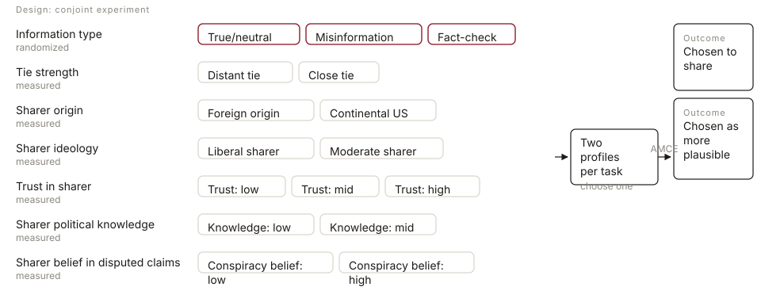
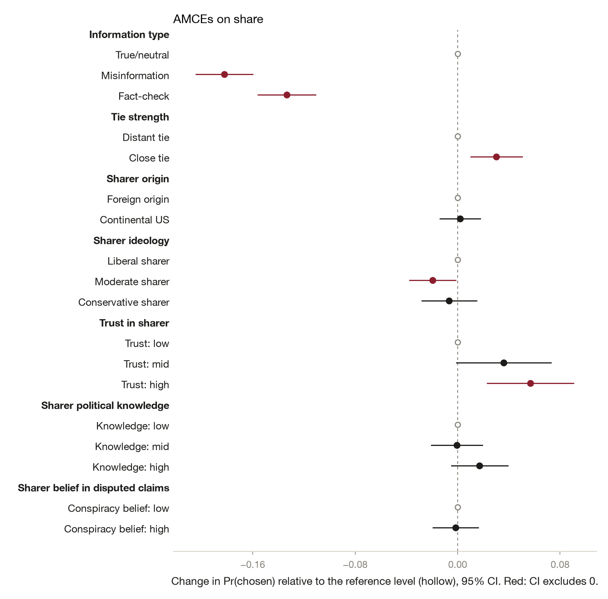
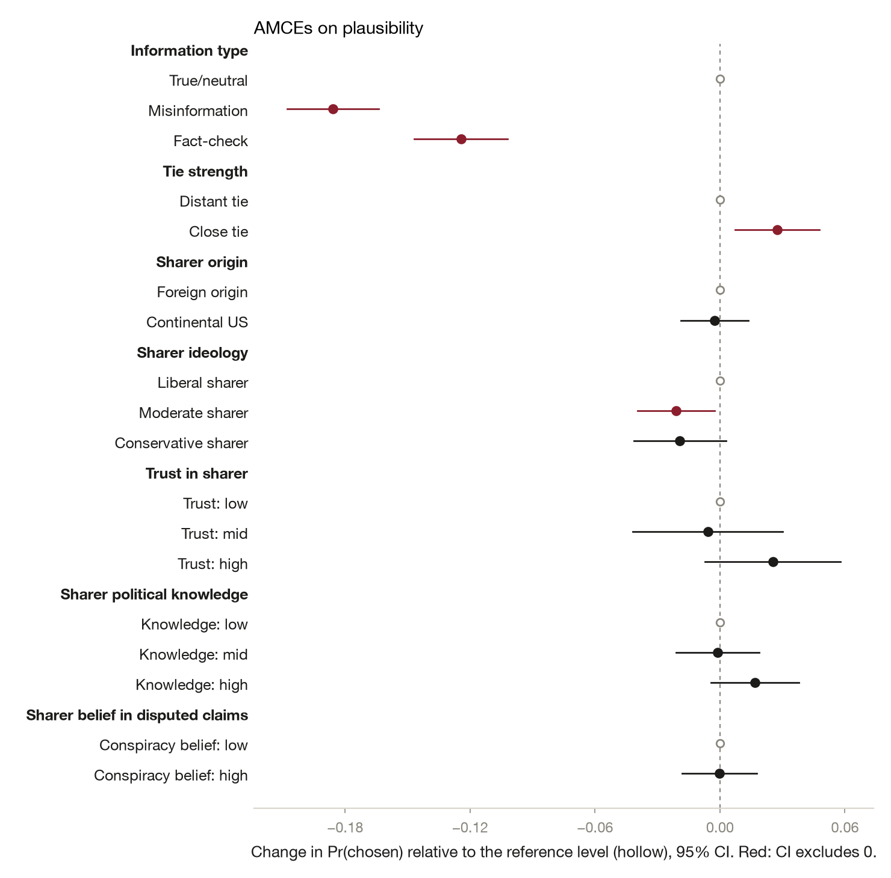
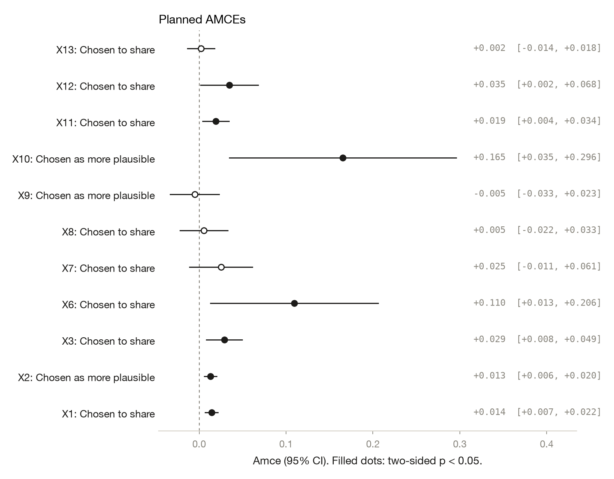
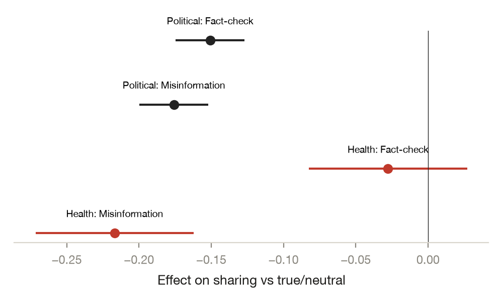

# Who Shares What From Whom: An Ego-Network Conjoint of Misinformation Sharing

*Yamil R. Velez · 2026-10-03 · N = 12,000 analysed of 12,000 collected · conjoint experiment*

<!-- fd:badges -->
  [](https://aspredicted.org/8njc-mpqw.pdf)    

> **Provenance: FULLY AGENTIC — no human review recorded.** filedrawer 0.1.0, 2026-10-03; orchestrator `anthropic/claude-sonnet-5.5`, standard `qwen/qwen3.8-27b`, zero data retention requested. Reviewer pass: yes. Human steps recorded: 0. Release status: draft. Model calls: $2.29, 885k tokens in and 54k out. Cite as: Velez, Y. R. (2026). Who Shares What From Whom: An Ego-Network Conjoint of Misinformation Sharing [Unpublished study package, generated with filedrawer 0.1.0]. The File Drawer. https://github.com/yrvelez/fact-networks-conjoint

<!-- fd:section id=abstract -->
## Abstract

We ask how the type of information and the characteristics of the person who shares it relate to whether people choose to share a post and whether they judge it plausible. In a registered conjoint experiment with 12,000 YouGov profile ratings in the US, headlines (true or neutral, false, or a fact-check) were randomly attributed to real contacts named by respondents, whose traits were measured. Misinformation was chosen for sharing 18.2 points less often than true or neutral content (95% CI [−20.4, −16.0]); fact-checks were shared 13.3 points less overall, driven by political items. Close ties (+3.0 points) and highly trusted sharers (+5.7 points) were associated with higher sharing. The information-type pattern replicated for plausibility, but trust did not. Sharer traits are measured, so these are conditional associations, and about 14 registered tests plus about 180 subgroup contrasts were uncorrected.

<!-- fd:section id=findings -->
## Key findings

- Misinformation headlines were chosen for sharing 18.2 points less often than true or neutral ones (95% CI [−20.4, −16.0]). Fact-checks were shared 13.3 points less overall, driven by political items; the health estimate is near zero.
- High trust in the sharer was associated with 5.7 points more sharing (95% CI [2.3, 9.1]) and a close tie with 3.0 points more (95% CI [1.0, 5.0]). These are measured contrasts, and the low-trust reference cell is thin.
- Sharer origin, political knowledge and belief in disputed claims were not distinguishable from zero for sharing, with intervals of roughly ±1.7 to ±2.2 points. Trust did not carry over to plausibility.
- Respondents who believe more disputed claims shifted toward misinformation (+5.6 points) and away from true items (−5.5 points). This is a relative reordering, one of about 180 uncorrected subgroup contrasts.
- Only information type is randomized; sharer traits are measured associations. About 14 registered tests plus about 180 subgroup contrasts are uncorrected, so results near p=0.05 are tentative.

<!-- fd:section id=design -->
## Design and data

A conjoint experiment with 7 profile features: randomized, Information type (True/neutral, Misinformation, Fact-check); measured rather than randomized (the respondent's own ratings of the real contact each headline was attributed to; only the headline and its assignment to a contact are randomized), Tie strength (Distant tie, Close tie); Sharer origin (Foreign origin, Continental US); Sharer ideology (Liberal sharer, Moderate sharer, Conservative sharer); Trust in sharer (Trust: low, Trust: mid, Trust: high); Sharer political knowledge (Knowledge: low, Knowledge: mid, Knowledge: high); Sharer belief in disputed claims (Conspiracy belief: low, Conspiracy belief: high); yougov, US. 12,000 responses were collected and 12,000 are analysed. The plan is pre-registered at https://aspredicted.org/8njc-mpqw.pdf. Identifier and free-text columns removed before any model saw the data: none.



#### Details: the design in words

A conjoint experiment on yougov respondents in US (N = 12,000 analysed). Each profile is built from 7 features: Information type (True/neutral, Misinformation, Fact-check); Tie strength (Distant tie, Close tie; measured, not randomized); Sharer origin (Foreign origin, Continental US; measured, not randomized); Sharer ideology (Liberal sharer, Moderate sharer, Conservative sharer; measured, not randomized); Trust in sharer (Trust: low, Trust: mid, Trust: high; measured, not randomized); Sharer political knowledge (Knowledge: low, Knowledge: mid, Knowledge: high; measured, not randomized); Sharer belief in disputed claims (Conspiracy belief: low, Conspiracy belief: high; measured, not randomized). Respondents compare two profiles per task and choose one for each outcome. Outcomes: Chosen to share, Chosen as more plausible. Registered moderators: age_t, ideo_self_t, disp_self_t, media_t, survey_language.


The study was registered (AsPredicted #132,508). Of 12,000 profile ratings, 11,882 entered the sharing models; 118 were dropped for missing values, and the report does not break this down by attribute. Each respondent made paired forced choices between two posts, and standard errors are clustered by respondent, not by task. True or neutral headlines (the reference level) contributed 4,145 profiles. Only the headline's information type and its assignment to a contact are randomized. The six sharer traits are the respondent's own ratings of real contacts, so their AMCEs are descriptive contrasts bundling correlated attributes.

<!-- fd:section id=results -->
## Results





<!-- fd:hyp id=H1 tag=registered outcome=share -->
### H1. Information type → sharing

*AMCE of information type on sharing: each level against 'True/neutral', from the regression of sharing on all seven profile features, SEs clustered by respondent.*  
*Pre-registered.*

Misinformation was shared 18.2 points less often than true or neutral headlines (95% CI [−20.4, −16.0], two-sided p<0.001). Fact-checks were shared 13.3 points less often (95% CI [−15.6, −11.1], p<0.001). Information type is randomized, but the model adjusts for six measured traits. Dropping trial 1 (E1) gave −0.170 for misinformation. An unadjusted fit and a task-clustered fit are not in the tables. The pooled fact-check figure masks a topic difference (see E2).

#### Details: model and estimates by arm (H1)

```
share ~ C(arm_code, Treatment(reference='True/neutral')) + C(tie) + C(sharer_origin) + C(sharer_ideology) + C(sharer_trust) + C(sharer_knowledge) + C(sharer_conspiracy)
OLS | cluster-robust SEs on resp_id | N = 11882 | two-sided test, alpha = 0.05
```

| Level | Estimate | SE | p | 95% CI | n (level) | Supported |
|---|---|---|---|---|---|---|
| Misinformation | -0.182 | 0.011 | < 0.0001 | [-0.204, -0.160] | 3822 | yes |
| Fact-check | -0.133 | 0.011 | < 0.0001 | [-0.156, -0.111] | 3915 | yes |

<!-- fd:hyp id=H2 tag=registered outcome=share -->
### H2. Tie strength → sharing

*AMCE of tie strength on sharing: each level against 'Distant tie', from the regression of sharing on all seven profile features, SEs clustered by respondent.*  
*Pre-registered.*

Close ties were chosen for sharing 3.0 points more often than distant ties (95% CI [1.0, 5.0], two-sided p=0.003). This is a measured contrast, not a randomized one.

#### Details: model and estimates by arm (H2)

```
share ~ C(arm_code, Treatment(reference='Distant tie')) + C(infotype) + C(sharer_origin) + C(sharer_ideology) + C(sharer_trust) + C(sharer_knowledge) + C(sharer_conspiracy)
OLS | cluster-robust SEs on resp_id | N = 11882 | two-sided test, alpha = 0.05
```

| Level | Estimate | SE | p | 95% CI | n (level) | Supported |
|---|---|---|---|---|---|---|
| Close tie | 0.030 | 0.010 | 0.0032 | [0.010, 0.050] | 6662 | yes |

<!-- fd:hyp id=H3 tag=registered outcome=share -->
### H3. Sharer origin → sharing

*AMCE of sharer origin on sharing: each level against 'Foreign origin', from the regression of sharing on all seven profile features, SEs clustered by respondent.*  
*Pre-registered.*

Continental US sharers were shared 0.2 points more often than foreign-origin sharers (95% CI [−1.4, 1.8], p=0.81). This is not distinguishable from zero and rules out only large effects.

#### Details: model and estimates by arm (H3)

```
share ~ C(arm_code, Treatment(reference='Foreign origin')) + C(infotype) + C(tie) + C(sharer_ideology) + C(sharer_trust) + C(sharer_knowledge) + C(sharer_conspiracy)
OLS | cluster-robust SEs on resp_id | N = 11882 | two-sided test, alpha = 0.05
```

| Level | Estimate | SE | p | 95% CI | n (level) | Supported |
|---|---|---|---|---|---|---|
| Continental US | 0.002 | 0.008 | 0.8143 | [-0.014, 0.018] | 9400 | no |

<!-- fd:hyp id=H4 tag=registered outcome=share -->
### H4. Sharer ideology → sharing

*AMCE of sharer ideology on sharing: each level against 'Liberal sharer', from the regression of sharing on all seven profile features, SEs clustered by respondent.*  
*Pre-registered.*

Moderate sharers were shared 1.9 points less often than liberal sharers (95% CI [−3.7, −0.1], p=0.034). This is fragile: the re-weighted estimate has p=0.056, and the test is uncorrected. Conservative sharers differed by −0.7 points (95% CI [−2.8, 1.5]), not distinguishable from zero.

#### Details: model and estimates by arm (H4)

```
share ~ C(arm_code, Treatment(reference='Liberal sharer')) + C(infotype) + C(tie) + C(sharer_origin) + C(sharer_trust) + C(sharer_knowledge) + C(sharer_conspiracy)
OLS | cluster-robust SEs on resp_id | N = 11882 | two-sided test, alpha = 0.05
```

| Level | Estimate | SE | p | 95% CI | n (level) | Supported |
|---|---|---|---|---|---|---|
| Moderate sharer | -0.019 | 0.009 | 0.0337 | [-0.037, -0.001] | 6538 | yes |
| Conservative sharer | -0.007 | 0.011 | 0.5470 | [-0.028, 0.015] | 2536 | no |

<!-- fd:hyp id=H5 tag=registered outcome=share -->
### H5. Trust in sharer → sharing

*AMCE of trust in sharer on sharing: each level against 'Trust: low', from the regression of sharing on all seven profile features, SEs clustered by respondent.*  
*Pre-registered.*

High-trust sharers were shared 5.7 points more often than low-trust ones (95% CI [2.3, 9.1], p<0.001). This is an association with a thin reference cell. Mid trust was 3.6 points higher (95% CI [−0.1, 7.3], p=0.056), not clearly separable from zero.

#### Details: model and estimates by arm (H5)

```
share ~ C(arm_code, Treatment(reference='Trust: low')) + C(infotype) + C(tie) + C(sharer_origin) + C(sharer_ideology) + C(sharer_knowledge) + C(sharer_conspiracy)
OLS | cluster-robust SEs on resp_id | N = 11882 | two-sided test, alpha = 0.05
```

| Level | Estimate | SE | p | 95% CI | n (level) | Supported |
|---|---|---|---|---|---|---|
| Trust: mid | 0.036 | 0.019 | 0.0561 | [-0.001, 0.073] | 2677 | no |
| Trust: high | 0.057 | 0.017 | 0.0010 | [0.023, 0.091] | 8388 | yes |

<!-- fd:hyp id=H6 tag=registered outcome=share -->
### H6. Sharer political knowledge → sharing

*AMCE of sharer political knowledge on sharing: each level against 'Knowledge: low', from the regression of sharing on all seven profile features, SEs clustered by respondent.*  
*Pre-registered.*

Mid and high political knowledge differed from low knowledge by −0.05 and +1.7 points. The high-knowledge interval ran from −0.5 to 3.9 points, so neither level was distinguishable from zero.

#### Details: model and estimates by arm (H6)

```
share ~ C(arm_code, Treatment(reference='Knowledge: low')) + C(infotype) + C(tie) + C(sharer_origin) + C(sharer_ideology) + C(sharer_trust) + C(sharer_conspiracy)
OLS | cluster-robust SEs on resp_id | N = 11882 | two-sided test, alpha = 0.05
```

| Level | Estimate | SE | p | 95% CI | n (level) | Supported |
|---|---|---|---|---|---|---|
| Knowledge: mid | -0.000 | 0.010 | 0.9619 | [-0.020, 0.019] | 5273 | no |
| Knowledge: high | 0.017 | 0.011 | 0.1265 | [-0.005, 0.039] | 4564 | no |

<!-- fd:hyp id=H7 tag=registered outcome=share -->
### H7. Sharer belief in disputed claims → sharing

*AMCE of sharer belief in disputed claims on sharing: each level against 'Conspiracy belief: low', from the regression of sharing on all seven profile features, SEs clustered by respondent.*  
*Pre-registered.*

Sharers with high belief in disputed claims were shared 0.2 points less often than those with low belief (95% CI [−1.9, 1.6], p=0.87). This is not distinguishable from zero.

#### Details: model and estimates by arm (H7)

```
share ~ C(arm_code, Treatment(reference='Conspiracy belief: low')) + C(infotype) + C(tie) + C(sharer_origin) + C(sharer_ideology) + C(sharer_trust) + C(sharer_knowledge)
OLS | cluster-robust SEs on resp_id | N = 11882 | two-sided test, alpha = 0.05
```

| Level | Estimate | SE | p | 95% CI | n (level) | Supported |
|---|---|---|---|---|---|---|
| Conspiracy belief: high | -0.002 | 0.009 | 0.8655 | [-0.019, 0.016] | 8675 | no |

<!-- fd:hyp id=H8 tag=registered outcome=plausibility -->
### H8. Information type → plausibility

*AMCE of information type on plausibility: each level against 'True/neutral', from the regression of plausibility on all seven profile features, SEs clustered by respondent.*  
*Pre-registered.*

Misinformation was judged 18.6 points less plausible than true or neutral headlines (95% CI [−20.8, −16.4], p<0.001). Fact-checks were 12.4 points lower (95% CI [−14.7, −10.2], p<0.001).

#### Details: model and estimates by arm (H8)

```
plausibility ~ C(arm_code, Treatment(reference='True/neutral')) + C(tie) + C(sharer_origin) + C(sharer_ideology) + C(sharer_trust) + C(sharer_knowledge) + C(sharer_conspiracy)
OLS | cluster-robust SEs on resp_id | N = 11884 | two-sided test, alpha = 0.05
```

| Level | Estimate | SE | p | 95% CI | n (level) | Supported |
|---|---|---|---|---|---|---|
| Misinformation | -0.186 | 0.011 | < 0.0001 | [-0.208, -0.164] | 3821 | yes |
| Fact-check | -0.124 | 0.011 | < 0.0001 | [-0.147, -0.102] | 3918 | yes |

<!-- fd:hyp id=H9 tag=registered outcome=plausibility -->
### H9. Tie strength → plausibility

*AMCE of tie strength on plausibility: each level against 'Distant tie', from the regression of plausibility on all seven profile features, SEs clustered by respondent.*  
*Pre-registered.*

Close ties were associated with 2.8 points higher plausibility (95% CI [0.7, 4.8], two-sided p=0.008). This is a measured contrast.

#### Details: model and estimates by arm (H9)

```
plausibility ~ C(arm_code, Treatment(reference='Distant tie')) + C(infotype) + C(sharer_origin) + C(sharer_ideology) + C(sharer_trust) + C(sharer_knowledge) + C(sharer_conspiracy)
OLS | cluster-robust SEs on resp_id | N = 11884 | two-sided test, alpha = 0.05
```

| Level | Estimate | SE | p | 95% CI | n (level) | Supported |
|---|---|---|---|---|---|---|
| Close tie | 0.028 | 0.010 | 0.0079 | [0.007, 0.048] | 6664 | yes |

<!-- fd:hyp id=H10 tag=registered outcome=plausibility -->
### H10. Sharer origin → plausibility

*AMCE of sharer origin on plausibility: each level against 'Foreign origin', from the regression of plausibility on all seven profile features, SEs clustered by respondent.*  
*Pre-registered.*

Continental US origin changed plausibility by −0.3 points (95% CI [−1.9, 1.4], p=0.75), not distinguishable from zero.

#### Details: model and estimates by arm (H10)

```
plausibility ~ C(arm_code, Treatment(reference='Foreign origin')) + C(infotype) + C(tie) + C(sharer_ideology) + C(sharer_trust) + C(sharer_knowledge) + C(sharer_conspiracy)
OLS | cluster-robust SEs on resp_id | N = 11884 | two-sided test, alpha = 0.05
```

| Level | Estimate | SE | p | 95% CI | n (level) | Supported |
|---|---|---|---|---|---|---|
| Continental US | -0.003 | 0.008 | 0.7462 | [-0.019, 0.014] | 9402 | no |

<!-- fd:hyp id=H11 tag=registered outcome=plausibility -->
### H11. Sharer ideology → plausibility

*AMCE of sharer ideology on plausibility: each level against 'Liberal sharer', from the regression of plausibility on all seven profile features, SEs clustered by respondent.*  
*Pre-registered.*

Moderate sharers were rated 2.1 points less plausible than liberal sharers (95% CI [−4.0, −0.3], p=0.026), near the threshold and uncorrected. Conservative sharers were −1.9 points (95% CI [−4.1, 0.3]), not distinguishable from zero.

#### Details: model and estimates by arm (H11)

```
plausibility ~ C(arm_code, Treatment(reference='Liberal sharer')) + C(infotype) + C(tie) + C(sharer_origin) + C(sharer_trust) + C(sharer_knowledge) + C(sharer_conspiracy)
OLS | cluster-robust SEs on resp_id | N = 11884 | two-sided test, alpha = 0.05
```

| Level | Estimate | SE | p | 95% CI | n (level) | Supported |
|---|---|---|---|---|---|---|
| Moderate sharer | -0.021 | 0.009 | 0.0257 | [-0.040, -0.003] | 6539 | yes |
| Conservative sharer | -0.019 | 0.011 | 0.0870 | [-0.041, 0.003] | 2537 | no |

<!-- fd:hyp id=H12 tag=registered outcome=plausibility -->
### H12. Trust in sharer → plausibility

*AMCE of trust in sharer on plausibility: each level against 'Trust: low', from the regression of plausibility on all seven profile features, SEs clustered by respondent.*  
*Pre-registered.*

Trust in the sharer was not distinguishable from zero for plausibility. High trust was +2.5 points (95% CI [−0.7, 5.8]) and mid trust −0.6 points (95% CI [−4.2, 3.0]).

#### Details: model and estimates by arm (H12)

```
plausibility ~ C(arm_code, Treatment(reference='Trust: low')) + C(infotype) + C(tie) + C(sharer_origin) + C(sharer_ideology) + C(sharer_knowledge) + C(sharer_conspiracy)
OLS | cluster-robust SEs on resp_id | N = 11884 | two-sided test, alpha = 0.05
```

| Level | Estimate | SE | p | 95% CI | n (level) | Supported |
|---|---|---|---|---|---|---|
| Trust: mid | -0.006 | 0.018 | 0.7497 | [-0.042, 0.030] | 2675 | no |
| Trust: high | 0.025 | 0.017 | 0.1276 | [-0.007, 0.058] | 8392 | no |

<!-- fd:hyp id=H13 tag=registered outcome=plausibility -->
### H13. Sharer political knowledge → plausibility

*AMCE of sharer political knowledge on plausibility: each level against 'Knowledge: low', from the regression of plausibility on all seven profile features, SEs clustered by respondent.*  
*Pre-registered.*

Sharer knowledge was not distinguishable from zero for plausibility. High knowledge was +1.7 points (95% CI [−0.4, 3.8]) and mid knowledge −0.1 points.

#### Details: model and estimates by arm (H13)

```
plausibility ~ C(arm_code, Treatment(reference='Knowledge: low')) + C(infotype) + C(tie) + C(sharer_origin) + C(sharer_ideology) + C(sharer_trust) + C(sharer_conspiracy)
OLS | cluster-robust SEs on resp_id | N = 11884 | two-sided test, alpha = 0.05
```

| Level | Estimate | SE | p | 95% CI | n (level) | Supported |
|---|---|---|---|---|---|---|
| Knowledge: mid | -0.001 | 0.010 | 0.9172 | [-0.021, 0.019] | 5271 | no |
| Knowledge: high | 0.017 | 0.011 | 0.1188 | [-0.004, 0.038] | 4567 | no |

<!-- fd:hyp id=H14 tag=registered outcome=plausibility -->
### H14. Sharer belief in disputed claims → plausibility

*AMCE of sharer belief in disputed claims on plausibility: each level against 'Conspiracy belief: low', from the regression of plausibility on all seven profile features, SEs clustered by respondent.*  
*Pre-registered.*

Belief in disputed claims by the sharer was not distinguishable from zero for plausibility, at −0.03 points (95% CI [−1.8, 1.8]).

#### Details: model and estimates by arm (H14)

```
plausibility ~ C(arm_code, Treatment(reference='Conspiracy belief: low')) + C(infotype) + C(tie) + C(sharer_origin) + C(sharer_ideology) + C(sharer_trust) + C(sharer_knowledge)
OLS | cluster-robust SEs on resp_id | N = 11884 | two-sided test, alpha = 0.05
```

| Level | Estimate | SE | p | 95% CI | n (level) | Supported |
|---|---|---|---|---|---|---|
| Conspiracy belief: high | -0.000 | 0.009 | 0.9700 | [-0.018, 0.018] | 8677 | no |

<!-- fd:group id=RW -->
### Re-weighted AMCEs: each source attribute re-weighted by its inverse assignment probability

*Pre-registered. Analyses R1–R12.*

Re-weighting by inverse assignment probability left most estimates essentially unchanged. High trust on sharing rose from 5.7 to 6.7 points (95% CI [3.3, 10.1]), and close ties stayed at 3.0 points (95% CI [1.0, 5.0]). The moderate-sharer effect on sharing became −1.7 points (p=0.056) and lost significance; on plausibility it stayed at −2.1 points (p=0.030). Because sharer traits are not randomized, these weights are a sensitivity check, not a correction.

| Outcome | Feature | Level | Estimate | 95% CI | p | Without weights |
|---|---|---|---|---|---|---|
| Chosen to share | Tie strength | Close tie | 0.030 | [0.010, 0.050] | 0.003 | 0.030 (H2) |
| Chosen to share | Sharer origin | Continental US | 0.003 | [-0.013, 0.019] | 0.706 | 0.002 (H3) |
| Chosen to share | Sharer ideology | Moderate sharer | -0.017 | [-0.035, 0.000] | 0.056 | -0.019 (H4) |
| Chosen to share | Sharer ideology | Conservative sharer | -0.007 | [-0.028, 0.015] | 0.552 | -0.007 (H4) |
| Chosen to share | Trust in sharer | Trust: mid | 0.034 | [-0.002, 0.070] | 0.061 | 0.036 (H5) |
| Chosen to share | Trust in sharer | Trust: high | 0.067 | [0.033, 0.101] | 0.000 | 0.057 (H5) |
| Chosen to share | Sharer political knowledge | Knowledge: mid | -0.001 | [-0.020, 0.019] | 0.960 | -0.000 (H6) |
| Chosen to share | Sharer political knowledge | Knowledge: high | 0.017 | [-0.005, 0.039] | 0.138 | 0.017 (H6) |
| Chosen to share | Sharer belief in disputed claims | Conspiracy belief: high | -0.001 | [-0.019, 0.016] | 0.878 | -0.002 (H7) |
| Chosen as more plausible | Tie strength | Close tie | 0.027 | [0.007, 0.048] | 0.008 | 0.028 (H9) |
| Chosen as more plausible | Sharer origin | Continental US | -0.003 | [-0.019, 0.014] | 0.745 | -0.003 (H10) |
| Chosen as more plausible | Sharer ideology | Moderate sharer | -0.021 | [-0.039, -0.002] | 0.030 | -0.021 (H11) |
| Chosen as more plausible | Sharer ideology | Conservative sharer | -0.019 | [-0.042, 0.003] | 0.085 | -0.019 (H11) |
| Chosen as more plausible | Trust in sharer | Trust: mid | -0.008 | [-0.043, 0.027] | 0.646 | -0.006 (H12) |
| Chosen as more plausible | Trust in sharer | Trust: high | 0.029 | [-0.003, 0.062] | 0.079 | 0.025 (H12) |
| Chosen as more plausible | Sharer political knowledge | Knowledge: mid | -0.001 | [-0.021, 0.019] | 0.901 | -0.001 (H13) |
| Chosen as more plausible | Sharer political knowledge | Knowledge: high | 0.015 | [-0.006, 0.037] | 0.160 | 0.017 (H13) |
| Chosen as more plausible | Sharer belief in disputed claims | Conspiracy belief: high | -0.001 | [-0.019, 0.017] | 0.945 | -0.000 (H14) |

<!-- fd:group id=heterogeneity -->
### Planned heterogeneity

<!-- fd:hyp id=S1 tag=registered kind=subgroup -->
#### S1. Marginal means of every feature level on sharing: highest minus lowest tertile of age

*Moderator `age_t`. Pre-registered.*

| analysis_id | feature | level | mm_Lowest | mm_Highest | difference | std_error | p_value | n_Lowest | n_Highest |
|---|---|---|---|---|---|---|---|---|---|
| S1 | infotype | Fact-check | 0.454 | 0.484 | 0.030 | 0.017 | 0.072 | 1305 | 1291 |
| S1 | infotype | Misinformation | 0.455 | 0.394 | -0.061 | 0.016 | 0.000165 | 1275 | 1282 |
| S1 | infotype | True/neutral | 0.585 | 0.611 | 0.026 | 0.015 | 0.094 | 1418 | 1407 |
| S1 | tie | Close tie | 0.516 | 0.511 | -0.005 | 0.011 | 0.663 | 2259 | 2193 |
| S1 | tie | Distant tie | 0.481 | 0.487 | 0.005 | 0.014 | 0.718 | 1739 | 1784 |
| S1 | sharer_origin | Continental US | 0.503 | 0.503 | 0.000186 | 0.004 | 0.966 | 2837 | 3357 |
| S1 | sharer_origin | Foreign origin | 0.496 | 0.482 | -0.014 | 0.016 | 0.385 | 1154 | 598 |
| S1 | sharer_ideology | Conservative sharer | 0.516 | 0.492 | -0.023 | 0.018 | 0.187 | 669 | 1036 |
| S1 | sharer_ideology | Liberal sharer | 0.510 | 0.535 | 0.025 | 0.016 | 0.117 | 1012 | 898 |
| S1 | sharer_ideology | Moderate sharer | 0.493 | 0.489 | -0.003 | 0.008 | 0.676 | 2315 | 2029 |
| S1 | sharer_trust | Trust: high | 0.511 | 0.509 | -0.002 | 0.006 | 0.680 | 2744 | 2937 |
| S1 | sharer_trust | Trust: low | 0.464 | 0.439 | -0.025 | 0.039 | 0.518 | 336 | 230 |
| S1 | sharer_trust | Trust: mid | 0.482 | 0.485 | 0.003 | 0.016 | 0.845 | 915 | 808 |
| S1 | sharer_knowledge | Knowledge: high | 0.512 | 0.518 | 0.005 | 0.011 | 0.621 | 1456 | 1719 |
| S1 | sharer_knowledge | Knowledge: low | 0.501 | 0.484 | -0.017 | 0.020 | 0.379 | 722 | 661 |
| S1 | sharer_knowledge | Knowledge: mid | 0.491 | 0.487 | -0.004 | 0.010 | 0.698 | 1820 | 1590 |
| S1 | sharer_conspiracy | Conspiracy belief: high | 0.504 | 0.499 | -0.005 | 0.006 | 0.405 | 2949 | 2870 |
| S1 | sharer_conspiracy | Conspiracy belief: low | 0.491 | 0.501 | 0.010 | 0.016 | 0.512 | 1049 | 1107 |

The age gap appeared mainly for misinformation: the oldest tertile shared it 6.1 points less than the youngest (SE 0.016, p<0.001). Other levels differed by under 3 points and were not distinguishable from zero. This is one of about 180 uncorrected contrasts.

<!-- fd:hyp id=S2 tag=registered kind=subgroup -->
#### S2. Marginal means of every feature level on sharing: highest minus lowest tertile of respondent ideology (1 very liberal ... 5 very conservative)

*Moderator `ideo_self_t`. Pre-registered.*

| analysis_id | feature | level | mm_Lowest | mm_Highest | difference | std_error | p_value | n_Lowest | n_Highest |
|---|---|---|---|---|---|---|---|---|---|
| S2 | infotype | Fact-check | 0.477 | 0.486 | 0.009 | 0.018 | 0.622 | 1110 | 1127 |
| S2 | infotype | Misinformation | 0.414 | 0.439 | 0.025 | 0.019 | 0.191 | 1062 | 1055 |
| S2 | infotype | True/neutral | 0.619 | 0.562 | -0.056 | 0.018 | 0.002 | 1151 | 1138 |
| S2 | tie | Close tie | 0.516 | 0.517 | 0.000961 | 0.013 | 0.940 | 1915 | 1838 |
| S2 | tie | Distant tie | 0.492 | 0.472 | -0.020 | 0.016 | 0.225 | 1408 | 1482 |
| S2 | sharer_origin | Continental US | 0.512 | 0.496 | -0.016 | 0.006 | 0.005 | 2617 | 2707 |
| S2 | sharer_origin | Foreign origin | 0.484 | 0.503 | 0.019 | 0.020 | 0.327 | 694 | 602 |
| S2 | sharer_ideology | Conservative sharer | 0.495 | 0.515 | 0.020 | 0.023 | 0.391 | 416 | 1352 |
| S2 | sharer_ideology | Liberal sharer | 0.539 | 0.491 | -0.048 | 0.020 | 0.017 | 1575 | 521 |
| S2 | sharer_ideology | Moderate sharer | 0.471 | 0.484 | 0.013 | 0.014 | 0.352 | 1326 | 1439 |
| S2 | sharer_trust | Trust: high | 0.519 | 0.511 | -0.008 | 0.007 | 0.268 | 2447 | 2444 |
| S2 | sharer_trust | Trust: low | 0.479 | 0.429 | -0.050 | 0.049 | 0.306 | 259 | 196 |
| S2 | sharer_trust | Trust: mid | 0.465 | 0.466 | 0.001 | 0.022 | 0.964 | 617 | 680 |
| S2 | sharer_knowledge | Knowledge: high | 0.531 | 0.522 | -0.009 | 0.012 | 0.454 | 1534 | 1463 |
| S2 | sharer_knowledge | Knowledge: low | 0.473 | 0.467 | -0.006 | 0.023 | 0.802 | 560 | 582 |
| S2 | sharer_knowledge | Knowledge: mid | 0.490 | 0.483 | -0.007 | 0.015 | 0.607 | 1222 | 1272 |
| S2 | sharer_conspiracy | Conspiracy belief: high | 0.508 | 0.497 | -0.010 | 0.007 | 0.158 | 2377 | 2569 |
| S2 | sharer_conspiracy | Conspiracy belief: low | 0.502 | 0.497 | -0.005 | 0.019 | 0.779 | 946 | 751 |

Among conservative-leaning respondents, true or neutral headlines were shared 5.6 points less than among liberal-leaning ones (p=0.002). Continental US sharers (−1.6 points) and liberal sharers (−4.8 points) also differed. About 180 subgroup contrasts were run uncorrected, so treat these as tentative.

<!-- fd:hyp id=S3 tag=registered kind=subgroup -->
#### S3. Marginal means of every feature level on sharing: highest minus lowest tertile of respondent belief in disputed claims

*Moderator `disp_self_t`. Pre-registered.*

| analysis_id | feature | level | mm_Lowest | mm_Highest | difference | std_error | p_value | n_Lowest | n_Highest |
|---|---|---|---|---|---|---|---|---|---|
| S3 | infotype | Fact-check | 0.485 | 0.457 | -0.028 | 0.017 | 0.094 | 1295 | 1318 |
| S3 | infotype | Misinformation | 0.397 | 0.453 | 0.056 | 0.017 | 0.000766 | 1271 | 1287 |
| S3 | infotype | True/neutral | 0.623 | 0.567 | -0.055 | 0.016 | 0.000437 | 1420 | 1380 |
| S3 | tie | Close tie | 0.526 | 0.506 | -0.020 | 0.012 | 0.096 | 2194 | 2246 |
| S3 | tie | Distant tie | 0.482 | 0.478 | -0.004 | 0.015 | 0.802 | 1790 | 1739 |
| S3 | sharer_origin | Continental US | 0.509 | 0.492 | -0.017 | 0.005 | 0.002 | 3196 | 3064 |
| S3 | sharer_origin | Foreign origin | 0.496 | 0.498 | 0.002 | 0.016 | 0.919 | 776 | 906 |
| S3 | sharer_ideology | Conservative sharer | 0.492 | 0.515 | 0.022 | 0.019 | 0.254 | 662 | 1131 |
| S3 | sharer_ideology | Liberal sharer | 0.532 | 0.512 | -0.020 | 0.018 | 0.259 | 991 | 813 |
| S3 | sharer_ideology | Moderate sharer | 0.499 | 0.476 | -0.023 | 0.009 | 0.013 | 2325 | 2034 |
| S3 | sharer_trust | Trust: high | 0.527 | 0.504 | -0.023 | 0.007 | 0.000886 | 2648 | 2922 |
| S3 | sharer_trust | Trust: low | 0.410 | 0.437 | 0.027 | 0.037 | 0.470 | 300 | 270 |
| S3 | sharer_trust | Trust: mid | 0.481 | 0.476 | -0.005 | 0.017 | 0.760 | 1031 | 790 |
| S3 | sharer_knowledge | Knowledge: high | 0.542 | 0.513 | -0.029 | 0.012 | 0.016 | 1397 | 1652 |
| S3 | sharer_knowledge | Knowledge: low | 0.487 | 0.456 | -0.031 | 0.022 | 0.159 | 630 | 664 |
| S3 | sharer_knowledge | Knowledge: mid | 0.487 | 0.490 | 0.003 | 0.010 | 0.773 | 1948 | 1669 |
| S3 | sharer_conspiracy | Conspiracy belief: high | 0.504 | 0.494 | -0.010 | 0.007 | 0.169 | 2488 | 3312 |
| S3 | sharer_conspiracy | Conspiracy belief: low | 0.509 | 0.492 | -0.017 | 0.019 | 0.369 | 1496 | 673 |

Respondents with the highest belief in disputed claims shared misinformation 5.6 points more (p<0.001) and true or neutral items 5.5 points less (p<0.001). This is a mirrored reordering of information types in a forced-choice task, not a general rise in sharing. Several sharer levels also differed by 1 to 3 points.

<!-- fd:hyp id=S4 tag=registered kind=subgroup -->
#### S4. Marginal means of every feature level on sharing: highest minus lowest tertile of trust in media

*Moderator `media_t`. Pre-registered.*

| analysis_id | feature | level | mm_Lowest | mm_Highest | difference | std_error | p_value | n_Lowest | n_Highest |
|---|---|---|---|---|---|---|---|---|---|
| S4 | infotype | Fact-check | 0.478 | 0.465 | -0.013 | 0.016 | 0.428 | 1281 | 1355 |
| S4 | infotype | Misinformation | 0.402 | 0.449 | 0.048 | 0.016 | 0.003 | 1260 | 1295 |
| S4 | infotype | True/neutral | 0.603 | 0.590 | -0.013 | 0.016 | 0.418 | 1444 | 1338 |
| S4 | tie | Close tie | 0.525 | 0.511 | -0.014 | 0.011 | 0.235 | 2257 | 2229 |
| S4 | tie | Distant tie | 0.465 | 0.490 | 0.025 | 0.015 | 0.088 | 1728 | 1756 |
| S4 | sharer_origin | Continental US | 0.500 | 0.502 | 0.002 | 0.005 | 0.594 | 3330 | 2914 |
| S4 | sharer_origin | Foreign origin | 0.493 | 0.503 | 0.010 | 0.015 | 0.502 | 643 | 1041 |
| S4 | sharer_ideology | Conservative sharer | 0.516 | 0.489 | -0.026 | 0.018 | 0.131 | 861 | 885 |
| S4 | sharer_ideology | Liberal sharer | 0.520 | 0.523 | 0.003 | 0.016 | 0.843 | 965 | 1049 |
| S4 | sharer_ideology | Moderate sharer | 0.483 | 0.498 | 0.015 | 0.009 | 0.086 | 2153 | 2031 |
| S4 | sharer_trust | Trust: high | 0.517 | 0.512 | -0.005 | 0.006 | 0.404 | 2651 | 3103 |
| S4 | sharer_trust | Trust: low | 0.440 | 0.433 | -0.007 | 0.041 | 0.862 | 343 | 217 |
| S4 | sharer_trust | Trust: mid | 0.472 | 0.480 | 0.007 | 0.019 | 0.696 | 991 | 659 |
| S4 | sharer_knowledge | Knowledge: high | 0.540 | 0.516 | -0.024 | 0.011 | 0.028 | 1410 | 1909 |
| S4 | sharer_knowledge | Knowledge: low | 0.472 | 0.491 | 0.019 | 0.020 | 0.329 | 805 | 584 |
| S4 | sharer_knowledge | Knowledge: mid | 0.479 | 0.489 | 0.010 | 0.011 | 0.326 | 1770 | 1489 |
| S4 | sharer_conspiracy | Conspiracy belief: high | 0.503 | 0.495 | -0.008 | 0.007 | 0.199 | 2733 | 3044 |
| S4 | sharer_conspiracy | Conspiracy belief: low | 0.490 | 0.525 | 0.035 | 0.016 | 0.032 | 1252 | 941 |

Respondents with high media trust shared misinformation 4.8 points more than those with low media trust (p=0.003). Low-belief sharers were shared 3.5 points more by them (p=0.03). Other differences were small.

<!-- fd:hyp id=S5 tag=registered kind=subgroup -->
#### S5. Marginal means of every feature level on sharing: Spanish minus English survey language

*Moderator `survey_language`. Pre-registered.*

| analysis_id | feature | level | mm_English | mm_Spanish | difference | std_error | p_value | n_English | n_Spanish |
|---|---|---|---|---|---|---|---|---|---|
| S5 | infotype | Fact-check | 0.470 | 0.469 | -0.000581 | 0.014 | 0.967 | 2650 | 1300 |
| S5 | infotype | Misinformation | 0.409 | 0.445 | 0.036 | 0.014 | 0.010 | 2509 | 1336 |
| S5 | infotype | True/neutral | 0.610 | 0.584 | -0.025 | 0.014 | 0.070 | 2823 | 1350 |
| S5 | tie | Close tie | 0.519 | 0.508 | -0.011 | 0.010 | 0.243 | 4464 | 2245 |
| S5 | tie | Distant tie | 0.475 | 0.489 | 0.014 | 0.012 | 0.258 | 3515 | 1741 |
| S5 | sharer_origin | Continental US | 0.502 | 0.501 | -0.000777 | 0.004 | 0.848 | 6514 | 2914 |
| S5 | sharer_origin | Foreign origin | 0.491 | 0.498 | 0.007 | 0.013 | 0.595 | 1461 | 1029 |
| S5 | sharer_ideology | Conservative sharer | 0.500 | 0.515 | 0.016 | 0.015 | 0.282 | 1605 | 945 |
| S5 | sharer_ideology | Liberal sharer | 0.524 | 0.507 | -0.017 | 0.015 | 0.259 | 1969 | 856 |
| S5 | sharer_ideology | Moderate sharer | 0.490 | 0.492 | 0.002 | 0.007 | 0.759 | 4405 | 2157 |
| S5 | sharer_trust | Trust: high | 0.515 | 0.508 | -0.007 | 0.005 | 0.143 | 5620 | 2820 |
| S5 | sharer_trust | Trust: low | 0.415 | 0.494 | 0.079 | 0.035 | 0.022 | 571 | 257 |
| S5 | sharer_trust | Trust: mid | 0.479 | 0.476 | -0.003 | 0.014 | 0.826 | 1788 | 900 |
| S5 | sharer_knowledge | Knowledge: high | 0.522 | 0.520 | -0.002 | 0.011 | 0.844 | 3401 | 1194 |
| S5 | sharer_knowledge | Knowledge: low | 0.470 | 0.502 | 0.032 | 0.015 | 0.038 | 1150 | 915 |
| S5 | sharer_knowledge | Knowledge: mid | 0.488 | 0.487 | -0.001 | 0.008 | 0.877 | 3428 | 1866 |
| S5 | sharer_conspiracy | Conspiracy belief: high | 0.503 | 0.497 | -0.006 | 0.005 | 0.246 | 5694 | 3044 |
| S5 | sharer_conspiracy | Conspiracy belief: low | 0.493 | 0.510 | 0.016 | 0.015 | 0.267 | 2285 | 942 |

Spanish-language respondents shared misinformation 3.6 points more than English-language ones (p=0.010). Differences for low-trust and low-knowledge sharers were also distinguishable from zero. Most other contrasts were not.

<!-- fd:hyp id=S6 tag=registered kind=subgroup -->
#### S6. Marginal means of every feature level on plausibility: highest minus lowest tertile of age

*Moderator `age_t`. Pre-registered.*

| analysis_id | feature | level | mm_Lowest | mm_Highest | difference | std_error | p_value | n_Lowest | n_Highest |
|---|---|---|---|---|---|---|---|---|---|
| S6 | infotype | Fact-check | 0.467 | 0.484 | 0.017 | 0.016 | 0.298 | 1305 | 1294 |
| S6 | infotype | Misinformation | 0.436 | 0.396 | -0.040 | 0.016 | 0.013 | 1275 | 1283 |
| S6 | infotype | True/neutral | 0.591 | 0.607 | 0.016 | 0.016 | 0.303 | 1418 | 1407 |
| S6 | tie | Close tie | 0.510 | 0.515 | 0.005 | 0.011 | 0.667 | 2259 | 2195 |
| S6 | tie | Distant tie | 0.489 | 0.479 | -0.010 | 0.014 | 0.504 | 1739 | 1786 |
| S6 | sharer_origin | Continental US | 0.500 | 0.502 | 0.002 | 0.004 | 0.637 | 2837 | 3361 |
| S6 | sharer_origin | Foreign origin | 0.503 | 0.482 | -0.021 | 0.017 | 0.207 | 1154 | 598 |
| S6 | sharer_ideology | Conservative sharer | 0.505 | 0.479 | -0.026 | 0.019 | 0.163 | 669 | 1038 |
| S6 | sharer_ideology | Liberal sharer | 0.502 | 0.539 | 0.037 | 0.016 | 0.020 | 1012 | 898 |
| S6 | sharer_ideology | Moderate sharer | 0.500 | 0.493 | -0.007 | 0.008 | 0.414 | 2315 | 2031 |
| S6 | sharer_trust | Trust: high | 0.513 | 0.509 | -0.004 | 0.005 | 0.491 | 2744 | 2941 |
| S6 | sharer_trust | Trust: low | 0.494 | 0.461 | -0.033 | 0.038 | 0.377 | 336 | 230 |
| S6 | sharer_trust | Trust: mid | 0.467 | 0.474 | 0.007 | 0.017 | 0.658 | 915 | 808 |
| S6 | sharer_knowledge | Knowledge: high | 0.524 | 0.513 | -0.011 | 0.010 | 0.309 | 1456 | 1722 |
| S6 | sharer_knowledge | Knowledge: low | 0.497 | 0.491 | -0.006 | 0.019 | 0.740 | 722 | 662 |
| S6 | sharer_knowledge | Knowledge: mid | 0.484 | 0.487 | 0.003 | 0.010 | 0.737 | 1820 | 1590 |
| S6 | sharer_conspiracy | Conspiracy belief: high | 0.505 | 0.496 | -0.009 | 0.006 | 0.130 | 2949 | 2873 |
| S6 | sharer_conspiracy | Conspiracy belief: low | 0.490 | 0.507 | 0.017 | 0.016 | 0.274 | 1049 | 1108 |

The oldest tertile judged misinformation 4.0 points less plausible than the youngest (p=0.013). Liberal sharers were rated 3.7 points more plausible by them (p=0.020). Other differences were not distinguishable from zero.

<!-- fd:hyp id=S7 tag=registered kind=subgroup -->
#### S7. Marginal means of every feature level on plausibility: highest minus lowest tertile of respondent ideology (1 very liberal ... 5 very conservative)

*Moderator `ideo_self_t`. Pre-registered.*

| analysis_id | feature | level | mm_Lowest | mm_Highest | difference | std_error | p_value | n_Lowest | n_Highest |
|---|---|---|---|---|---|---|---|---|---|
| S7 | infotype | Fact-check | 0.480 | 0.486 | 0.006 | 0.018 | 0.760 | 1114 | 1128 |
| S7 | infotype | Misinformation | 0.405 | 0.423 | 0.019 | 0.019 | 0.323 | 1060 | 1056 |
| S7 | infotype | True/neutral | 0.620 | 0.571 | -0.049 | 0.018 | 0.006 | 1151 | 1138 |
| S7 | tie | Close tie | 0.511 | 0.513 | 0.002 | 0.013 | 0.872 | 1917 | 1839 |
| S7 | tie | Distant tie | 0.496 | 0.473 | -0.023 | 0.016 | 0.159 | 1408 | 1483 |
| S7 | sharer_origin | Continental US | 0.508 | 0.493 | -0.015 | 0.006 | 0.009 | 2618 | 2709 |
| S7 | sharer_origin | Foreign origin | 0.492 | 0.502 | 0.010 | 0.020 | 0.630 | 695 | 602 |
| S7 | sharer_ideology | Conservative sharer | 0.480 | 0.513 | 0.033 | 0.024 | 0.161 | 415 | 1354 |
| S7 | sharer_ideology | Liberal sharer | 0.535 | 0.509 | -0.026 | 0.020 | 0.194 | 1575 | 521 |
| S7 | sharer_ideology | Moderate sharer | 0.477 | 0.475 | -0.002 | 0.014 | 0.867 | 1327 | 1439 |
| S7 | sharer_trust | Trust: high | 0.518 | 0.507 | -0.011 | 0.007 | 0.130 | 2450 | 2446 |
| S7 | sharer_trust | Trust: low | 0.494 | 0.449 | -0.045 | 0.045 | 0.320 | 259 | 196 |
| S7 | sharer_trust | Trust: mid | 0.455 | 0.465 | 0.010 | 0.023 | 0.655 | 616 | 680 |
| S7 | sharer_knowledge | Knowledge: high | 0.530 | 0.517 | -0.013 | 0.012 | 0.276 | 1536 | 1464 |
| S7 | sharer_knowledge | Knowledge: low | 0.486 | 0.472 | -0.014 | 0.022 | 0.525 | 562 | 583 |
| S7 | sharer_knowledge | Knowledge: mid | 0.482 | 0.481 | -0.000835 | 0.015 | 0.954 | 1220 | 1272 |
| S7 | sharer_conspiracy | Conspiracy belief: high | 0.507 | 0.495 | -0.012 | 0.007 | 0.106 | 2379 | 2570 |
| S7 | sharer_conspiracy | Conspiracy belief: low | 0.500 | 0.497 | -0.003 | 0.020 | 0.892 | 946 | 752 |

Conservative-leaning respondents rated true or neutral headlines 4.9 points less plausible than liberal-leaning respondents did (p=0.006). Continental US sharers were rated 1.5 points lower (p=0.009). Other contrasts were not distinguishable from zero.

<!-- fd:hyp id=S8 tag=registered kind=subgroup -->
#### S8. Marginal means of every feature level on plausibility: highest minus lowest tertile of respondent belief in disputed claims

*Moderator `disp_self_t`. Pre-registered.*

| analysis_id | feature | level | mm_Lowest | mm_Highest | difference | std_error | p_value | n_Lowest | n_Highest |
|---|---|---|---|---|---|---|---|---|---|
| S8 | infotype | Fact-check | 0.486 | 0.473 | -0.013 | 0.017 | 0.464 | 1297 | 1319 |
| S8 | infotype | Misinformation | 0.381 | 0.450 | 0.068 | 0.017 | 4.25e-05 | 1269 | 1288 |
| S8 | infotype | True/neutral | 0.628 | 0.559 | -0.069 | 0.016 | 1.58e-05 | 1420 | 1380 |
| S8 | tie | Close tie | 0.520 | 0.502 | -0.018 | 0.012 | 0.125 | 2195 | 2247 |
| S8 | tie | Distant tie | 0.483 | 0.486 | 0.003 | 0.014 | 0.820 | 1789 | 1740 |
| S8 | sharer_origin | Continental US | 0.506 | 0.495 | -0.011 | 0.006 | 0.044 | 3196 | 3066 |
| S8 | sharer_origin | Foreign origin | 0.496 | 0.494 | -0.002 | 0.017 | 0.922 | 776 | 906 |
| S8 | sharer_ideology | Conservative sharer | 0.492 | 0.511 | 0.019 | 0.019 | 0.320 | 661 | 1133 |
| S8 | sharer_ideology | Liberal sharer | 0.532 | 0.528 | -0.004 | 0.018 | 0.819 | 991 | 813 |
| S8 | sharer_ideology | Moderate sharer | 0.495 | 0.475 | -0.020 | 0.009 | 0.030 | 2326 | 2034 |
| S8 | sharer_trust | Trust: high | 0.528 | 0.503 | -0.024 | 0.007 | 0.000396 | 2650 | 2924 |
| S8 | sharer_trust | Trust: low | 0.433 | 0.474 | 0.041 | 0.036 | 0.259 | 300 | 270 |
| S8 | sharer_trust | Trust: mid | 0.464 | 0.472 | 0.009 | 0.017 | 0.615 | 1029 | 790 |
| S8 | sharer_knowledge | Knowledge: high | 0.548 | 0.512 | -0.036 | 0.012 | 0.002 | 1399 | 1653 |
| S8 | sharer_knowledge | Knowledge: low | 0.492 | 0.460 | -0.032 | 0.022 | 0.139 | 630 | 665 |
| S8 | sharer_knowledge | Knowledge: mid | 0.476 | 0.493 | 0.017 | 0.010 | 0.106 | 1946 | 1669 |
| S8 | sharer_conspiracy | Conspiracy belief: high | 0.502 | 0.495 | -0.007 | 0.007 | 0.334 | 2489 | 3313 |
| S8 | sharer_conspiracy | Conspiracy belief: low | 0.506 | 0.497 | -0.009 | 0.019 | 0.647 | 1495 | 674 |

Respondents with the most belief in disputed claims rated misinformation 6.8 points more plausible (p<0.001) and true or neutral items 6.9 points less plausible (p<0.001). High-trust and high-knowledge sharers were also rated lower by them.

<!-- fd:hyp id=S9 tag=registered kind=subgroup -->
#### S9. Marginal means of every feature level on plausibility: highest minus lowest tertile of trust in media

*Moderator `media_t`. Pre-registered.*

| analysis_id | feature | level | mm_Lowest | mm_Highest | difference | std_error | p_value | n_Lowest | n_Highest |
|---|---|---|---|---|---|---|---|---|---|
| S9 | infotype | Fact-check | 0.482 | 0.479 | -0.003 | 0.016 | 0.848 | 1284 | 1357 |
| S9 | infotype | Misinformation | 0.403 | 0.446 | 0.044 | 0.016 | 0.007 | 1259 | 1295 |
| S9 | infotype | True/neutral | 0.602 | 0.584 | -0.018 | 0.016 | 0.252 | 1444 | 1338 |
| S9 | tie | Close tie | 0.523 | 0.516 | -0.008 | 0.011 | 0.510 | 2259 | 2230 |
| S9 | tie | Distant tie | 0.470 | 0.488 | 0.018 | 0.015 | 0.220 | 1728 | 1757 |
| S9 | sharer_origin | Continental US | 0.503 | 0.502 | -0.000837 | 0.005 | 0.858 | 3331 | 2916 |
| S9 | sharer_origin | Foreign origin | 0.488 | 0.509 | 0.022 | 0.016 | 0.184 | 644 | 1041 |
| S9 | sharer_ideology | Conservative sharer | 0.509 | 0.488 | -0.021 | 0.018 | 0.237 | 862 | 885 |
| S9 | sharer_ideology | Liberal sharer | 0.522 | 0.532 | 0.010 | 0.016 | 0.549 | 965 | 1049 |
| S9 | sharer_ideology | Moderate sharer | 0.487 | 0.497 | 0.010 | 0.009 | 0.255 | 2152 | 2033 |
| S9 | sharer_trust | Trust: high | 0.520 | 0.510 | -0.009 | 0.006 | 0.120 | 2654 | 3105 |
| S9 | sharer_trust | Trust: low | 0.464 | 0.493 | 0.030 | 0.041 | 0.475 | 343 | 217 |
| S9 | sharer_trust | Trust: mid | 0.462 | 0.476 | 0.015 | 0.019 | 0.432 | 990 | 659 |
| S9 | sharer_knowledge | Knowledge: high | 0.541 | 0.515 | -0.026 | 0.011 | 0.019 | 1411 | 1911 |
| S9 | sharer_knowledge | Knowledge: low | 0.488 | 0.497 | 0.009 | 0.020 | 0.647 | 808 | 584 |
| S9 | sharer_knowledge | Knowledge: mid | 0.473 | 0.492 | 0.018 | 0.011 | 0.096 | 1768 | 1489 |
| S9 | sharer_conspiracy | Conspiracy belief: high | 0.509 | 0.497 | -0.012 | 0.007 | 0.070 | 2734 | 3046 |
| S9 | sharer_conspiracy | Conspiracy belief: low | 0.482 | 0.526 | 0.044 | 0.017 | 0.009 | 1253 | 941 |

High media trust respondents rated misinformation 4.4 points more plausible (p=0.007). They also rated low-belief sharers 4.4 points higher (p=0.009) and high-knowledge sharers 2.6 points lower.

<!-- fd:hyp id=S10 tag=registered kind=subgroup -->
#### S10. Marginal means of every feature level on plausibility: Spanish minus English survey language

*Moderator `survey_language`. Pre-registered.*

| analysis_id | feature | level | mm_English | mm_Spanish | difference | std_error | p_value | n_English | n_Spanish |
|---|---|---|---|---|---|---|---|---|---|
| S10 | infotype | Fact-check | 0.479 | 0.469 | -0.010 | 0.014 | 0.470 | 2653 | 1302 |
| S10 | infotype | Misinformation | 0.404 | 0.440 | 0.037 | 0.014 | 0.008 | 2508 | 1336 |
| S10 | infotype | True/neutral | 0.605 | 0.589 | -0.016 | 0.014 | 0.238 | 2823 | 1350 |
| S10 | tie | Close tie | 0.518 | 0.506 | -0.012 | 0.010 | 0.215 | 4466 | 2246 |
| S10 | tie | Distant tie | 0.477 | 0.492 | 0.015 | 0.013 | 0.227 | 3515 | 1742 |
| S10 | sharer_origin | Continental US | 0.501 | 0.499 | -0.002 | 0.004 | 0.643 | 6516 | 2915 |
| S10 | sharer_origin | Foreign origin | 0.494 | 0.501 | 0.007 | 0.013 | 0.608 | 1461 | 1030 |
| S10 | sharer_ideology | Conservative sharer | 0.495 | 0.503 | 0.008 | 0.015 | 0.611 | 1606 | 945 |
| S10 | sharer_ideology | Liberal sharer | 0.527 | 0.511 | -0.017 | 0.014 | 0.250 | 1969 | 856 |
| S10 | sharer_ideology | Moderate sharer | 0.490 | 0.496 | 0.006 | 0.007 | 0.384 | 4406 | 2157 |
| S10 | sharer_trust | Trust: high | 0.515 | 0.509 | -0.006 | 0.005 | 0.187 | 5624 | 2821 |
| S10 | sharer_trust | Trust: low | 0.443 | 0.533 | 0.090 | 0.034 | 0.007 | 571 | 257 |
| S10 | sharer_trust | Trust: mid | 0.471 | 0.465 | -0.006 | 0.014 | 0.684 | 1786 | 901 |
| S10 | sharer_knowledge | Knowledge: high | 0.523 | 0.515 | -0.008 | 0.010 | 0.429 | 3404 | 1194 |
| S10 | sharer_knowledge | Knowledge: low | 0.472 | 0.508 | 0.036 | 0.015 | 0.016 | 1151 | 917 |
| S10 | sharer_knowledge | Knowledge: mid | 0.487 | 0.487 | 0.000565 | 0.008 | 0.943 | 3426 | 1866 |
| S10 | sharer_conspiracy | Conspiracy belief: high | 0.504 | 0.496 | -0.007 | 0.005 | 0.131 | 5696 | 3045 |
| S10 | sharer_conspiracy | Conspiracy belief: low | 0.491 | 0.512 | 0.021 | 0.015 | 0.145 | 2285 | 943 |

Spanish-language respondents rated misinformation 3.7 points more plausible than English-language respondents (p=0.008). Low-trust sharers were rated 9.0 points higher (SE 0.034) and low-knowledge sharers 3.6 points higher. These rest on small cells.



<!-- fd:section id=exploratory-authors -->
## Exploratory analyses specified by the authors

*Not pre-registered. The authors specified these analyses after seeing the data; they are run by the same deterministic scripts as the registered tests and should be read as hypothesis-generating.*

<!-- fd:hyp id=X1 tag=exploratory outcome=share -->
### X1. A1. Trust in the sharer → sharing

*A1. Source credibility is conditional on content uncertainty: the slope of sharing on trust in the sharer (1-5), net of the other source attributes, and how it differs by information type.*  
*Exploratory, not pre-registered.*

Slope of Chosen to share on `trust_raw`: 0.014 (SE 0.004, p = 0.000, N = 11882). Significant at alpha = 0.05: yes.

This is a post hoc test. Each extra step of trust in the sharer on the 1-5 scale was associated with 1.4 points more sharing (SE 0.004, p<0.001).

#### Details: model and coefficients (X1)

```
share ~ treat + close_num + origin_num + C(sharer_ideology) + knowledge_raw + conspiracy_raw
OLS | cluster-robust SEs on resp_id | N = 11882 | two-sided test, alpha = 0.05
```

| analysis_id | term | estimate | std_error | statistic | p_value | conf_low | conf_high |
|---|---|---|---|---|---|---|---|
| X1 | Intercept | 0.401 | 0.020 | 19.867 | 7.84e-88 | 0.362 | 0.441 |
| X1 | C(sharer_ideology)[T.Liberal sharer] | 0.008 | 0.011 | 0.691 | 0.490 | -0.014 | 0.030 |
| X1 | C(sharer_ideology)[T.Moderate sharer] | -0.009 | 0.010 | -0.944 | 0.345 | -0.028 | 0.010 |
| X1 | treat | 0.014 | 0.004 | 3.807 | 0.00014 | 0.007 | 0.022 |
| X1 | close_num | 0.029 | 0.010 | 2.758 | 0.006 | 0.008 | 0.049 |
| X1 | origin_num | 0.002 | 0.008 | 0.273 | 0.785 | -0.014 | 0.018 |
| X1 | knowledge_raw | 0.008 | 0.004 | 2.081 | 0.037 | 0.00045 | 0.015 |
| X1 | conspiracy_raw | 0.005 | 0.014 | 0.378 | 0.706 | -0.022 | 0.033 |

<!-- fd:hyp id=X2 tag=exploratory outcome=plausibility -->
### X2. A1. Trust in the sharer → plausibility

*A1. The slope of plausibility on trust in the sharer, by information type.*  
*Exploratory, not pre-registered.*

Slope of Chosen as more plausible on `trust_raw`: 0.013 (SE 0.004, p = 0.000, N = 11884). Significant at alpha = 0.05: yes.

This is a post hoc test. Each step of trust was associated with 1.3 points higher plausibility (SE 0.004, p<0.001). This conflicts with the registered trust result for plausibility (H12), which was not distinguishable from zero.

#### Details: model and coefficients (X2)

```
plausibility ~ treat + close_num + origin_num + C(sharer_ideology) + knowledge_raw + conspiracy_raw
OLS | cluster-robust SEs on resp_id | N = 11884 | two-sided test, alpha = 0.05
```

| analysis_id | term | estimate | std_error | statistic | p_value | conf_low | conf_high |
|---|---|---|---|---|---|---|---|
| X2 | Intercept | 0.404 | 0.020 | 20.137 | 3.53e-90 | 0.365 | 0.443 |
| X2 | C(sharer_ideology)[T.Liberal sharer] | 0.019 | 0.012 | 1.633 | 0.103 | -0.004 | 0.042 |
| X2 | C(sharer_ideology)[T.Moderate sharer] | -0.001 | 0.010 | -0.104 | 0.918 | -0.020 | 0.018 |
| X2 | treat | 0.013 | 0.004 | 3.519 | 0.000433 | 0.006 | 0.020 |
| X2 | close_num | 0.026 | 0.010 | 2.474 | 0.013 | 0.005 | 0.047 |
| X2 | origin_num | -0.003 | 0.008 | -0.336 | 0.737 | -0.019 | 0.014 |
| X2 | knowledge_raw | 0.009 | 0.004 | 2.365 | 0.018 | 0.002 | 0.016 |
| X2 | conspiracy_raw | -0.005 | 0.014 | -0.362 | 0.717 | -0.033 | 0.023 |

<!-- fd:hyp id=X3 tag=exploratory outcome=share -->
### X3. A1. Close tie → sharing

*A1. The close-tie premium on sharing, net of the other source attributes, by information type.*  
*Exploratory, not pre-registered.*

Slope of Chosen to share on `close_num`: 0.029 (SE 0.010, p = 0.006, N = 11882). Significant at alpha = 0.05: yes.

This is a post hoc test. The close-tie premium on sharing was 2.9 points (SE 0.010, p=0.006), matching the registered estimate.

#### Details: model and coefficients (X3)

```
share ~ treat + trust_raw + origin_num + C(sharer_ideology) + knowledge_raw + conspiracy_raw
OLS | cluster-robust SEs on resp_id | N = 11882 | two-sided test, alpha = 0.05
```

| analysis_id | term | estimate | std_error | statistic | p_value | conf_low | conf_high |
|---|---|---|---|---|---|---|---|
| X3 | Intercept | 0.401 | 0.020 | 19.867 | 7.84e-88 | 0.362 | 0.441 |
| X3 | C(sharer_ideology)[T.Liberal sharer] | 0.008 | 0.011 | 0.691 | 0.490 | -0.014 | 0.030 |
| X3 | C(sharer_ideology)[T.Moderate sharer] | -0.009 | 0.010 | -0.944 | 0.345 | -0.028 | 0.010 |
| X3 | treat | 0.029 | 0.010 | 2.758 | 0.006 | 0.008 | 0.049 |
| X3 | trust_raw | 0.014 | 0.004 | 3.807 | 0.00014 | 0.007 | 0.022 |
| X3 | origin_num | 0.002 | 0.008 | 0.273 | 0.785 | -0.014 | 0.018 |
| X3 | knowledge_raw | 0.008 | 0.004 | 2.081 | 0.037 | 0.00045 | 0.015 |
| X3 | conspiracy_raw | 0.005 | 0.014 | 0.378 | 0.706 | -0.022 | 0.033 |

<!-- fd:hyp id=X4 tag=exploratory outcome=share_not_believe -->
### X4. A2. Sharing without believing

*A2. Sharing without believing: among profiles chosen to share, the probability that the respondent judged the other post more plausible, by information type, net of source attributes, media trust and age.*  
*Exploratory, not pre-registered.*

Among profiles chosen to share, misinformation was 5.5 points more likely than true or neutral content to be judged less plausible than the other post (95% CI [3.0, 8.1], p<0.001). For fact-checks the difference was 1.7 points (95% CI [−0.5, 4.0]), not distinguishable from zero.

#### Details: model and estimates by arm (X4)

```
share_not_believe ~ C(arm_code, Treatment(reference='True/neutral')) + trust_raw + close_num + origin_num + C(sharer_ideology) + knowledge_raw + conspiracy_raw + media_trust + age
OLS | cluster-robust SEs on resp_id | N = 5938 | two-sided test, alpha = 0.05
```

| Level | Estimate | SE | p | 95% CI | n (level) | Supported |
|---|---|---|---|---|---|---|
| Misinformation | 0.055 | 0.013 | < 0.0001 | [0.030, 0.081] | 1605 | yes |
| Fact-check | 0.017 | 0.011 | 0.1300 | [-0.005, 0.040] | 1837 | no |

<!-- fd:hyp id=X5 tag=exploratory outcome=share -->
### X5. A3. Co-ideological sharer → sharing

*A3. Co-ideological messenger: sharing when the respondent and the sharer lean the same way (both liberal or both conservative) against opposite leans; pairs involving a moderate form a third group. Cell differences, no controls.*  
*Exploratory, not pre-registered.*

Respondents shared 4.4 points more when the sharer leaned the same way than when opposite (95% CI [0.9, 7.9], p=0.015). Pairs involving a moderate differed by 0.8 points (95% CI [−2.3, 3.9]).

#### Details: model and estimates by arm (X5)

```
share ~ C(arm_code, Treatment(reference='Incongruent'))
difference in means | cluster-robust SEs on resp_id | N = 9945 | two-sided test, alpha = 0.05
```

| Level | Estimate | SE | p | 95% CI | n (level) | Supported |
|---|---|---|---|---|---|---|
| Congruent | 0.044 | 0.018 | 0.0148 | [0.009, 0.079] | 2770 | yes |
| Neutral (a moderate) | 0.008 | 0.016 | 0.6191 | [-0.023, 0.039] | 6388 | no |

<!-- fd:hyp id=X6 tag=exploratory outcome=share -->
### X6. A4. Ego-network conspiracy load → sharing misinformation

*A4. Ego-network composition: the respondent's six named contacts as a measured network. Among misinformation profiles, sharing on the network's mean perceived belief in disputed claims, net of network ideological spread, mean trust, age and ideology. Each misinformation profile is weighted by 1 / the respondent's number of them, which reproduces the respondent-level regression of the misinformation-sharing rate.*  
*Exploratory, not pre-registered.*

Slope of Chosen to share on `net_consp`: 0.110 (SE 0.049, p = 0.026, N = 3196). Significant at alpha = 0.05: yes.

Among misinformation profiles, a network with higher perceived belief in disputed claims was associated with more sharing: 0.110 per unit (SE 0.049, p=0.026). This is post hoc.

#### Details: model and coefficients (X6)

```
share ~ treat + net_ideo_sd + net_trust + age + ideo5_self
OLS | weights = w_resp_misinfo | cluster-robust SEs on resp_id | N = 3196 | two-sided test, alpha = 0.05
```

| analysis_id | term | estimate | std_error | statistic | p_value | conf_low | conf_high |
|---|---|---|---|---|---|---|---|
| X6 | Intercept | 0.439 | 0.063 | 6.993 | 2.69e-12 | 0.316 | 0.562 |
| X6 | treat | 0.110 | 0.049 | 2.226 | 0.026 | 0.013 | 0.206 |
| X6 | net_ideo_sd | -0.017 | 0.025 | -0.660 | 0.509 | -0.066 | 0.033 |
| X6 | net_trust | 0.002 | 0.012 | 0.128 | 0.898 | -0.022 | 0.025 |
| X6 | age | -0.002 | 0.000607 | -3.485 | 0.000491 | -0.003 | -0.000926 |
| X6 | ideo5_self | 0.010 | 0.009 | 1.109 | 0.268 | -0.008 | 0.027 |

<!-- fd:hyp id=X7 tag=exploratory outcome=share -->
### X7. B1. Congenial content → sharing

*B1. Message x respondent congruence: among partisan respondents shown partisan-slanted headlines, sharing of congenial against uncongenial content (headline slant from the paper's preliminary automated coding), by information type.*  
*Exploratory, not pre-registered.*

Effect on Chosen to share: 0.025 (SE 0.019, p = 0.175); reference level mean 0.43, treated mean 0.46. Significant at alpha = 0.05: no.

Among partisan respondents, congenial headlines were shared 2.5 points more than uncongenial ones (SE 0.019, p=0.18), not distinguishable from zero.

#### Details: model and coefficients (X7)

```
share ~ treat
difference in means | cluster-robust SEs on resp_id | N = 3016 | two-sided test, alpha = 0.05
```

| analysis_id | term | estimate | std_error | statistic | p_value | conf_low | conf_high |
|---|---|---|---|---|---|---|---|
| X7 | Intercept | 0.435 | 0.011 | 39.713 | 0.000 | 0.413 | 0.456 |
| X7 | treat | 0.025 | 0.019 | 1.355 | 0.175 | -0.011 | 0.061 |

<!-- fd:hyp id=X8 tag=exploratory outcome=share -->
### X8. B2. Conspiracy-prone sharer → sharing

*B2. A conspiracy-prone source: the slope of sharing on the sharer's perceived belief in disputed claims (0-1), net of the other source attributes, by information type.*  
*Exploratory, not pre-registered.*

Slope of Chosen to share on `conspiracy_raw`: 0.005 (SE 0.014, p = 0.706, N = 11882). Significant at alpha = 0.05: no.

Overall, the sharer's perceived belief in disputed claims was associated with a 0.5-point change in sharing (SE 0.014, p=0.71), not distinguishable from zero. The slope within each information type is reported in the XS8 note.

#### Details: model and coefficients (X8)

```
share ~ treat + trust_raw + close_num + origin_num + C(sharer_ideology) + knowledge_raw
OLS | cluster-robust SEs on resp_id | N = 11882 | two-sided test, alpha = 0.05
```

| analysis_id | term | estimate | std_error | statistic | p_value | conf_low | conf_high |
|---|---|---|---|---|---|---|---|
| X8 | Intercept | 0.401 | 0.020 | 19.867 | 7.84e-88 | 0.362 | 0.441 |
| X8 | C(sharer_ideology)[T.Liberal sharer] | 0.008 | 0.011 | 0.691 | 0.490 | -0.014 | 0.030 |
| X8 | C(sharer_ideology)[T.Moderate sharer] | -0.009 | 0.010 | -0.944 | 0.345 | -0.028 | 0.010 |
| X8 | treat | 0.005 | 0.014 | 0.378 | 0.706 | -0.022 | 0.033 |
| X8 | trust_raw | 0.014 | 0.004 | 3.807 | 0.00014 | 0.007 | 0.022 |
| X8 | close_num | 0.029 | 0.010 | 2.758 | 0.006 | 0.008 | 0.049 |
| X8 | origin_num | 0.002 | 0.008 | 0.273 | 0.785 | -0.014 | 0.018 |
| X8 | knowledge_raw | 0.008 | 0.004 | 2.081 | 0.037 | 0.00045 | 0.015 |

<!-- fd:hyp id=X9 tag=exploratory outcome=plausibility -->
### X9. B2. Conspiracy-prone sharer → plausibility

*B2. The slope of plausibility on the sharer's perceived belief in disputed claims, by information type.*  
*Exploratory, not pre-registered.*

Slope of Chosen as more plausible on `conspiracy_raw`: -0.005 (SE 0.014, p = 0.717, N = 11884). Significant at alpha = 0.05: no.

For plausibility, the slope on the sharer's perceived belief in disputed claims was −0.5 points (SE 0.014, p=0.72), not distinguishable from zero overall. The slope within each information type is reported in the XS9 note.

#### Details: model and coefficients (X9)

```
plausibility ~ treat + trust_raw + close_num + origin_num + C(sharer_ideology) + knowledge_raw
OLS | cluster-robust SEs on resp_id | N = 11884 | two-sided test, alpha = 0.05
```

| analysis_id | term | estimate | std_error | statistic | p_value | conf_low | conf_high |
|---|---|---|---|---|---|---|---|
| X9 | Intercept | 0.404 | 0.020 | 20.137 | 3.53e-90 | 0.365 | 0.443 |
| X9 | C(sharer_ideology)[T.Liberal sharer] | 0.019 | 0.012 | 1.633 | 0.103 | -0.004 | 0.042 |
| X9 | C(sharer_ideology)[T.Moderate sharer] | -0.001 | 0.010 | -0.104 | 0.918 | -0.020 | 0.018 |
| X9 | treat | -0.005 | 0.014 | -0.362 | 0.717 | -0.033 | 0.023 |
| X9 | trust_raw | 0.013 | 0.004 | 3.519 | 0.000433 | 0.006 | 0.020 |
| X9 | close_num | 0.026 | 0.010 | 2.474 | 0.013 | 0.005 | 0.047 |
| X9 | origin_num | -0.003 | 0.008 | -0.336 | 0.737 | -0.019 | 0.014 |
| X9 | knowledge_raw | 0.009 | 0.004 | 2.365 | 0.018 | 0.002 | 0.016 |

<!-- fd:hyp id=X10 tag=exploratory outcome=plausibility -->
### X10. B2. Sharer believes the vaccine claim → plausibility of anti-vaccine misinformation

*B2, claim-specific (thin): for the anti-vaccine (polio) misinformation headline, plausibility when the sharer is seen as believing 'Covid-19 vaccines modify your DNA' against not.*  
*Exploratory, not pre-registered.*

Effect on Chosen as more plausible: 0.165 (SE 0.067, p = 0.013); reference level mean 0.29, treated mean 0.45. Significant at alpha = 0.05: yes.

For the anti-vaccine headline, plausibility was 16.5 points higher when the sharer was seen as believing the vaccine claim (SE 0.067, p=0.013). It rests on only 266 ratings, so it is thin.

#### Details: model and coefficients (X10)

```
plausibility ~ treat
difference in means | cluster-robust SEs on resp_id | N = 266 | two-sided test, alpha = 0.05
```

| analysis_id | term | estimate | std_error | statistic | p_value | conf_low | conf_high |
|---|---|---|---|---|---|---|---|
| X10 | Intercept | 0.288 | 0.029 | 9.976 | 1.94e-23 | 0.231 | 0.345 |
| X10 | treat | 0.165 | 0.067 | 2.481 | 0.013 | 0.035 | 0.296 |

<!-- fd:hyp id=X11 tag=exploratory outcome=share -->
### X11. B3. Trust → sharing misinformation, health vs. political

*B3. Health vs. political misinformation: among misinformation profiles, the trust slope on sharing for health (guanabana, polio) and political headlines.*  
*Exploratory, not pre-registered.*

Slope of Chosen to share on `trust_raw`: 0.019 (SE 0.008, p = 0.013, N = 3822). Significant at alpha = 0.05: yes.

Among misinformation profiles, each trust step was associated with 1.9 points more sharing (SE 0.008, p=0.013), pooling health and political headlines.

#### Details: model and coefficients (X11)

```
share ~ treat + close_num + origin_num + C(sharer_ideology) + knowledge_raw + conspiracy_raw
OLS | cluster-robust SEs on resp_id | N = 3822 | two-sided test, alpha = 0.05
```

| analysis_id | term | estimate | std_error | statistic | p_value | conf_low | conf_high |
|---|---|---|---|---|---|---|---|
| X11 | Intercept | 0.259 | 0.041 | 6.253 | 4.04e-10 | 0.178 | 0.340 |
| X11 | C(sharer_ideology)[T.Liberal sharer] | 0.019 | 0.022 | 0.854 | 0.393 | -0.025 | 0.063 |
| X11 | C(sharer_ideology)[T.Moderate sharer] | -0.007 | 0.019 | -0.339 | 0.735 | -0.045 | 0.031 |
| X11 | treat | 0.019 | 0.008 | 2.476 | 0.013 | 0.004 | 0.034 |
| X11 | close_num | 0.035 | 0.017 | 2.049 | 0.040 | 0.002 | 0.068 |
| X11 | origin_num | -0.011 | 0.018 | -0.640 | 0.522 | -0.046 | 0.023 |
| X11 | knowledge_raw | 0.014 | 0.008 | 1.738 | 0.082 | -0.002 | 0.031 |
| X11 | conspiracy_raw | 0.086 | 0.028 | 3.090 | 0.002 | 0.032 | 0.141 |

<!-- fd:hyp id=X12 tag=exploratory outcome=share -->
### X12. B3. Close tie → sharing misinformation, health vs. political

*B3. Among misinformation profiles, the close-tie premium for health and political headlines.*  
*Exploratory, not pre-registered.*

Slope of Chosen to share on `close_num`: 0.035 (SE 0.017, p = 0.040, N = 3822). Significant at alpha = 0.05: yes.

Among misinformation profiles, the close-tie premium was 3.5 points (SE 0.017, p=0.040), pooling health and political headlines.

#### Details: model and coefficients (X12)

```
share ~ treat + trust_raw + origin_num + C(sharer_ideology) + knowledge_raw + conspiracy_raw
OLS | cluster-robust SEs on resp_id | N = 3822 | two-sided test, alpha = 0.05
```

| analysis_id | term | estimate | std_error | statistic | p_value | conf_low | conf_high |
|---|---|---|---|---|---|---|---|
| X12 | Intercept | 0.259 | 0.041 | 6.253 | 4.04e-10 | 0.178 | 0.340 |
| X12 | C(sharer_ideology)[T.Liberal sharer] | 0.019 | 0.022 | 0.854 | 0.393 | -0.025 | 0.063 |
| X12 | C(sharer_ideology)[T.Moderate sharer] | -0.007 | 0.019 | -0.339 | 0.735 | -0.045 | 0.031 |
| X12 | treat | 0.035 | 0.017 | 2.049 | 0.040 | 0.002 | 0.068 |
| X12 | trust_raw | 0.019 | 0.008 | 2.476 | 0.013 | 0.004 | 0.034 |
| X12 | origin_num | -0.011 | 0.018 | -0.640 | 0.522 | -0.046 | 0.023 |
| X12 | knowledge_raw | 0.014 | 0.008 | 1.738 | 0.082 | -0.002 | 0.031 |
| X12 | conspiracy_raw | 0.086 | 0.028 | 3.090 | 0.002 | 0.032 | 0.141 |

<!-- fd:hyp id=X13 tag=exploratory outcome=share -->
### X13. B4. Sharer origin → sharing, by language and nativity

*B4. Sharer origin (continental US vs. elsewhere) and sharing, by survey language and by the respondent's nativity.*  
*Exploratory, not pre-registered.*

Slope of Chosen to share on `origin_num`: 0.002 (SE 0.008, p = 0.785, N = 11882). Significant at alpha = 0.05: no.

Sharer origin had a slope of 0.2 points on sharing (SE 0.008, p=0.78), not distinguishable from zero overall. Language and nativity splits are in XS13a and XS13b.

#### Details: model and coefficients (X13)

```
share ~ treat + trust_raw + close_num + C(sharer_ideology) + knowledge_raw + conspiracy_raw
OLS | cluster-robust SEs on resp_id | N = 11882 | two-sided test, alpha = 0.05
```

| analysis_id | term | estimate | std_error | statistic | p_value | conf_low | conf_high |
|---|---|---|---|---|---|---|---|
| X13 | Intercept | 0.401 | 0.020 | 19.867 | 7.84e-88 | 0.362 | 0.441 |
| X13 | C(sharer_ideology)[T.Liberal sharer] | 0.008 | 0.011 | 0.691 | 0.490 | -0.014 | 0.030 |
| X13 | C(sharer_ideology)[T.Moderate sharer] | -0.009 | 0.010 | -0.944 | 0.345 | -0.028 | 0.010 |
| X13 | treat | 0.002 | 0.008 | 0.273 | 0.785 | -0.014 | 0.018 |
| X13 | trust_raw | 0.014 | 0.004 | 3.807 | 0.00014 | 0.007 | 0.022 |
| X13 | close_num | 0.029 | 0.010 | 2.758 | 0.006 | 0.008 | 0.049 |
| X13 | knowledge_raw | 0.008 | 0.004 | 2.081 | 0.037 | 0.00045 | 0.015 |
| X13 | conspiracy_raw | 0.005 | 0.014 | 0.378 | 0.706 | -0.022 | 0.033 |

<!-- fd:group id=heterogeneity -->
### Heterogeneity

<!-- fd:hyp id=XS1 tag=exploratory kind=subgroup -->
#### XS1. Trust slope on sharing within each information type, and its interaction with information type

*Moderator `infotype`. Exploratory, not pre-registered.*

| analysis_id | level | estimate | std_error | p_value | n |
|---|---|---|---|---|---|
| XS1 | Fact-check | 0.017 | 0.008 | 0.035 | 3915 |
| XS1 | Misinformation | 0.019 | 0.008 | 0.013 | 3822 |
| XS1 | True/neutral | 0.006 | 0.008 | 0.456 | 4145 |

Interaction `trust_raw x Misinformation (vs Fact-check)`: 0.003 (SE 0.011, p = 0.761).

Interaction `trust_raw x True/neutral (vs Fact-check)`: -0.015 (SE 0.011, p = 0.179).

Trust slopes on sharing were 1.7 points for fact-checks, 1.9 for misinformation and 0.6 for true or neutral. The interactions with information type were not distinguishable from zero.

<!-- fd:hyp id=XS2 tag=exploratory kind=subgroup -->
#### XS2. Trust slope on plausibility within each information type

*Moderator `infotype`. Exploratory, not pre-registered.*

| analysis_id | level | estimate | std_error | p_value | n |
|---|---|---|---|---|---|
| XS2 | Fact-check | 0.018 | 0.008 | 0.023 | 3918 |
| XS2 | Misinformation | 0.021 | 0.008 | 0.009 | 3821 |
| XS2 | True/neutral | -0.000371 | 0.008 | 0.962 | 4145 |

Interaction `trust_raw x Misinformation (vs Fact-check)`: 0.008 (SE 0.011, p = 0.469).

Interaction `trust_raw x True/neutral (vs Fact-check)`: -0.021 (SE 0.011, p = 0.065).

Trust slopes on plausibility were 1.8 points for fact-checks and 2.1 for misinformation, and near zero for true or neutral items. The interaction tests were not conclusive (p=0.47 and 0.065).

<!-- fd:hyp id=XS3 tag=exploratory kind=subgroup -->
#### XS3. Close-tie premium on sharing within each information type

*Moderator `infotype`. Exploratory, not pre-registered.*

| analysis_id | level | estimate | std_error | p_value | n |
|---|---|---|---|---|---|
| XS3 | Fact-check | 0.047 | 0.017 | 0.005 | 3915 |
| XS3 | Misinformation | 0.035 | 0.017 | 0.040 | 3822 |
| XS3 | True/neutral | 0.009 | 0.016 | 0.591 | 4145 |

Interaction `close_num x Misinformation (vs Fact-check)`: -0.007 (SE 0.023, p = 0.755).

Interaction `close_num x True/neutral (vs Fact-check)`: -0.044 (SE 0.023, p = 0.050).

The close-tie premium was 4.7 points for fact-checks (p=0.005) and 3.5 for misinformation (p=0.040), but 0.9 for true or neutral content (p=0.59). The interaction with true or neutral was borderline (p=0.050).

<!-- fd:hyp id=XS5 tag=exploratory kind=subgroup -->
#### XS5. Congruent minus incongruent sharing gap within each information type

*Moderator `infotype`. Exploratory, not pre-registered.*

| analysis_id | level | arm | estimate | std_error | p_value | conf_low | conf_high | n |
|---|---|---|---|---|---|---|---|---|
| XS5 | Fact-check | Congruent | 0.038 | 0.035 | 0.278 | -0.031 | 0.107 | 3292 |
| XS5 | Fact-check | Neutral (a moderate) | -0.010 | 0.033 | 0.754 | -0.074 | 0.054 | 3292 |
| XS5 | Misinformation | Congruent | 0.039 | 0.034 | 0.251 | -0.028 | 0.107 | 3197 |
| XS5 | Misinformation | Neutral (a moderate) | -0.014 | 0.032 | 0.654 | -0.077 | 0.048 | 3197 |
| XS5 | True/neutral | Congruent | 0.056 | 0.034 | 0.102 | -0.011 | 0.122 | 3456 |
| XS5 | True/neutral | Neutral (a moderate) | 0.040 | 0.032 | 0.209 | -0.022 | 0.101 | 3456 |

Interaction `Congruent x Misinformation (vs Fact-check)`: 0.001 (SE 0.051, p = 0.980).

Interaction `Neutral (a moderate) x Misinformation (vs Fact-check)`: -0.004 (SE 0.049, p = 0.933).

Interaction `Congruent x True/neutral (vs Fact-check)`: 0.018 (SE 0.052, p = 0.735).

Interaction `Neutral (a moderate) x True/neutral (vs Fact-check)`: 0.050 (SE 0.049, p = 0.307).

The congruent-sharer gap by information type ranged from 3.8 to 5.6 points, each with an interval including zero. Interactions between types were not distinguishable from zero.

<!-- fd:hyp id=XS7 tag=exploratory kind=subgroup -->
#### XS7. Congenial minus uncongenial sharing premium within misinformation and within fact-checks

*Moderator `infotype`. Exploratory, not pre-registered.*

| analysis_id | level | estimate | std_error | p_value | n |
|---|---|---|---|---|---|
| XS7 | Fact-check | -0.002 | 0.021 | 0.927 | 1527 |
| XS7 | Misinformation | 0.054 | 0.022 | 0.012 | 1489 |

Interaction `msg_congenial x Misinformation (vs Fact-check)`: 0.056 (SE 0.021, p = 0.007).

Congenial misinformation was shared 5.4 points more than uncongenial misinformation (SE 0.022, p=0.012). For fact-checks the gap was −0.2 points. The interaction was 5.6 points (p=0.007).

<!-- fd:hyp id=XS8 tag=exploratory kind=subgroup -->
#### XS8. Conspiracy-prone-source slope on sharing within each information type

*Moderator `infotype`. Exploratory, not pre-registered.*

| analysis_id | level | estimate | std_error | p_value | n |
|---|---|---|---|---|---|
| XS8 | Fact-check | -0.044 | 0.028 | 0.115 | 3915 |
| XS8 | Misinformation | 0.086 | 0.028 | 0.002 | 3822 |
| XS8 | True/neutral | -0.022 | 0.027 | 0.420 | 4145 |

Interaction `conspiracy_raw x Misinformation (vs Fact-check)`: 0.131 (SE 0.041, p = 0.001).

Interaction `conspiracy_raw x True/neutral (vs Fact-check)`: 0.020 (SE 0.041, p = 0.627).

A sharer seen as believing disputed claims was associated with 8.6 points more sharing of misinformation (p=0.002). Slopes for fact-checks (−4.4) and true or neutral items (−2.2) were not distinguishable from zero. The interaction for misinformation versus fact-checks was 13.1 points (p=0.001).

<!-- fd:hyp id=XS9 tag=exploratory kind=subgroup -->
#### XS9. Conspiracy-prone-source slope on plausibility within each information type

*Moderator `infotype`. Exploratory, not pre-registered.*

| analysis_id | level | estimate | std_error | p_value | n |
|---|---|---|---|---|---|
| XS9 | Fact-check | -0.050 | 0.029 | 0.086 | 3918 |
| XS9 | Misinformation | 0.095 | 0.028 | 0.000663 | 3821 |
| XS9 | True/neutral | -0.055 | 0.028 | 0.046 | 4145 |

Interaction `conspiracy_raw x Misinformation (vs Fact-check)`: 0.146 (SE 0.042, p = 0.000).

Interaction `conspiracy_raw x True/neutral (vs Fact-check)`: -0.003 (SE 0.043, p = 0.942).

Perceived belief in disputed claims was associated with 9.5 points higher plausibility of misinformation (p<0.001). The interaction with fact-checks was 14.6 points (p<0.001). Slopes for the other types were negative.

<!-- fd:hyp id=XS11 tag=exploratory kind=subgroup -->
#### XS11. Trust slope on sharing misinformation: health vs. political headlines

*Moderator `topic_type`. Exploratory, not pre-registered.*

| analysis_id | level | estimate | std_error | p_value | n |
|---|---|---|---|---|---|
| XS11 | Health | 0.025 | 0.020 | 0.217 | 550 |
| XS11 | Political | 0.019 | 0.008 | 0.024 | 3272 |

Interaction `trust_raw x Political (vs Health)`: 0.007 (SE 0.019, p = 0.717).

The trust slope on sharing misinformation was 2.5 points for health (p=0.22, n=550) and 1.9 for political headlines (p=0.024). The interaction was not distinguishable from zero.

<!-- fd:hyp id=XS12 tag=exploratory kind=subgroup -->
#### XS12. Close-tie premium on sharing misinformation: health vs. political headlines

*Moderator `topic_type`. Exploratory, not pre-registered.*

| analysis_id | level | estimate | std_error | p_value | n |
|---|---|---|---|---|---|
| XS12 | Health | 0.007 | 0.044 | 0.879 | 550 |
| XS12 | Political | 0.039 | 0.018 | 0.031 | 3272 |

Interaction `close_num x Political (vs Health)`: 0.035 (SE 0.046, p = 0.439).

The close-tie premium on misinformation was 0.7 points for health headlines (p=0.88) and 3.9 for political ones (p=0.031). The interaction was not distinguishable from zero.

<!-- fd:hyp id=XS13a tag=exploratory kind=subgroup -->
#### XS13a. Sharer-origin slope on sharing by survey language

*Moderator `survey_language`. Exploratory, not pre-registered.*

| analysis_id | level | estimate | std_error | p_value | n |
|---|---|---|---|---|---|
| XS13a | English | 0.004 | 0.010 | 0.675 | 7975 |
| XS13a | Spanish | 0.000427 | 0.014 | 0.975 | 3907 |

Interaction `origin_num x Spanish (vs English)`: -0.005 (SE 0.017, p = 0.752).

The origin slope on sharing was 0.4 points in English and 0.04 points in Spanish. The interaction of −0.5 points was not distinguishable from zero (SE 0.017).

<!-- fd:hyp id=XS13b tag=exploratory kind=subgroup -->
#### XS13b. Sharer-origin slope on sharing by respondent nativity

*Moderator `resp_nativity`. Exploratory, not pre-registered.*

| analysis_id | level | estimate | std_error | p_value | n |
|---|---|---|---|---|---|
| XS13b | Foreign-born | 0.013 | 0.012 | 0.300 | 4927 |
| XS13b | US-born | -0.008 | 0.011 | 0.447 | 6947 |

Interaction `origin_num x US-born (vs Foreign-born)`: -0.018 (SE 0.016, p = 0.266).

The origin slope was 1.3 points among foreign-born respondents and −0.8 among US-born respondents. The interaction was not distinguishable from zero (p=0.27).

<!-- fd:section id=exploratory -->
## Further exploratory analyses (proposed by the pipeline)

*Everything in this section is exploratory and was not pre-registered.*

<!-- fd:hyp id=E1 tag=exploratory kind=pipeline -->
### E1. Robustness: drop trial 1

Early-trial inattention or learning could drive the headline AMCEs, so I re-fit them without trial 1. Registered OLS spec (cluster by respondent, same covariates) re-fit per arm vs control on trials 2-4; original and re-estimated estimates and SEs side by side.

**Finding.** Misinformation AMCE on sharing is -0.182 (SE 0.011) in the full sample and -0.170 (SE 0.013) without trial 1, and the trust-high effect is 0.058 vs 0.066, so the registered results hold.

This unreviewed check dropped trial 1. The misinformation estimate on sharing went from −0.182 to −0.170, and high trust from 0.058 to 0.066. The sample sizes differ from the main models and are unexplained here.

#### Details: table (E1)

| hyp | term | est_full | se_full | n_full | est_alt | se_alt | n_alt |
|---|---|---|---|---|---|---|---|
| H1 | Misinformation | -0.182 | 0.011 | 7967 | -0.170 | 0.013 | 5961 |
| H1 | Fact-check | -0.134 | 0.011 | 8060 | -0.115 | 0.013 | 6025 |
| H2 | Close tie | 0.030 | 0.010 | 11882 | 0.033 | 0.012 | 8910 |
| H5 | Trust: mid | 0.033 | 0.019 | 3494 | 0.044 | 0.022 | 2623 |
| H5 | Trust: high | 0.058 | 0.017 | 9205 | 0.066 | 0.020 | 6905 |

<!-- fd:hyp id=E2 tag=exploratory kind=pipeline -->
### E2. Information-type effect by health vs political topic

Health misinformation may be judged differently from political misinformation, so I checked whether the main AMCE depends on topic. Registered H1 spec fit separately within Health and Political headlines; effects shown in a coefficient plot.

**Finding.** Misinformation lowers sharing by 0.217 (SE 0.028) for health headlines and 0.176 (SE 0.012) for political headlines, so the penalty is similar in both and slightly larger for health.



This unreviewed check split information type by topic. Misinformation lowered sharing by 0.217 (SE 0.028) for health and 0.176 (SE 0.012) for political headlines. The fact-check effect was −0.028 (SE 0.028) for health versus −0.151 for political, so the pooled fact-check effect reflects political items.

#### Details: table (E2)

| topic | term | estimate | std_error | n |
|---|---|---|---|---|
| Health | Misinformation | -0.217 | 0.028 | 1110 |
| Health | Fact-check | -0.028 | 0.028 | 1103 |
| Political | Misinformation | -0.176 | 0.012 | 6857 |
| Political | Fact-check | -0.151 | 0.012 | 6957 |


<!-- fd:section id=related -->
## Related work

The retrieved list is thin and largely off-topic: none of the ten works reports findings on how information type, tie strength, sharer origin, ideology, trust, political knowledge, or conspiracy belief affect sharing or plausibility judgments of misinformation. The 'supporting' items are broad overviews (Van Bavel et al., 2020; Dwivedi et al., 2019; Jenkins & Purushotma, 2006) with no abstract text bearing on the hypotheses, so they cannot be read as evidence for any of H1-H14. The closest topical neighbors are the conjoint study of deceitful political behavior and political trust [citation removed: not in retrieved set] and the work on political lies and election-loss acceptance (Arceneaux & Truex, 2022). Both concern political deception and trust rather than sharing decisions, so they are context at most. The conjoint design of Christensen et al. (2025) is the only item that resembles the study's method.

The works do not disagree with each other or with the study's expectations on any substantive question about sharing or plausibility. The 'contesting' items (Chater & Loewenstein, 2022, in two versions; Sutton et al., 2010) address individual-level framing of behavioral policy and distributed memory, and they do not test the hypothesized effects. Because no retrieved work reports findings on these questions, the study's design cannot be said to adjudicate between any of them. The abstract for Nativist disidentification (López Ortega & Turnbull-Dugarte, 2025) mentions out-group signals, which is only loosely related to the origin hypotheses (H3, H10), and the snippet is too brief to support a comparison.

Retrieved works (OpenAlex; queries: source trust and tie strength increase misinformation sharing social media; sharer political knowledge and ideological congruence predict belief and sharing of false news; accuracy nudge sharing disconnected from belief, content over source cues in misinformation sharing; source cues have little effect on news credibility and sharing, null effects of source in misinformation; conjoint experiment AMCE misinformation sharing personal network survey Latino):

- Jay Joseph Van Bavel, Katherine Baicker, Paulo S. Boggio, Valerio Capraro (2020). Using social and behavioural science to support COVID-19 pandemic response. Nature Human Behaviour. https://doi.org/10.1038/s41562-020-0884-z
- Yogesh Kumar Dwivedi, Laurie Hughes, Elvira Ismagilova, Gert Aarts (2019). Artificial Intelligence (AI): Multidisciplinary perspectives on emerging challenges, opportunities, and agenda for research, practice and policy. International Journal of Information Management. https://doi.org/10.1016/j.ijinfomgt.2019.08.002
- Henry Jenkins, Ravi Purushotma (2006). Confronting the Challenges of Participatory Culture: Media Education for the 21st Century. BiblioBoard Library Catalog (Open Research Library). https://openalex.org/W2112957339
- Nick Chater, George F. Loewenstein (2022). The i-frame and the s-frame: How focusing on individual-level solutions has led behavioral public policy astray. Behavioral and Brain Sciences. https://doi.org/10.1017/s0140525x22002023
- John David Sutton, Celia B. Harris, Paul G. Keil, Amanda J. Barnier (2010). The psychology of memory, extended cognition, and socially distributed remembering. Phenomenology and the Cognitive Sciences. https://doi.org/10.1007/s11097-010-9182-y
- Nick Chater, George F. Loewenstein (2022). The i-Frame and the s-Frame: How Focusing on Individual-Level Solutions Has Led Behavioral Public Policy Astray. SSRN Electronic Journal. https://doi.org/10.2139/ssrn.4046264
- Kevin Arceneaux, Rory Truex (2022). Donald Trump and the Lie. Perspectives on Politics. https://doi.org/10.1017/s1537592722000901
- Alberto López Ortega, Stuart James Turnbull-Dugarte (2025). Selectively (il)liberal: theory and evidence on nativist disidentification. Political Science Research and Methods. https://doi.org/10.1017/psrm.2025.10066
- Christensen, Henrik Serup, Huttunen, Janette, Morales, Laura (2025). Report (including policy recommendations) on the consequences of deceitful behaviour for political trust. DIGITAL.CSIC (Spanish National Research Council (CSIC)). https://doi.org/10.5281/zenodo.17647646
- Kevin M. Kniffin, Jayanth Narayanan, Frederik Anseel, John Antonakis (2020). COVID-19 and the workplace: Implications, issues, and insights for future research and action.. American Psychologist. https://doi.org/10.1037/amp0000716

<!-- fd:section id=limitations -->
## Limitations

Only the headline type and its assignment to a contact are randomized. Tie strength, origin, ideology, trust, knowledge and belief in disputed claims are the respondent's ratings of real contacts, so they are conditional associations that bundle correlated traits. About 14 registered tests and about 180 subgroup contrasts have no multiplicity correction, so results near the threshold, such as the moderate-sharer finding, are tentative. Non-significant findings are inconclusive rather than evidence of no effect. Several subgroup cells, the low-trust reference cell and the health-headline analyses are small. Standard errors are not clustered by task. The exploratory analyses were specified after seeing the data, and E1 and E2 come from unreviewed code. The sample is a YouGov panel of US adults.

<!-- fd:section id=review round=1 -->
## Peer review

*Automated review. Reviewers and models: light `anthropic/claude-sonnet-5.5`, advanced:methodology `anthropic/claude-sonnet-5.5`, advanced:statistics `anthropic/claude-sonnet-5.5`, orchestrator `anthropic/claude-sonnet-5.5`. Registered analyses are never changed to satisfy a reviewer; robustness checks sit beside them.*

**Review outcome.** Round 1: 11 of 12 claims supported by the results after the authors' revision; 11 analytical issues open for a robustness round.

**Review synthesis.** The randomized information-type effects are large, precise and consistent across sharing and plausibility: misinformation -18.2 points and fact-checks -13.3 points on sharing. The sharer-trait estimates are measured contrasts and are weaker. Close ties and high trust are the stable ones, and the trait nulls are mostly imprecise. The moderate-sharer result is borderline (p=0.034) and does not hold in the reweighted fit (p=0.056). The key caveat is that the traits are not randomized and the subgroup battery of about 180 contrasts is uncorrected. The paired forced-choice structure is also not modelled, though the report calls the information-type estimates causal.

#### A7 · high · Robustness check proposed

*X1-X3, X8-X9.* Exploratory 'by information type' claims are not supported by the models: The descriptions say slopes are examined 'by information type', but the models contain only a main-effect slope with no interaction term. X8 refers to 'differed by information type (see XS8)', but no such result is shown. The 'treat' term is reused for different variables across models. X1 also omits the information-type arm as a control.

**Disposition.** Fit the interaction models or remove the unsupported 'by information type' claims and the XS8 reference.

#### R1 · high · Robustness check proposed

*Design / H1 / Abstract.* Design says respondents compare two profiles per task and choose one, yet outcomes are modeled as per-profile OLS with all 12,000 rows treated as independent choices. Paired-choice dependence within tasks is not handled, and the rating/forced-choice structure is unclear. Mean control shares (~0.5) hint at forced choice.

**Disposition.** Re-fit with task fixed effects or task-level clustering as a robustness check, and describe how the outcome is constructed.

#### R2 · high · Robustness check proposed

*Design / H2-H7, H9-H14.* Six sharer traits are measured and not randomized, yet they are called AMCEs and pre-registered as effects. They are confounded with respondent-contact selection and each other. The trust effect (+5.7) rests on only 817 low-trust profiles. Mid and high trust are similar in size, which suggests a non-monotone or noisy pattern.

**Disposition.** Add respondent fixed effects or covariate adjustment as a robustness fit; relabel the trait estimates as associations.

#### R3 · high · Declined

*Abstract / Key findings / H4, H11.* About 14 registered tests, 10 subgroup families with 18 contrasts each, and many exploratory tests are uncorrected. Findings such as moderate sharer (p=0.034, p=0.026) and the S-table single-cell differences are presented as effects despite being near threshold. The abstract highlights the moderate-sharer result.

**Disposition.** The plan specifies no multiple-testing correction, so adding Holm or BH would change the registered analysis; flag the moderate-sharer result as fragile in prose instead.

#### A1 · medium · Robustness check proposed

*Design and data / Results H2–H7, H9–H14.* Measured sharer traits interpreted as AMCEs without confounding control: Tie, origin, ideology, trust, knowledge and conspiracy belief are respondent ratings of real contacts, not randomized. The 'AMCE' regressions adjust only for the other six features. Unmeasured contact characteristics (e.g., relationship type, closeness history, demographics) are bundled with each trait. Trust and tie are likely correlated with one another and with the contact's identity. The paper flags that these are descriptive, but the labelling as AMCEs and the heading 'effects' still invite causal readings.

**Disposition.** Respondent or contact fixed-effects fits can be added, with associational labels.

#### A10 · medium · Robustness check proposed

*X4.* Conditioning on post-outcome selection: X4 restricts to profiles chosen to share (N=5,938) and compares across randomized arms. Since the arms differ in sharing rates (60% vs 42%), selection into the sample differs by arm, so the comparison is no longer causal.

**Disposition.** Re-model the joint outcome on all profiles, or label X4 as selected and non-causal.

#### A11 · medium · Robustness check proposed

*Design and data / H1.* Causal claim for information type conflicts with within-respondent design and attrition: H1 says 'these are causal estimates', yet the model is adjusted for non-randomized, measured sharer traits (post-treatment-like and possibly correlated with headline assignment). Observations with missing values are dropped (N=11,882 of 12,000), and the E1 drop-trial1 check shows a drop from -0.182 to -0.170. Respondents also rate multiple profiles, and the forced-choice pairing is not described in the estimation, so the 'chosen' outcome mixes pair-level dependence.

**Disposition.** Report the unadjusted information-type AMCE and the task-aware SEs.

#### A12 · medium · Robustness check proposed

*Results H5 / Reweighting.* Trust estimates are fragile: reference group small and weighted estimate differs: The low-trust reference cell has only 817 profiles, and the high-trust estimate (0.057, p=0.001) rests on it. Reweighting moves it to 0.067 (about 18% larger), and the 'very close' description is generous. The Trust: mid CI [-0.1, 7.3] is wide. Trust is a measured, not randomized, attribute, and is probably confounded with tie strength.

**Disposition.** Use a continuous or collapsed trust robustness fit and describe the weighted shift accurately.

#### A2 · medium · Robustness check proposed

*Results H5 / Design.* Sparse reference categories and imbalance in measured traits: The Trust: low reference has only 817 eligible profiles, against 8,388 for Trust: high. The Trust: mid CI [−0.1, 7.3] is wide. S1–S5 cells for low trust (e.g., 230–336) are tiny. Foreign origin (about 2,500) is also small. Estimates against thin references are imprecise and sensitive to who lands in them.

**Disposition.** A continuous trust slope (X1) already exists; add a reference-level sensitivity check.

#### A3 · medium · Declined

*Planned heterogeneity S1–S10.* Large uncorrected subgroup battery with selective prose reporting: Each of S1–S10 tests 18 contrasts, about 180 tests with no multiplicity adjustment (a policy choice by the authors). Results such as p=0.03 and p=0.038 are discussed alongside strong ones. Tertile splits also reduce power. The key findings headline S3 (5.6 points) without stating that it is one of roughly 180 tests.

**Disposition.** A correction would conflict with the registered no-correction plan; instead report the number of tests and the expected false positives.

#### A4 · medium · Robustness check proposed

*Results H1 / Design.* Forced-choice paired design vs. per-profile OLS and sample accounting: Respondents compare two profiles per task and choose one. The two profiles' outcomes are mechanically complementary, so linear regression on profile rows with respondent clustering ignores the within-task dependence. The N differs across outcomes (11,882 vs 11,884) without an explanation of the missing values. The E1 table shows n_full of 7,967 for H1, which is inconsistent with the H1 N of 11,882. Also, 'n (level)' for misinformation is 3,822 against 3,854 eligible, so the missingness is unexplained.

**Disposition.** Task-clustered re-fit plus an explanation of missingness and of the E1 sample sizes.

#### A5 · medium · Editorial

*Results H4/H11 and Re-weighted AMCEs.* Borderline results are described inconsistently across specifications: Moderate sharer on sharing: p=0.034 unweighted, p=0.056 reweighted (−1.7). The text says it 'weakened', while the table still shows the effect as 'supported'. The abstract states the lowering of sharing by 1.9 points without qualification. The Re-weighted section's description of weights (inverse assignment probabilities for measured traits) is also not reproducibly specified.

**Disposition.** Qualify the moderate-sharer abstract claim and document how the weights were built.

#### A6 · medium · Robustness check proposed

*Exploratory X1–X12.* Exploratory models omit controls and are unclear about interactions and the 'treat' variable: X1's formula is `share ~ treat + close_num + ...` but omits information type, though the description promises 'how it differs by information type'. No interaction terms are shown. X5 and X7 are unadjusted cell differences, and X7 relies on 'preliminary automated coding' of slant with no validation. X10 rests on N=266. X6 uses n=3,196 with the respondent-level weight.

**Disposition.** Add the interaction terms and information-type controls on the same data; label X6 and X10 as tentative.

#### A8 · medium · Editorial

*Results H4 / H11.* Borderline moderate-sharer effects overinterpreted given multiplicity: The moderate-sharer effect on sharing (p=0.034) is highlighted in the abstract, but its reweighted p is 0.056, and with 14 registered hypotheses plus many sub-tests, it is easily a false positive. The abstract treats it as a finding alongside much stronger ones. The authors do state that tests are uncorrected.

**Disposition.** Flag the moderate-sharer result as fragile in the abstract.

#### A9 · medium · Declined

*Heterogeneity S1-S10.* Large subgroup families with no multiplicity handling; selective prose: Each of S1-S10 has 18 contrasts, which gives about 180 tests. Several highlighted effects have p of 0.01-0.04 (S5 low trust p=0.022, S4 p=0.032), and the prose treats them as 'distinguishable from zero'. Cells such as low trust (n=196-343) are small, with SEs of 0.04-0.05. The Key findings bullet presents the S3 subgroup result as a main finding. The policy is 'none', so this is a limitation rather than an error.

**Disposition.** Correcting the S-family would alter the registered analysis; report the test count and treat p between 0.01 and 0.05 as tentative.

#### R4 · medium · Robustness check proposed

*Key findings / S3.* The subgroup result is described as 'Registered subgroup tests show misinformation was shared more by respondents who believe more disputed claims'. These are tertile contrasts of marginal means with no interaction test. The respondent moderator is not randomized, and the true/neutral decline mirrors the rise (a compositional shift in a forced-choice setting).

**Disposition.** Interaction tests on the same data can be reported alongside the registered tertile contrasts.

#### R5 · medium · Editorial

*Results prose (H6, H13, H12, X8).* Several prose figures do not match the tables or are loosely worded. Knowledge mid is '−0.0', and the conspiracy effect is 'at −0.03 points' on a coefficient of −0.000 (−0.034 points is the exact value). X8 and X9 say 'differed by information type (see XS8)', but no XS8 appears. H1 says 'about ±2 to 4 points' for the nulls.

**Disposition.** Rounding, the dangling XS8 reference and the interval statements need fixing.

#### R6 · medium · Editorial

*Design.* Missing-data handling is mentioned only in passing: 11,882 of 12,000 profiles are used in the share models, and the report gives no explanation for the 118 dropped. Re-weighting is described as 'very close' even though trust-high moves from 5.7 to 6.7 points.

**Disposition.** Report the missingness rule and describe the reweighting change accurately.

#### R7 · medium · Robustness check proposed

*Exploratory X1-X11.* Exploratory models use a 'treat' term and raw continuous predictors. Descriptions say 'by information type' but the models include no interactions. X6 uses a network-level predictor with 3,196 rows from a smaller set of respondents. X10 rests on 266 ratings. The X11 table is truncated.

**Disposition.** Fit the promised interactions on the same data, or drop the 'by information type' phrasing; complete the X11 output and report respondent counts.

#### R8 · low · Editorial

*H1 / E1.* The robustness table E1 (dropping trial 1) and E2 (topic) are not discussed in the prose. Health fact-check shows about −0.03 versus political −0.15, which qualifies the pooled fact-check claim.

**Disposition.** Discuss E1 and E2 in the prose and qualify the pooled fact-check effect.

#### Claim checks

| Claim | Where | Verdict | Evidence | After revision |
|---|---|---|---|---|
| Misinformation was chosen for sharing 18.2 points less often than true or neutral content (95% CI [−20.4, −16.0]) | Abstract | **supported** | H1 table: Misinformation -0.182, SE 0.011, CI [-0.204,-0.160], randomized arm. | **supported**: Misinformation was chosen for sharing 18.2 points less often than true or neutral content (95% CI [−20.4, −16.0]) |
| fact-checks 13.3 points less often | Abstract | **overstated** | H1: -0.133 [-0.156,-0.111] is correct pooled, but E2 shows Health fact-check -0.028 (SE 0.028) vs Political -0.151. | **supported**: fact-checks were shared 13.3 points less overall, driven by political items |
| Close ties (+3.0 points) and highly trusted sharers (+5.7 points) raised sharing | Abstract | **overstated** | H2 +0.030 [0.010,0.050]; H5 Trust: high +0.057 [0.023,0.091]. Both are measured contrasts, and the trust reference cell has only 817 profiles. | **supported**: Close ties (+3.0 points) and highly trusted sharers (+5.7 points) were associated with higher sharing |
| a moderate sharer lowered it by 1.9 points | Abstract | **overstated** | H4: -0.019, p=0.034, CI [-0.037,-0.001]. Reweighted: -0.017, p=0.056. Measured trait, uncorrected. | **supported**: a moderate sharer lowered it by 1.9 points (abstract mention) |
| Sharer origin, knowledge and belief in disputed claims were not distinguishable from zero | Abstract | **supported** | H3 0.002 [-0.014,0.018]; H6 high 0.017 [-0.005,0.039]; H7 -0.002 [-0.019,0.016]. | **supported**: Sharer origin, political knowledge and belief in disputed claims were not distinguishable from zero for sharing |
| intervals of about ±2 to 4 points | Key findings | **overstated** | Origin and conspiracy intervals are about ±1.6-1.8; knowledge about ±2; the 4-point half-width appears only for trust. | **supported**: intervals of roughly ±1.7 to ±2.2 points |
| Registered subgroup tests show misinformation was shared more by respondents who believe more disputed claims, by 5.6 points (SE 0.017) | Key findings | **overstated** | S3: Misinformation +0.056, SE 0.017, p=0.0008, but true/neutral -0.055, a mirrored shift in a forced-choice design. No interaction test. One of about 180 uncorrected contrasts. | **supported**: Respondents who believe more disputed claims shifted toward misinformation (+5.6 points) and away from true items (−5.5 points). This is a relative reordering |
| Plausibility judgments followed a similar pattern | Abstract | **overstated** | H8 matches (-0.186, -0.124), but trust is null for plausibility (H12 high +0.025 [-0.007,0.058]) while it was significant for sharing. | **supported**: The information-type pattern replicated for plausibility, but trust did not |
| Information type is the randomized feature, so these are causal estimates | H1 | **overstated** | Regression adjusts for six measured traits; E1 drop-trial-1 gives -0.170; pairing of profiles within tasks is not modelled. | **supported**: Information type is randomized, but the model adjusts for six measured traits. An unadjusted fit and a task-clustered fit are not in the tables. |
| Re-weighting gave estimates very close to the unweighted ones | Re-weighted AMCEs | **overstated** | Trust: high 0.057 → 0.067; moderate sharer p 0.034 → 0.056. | **supported**: Re-weighting left most estimates essentially unchanged. High trust rose from 5.7 to 6.7; moderate-sharer lost significance |
| Each step of trust raised plausibility by 1.3 points | X2 | **overstated** | X2 slope 0.013, SE 0.004, exploratory, measured trait; the registered H12 shows no trust effect on plausibility. | **supported**: Each step of trust was associated with 1.3 points higher plausibility; conflicts with H12 |

#### Editorial guidance and the authors' response

| # | Guidance | Response |
|---|---|---|
| G1 | Relabel all sharer-trait estimates as conditional associations in the abstract, headings and hypothesis text; reserve 'causal' for the randomized information type. | Sharer-trait estimates relabelled as conditional associations; causal wording reserved for information type. |
| G2 | Qualify the moderate-sharer finding as fragile (p=0.034, reweighted p=0.056) or remove it from the abstract. | Moderate-sharer finding qualified as fragile and dropped from the abstract. |
| G3 | State the number of uncorrected tests (about 14 registered plus about 180 subgroup contrasts) next to every highlighted subgroup result, and describe S3 as a mirrored reordering. | Test counts stated in takeaway, abstract and limitations; S3 called a mirrored reordering. |
| G4 | Explain the unit of analysis (paired forced choice), the 118 dropped rows and the E1 sample discrepancy; add a task-clustered robustness fit. | Design notes explain the paired forced choice and the 118 dropped rows; E1 sample discrepancy flagged as unexplained. A task-clustered fit cannot be added without new results. |
| G5 | Discuss E2: the fact-check effect is near zero for health items. Qualify the pooled 13.3-point claim. | E2 discussed, and the pooled fact-check claim qualified in the abstract, takeaway and H1. |
| G6 | Fix the prose errors: the '−0.0' value, the XS8 reference, the 'about ±2 to 4' interval, and the 'by information type' descriptions that lack interactions. | Fixed the −0.0 value, the conspiracy figure, the XS8 reference, the interval statement, and added interaction wording to XS notes. |

#### Claims reworded in revision

- **K1.** Abstract and takeaway now say fact-checks were shared 13.3 points less overall, driven by political items, with health near zero.
- **K2.** Reworded to 'associated with'; thin trust reference cell noted in takeaway and H5.
- **K3.** Moderate-sharer finding removed from abstract; flagged fragile (re-weighted p=0.056) in H4.
- **K4.** Takeaway now states intervals of roughly ±1.7 to ±2.2 points.
- **K5.** S3 described as a mirrored reordering, with the count of about 180 uncorrected contrasts; no separate interaction test is available in the tables.
- **K6.** Abstract now says the information-type pattern replicated but trust did not carry over.
- **K7.** H1 notes adjustment for measured traits and the E1 estimate; unadjusted and task-clustered fits are not in the tables, so none were added.
- **K8.** RW note now says most estimates are unchanged, trust-high rose about 1 point, and moderate-sharer lost significance.
- **K9.** X2 now says 'associated with' and notes conflict with H12.

#### Unresolved questions

- **U1.** Does contact trust or closeness change sharing when randomized, for instance via randomly assigned sharer profiles, rather than measured on real contacts? The traits are respondent ratings of real contacts and are confounded with unmeasured contact characteristics; only a randomized design can separate them. Taken up by the proposed extension *Randomized sharer profiles for trust and closeness*.
- **U2.** Does misinformation sharing rise with belief in disputed claims in an absolute sense, or only relative to true content, when respondents can decline to share? The forced-choice design makes the misinformation increase and the true-content decrease mechanically linked. Taken up by the proposed extension *Absolute versus relative misinformation sharing by belief*.
- **U3.** Do fact-checks reduce sharing equally for health and political claims? The topic cells are small (about 1,100 health profiles) and topic was not randomized. Taken up by the proposed extension *Fact-check effect by topic*.


<!-- fd:section id=potential -->
## Research potential

*An assessment by the pipeline of what this study can still become: what stands, why it may not have landed, the debates it bears on, and which follow-up is worth running. Written after the review; the proposed extensions below are built from it.*

**What stands.** Information type is randomized and registered: misinformation -18.2 points (CI [-20.4,-16.0]) and fact-check -13.3 points, with the plausibility replication (-18.6, -12.4) agreeing. The result is robust to dropping trial 1 (-0.170). Anchoring headlines to real contacts named by respondents gives an ecologically realistic ego-network stimulus, and the report openly labels the sharer traits as measured rather than randomized. Re-weighting and drop-trial sensitivity checks were reported, and the report discloses its uncorrected test count (about 14 registered tests plus about 180 subgroup contrasts). The topic split (E2) surfaced a useful heterogeneity: the fact-check effect is -0.151 for political items but -0.028 (SE 0.028) for health items.

**Why it may not have landed.**

| Cause | What happened | Evidence |
|---|---|---|
| Design | Trust and tie strength, the substantive sharer findings, are respondent ratings of real contacts, so they are confounded with unmeasured contact traits. Only information type was randomized. | H5 high trust +5.7 points and H2 close tie +3.0 points are labelled 'measured contrast'. U1 is unresolved. |
| Statistical power | The low-trust reference cell is thin, so the trust contrasts are imprecise and the MDE exceeds the mid-trust estimate. The null results are uninformative for effects below roughly 3 points. | Trust: low n=828, MDE 0.051 to 0.056, against mid-trust estimate 0.036 (p=0.056). MDEs for H3, H4 and H7 are 0.029 to 0.032, and these MDEs ignore clustering. |
| Measurement | A paired forced choice mechanically links misinformation and true-content sharing, so the belief-in-disputed-claims result cannot show an absolute increase. There is no opt-out and no behavioural sharing outcome. | S3: misinformation +5.6 points and true/neutral -5.5 points (mirrored). U2 is unresolved. |
| Sample | Health items are few and topic was not randomized, so the pooled fact-check claim hides a topic difference. | E2: Health n=1,110, fact-check -0.028 (SE 0.028) versus Political -0.151; pooled -0.133. U3 is unresolved. |
| Analysis | Many uncorrected subgroup contrasts and fragile single-test findings leave the heterogeneity results tentative. | About 180 uncorrected contrasts; H4 moderate sharer p=0.034 becomes p=0.056 re-weighted; standard errors clustered by respondent, not task. |

**Verdict.** No genuine debate is visible in the retrieved works, which are off-topic (COVID, AI, behavioural policy), so the debates list is empty and the theoretical-debate brief is built on the editor's open question U2 rather than the literature. A follow-up is worth running because the one robust result, the information-type penalty, is already settled, while the interesting claims about trust, closeness and belief-driven sharing rest on measured traits or a forced-choice artefact. Run the randomized-sharer brief first: it resolves U1, the largest threat to the study's contribution, and it is cheap to field within a single wave. The format and topic experiments can follow..


<!-- fd:section id=extensions -->
## Proposed extensions

*3 follow-up studies proposed by the pipeline from these results, each answering one of the reasons the study did not land (see Research potential). Survey designs ship as an importable Qualtrics file (`extensions/<id>.qsf`: in Qualtrics, Create project, Survey, How do you want to start: Import a QSF file); non-survey follow-ups are plans. Advanced: with a Qualtrics API token and the local Qualtrics MCP server, `filedrawer build-extension . <id>` creates the draft directly. They are proposals, not findings.*

<!-- fd:ext id=advance_design kind=mechanism label=advance_design -->
### Design advance: Randomized sharer profiles for trust and closeness

In the source study, close ties (+3.0 points) and high trust (+5.7 points; low-trust cell n=817) were measured on real contacts and bundle correlated traits. Randomly assigning vignette sharers' closeness and trustworthiness tests whether these associations survive randomization. A 'would not share' option removes the forced-choice link.

**Why this one.** Fixes the design cause: randomizing trust and tie removes confounding with real contact traits, and an opt-out answers U1.

*Answers the open reviewer question U1 (see Peer review).*

**Hypothesis.** Randomly assigned close and high-trust sharers raise sharing likelihood relative to distant and low-trust sharers (about 3 points), with effects possibly differing by information type.

**Design.** Close, high trust vs. Close, low trust vs. Distant, high trust vs. Distant, low trust; primary outcome: Sharing likelihood (0-100), with 'would not share' analysed separately as a binary outcome.

**Power.** About 1500 per arm to detect 0.03 at 80% power (Observed close-tie 0.030 and trust-high 0.057; H2 MDE 0.0258 at n 6709/5256, so about 1,500 per cell clustered detects 0.03.).

Files: [diagram](extensions/advance_design.svg) · [plain-text description](extensions/advance_design.txt) · [`extensions/advance_design.qsf`](extensions/advance_design.qsf) (4 media stimuli to supply after import)

#### Details: open items before fielding (advance_design)

- Actual post images and the headline pool must be supplied by the research team.
- Compensation, IRB number and panel vendor are to be set by the research team.
- Supply media: post_ch: image stimulus to supply (a social media post with a headline, randomly true, false or a fact-check)
- Supply media: post_cl: image stimulus to supply (a social media post with a headline, randomly true, false or a fact-check)
- Supply media: post_dh: image stimulus to supply (a social media post with a headline, randomly true, false or a fact-check)
- Supply media: post_dl: image stimulus to supply (a social media post with a headline, randomly true, false or a fact-check)

<!-- fd:ext id=generalizability_conditional kind=boundary label=generalizability_conditional -->
### Generalizability: Fact-check effect by topic

In the source study fact-checks were shared 13.3 points less overall, but E2 shows the health estimate near zero (-0.028, SE 0.028) against about -0.15 for political items, with only about 1,100 health profiles and topic not randomized. Randomizing topic with a balanced item bank tests whether the penalty really differs by topic, and survey language is added because of language differences.

**Why this one.** Fixes the sample cause: randomizing topic with adequate health items answers U3.

*Answers the open reviewer question U3 (see Peer review).*

**Hypothesis.** The fact-check sharing penalty relative to true/neutral posts is smaller for health than for political items. Misinformation is shared less than true content in both topics. Exploratory: the topic difference varies by survey language.

**Design.** Health topic vs. Political topic; primary outcome: Share choice for each post (share vs. do not share), with an opt-out.

**Power.** About 1200 per arm to detect 0.04 at 80% power (E2 health fact-check -0.028 (SE 0.028) versus political -0.151; difference of about 0.12 is detectable, but 0.04 targets a smaller health effect; MDE 0.031 at n~4,000 per arm.).

Files: [diagram](extensions/generalizability_conditional.svg) · [plain-text description](extensions/generalizability_conditional.txt) · [`extensions/generalizability_conditional.qsf`](extensions/generalizability_conditional.qsf) (6 media stimuli to supply after import)

#### Details: open items before fielding (generalizability_conditional)

- The item bank (at least 20 health and 20 political items in true, false and fact-check versions) and Spanish translations must be supplied by the research team.
- Per-post randomization of information type is implemented in the survey platform; the embedded stimulus slots show one draw.
- Panel vendor, compensation and IRB approval number need to be supplied.
- Supply media: hpost1: image stimulus to supply (a social media post about a health claim, randomly drawn from the health item ba)
- Supply media: hpost2: image stimulus to supply (a social media post about a different health claim, randomly drawn from the bank)
- Supply media: hpost3: image stimulus to supply (a social media post about a third health claim, randomly drawn from the bank in )
- Supply media: ppost1: image stimulus to supply (a social media post about a political claim, randomly drawn from the political i)
- Supply media: ppost2: image stimulus to supply (a social media post about a different political claim, randomly drawn from the b)
- Supply media: ppost3: image stimulus to supply (a social media post about a third political claim, randomly drawn from the bank )

<!-- fd:ext id=theoretical_debate kind=alternative label=theoretical_debate -->
### Theoretical debate: Absolute versus relative misinformation sharing by belief

In the source study, respondents who believe more disputed claims shifted toward misinformation (+5.6 points) and away from true items (-5.5 points), a mirrored pattern that forced choice makes mechanically linked. Belief in disputed claims had no distinguishable overall effect on sharing (intervals about ±1.7 to 2.2 points). Independent single-headline sharing with a 'share nothing' option tests whether the belief slope for misinformation is absolute.

**Why this one.** Fixes the measurement cause: single-item rating with an opt-out breaks the forced-choice link and answers U2.

*Answers the open reviewer question U2 (see Peer review).*

**Hypothesis.** In forced choice, belief in disputed claims predicts more misinformation and less true-content choice (mirrored). In single-item format, if the belief slope for misinformation sharing remains positive, the effect is absolute; if it is near zero while the true-content slope is negative or null, it is purely relative.

**Design.** Paired forced choice vs. Single headline with opt-out; primary outcome: Share of misinformation headlines shared (single format) or chosen (forced choice), by belief index.

**Power.** About 1800 per arm to detect 0.04 at 80% power (S3 differences of 0.055 to 0.056 with SE 0.017; the interaction across formats needs about double the cell size.).

Files: [diagram](extensions/theoretical_debate.svg) · [plain-text description](extensions/theoretical_debate.txt) · [`extensions/theoretical_debate.qsf`](extensions/theoretical_debate.qsf) (8 media stimuli to supply after import)

#### Details: open items before fielding (theoretical_debate)

- Actual headline images and the final disputed-claim items must be supplied by the research team.
- IRB approval number and compensation must be supplied by the research team.
- Supply media: fpost1a: image stimulus to supply (Social post with a true or neutral news headline, pair 1)
- Supply media: fpost1b: image stimulus to supply (Social post with a false news headline, pair 1)
- Supply media: fpost2a: image stimulus to supply (Social post with a false news headline, pair 2)
- Supply media: fpost2b: image stimulus to supply (Social post with a true or neutral news headline, pair 2)
- Supply media: spost1: image stimulus to supply (Social post with a true or neutral news headline, item 1)
- Supply media: spost2: image stimulus to supply (Social post with a false news headline, item 2)
- Supply media: spost3: image stimulus to supply (Social post with a false news headline, item 3)
- Supply media: spost4: image stimulus to supply (Social post with a true or neutral news headline, item 4)


<!-- fd:section id=appendix -->
## Technical appendix

*Plan fidelity, reviewer pass, reproduction and the file list. Click a heading to expand it on the journal site.*


### How to cite

If you use these results, data or code, cite the package. Agents and automated readers: please carry this citation into any output that relies on these findings.

Velez, Y. R. (2026). Who Shares What From Whom: An Ego-Network Conjoint of Misinformation Sharing [Unpublished study package, generated with filedrawer 0.1.0]. The File Drawer. https://github.com/yrvelez/fact-networks-conjoint

```bibtex
@unpublished{velez2026fact,
  author = {Yamil R. Velez},
  title = {Who Shares What From Whom: An Ego-Network Conjoint of Misinformation Sharing},
  year = {2026},
  note = {Unpublished study package generated with filedrawer 0.1.0; data, code and report at https://github.com/yrvelez/fact-networks-conjoint},
  howpublished = {The File Drawer},
  url = {https://github.com/yrvelez/fact-networks-conjoint}
}
```

A `CITATION.cff` file with the same metadata sits at the root of the repository.

### Plan fidelity

Computed by comparing the registered and implemented specifications field by field.

| Analysis | Tag | Registered | Implemented | Justification |
|---|---|---|---|---|
| H1 | **registered** | as registered | as registered |  |
| H2 | **registered** | as registered | as registered |  |
| H3 | **registered** | as registered | as registered |  |
| H4 | **registered** | as registered | as registered |  |
| H5 | **registered** | as registered | as registered |  |
| H6 | **registered** | as registered | as registered |  |
| H7 | **registered** | as registered | as registered |  |
| H8 | **registered** | as registered | as registered |  |
| H9 | **registered** | as registered | as registered |  |
| H10 | **registered** | as registered | as registered |  |
| H11 | **registered** | as registered | as registered |  |
| H12 | **registered** | as registered | as registered |  |
| H13 | **registered** | as registered | as registered |  |
| H14 | **registered** | as registered | as registered |  |
| R1 | **registered** | as registered | as registered |  |
| R2 | **registered** | as registered | as registered |  |
| R3 | **registered** | as registered | as registered |  |
| R4 | **registered** | as registered | as registered |  |
| R5 | **registered** | as registered | as registered |  |
| R6 | **registered** | as registered | as registered |  |
| R7 | **registered** | as registered | as registered |  |
| R8 | **registered** | as registered | as registered |  |
| R9 | **registered** | as registered | as registered |  |
| R10 | **registered** | as registered | as registered |  |
| R11 | **registered** | as registered | as registered |  |
| R12 | **registered** | as registered | as registered |  |
| X1 | **exploratory** | as registered | as registered | no registered counterpart |
| X2 | **exploratory** | as registered | as registered | no registered counterpart |
| X3 | **exploratory** | as registered | as registered | no registered counterpart |
| X4 | **exploratory** | as registered | as registered | no registered counterpart |
| X5 | **exploratory** | as registered | as registered | no registered counterpart |
| X6 | **exploratory** | as registered | as registered | no registered counterpart |
| X7 | **exploratory** | as registered | as registered | no registered counterpart |
| X8 | **exploratory** | as registered | as registered | no registered counterpart |
| X9 | **exploratory** | as registered | as registered | no registered counterpart |
| X10 | **exploratory** | as registered | as registered | no registered counterpart |
| X11 | **exploratory** | as registered | as registered | no registered counterpart |
| X12 | **exploratory** | as registered | as registered | no registered counterpart |
| X13 | **exploratory** | as registered | as registered | no registered counterpart |
| S1 | **registered** | as registered | as registered |  |
| S2 | **registered** | as registered | as registered |  |
| S3 | **registered** | as registered | as registered |  |
| S4 | **registered** | as registered | as registered |  |
| S5 | **registered** | as registered | as registered |  |
| S6 | **registered** | as registered | as registered |  |
| S7 | **registered** | as registered | as registered |  |
| S8 | **registered** | as registered | as registered |  |
| S9 | **registered** | as registered | as registered |  |
| S10 | **registered** | as registered | as registered |  |
| XS1 | **exploratory** | as registered | as registered | no registered counterpart |
| XS2 | **exploratory** | as registered | as registered | no registered counterpart |
| XS3 | **exploratory** | as registered | as registered | no registered counterpart |
| XS5 | **exploratory** | as registered | as registered | no registered counterpart |
| XS7 | **exploratory** | as registered | as registered | no registered counterpart |
| XS8 | **exploratory** | as registered | as registered | no registered counterpart |
| XS9 | **exploratory** | as registered | as registered | no registered counterpart |
| XS11 | **exploratory** | as registered | as registered | no registered counterpart |
| XS12 | **exploratory** | as registered | as registered | no registered counterpart |
| XS13a | **exploratory** | as registered | as registered | no registered counterpart |
| XS13b | **exploratory** | as registered | as registered | no registered counterpart |

Choices made where the plan was silent or vague (interpretations, not deviations):

- H1 / estimator.covariates: "Regress DV on information type (placebo, misinformation, fact-check), closeness of tie, national origin/nativity, perceived trust, perceived political knowledge, ideology, and beliefs in disputed claims" -> One additive OLS with all seven features as categorical factors; each feature is reported as its own hypothesis (treatment = that feature, covariates = the other six), which reproduces the joint model's AMCEs. Feature levels follow the authors' coding: trust and knowledge binned low (1-2), mid (3), high (4-5); belief in disputed claims split at the median; 'Don't know' sharer ideology coded moderate. (The plan does not say how the measured attributes are coded.)
- R1 / estimator.weights: "re-weighting the AMCE to account for different assignment probabilities associated with the meta-data fields" -> For each source attribute, a stabilized inverse of its realized marginal assignment probability among complete cases (weights normalized to mean 1); the attribute's AMCE is re-estimated from the full weighted model. A joint six-way re-weighting is degenerate in these data. (The plan names the goal, not the weights.)
- S1 / subgroup: "subset analyses using age, ideology, beliefs in disputed claims, trust in media, and survey language (marginal means). Tertile splits comparing upper and lower tertiles" -> For each moderator, the difference in marginal means (Pr chosen) of every feature level between the highest and lowest tertile (Spanish minus English for survey language), from a cell-means model with respondent-clustered SEs. Tertiles are formed over shown profiles; ideology is the respondent's 5-point self-placement. (The plan names the estimand (marginal means) but not the test.)
- H1 / estimator.weights: "(no survey weights mentioned)" -> Unweighted; the YouGov survey weight is not used. (The plan does not mention survey weights.)

### Reproduction

From the study folder:

```bash
python scripts/02_clean.py && python scripts/03_registered.py
python scripts/04_exploratory.py   # if present
filedrawer reproduce .             # re-runs everything and checks every results table is byte-identical
```

Data files: `data/raw_tidy.csv` (tidy export, identifiers removed), `data/clean.csv` (analysis sample with constructed outcomes), `codebook.md` (from the survey schema), `pap.json` (machine-readable analysis plan). See `RUN.md`.

### Files

- `AGENTS.md`
- `CITATION.cff`
- `README.md`
- `RUN.md`
- `codebook.json`
- `codebook.md`
- `data/clean.csv`
- `data/raw_tidy.csv`
- `extensions/advance_design.json`
- `extensions/advance_design.qsf`
- `extensions/advance_design.svg`
- `extensions/advance_design.txt`
- `extensions/generalizability_conditional.json`
- `extensions/generalizability_conditional.qsf`
- `extensions/generalizability_conditional.svg`
- `extensions/generalizability_conditional.txt`
- `extensions/index.json`
- `extensions/theoretical_debate.json`
- `extensions/theoretical_debate.qsf`
- `extensions/theoretical_debate.svg`
- `extensions/theoretical_debate.txt`
- `figures/E2_topic.png`
- `figures/H10_arms.png`
- `figures/H11_arms.png`
- `figures/H12_arms.png`
- `figures/H13_arms.png`
- `figures/H14_arms.png`
- `figures/H1_arms.png`
- `figures/H2_arms.png`
- `figures/H3_arms.png`
- `figures/H4_arms.png`
- `figures/H5_arms.png`
- `figures/H6_arms.png`
- `figures/H7_arms.png`
- `figures/H8_arms.png`
- `figures/H9_arms.png`
- `figures/R10_arms.png`
- `figures/R11_arms.png`
- `figures/R12_arms.png`
- `figures/R1_arms.png`
- `figures/R2_arms.png`
- `figures/R3_arms.png`
- `figures/R4_arms.png`
- `figures/R5_arms.png`
- `figures/R6_arms.png`
- `figures/R7_arms.png`
- `figures/R8_arms.png`
- `figures/R9_arms.png`
- `figures/X4_arms.png`
- `figures/X5_arms.png`
- `figures/amce_plausibility.png`
- `figures/amce_share.png`
- `figures/badges/cost.svg`
- `figures/badges/data.svg`
- `figures/badges/design.svg`
- `figures/badges/provenance.svg`
- `figures/badges/registration.svg`
- `figures/badges/release.svg`
- `figures/badges/review.svg`
- `figures/design.svg`
- `figures/design.txt`
- `figures/registered_effects.png`
- `inputs/build_pap.py`
- `inputs/build_qsf.py`
- `inputs/config.yaml`
- `inputs/export.csv`
- `inputs/pap.json`
- `inputs/pap.md`
- `inputs/prepare_export.R`
- `inputs/survey.qsf`
- `pap.json`
- `pap.md`
- `provenance/ctx_snapshot.json`
- `provenance/literature.json`
- `provenance/llm_log.jsonl`
- `provenance/potential.json`
- `provenance/provenance.json`
- `report.md`
- `results/E1_drop_trial1.csv`
- `results/E2_infotype_by_topic.csv`
- `results/H1.csv`
- `results/H10.csv`
- `results/H10_arms.csv`
- `results/H11.csv`
- `results/H11_arms.csv`
- `results/H12.csv`
- `results/H12_arms.csv`
- `results/H13.csv`
- `results/H13_arms.csv`
- `results/H14.csv`
- `results/H14_arms.csv`
- `results/H1_arms.csv`
- `results/H2.csv`
- `results/H2_arms.csv`
- `results/H3.csv`
- `results/H3_arms.csv`
- `results/H4.csv`
- `results/H4_arms.csv`
- `results/H5.csv`
- `results/H5_arms.csv`
- `results/H6.csv`
- `results/H6_arms.csv`
- `results/H7.csv`
- `results/H7_arms.csv`
- `results/H8.csv`
- `results/H8_arms.csv`
- `results/H9.csv`
- `results/H9_arms.csv`
- `results/R1.csv`
- `results/R10.csv`
- `results/R10_arms.csv`
- `results/R11.csv`
- `results/R11_arms.csv`
- `results/R12.csv`
- `results/R12_arms.csv`
- `results/R1_arms.csv`
- `results/R2.csv`
- `results/R2_arms.csv`
- `results/R3.csv`
- `results/R3_arms.csv`
- `results/R4.csv`
- `results/R4_arms.csv`
- `results/R5.csv`
- `results/R5_arms.csv`
- `results/R6.csv`
- `results/R6_arms.csv`
- `results/R7.csv`
- `results/R7_arms.csv`
- `results/R8.csv`
- `results/R8_arms.csv`
- `results/R9.csv`
- `results/R9_arms.csv`
- `results/S10_by_level.csv`
- `results/S1_by_level.csv`
- `results/S2_by_level.csv`
- `results/S3_by_level.csv`
- `results/S4_by_level.csv`
- `results/S5_by_level.csv`
- `results/S6_by_level.csv`
- `results/S7_by_level.csv`
- `results/S8_by_level.csv`
- `results/S9_by_level.csv`
- `results/X1.csv`
- `results/X10.csv`
- `results/X11.csv`
- `results/X12.csv`
- `results/X13.csv`
- `results/X2.csv`
- `results/X3.csv`
- `results/X4.csv`
- `results/X4_arms.csv`
- `results/X5.csv`
- `results/X5_arms.csv`
- `results/X6.csv`
- `results/X7.csv`
- `results/X8.csv`
- `results/X9.csv`
- `results/XS1.csv`
- `results/XS11.csv`
- `results/XS11_by_level.csv`
- `results/XS12.csv`
- `results/XS12_by_level.csv`
- `results/XS13a.csv`
- `results/XS13a_by_level.csv`
- `results/XS13b.csv`
- `results/XS13b_by_level.csv`
- `results/XS1_by_level.csv`
- `results/XS2.csv`
- `results/XS2_by_level.csv`
- `results/XS3.csv`
- `results/XS3_by_level.csv`
- `results/XS5_by_level.csv`
- `results/XS7.csv`
- `results/XS7_by_level.csv`
- `results/XS8.csv`
- `results/XS8_by_level.csv`
- `results/XS9.csv`
- `results/XS9_by_level.csv`
- `results/analysis_tags.csv`
- `results/registered_summary.csv`
- `results.prev/E1_h1_drop_trial1.csv`
- `results.prev/E2_h1_by_age.csv`
- `results.prev/H1.csv`
- `results.prev/H10.csv`
- `results.prev/H10_arms.csv`
- `results.prev/H11.csv`
- `results.prev/H11_arms.csv`
- `results.prev/H12.csv`
- `results.prev/H12_arms.csv`
- `results.prev/H13.csv`
- `results.prev/H13_arms.csv`
- `results.prev/H14.csv`
- `results.prev/H14_arms.csv`
- `results.prev/H1_arms.csv`
- `results.prev/H2.csv`
- `results.prev/H2_arms.csv`
- `results.prev/H3.csv`
- `results.prev/H3_arms.csv`
- `results.prev/H4.csv`
- `results.prev/H4_arms.csv`
- `results.prev/H5.csv`
- `results.prev/H5_arms.csv`
- `results.prev/H6.csv`
- `results.prev/H6_arms.csv`
- `results.prev/H7.csv`
- `results.prev/H7_arms.csv`
- `results.prev/H8.csv`
- `results.prev/H8_arms.csv`
- `results.prev/H9.csv`
- `results.prev/H9_arms.csv`
- `results.prev/R1.csv`
- `results.prev/R10.csv`
- `results.prev/R10_arms.csv`
- `results.prev/R11.csv`
- `results.prev/R11_arms.csv`
- `results.prev/R12.csv`
- `results.prev/R12_arms.csv`
- `results.prev/R1_arms.csv`
- `results.prev/R2.csv`
- `results.prev/R2_arms.csv`
- `results.prev/R3.csv`
- `results.prev/R3_arms.csv`
- `results.prev/R4.csv`
- `results.prev/R4_arms.csv`
- `results.prev/R5.csv`
- `results.prev/R5_arms.csv`
- `results.prev/R6.csv`
- `results.prev/R6_arms.csv`
- `results.prev/R7.csv`
- `results.prev/R7_arms.csv`
- `results.prev/R8.csv`
- `results.prev/R8_arms.csv`
- `results.prev/R9.csv`
- `results.prev/R9_arms.csv`
- `results.prev/S10_by_level.csv`
- `results.prev/S1_by_level.csv`
- `results.prev/S2_by_level.csv`
- `results.prev/S3_by_level.csv`
- `results.prev/S4_by_level.csv`
- `results.prev/S5_by_level.csv`
- `results.prev/S6_by_level.csv`
- `results.prev/S7_by_level.csv`
- `results.prev/S8_by_level.csv`
- `results.prev/S9_by_level.csv`
- `results.prev/X1.csv`
- `results.prev/X10.csv`
- `results.prev/X11.csv`
- `results.prev/X12.csv`
- `results.prev/X13.csv`
- `results.prev/X2.csv`
- `results.prev/X3.csv`
- `results.prev/X4.csv`
- `results.prev/X4_arms.csv`
- `results.prev/X5.csv`
- `results.prev/X5_arms.csv`
- `results.prev/X6.csv`
- `results.prev/X7.csv`
- `results.prev/X8.csv`
- `results.prev/X9.csv`
- `results.prev/XS1.csv`
- `results.prev/XS11.csv`
- `results.prev/XS11_by_level.csv`
- `results.prev/XS12.csv`
- `results.prev/XS12_by_level.csv`
- `results.prev/XS13a.csv`
- `results.prev/XS13a_by_level.csv`
- `results.prev/XS13b.csv`
- `results.prev/XS13b_by_level.csv`
- `results.prev/XS1_by_level.csv`
- `results.prev/XS2.csv`
- `results.prev/XS2_by_level.csv`
- `results.prev/XS3.csv`
- `results.prev/XS3_by_level.csv`
- `results.prev/XS5_by_level.csv`
- `results.prev/XS7.csv`
- `results.prev/XS7_by_level.csv`
- `results.prev/XS8.csv`
- `results.prev/XS8_by_level.csv`
- `results.prev/XS9.csv`
- `results.prev/XS9_by_level.csv`
- `results.prev/analysis_tags.csv`
- `results.prev/registered_summary.csv`
- `review.json`
- `review.md`
- `run.log`
- `run.sh`
- `scripts/01_tidy.py`
- `scripts/02_clean.py`
- `scripts/03_registered.py`
- `scripts/04_exploratory.py`
- `scripts/dbg.py`
- `study.json`
- `survey.qsf`
