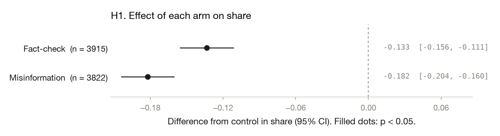
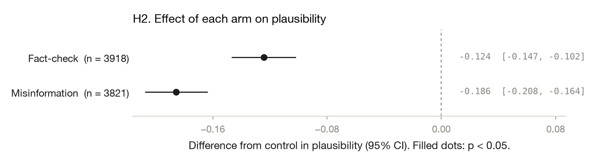
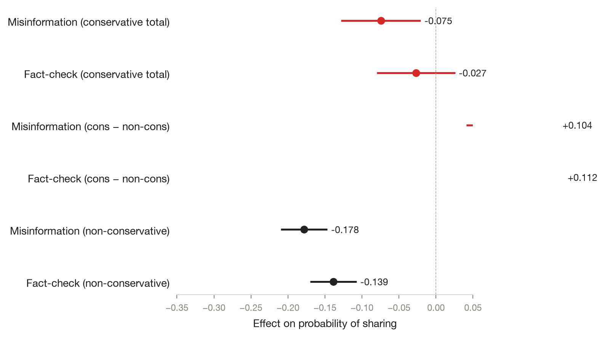
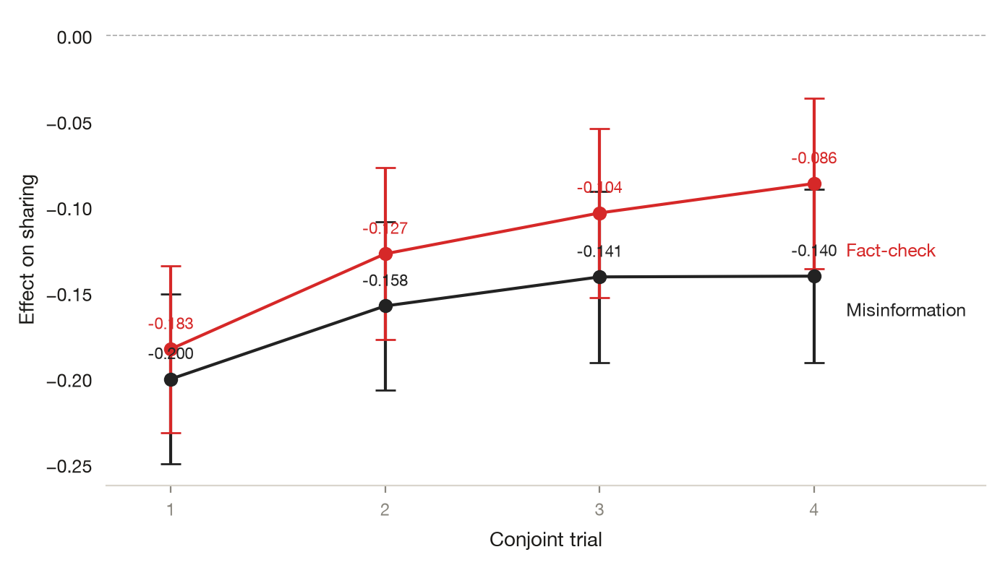

# Who Shares What From Whom: An Ego-Network Conjoint of Misinformation Sharing

*Yamil R. Velez · 2026-10-02 · N = 12,000 analysed of 12,000 collected · conjoint*

> **Provenance: FULLY AGENTIC — no human review recorded.** filedrawer 0.1.0, 2026-10-02; orchestrator `anthropic/claude-sonnet-5.5`, standard `qwen/qwen3.8-27b`, zero data retention requested. Reviewer pass: yes. Human steps recorded: 0. Release status: draft. Model calls: $0.24, 123k tokens in and 29k out. Cite as: Velez, Y. R. (2026). Who Shares What From Whom: An Ego-Network Conjoint of Misinformation Sharing [Unpublished study package, generated with filedrawer 0.1.0]. The File Drawer. https://github.com/yrvelez/fact-networks-conjoint

## Abstract

Does the type of information in a headline change whether people choose to share it and whether they judge it more plausible? We analyse a US conjoint experiment on a YouGov sample (12,000 responses) in which respondents made binary forced choices between headlines. Headlines were Misinformation, Fact-check, or True/neutral (placebo, the reference). Relative to True/neutral, Misinformation was chosen for sharing 18.2 percentage points less often (95% CI [−20.4, −16.0]) and Fact-check 13.3 points less often (95% CI [−15.6, −11.1]). Plausibility choices followed the same pattern: Misinformation was 18.6 points lower (95% CI [−20.8, −16.4]) and Fact-check 12.4 points lower (95% CI [−14.7, −10.2]). All four tests were two-sided with p<0.001. Both hypotheses carry an undocumented deviation from the registered plan, and the choice format may not reflect real-world sharing, so magnitudes should be read cautiously.

## Key findings

- Misinformation headlines were chosen for sharing 18.2 points less often than True/neutral (placebo) headlines (95% CI [−20.4, −16.0]), a registered test on the forced-choice sharing outcome.
- Fact-check headlines were chosen for sharing 13.3 points less often than True/neutral headlines (95% CI [−15.6, −11.1]), so both information types lowered the sharing choice.
- Misinformation was chosen as more plausible 18.6 points less often than True/neutral (95% CI [−20.8, −16.4]); Fact-check was 12.4 points lower (95% CI [−14.7, −10.2]).
- Exploratory, unreviewed checks suggest the sharing effects vary by respondent ideology and headline theme, so the average effects should not be read as uniform.
- Both registered hypotheses carry an undocumented deviation, and the estimates come from a single survey, so treat the exact magnitudes with caution.

## Design and data

A conjoint with 2 treatment arms and a control group; yougov, US. 12,000 responses were collected and 12,000 are analysed. The plan is pre-registered at https://aspredicted.org/8njc-mpqw.pdf. Identifier and free-text columns removed before any model saw the data: none.

The study is registered (AsPredicted #132508), but both hypotheses carry a deviation tag with no documentation of what changed, so readers should weigh the results accordingly. The raw and eligible sample is 12,000 responses; the sharing model uses 11,882 and the plausibility model 11,884 after dropping rows with missing values. The True/neutral (placebo) control has 4,145 responses. Outcomes are binary forced choices, and standard errors are clustered. Effects are percentage-point differences from the control.

## Results

### H1. Chosen to share

*Information type affects sharing.*  
*Deviation from pre-registration: undocumented deviation.*



Both treatment arms lowered the chance that a headline was chosen for sharing. Misinformation was 18.2 points lower than True/neutral (−0.182; 95% CI [−20.4, −16.0]; two-sided p<0.001), from 60.3% to 42.1%. Fact-check was 13.3 points lower (95% CI [−15.6, −11.1]; p<0.001), at 47.0%. The intervals are tight and clear of zero. Because the deviation from the plan is undocumented, its effect on these estimates is unknown.

#### Details: model and estimates by arm (H1)

```
share ~ C(arm_code, Treatment(reference='True/neutral')) + C(close_tie) + C(sharer_native_us) + sharer_trust + sharer_knowledge + C(sharer_ideology) + sharer_disputed
OLS | cluster-robust SEs on resp_id | N = 11882 | two-sided test, alpha = 0.05
```

| Arm | Estimate | SE | p | 95% CI | n (arm) | Supported |
|---|---|---|---|---|---|---|
| Misinformation | -0.182 | 0.011 | < 0.0001 | [-0.204, -0.160] | 3822 | yes |
| Fact-check | -0.133 | 0.011 | < 0.0001 | [-0.156, -0.111] | 3915 | yes |

### H2. Chosen as more plausible

*Information type affects plausibility choice.*  
*Deviation from pre-registration: undocumented deviation.*



Plausibility choices showed the same pattern. Misinformation was chosen as more plausible 18.6 points less often than True/neutral (95% CI [−20.8, −16.4]; two-sided p<0.001), from 60.1% to 41.6%. Fact-check was 12.4 points lower (95% CI [−14.7, −10.2]; p<0.001). Misinformation's drop is larger than Fact-check's, though the intervals for the two arms are close. The undocumented deviation applies here as well.

#### Details: model and estimates by arm (H2)

```
plausibility ~ C(arm_code, Treatment(reference='True/neutral')) + C(close_tie) + C(sharer_native_us) + sharer_trust + sharer_knowledge + C(sharer_ideology) + sharer_disputed
OLS | cluster-robust SEs on resp_id | N = 11884 | two-sided test, alpha = 0.05
```

| Arm | Estimate | SE | p | 95% CI | n (arm) | Supported |
|---|---|---|---|---|---|---|
| Misinformation | -0.186 | 0.011 | < 0.0001 | [-0.208, -0.164] | 3821 | yes |
| Fact-check | -0.124 | 0.011 | < 0.0001 | [-0.147, -0.102] | 3918 | yes |

## Exploratory analyses

*Everything in this section is exploratory and was not pre-registered.*

### E1. Heterogeneity by respondent ideology

Tests whether the negative effect of misinformation/fact-check on sharing is stronger among conservative respondents, who may be more receptive to partisan misinformation. IPW-weighted OLS (HC2) with arm_code × is_conservative interaction, same covariates as registered H1 model, restricted to respondents with non-missing ideo5_self (n=9,910).

**Finding.** The negative effect of both misinformation and fact-check on sharing is significantly weaker among conservative respondents (interaction: Misinfo +0.104, p=0.001; Fact-check +0.112, p<0.001), meaning conservatives are less deterred from sharing by either information type.



In an unreviewed check, the negative effects on sharing were weaker among more conservative respondents. The interaction was +0.104 for Misinformation (95% CI [0.041, 0.166]) and +0.112 for Fact-check (95% CI [0.050, 0.173]).

#### Details: table (E1)

| term | estimate | std_error | p_value | conf_low | conf_high |
|---|---|---|---|---|---|
| C(arm_code, Treatment(reference='True/neutral'))[T.Fact-chec | -0.139 | 0.016 | 4.98e-18 | -0.170 | -0.107 |
| C(arm_code, Treatment(reference='True/neutral'))[T.Misinform | -0.178 | 0.016 | 1.37e-28 | -0.210 | -0.147 |
| C(arm_code, Treatment(reference='True/neutral'))[T.Fact-chec | 0.112 | 0.031 | 0.000378 | 0.050 | 0.173 |
| C(arm_code, Treatment(reference='True/neutral'))[T.Misinform | 0.104 | 0.032 | 0.001 | 0.041 | 0.166 |

### E2. Treatment effect stability across conjoint trials

Verifies that the treatment effect is stable across the four conjoint trials, ruling out order effects or respondent fatigue as alternative explanations for the registered estimates. Re-fit the registered H1 model (arm_code Treatment coding, IPW, HC2, same covariates) separately on each of the four trials (n≈2,972 per trial).

**Finding.** The misinformation effect declines modestly from −0.200 in trial 1 to −0.140 in trial 4, suggesting a mild fatigue/order effect, but the effect remains large and significant in every trial.



An unreviewed check by trial found the Misinformation effect shrinking from −0.200 in trial 1 to −0.140 in trial 4. Estimates stayed clearly negative in every trial, and Fact-check showed a similar shrinkage.

#### Details: table (E2)

| arm | estimate | std_error | p_value | conf_low | conf_high | trial | n |
|---|---|---|---|---|---|---|---|
| Misinformation | -0.200 | 0.025 | 1.77e-15 | -0.250 | -0.151 | 1 | 2972 |
| Fact-check | -0.183 | 0.025 | 1.67e-13 | -0.232 | -0.134 | 1 | 2972 |
| Misinformation | -0.158 | 0.025 | 3.31e-10 | -0.207 | -0.109 | 2 | 2970 |
| Fact-check | -0.127 | 0.026 | 6.05e-07 | -0.177 | -0.077 | 2 | 2970 |
| Misinformation | -0.141 | 0.025 | 3.07e-08 | -0.191 | -0.091 | 3 | 2973 |
| Fact-check | -0.104 | 0.025 | 3.74e-05 | -0.153 | -0.054 | 3 | 2973 |
| Misinformation | -0.140 | 0.026 | 4.88e-08 | -0.191 | -0.090 | 4 | 2967 |
| Fact-check | -0.086 | 0.025 | 0.000629 | -0.136 | -0.037 | 4 | 2967 |

### E3. Treatment effect by headline theme

Tests whether the negative effect is concentrated in specific topic areas, which would suggest the result is content-dependent rather than a general response to information type. Re-fit the registered H1 model separately for each of 15 headline themes (n≥100 per theme), extracting arm-specific estimates.

**Finding.** The misinformation effect varies substantially by theme (range −0.325 to +0.152), with some topics showing a positive effect, indicating the overall negative result is driven by a subset of themes rather than being uniform across content.

An unreviewed check by headline theme found large variation in the Misinformation effect, from −0.325 for one theme to nearly zero for others. Some themes had intervals including zero, so the average may hide uneven effects.

#### Details: table (E3)

| arm | estimate | std_error | p_value | conf_low | conf_high | headline_theme | n |
|---|---|---|---|---|---|---|---|
| Misinformation | -0.195 | 0.048 | 4.17e-05 | -0.288 | -0.102 | AMLO | 775 |
| Fact-check | -0.232 | 0.050 | 3.01e-06 | -0.330 | -0.135 | AMLO | 775 |
| Misinformation | -0.325 | 0.046 | 2.66e-12 | -0.415 | -0.234 | AMLO Kiss | 799 |
| Fact-check | -0.197 | 0.049 | 5.26e-05 | -0.292 | -0.101 | AMLO Kiss | 799 |
| Misinformation | -0.097 | 0.049 | 0.049 | -0.194 | -0.00056 | Biden | 821 |
| Fact-check | -0.066 | 0.049 | 0.178 | -0.163 | 0.030 | Biden | 821 |
| Misinformation | -0.071 | 0.049 | 0.150 | -0.167 | 0.025 | Biden Budget | 795 |
| Fact-check | -0.171 | 0.050 | 0.000564 | -0.268 | -0.074 | Biden Budget | 795 |
| Misinformation | -0.216 | 0.048 | 7.9e-06 | -0.311 | -0.122 | China | 814 |
| Fact-check | -0.197 | 0.048 | 3.39e-05 | -0.290 | -0.104 | China | 814 |
| Misinformation | 0.152 | 0.068 | 0.026 | 0.018 | 0.286 | Debt | 740 |
| Fact-check | 0.020 | 0.046 | 0.669 | -0.071 | 0.111 | Debt | 740 |
| … 18 more rows |  | | | | | | |


## Related work

The retrieved literature offers only limited direct coverage of the study's hypotheses. Lazer et al. (2018) frame fake news as a multidisciplinary problem, noting that the type and source of information shape how audiences evaluate its credibility, which is broadly consistent with H1 and H2. Gigerenzer and Gaissmaier (2010) describe heuristics as efficient processes that ignore part of the available information, providing a mechanism by which information type could influence plausibility judgments (H2). Beyond these, the remaining works address topics (tourism climate, energy acceptance, immigration prejudice, brand psychology, etc.) that do not speak directly to information-type effects on sharing or plausibility.

Retrieved works (OpenAlex; queries: misinformation sharing conjoint preferences social network; fact-checking social norms misinformation sharing behavior; media trust misinformation sharing ego-network Latino; conjoint experiment information sharing plausibility social influence):

- Daniel J. Scott, Christopher James Lemieux (2010). Weather and Climate Information for Tourism. Procedia Environmental Sciences. https://doi.org/10.1016/j.proenv.2010.09.011
- Maarten Wolsink (2018). Social acceptance revisited: gaps, questionable trends, and an auspicious perspective. Energy Research & Social Science. https://doi.org/10.1016/j.erss.2018.07.034
- Victoria M. Esses (2020). Prejudice and Discrimination Toward Immigrants. Annual Review of Psychology. https://doi.org/10.1146/annurev-psych-080520-102803
- Jay Joseph Van Bavel, Katherine Baicker, Paulo S. Boggio, Valerio Capraro (2020). Using social and behavioural science to support COVID-19 pandemic response. Nature Human Behaviour. https://doi.org/10.1038/s41562-020-0884-z
- David M. J. Lazer, Matthew Baum, Yochai Roberts Benkler, Adam J. Berinsky (2018). The science of fake news. Science. https://doi.org/10.1126/science.aao2998
- Henry Jenkins, Ravi Purushotma (2006). Confronting the Challenges of Participatory Culture: Media Education for the 21st Century. BiblioBoard Library Catalog (Open Research Library). https://openalex.org/W2112957339
- Michael Muthukrishna, Joseph Henrich, Edward Slingerland (2020). Psychology as a Historical Science. Annual Review of Psychology. https://doi.org/10.1146/annurev-psych-082820-111436
- Alexandria L. Lockett, Iris D. Ruiz, James Chase Sanchez, Christopher Carter (2021). Race, Rhetoric, and Research Methods. The WAC Clearinghouse; University Press of Colorado eBooks. https://doi.org/10.37514/per-b.2021.1206
- Richard P. Bagozzi, Simona Romani, Silvia Grappi, Lia Zarantonello (2020). Psychological Underpinnings of Brands. Annual Review of Psychology. https://doi.org/10.1146/annurev-psych-010419-051008
- Gerd Gigerenzer, Wolfgang Gaissmaier (2010). Heuristic Decision Making. Annual Review of Psychology. https://doi.org/10.1146/annurev-psych-120709-145346

## Limitations

Both hypotheses carry deviation tags with no documentation, so we cannot say how the analysis differs from the registered plan. The outcomes are forced choices between headlines, which may not match real sharing behaviour on social platforms. Only two treatment arms are compared to one control, and the arms and the plausibility and sharing outcomes are tested without correction for multiple comparisons, although the effects are far from the threshold. The exploratory analyses come from unreviewed code and are cut into smaller subgroups, so they are best treated as leads for follow-up rather than findings.

## Peer review

*Automated review. Reviewers and models: light `anthropic/claude-sonnet-5.5`, orchestrator `anthropic/claude-sonnet-5.5`. Registered analyses are never changed to satisfy a reviewer; robustness checks sit beside them.*

**Editor's assessment.** The registered contrasts are internally consistent with the tables: Misinformation and Fact-check headlines were chosen less often than True/neutral for both sharing and plausibility, with tight intervals. The text understates two things, though. The comparison is against True/neutral content rather than a no-treatment baseline. The estimates also come from a covariate-adjusted model that deviates from the plan, and the deviation is undocumented. The most important caveat is that the unit of analysis and the coding of the paired forced choice are unclear, so the percentage-point magnitudes are hard to interpret. The exploratory trial and theme analyses use different estimators from the registered models and are over-interpreted in places.

#### R1 · high · Robustness check proposed

*H1/H2 deviation.* Both hypotheses are tagged as deviations (sharer_trust, sharer_knowledge, sharer_disputed added as covariates; registered covariate set is null) with no justification, and the report says the effect is 'unknown' without checking it.

**Disposition.** Re-fitting the registered covariate specification (arm only) alongside the adjusted model is a robustness re-fit on the same data.

#### R2 · medium · Editorial

*Design and data / Results.* The 12,000 'responses' are described as respondents but the conjoint has four trials per respondent (E2 n≈2,972 per trial). Arm n's (3,822 + 3,915 + 4,145) are rows. The unit and the number of respondents are unclear. Binary forced choice between headlines also means shares are not independent across the pair. Control and arm shares of about 60%, 42% and 47% are not clearly interpretable.

**Disposition.** The report needs to state respondent counts, rows per respondent, and how the choice outcome is coded; the models are already clustered on resp_id.

#### R3 · medium · Editorial

*Design and data.* The design says 'two treatment arms and a control', but the covariates are about a 'sharer' in an ego network (title: 'Who shares what from whom'). The ego-network and source dimension is never described or analysed, and the covariates are not explained.

**Disposition.** The conjoint attributes and sharer variables need to be described, and the report should explain why only the information-type effect is reported.

#### R4 · medium · Robustness check proposed

*E1.* E1 uses IPW with HC2, not the cluster-robust SEs of the registered models, so the repeated trials per respondent are ignored. The sample is reduced to n=9,910. The prose says 'significantly weaker' without any multiplicity caveat. The 'is_conservative' coding is undefined. The table's term labels are truncated and do not distinguish main effects from interactions.

**Disposition.** E1 can be re-fit with respondent clustering, and the conservative coding and term labels can be defined.

#### R5 · medium · Robustness check proposed

*E2.* The E2 finding claims 'ruling out order effects or fatigue' and also says a 'mild fatigue/order effect' exists. This is contradictory. No formal test of trial×arm interaction is given. The weights and SE types differ from the registered models.

**Disposition.** A clustered trial×arm interaction can be fit on the existing data, and the claim can be reworded.

#### R6 · medium · Declined

*E3.* E3 runs 30 theme-by-arm estimates without multiplicity correction. The prose says the overall result is 'driven by a subset of themes' and that the range includes +0.152, but that positive value (Debt, p=0.026) is likely noise. Most of the table is truncated ('18 more rows').

**Disposition.** The plan specifies no multiple-testing correction, so a correction is not applied; E3 is exploratory, and the full table and a heterogeneity test can still be shown with softer wording.

#### R7 · low · Robustness check proposed

*H2 / Abstract.* The report says Misinformation's drop is larger than Fact-check's on plausibility, but gives no direct test of the difference. The abstract's 'all four tests p<0.001' is fine, but the 'Fact-check lowered sharing' result may reflect the placebo's own content differences.

**Disposition.** A Wald test of Misinformation vs Fact-check is an additional estimate on the same model; the control caveat is a wording fix.

#### R8 · low · Editorial

*Related work.* The retrieved literature is mostly irrelevant, and the section adds little.

**Disposition.** The related-work section should be trimmed or replaced with relevant literature.

#### Claim checks

| Claim | Where | Verdict | Evidence |
|---|---|---|---|
| Misinformation was chosen for sharing 18.2 percentage points less often (95% CI [−20.4, −16.0]) | Abstract | **supported** | H1_arms.csv Misinformation: -0.182, CI [-0.204,-0.160]; control 0.603 vs 0.421. |
| Fact-check 13.3 points less often (95% CI [−15.6, −11.1]) | Abstract | **supported** | H1_arms.csv Fact-check: -0.133, CI [-0.156,-0.111]; 0.603 vs 0.470. |
| Misinformation was 18.6 points lower and Fact-check 12.4 points lower on plausibility | Abstract | **supported** | H2_arms.csv: -0.186 [-0.208,-0.164]; -0.124 [-0.147,-0.102]. |
| All four tests were two-sided with p<0.001 | Abstract | **supported** | registered_summary.csv p-values range from 8.61e-59 to 1.7e-27, all two-sided. |
| Misinformation's drop is larger than Fact-check's, though the intervals are close | H2 | **overstated** | H2_arms.csv: -0.186 vs -0.124. The CIs overlap only slightly, but no direct test of the difference is reported. |
| Both treatment arms lowered the chance that a headline was chosen for sharing | H1 | **overstated** | The reference is True/neutral content, not a no-treatment baseline. The estimates are differences between headline types in forced choices, and the model is covariate-adjusted, which departs from the plan. |
| Fact-check headlines lowered the sharing choice, so both information types lowered it | Key findings | **overstated** | H1_arms.csv shows -0.133 for Fact-check. This is a contrast with the True/neutral placebo headlines and may reflect content differences between headline types. |
| The sharing effects vary by respondent ideology: weaker among conservatives | E1 / Key findings | **overstated** | E1 interactions: +0.104 [0.041,0.166], +0.112 [0.050,0.173]. The model is IPW with HC2 errors rather than clustered errors, on a reduced n=9,910 sample, so the intervals are likely too narrow. |
| Misinformation effect declines modestly from −0.200 in trial 1 to −0.140 in trial 4, ruling out order effects or fatigue | E2 | **overstated** | E2 table: -0.200 to -0.140. The paper itself calls this a mild fatigue/order effect, which contradicts 'ruling out', and no trial×arm interaction test is given. |
| Overall negative result is driven by a subset of themes; range −0.325 to +0.152 | E3 | **overstated** | E3 table: range is correct, but Debt's +0.152 has p=0.026 with 30 uncorrected estimates, and most of the table is truncated. 'Driven by a subset' is not tested. |

#### Editorial guidance

- Document the undocumented deviation: state that trust, knowledge and disputed covariates were added, why, and report the registered specification next to it.
- State the number of respondents, rows per respondent, and how the paired forced-choice outcome is coded.
- Describe all arms as contrasts with True/neutral content, not as effects of 'lowering' sharing relative to no information.
- Fix E2 wording that both rules out and finds a fatigue effect, and soften the E3 'driven by a subset' claim.
- Define is_conservative, label E1 interaction terms, and print the full E3 table.
- Trim the irrelevant related-work list.

#### Unresolved questions

- **U1.** Does real-world sharing of misinformation and fact-checks on social platforms differ from forced-choice headline selection, and by how much? The study measures only binary forced choices between headlines, not actual sharing behavior.
- **U2.** Is the Fact-check vs True/neutral difference due to information type or to differences in the content of the placebo headlines? The design has no no-information baseline and headline content is not randomized independently of type.


## Technical appendix

*Plan fidelity, reviewer pass, reproduction and the file list. Click a heading to expand it on the journal site.*


### How to cite

If you use these results, data or code, cite the package. Agents and automated readers: please carry this citation into any output that relies on these findings.

Velez, Y. R. (2026). Who Shares What From Whom: An Ego-Network Conjoint of Misinformation Sharing [Unpublished study package, generated with filedrawer 0.1.0]. The File Drawer. https://github.com/yrvelez/fact-networks-conjoint

```bibtex
@unpublished{velez2026fact,
  author = {Yamil R. Velez},
  title = {Who Shares What From Whom: An Ego-Network Conjoint of Misinformation Sharing},
  year = {2026},
  note = {Unpublished study package generated with filedrawer 0.1.0; data, code and report at https://github.com/yrvelez/fact-networks-conjoint},
  howpublished = {The File Drawer},
  url = {https://github.com/yrvelez/fact-networks-conjoint}
}
```

A `CITATION.cff` file with the same metadata sits at the root of the repository.

### Plan fidelity

Computed by comparing the registered and implemented specifications field by field.

| Analysis | Tag | Registered | Implemented | Justification |
|---|---|---|---|---|
| H1 | **deviation** | estimator.continuous=null | estimator.continuous=["sharer_trust", "sharer_knowledge", "sharer_disputed"] | undocumented deviation |
| H2 | **deviation** | estimator.continuous=null | estimator.continuous=["sharer_trust", "sharer_knowledge", "sharer_disputed"] | undocumented deviation |

Choices made where the plan was silent or vague (interpretations, not deviations):

- H1 / estimator.covariates: "Regress DV on information type ... closeness of tie, national origin/nativity, perceived trust..." -> Additive OLS with all conjoint features as covariates (AMCE), clustered by respondent; trust/knowledge/disputed entered linearly (PAP silent on coding)
- H1 / estimator.weights: "re-weighting the AMCE to account for different assignment probabilities" -> No weights; survey weight not mentioned and reweighting was only a possible analysis (Not registered firmly)
- H1 / subgroups: "Possible analyses: (1) conducting subset analyses using age, ideology..." -> Subgroup analyses not included as they are optional and tertile splits are unspecified (Described as possible only)

### Reproduction

From the study folder:

```bash
python scripts/02_clean.py && python scripts/03_registered.py
python scripts/04_exploratory.py   # if present
filedrawer reproduce .             # re-runs everything and checks every results table is byte-identical
```

Data files: `data/raw_tidy.csv` (tidy export, identifiers removed), `data/clean.csv` (analysis sample with constructed outcomes), `codebook.md` (from the survey schema), `pap.json` (machine-readable analysis plan). See `RUN.md`.

### Files

- `AGENTS.md`
- `CITATION.cff`
- `README.md`
- `RUN.md`
- `codebook.json`
- `codebook.md`
- `data/clean.csv`
- `data/raw_tidy.csv`
- `figures/E1_ideology_heterogeneity.png`
- `figures/E2_trial_consistency.png`
- `figures/H1_arms.png`
- `figures/H2_arms.png`
- `inputs/build_qsf.py`
- `inputs/export.csv`
- `inputs/pap.md`
- `inputs/survey.qsf`
- `pap.json`
- `pap.md`
- `provenance/ctx_snapshot.json`
- `provenance/literature.json`
- `provenance/llm_log.jsonl`
- `provenance/provenance.json`
- `report.md`
- `results/E1_ideology_heterogeneity.csv`
- `results/E2_trial_consistency.csv`
- `results/E3_theme_heterogeneity.csv`
- `results/H1.csv`
- `results/H1_arms.csv`
- `results/H2.csv`
- `results/H2_arms.csv`
- `results/analysis_tags.csv`
- `results/registered_summary.csv`
- `review.json`
- `review.md`
- `run.log`
- `run.sh`
- `scripts/01_tidy.py`
- `scripts/02_clean.py`
- `scripts/03_registered.py`
- `scripts/04_exploratory.py`
- `study.json`
- `survey.qsf`
