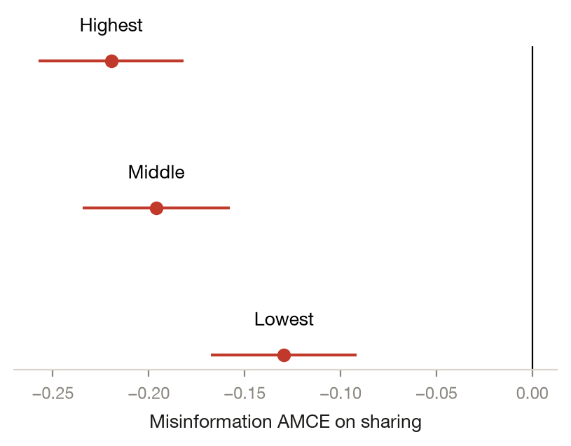

# Who Shares What From Whom: An Ego-Network Conjoint of Misinformation Sharing

*Yamil R. Velez · 2026-10-02 · N = 12,000 analysed of 12,000 collected · conjoint*

> **Provenance: FULLY AGENTIC — no human review recorded.** filedrawer 0.1.0, 2026-10-02; orchestrator `anthropic/claude-sonnet-5.5`, standard `qwen/qwen3.8-27b`, zero data retention requested. Reviewer pass: yes. Human steps recorded: 0. Release status: draft. Model calls: $1.33, 561k tokens in and 22k out. Cite as: Velez, Y. R. (2026). Who Shares What From Whom: An Ego-Network Conjoint of Misinformation Sharing [Unpublished study package, generated with filedrawer 0.1.0]. The File Drawer. https://github.com/yrvelez/fact-networks-conjoint

## Abstract

This study asks how the type of information and the characteristics of the person sharing it shape whether people say they would share a post and how plausible they find it. In a registered conjoint experiment on a YouGov sample of US respondents (12,000 profiles, all analysed), each headline was randomly true or neutral, false, or a fact-check, and was attributed to one of the respondent's real contacts. Relative to true or neutral headlines, misinformation was 18.2 points less likely to be chosen for sharing (95% CI [−20.4, −16.0]) and fact-checks 13.3 points less (95% CI [−15.6, −11.1]); plausibility showed a similar pattern. Close ties (+3.0 points) and highly trusted sharers (+5.7 points) raised sharing. Sharer origin, knowledge and belief in disputed claims were not distinguishable from zero. Respondents' own belief in disputed claims and their age moderated the response to misinformation. The sharer attributes are measured, not randomized, many tests were uncorrected, and several differences are small.

## Key findings

- Headlines that were false or that corrected a false claim were shared less than true or neutral ones: misinformation by 18.2 points (95% CI [−20.4, −16.0]), fact-checks by 13.3 points (95% CI [−15.6, −11.1]).
- Among the sharer attributes, which were measured and not randomized, a close tie raised sharing by 3.0 points (95% CI [1.0, 5.0]) and high trust in the sharer by 5.7 points (95% CI [2.3, 9.1]).
- Sharer origin, political knowledge and belief in disputed claims were not distinguishable from zero for sharing, with intervals of roughly ±2 to ±4 points.
- Registered subgroup comparisons show that respondents with high belief in disputed claims shared misinformation 5.6 points more than those with low belief (p<0.001), and older respondents shared it 6.1 points less.
- Many tests were run without correction, and the sharer attributes are measured ratings of real contacts, so their effects are descriptive, not causal.

## Design and data

A conjoint with 7 profile features: randomized, Information type (True/neutral, Misinformation, Fact-check); measured rather than randomized (the respondent's own ratings of the real contact each headline was attributed to; only the headline and its assignment to a contact are randomized), Tie strength (Distant tie, Close tie); Sharer origin (Foreign origin, Continental US); Sharer ideology (Liberal sharer, Moderate sharer, Conservative sharer); Trust in sharer (Trust: low, Trust: mid, Trust: high); Sharer political knowledge (Knowledge: low, Knowledge: mid, Knowledge: high); Sharer belief in disputed claims (Conspiracy belief: low, Conspiracy belief: high); yougov, US. 12,000 responses were collected and 12,000 are analysed. The plan is pre-registered at https://aspredicted.org/8njc-mpqw.pdf. Identifier and free-text columns removed before any model saw the data: none.

Each respondent rated pairs of posts, and the 12,000 profiles were all analysed; no rows were dropped for the main models, though a few outcome cells were missing by a handful of rows. Only the information type was randomized, with True/neutral headlines as the reference level (4,145 profiles with that level in the exploratory models). Tie strength, sharer origin, ideology, trust, knowledge and belief in disputed claims are the respondent's own ratings of real contacts. Their effects are therefore descriptive contrasts that bundle correlated attributes. Standard errors are clustered by respondent. All tests labelled registered follow the AsPredicted plan; those labelled exploratory were specified after seeing the data.

## Results


### H1. Information type → sharing

*AMCE of information type on sharing: each level against 'True/neutral', from the regression of sharing on all seven profile features, SEs clustered by respondent.*  
*Pre-registered.*

False headlines were chosen for sharing 18.2 points less often than true or neutral ones (95% CI [−20.4, −16.0], p<0.001, two-sided). Fact-checks were 13.3 points lower (95% CI [−15.6, −11.1], p<0.001). Sharing rates were 60.3% for true or neutral headlines, 42.1% for misinformation and 47.0% for fact-checks. Because information type was randomized, these are causal estimates.

#### Details: model and estimates by arm (H1)

```
share ~ C(arm_code, Treatment(reference='True/neutral')) + C(tie) + C(sharer_origin) + C(sharer_ideology) + C(sharer_trust) + C(sharer_knowledge) + C(sharer_conspiracy)
OLS | cluster-robust SEs on resp_id | N = 11882 | two-sided test, alpha = 0.05
```

| Arm | Estimate | SE | p | 95% CI | n (arm) | Supported |
|---|---|---|---|---|---|---|
| Misinformation | -0.182 | 0.011 | < 0.0001 | [-0.204, -0.160] | 3822 | yes |
| Fact-check | -0.133 | 0.011 | < 0.0001 | [-0.156, -0.111] | 3915 | yes |

### H2. Tie strength → sharing

*AMCE of tie strength on sharing: each level against 'Distant tie', from the regression of sharing on all seven profile features, SEs clustered by respondent.*  
*Pre-registered.*

Posts from close ties were chosen for sharing 3.0 points more often than those from distant ties (95% CI [1.0, 5.0], p=0.003, two-sided). Tie strength is a measured rating, so the contrast is descriptive.

#### Details: model and estimates by arm (H2)

```
share ~ C(arm_code, Treatment(reference='Distant tie')) + C(infotype) + C(sharer_origin) + C(sharer_ideology) + C(sharer_trust) + C(sharer_knowledge) + C(sharer_conspiracy)
OLS | cluster-robust SEs on resp_id | N = 11882 | two-sided test, alpha = 0.05
```

| Arm | Estimate | SE | p | 95% CI | n (arm) | Supported |
|---|---|---|---|---|---|---|
| Close tie | 0.030 | 0.010 | 0.0032 | [0.010, 0.050] | 6662 | yes |

### H3. Sharer origin → sharing

*AMCE of sharer origin on sharing: each level against 'Foreign origin', from the regression of sharing on all seven profile features, SEs clustered by respondent.*  
*Pre-registered.*

Posts from sharers in the continental US were not distinguishable from foreign-origin sharers in sharing (+0.2 points, 95% CI [−1.4, 1.8], p=0.81). The interval is narrow but still compatible with small effects either way.

#### Details: model and estimates by arm (H3)

```
share ~ C(arm_code, Treatment(reference='Foreign origin')) + C(infotype) + C(tie) + C(sharer_ideology) + C(sharer_trust) + C(sharer_knowledge) + C(sharer_conspiracy)
OLS | cluster-robust SEs on resp_id | N = 11882 | two-sided test, alpha = 0.05
```

| Arm | Estimate | SE | p | 95% CI | n (arm) | Supported |
|---|---|---|---|---|---|---|
| Continental US | 0.002 | 0.008 | 0.8143 | [-0.014, 0.018] | 9400 | no |

### H4. Sharer ideology → sharing

*AMCE of sharer ideology on sharing: each level against 'Liberal sharer', from the regression of sharing on all seven profile features, SEs clustered by respondent.*  
*Pre-registered.*

Moderate sharers were chosen 1.9 points less often than liberal sharers (95% CI [−3.7, −0.1], p=0.034), a result near the threshold given the many tests. Conservative sharers were −0.7 points (95% CI [−2.8, 1.5]), not distinguishable from liberal ones.

#### Details: model and estimates by arm (H4)

```
share ~ C(arm_code, Treatment(reference='Liberal sharer')) + C(infotype) + C(tie) + C(sharer_origin) + C(sharer_trust) + C(sharer_knowledge) + C(sharer_conspiracy)
OLS | cluster-robust SEs on resp_id | N = 11882 | two-sided test, alpha = 0.05
```

| Arm | Estimate | SE | p | 95% CI | n (arm) | Supported |
|---|---|---|---|---|---|---|
| Moderate sharer | -0.019 | 0.009 | 0.0337 | [-0.037, -0.001] | 6538 | yes |
| Conservative sharer | -0.007 | 0.011 | 0.5470 | [-0.028, 0.015] | 2536 | no |

### H5. Trust in sharer → sharing

*AMCE of trust in sharer on sharing: each level against 'Trust: low', from the regression of sharing on all seven profile features, SEs clustered by respondent.*  
*Pre-registered.*

Highly trusted sharers were chosen 5.7 points more often than low-trust sharers (95% CI [2.3, 9.1], p<0.001). Mid trust was +3.6 points (95% CI [−0.1, 7.3], p=0.056), not clearly distinguishable from zero.

#### Details: model and estimates by arm (H5)

```
share ~ C(arm_code, Treatment(reference='Trust: low')) + C(infotype) + C(tie) + C(sharer_origin) + C(sharer_ideology) + C(sharer_knowledge) + C(sharer_conspiracy)
OLS | cluster-robust SEs on resp_id | N = 11882 | two-sided test, alpha = 0.05
```

| Arm | Estimate | SE | p | 95% CI | n (arm) | Supported |
|---|---|---|---|---|---|---|
| Trust: mid | 0.036 | 0.019 | 0.0561 | [-0.001, 0.073] | 2677 | no |
| Trust: high | 0.057 | 0.017 | 0.0010 | [0.023, 0.091] | 8388 | yes |

### H6. Sharer political knowledge → sharing

*AMCE of sharer political knowledge on sharing: each level against 'Knowledge: low', from the regression of sharing on all seven profile features, SEs clustered by respondent.*  
*Pre-registered.*

Sharer political knowledge was not distinguishable from zero for sharing: mid knowledge −0.0 points (95% CI [−2.0, 1.9]) and high knowledge +1.7 points (95% CI [−0.5, 3.9]), against low knowledge.

#### Details: model and estimates by arm (H6)

```
share ~ C(arm_code, Treatment(reference='Knowledge: low')) + C(infotype) + C(tie) + C(sharer_origin) + C(sharer_ideology) + C(sharer_trust) + C(sharer_conspiracy)
OLS | cluster-robust SEs on resp_id | N = 11882 | two-sided test, alpha = 0.05
```

| Arm | Estimate | SE | p | 95% CI | n (arm) | Supported |
|---|---|---|---|---|---|---|
| Knowledge: mid | -0.000 | 0.010 | 0.9619 | [-0.020, 0.019] | 5273 | no |
| Knowledge: high | 0.017 | 0.011 | 0.1265 | [-0.005, 0.039] | 4564 | no |

### H7. Sharer belief in disputed claims → sharing

*AMCE of sharer belief in disputed claims on sharing: each level against 'Conspiracy belief: low', from the regression of sharing on all seven profile features, SEs clustered by respondent.*  
*Pre-registered.*

High belief in disputed claims by the sharer was not distinguishable from low belief for sharing (−0.2 points, 95% CI [−1.9, 1.6], p=0.87).

#### Details: model and estimates by arm (H7)

```
share ~ C(arm_code, Treatment(reference='Conspiracy belief: low')) + C(infotype) + C(tie) + C(sharer_origin) + C(sharer_ideology) + C(sharer_trust) + C(sharer_knowledge)
OLS | cluster-robust SEs on resp_id | N = 11882 | two-sided test, alpha = 0.05
```

| Arm | Estimate | SE | p | 95% CI | n (arm) | Supported |
|---|---|---|---|---|---|---|
| Conspiracy belief: high | -0.002 | 0.009 | 0.8655 | [-0.019, 0.016] | 8675 | no |

### H8. Information type → plausibility

*AMCE of information type on plausibility: each level against 'True/neutral', from the regression of plausibility on all seven profile features, SEs clustered by respondent.*  
*Pre-registered.*

Misinformation was judged 18.6 points less often the more plausible post than true or neutral headlines (95% CI [−20.8, −16.4], p<0.001, two-sided). Fact-checks were 12.4 points lower (95% CI [−14.7, −10.2], p<0.001).

#### Details: model and estimates by arm (H8)

```
plausibility ~ C(arm_code, Treatment(reference='True/neutral')) + C(tie) + C(sharer_origin) + C(sharer_ideology) + C(sharer_trust) + C(sharer_knowledge) + C(sharer_conspiracy)
OLS | cluster-robust SEs on resp_id | N = 11884 | two-sided test, alpha = 0.05
```

| Arm | Estimate | SE | p | 95% CI | n (arm) | Supported |
|---|---|---|---|---|---|---|
| Misinformation | -0.186 | 0.011 | < 0.0001 | [-0.208, -0.164] | 3821 | yes |
| Fact-check | -0.124 | 0.011 | < 0.0001 | [-0.147, -0.102] | 3918 | yes |

### H9. Tie strength → plausibility

*AMCE of tie strength on plausibility: each level against 'Distant tie', from the regression of plausibility on all seven profile features, SEs clustered by respondent.*  
*Pre-registered.*

Close ties raised plausibility by 2.8 points relative to distant ties (95% CI [0.7, 4.8], p=0.008).

#### Details: model and estimates by arm (H9)

```
plausibility ~ C(arm_code, Treatment(reference='Distant tie')) + C(infotype) + C(sharer_origin) + C(sharer_ideology) + C(sharer_trust) + C(sharer_knowledge) + C(sharer_conspiracy)
OLS | cluster-robust SEs on resp_id | N = 11884 | two-sided test, alpha = 0.05
```

| Arm | Estimate | SE | p | 95% CI | n (arm) | Supported |
|---|---|---|---|---|---|---|
| Close tie | 0.028 | 0.010 | 0.0079 | [0.007, 0.048] | 6664 | yes |

### H10. Sharer origin → plausibility

*AMCE of sharer origin on plausibility: each level against 'Foreign origin', from the regression of plausibility on all seven profile features, SEs clustered by respondent.*  
*Pre-registered.*

Sharer origin was not distinguishable from zero for plausibility (−0.3 points, 95% CI [−1.9, 1.4]).

#### Details: model and estimates by arm (H10)

```
plausibility ~ C(arm_code, Treatment(reference='Foreign origin')) + C(infotype) + C(tie) + C(sharer_ideology) + C(sharer_trust) + C(sharer_knowledge) + C(sharer_conspiracy)
OLS | cluster-robust SEs on resp_id | N = 11884 | two-sided test, alpha = 0.05
```

| Arm | Estimate | SE | p | 95% CI | n (arm) | Supported |
|---|---|---|---|---|---|---|
| Continental US | -0.003 | 0.008 | 0.7462 | [-0.019, 0.014] | 9402 | no |

### H11. Sharer ideology → plausibility

*AMCE of sharer ideology on plausibility: each level against 'Liberal sharer', from the regression of plausibility on all seven profile features, SEs clustered by respondent.*  
*Pre-registered.*

Moderate sharers were rated 2.1 points less plausible than liberal sharers (95% CI [−4.0, −0.3], p=0.026), near the threshold. Conservative sharers were −1.9 points (95% CI [−4.1, 0.3]), not distinguishable from zero.

#### Details: model and estimates by arm (H11)

```
plausibility ~ C(arm_code, Treatment(reference='Liberal sharer')) + C(infotype) + C(tie) + C(sharer_origin) + C(sharer_trust) + C(sharer_knowledge) + C(sharer_conspiracy)
OLS | cluster-robust SEs on resp_id | N = 11884 | two-sided test, alpha = 0.05
```

| Arm | Estimate | SE | p | 95% CI | n (arm) | Supported |
|---|---|---|---|---|---|---|
| Moderate sharer | -0.021 | 0.009 | 0.0257 | [-0.040, -0.003] | 6539 | yes |
| Conservative sharer | -0.019 | 0.011 | 0.0870 | [-0.041, 0.003] | 2537 | no |

### H12. Trust in sharer → plausibility

*AMCE of trust in sharer on plausibility: each level against 'Trust: low', from the regression of plausibility on all seven profile features, SEs clustered by respondent.*  
*Pre-registered.*

Trust in the sharer was not distinguishable from zero for plausibility: mid −0.6 points (95% CI [−4.2, 3.0]) and high +2.5 points (95% CI [−0.7, 5.8]).

#### Details: model and estimates by arm (H12)

```
plausibility ~ C(arm_code, Treatment(reference='Trust: low')) + C(infotype) + C(tie) + C(sharer_origin) + C(sharer_ideology) + C(sharer_knowledge) + C(sharer_conspiracy)
OLS | cluster-robust SEs on resp_id | N = 11884 | two-sided test, alpha = 0.05
```

| Arm | Estimate | SE | p | 95% CI | n (arm) | Supported |
|---|---|---|---|---|---|---|
| Trust: mid | -0.006 | 0.018 | 0.7497 | [-0.042, 0.030] | 2675 | no |
| Trust: high | 0.025 | 0.017 | 0.1276 | [-0.007, 0.058] | 8392 | no |

### H13. Sharer political knowledge → plausibility

*AMCE of sharer political knowledge on plausibility: each level against 'Knowledge: low', from the regression of plausibility on all seven profile features, SEs clustered by respondent.*  
*Pre-registered.*

Sharer political knowledge was not distinguishable from zero for plausibility; high knowledge was +1.7 points (95% CI [−0.4, 3.8]) and mid knowledge −0.1 points (95% CI [−2.1, 1.9]).

#### Details: model and estimates by arm (H13)

```
plausibility ~ C(arm_code, Treatment(reference='Knowledge: low')) + C(infotype) + C(tie) + C(sharer_origin) + C(sharer_ideology) + C(sharer_trust) + C(sharer_conspiracy)
OLS | cluster-robust SEs on resp_id | N = 11884 | two-sided test, alpha = 0.05
```

| Arm | Estimate | SE | p | 95% CI | n (arm) | Supported |
|---|---|---|---|---|---|---|
| Knowledge: mid | -0.001 | 0.010 | 0.9172 | [-0.021, 0.019] | 5271 | no |
| Knowledge: high | 0.017 | 0.011 | 0.1188 | [-0.004, 0.038] | 4567 | no |

### H14. Sharer belief in disputed claims → plausibility

*AMCE of sharer belief in disputed claims on plausibility: each level against 'Conspiracy belief: low', from the regression of plausibility on all seven profile features, SEs clustered by respondent.*  
*Pre-registered.*

The sharer's belief in disputed claims was not distinguishable from zero for plausibility (−0.0 points, 95% CI [−1.8, 1.8], p=0.97).

#### Details: model and estimates by arm (H14)

```
plausibility ~ C(arm_code, Treatment(reference='Conspiracy belief: low')) + C(infotype) + C(tie) + C(sharer_origin) + C(sharer_ideology) + C(sharer_trust) + C(sharer_knowledge)
OLS | cluster-robust SEs on resp_id | N = 11884 | two-sided test, alpha = 0.05
```

| Arm | Estimate | SE | p | 95% CI | n (arm) | Supported |
|---|---|---|---|---|---|---|
| Conspiracy belief: high | -0.000 | 0.009 | 0.9700 | [-0.018, 0.018] | 8677 | no |

### Re-weighted AMCEs: each source attribute re-weighted by its inverse assignment probability

*Pre-registered. Analyses R1–R12.*

Re-weighting each source attribute by its inverse assignment probability left the picture essentially unchanged. For sharing, close ties stayed at +3.0 points (95% CI [1.0, 5.0]) and high trust rose slightly to +6.7 points (95% CI [3.3, 10.1]). The moderate-sharer contrast on sharing weakened to −1.7 points (95% CI [−3.5, 0.0], p=0.056). For plausibility, close ties (+2.7 points) and moderate sharers (−2.1 points) kept their sign and size. The remaining re-weighted estimates were not distinguishable from zero.

| Outcome | Feature | Level | Estimate | 95% CI | p | Without weights |
|---|---|---|---|---|---|---|
| Chosen to share | Tie strength | Close tie | 0.030 | [0.010, 0.050] | 0.003 | 0.030 (H2) |
| Chosen to share | Sharer origin | Continental US | 0.003 | [-0.013, 0.019] | 0.706 | 0.002 (H3) |
| Chosen to share | Sharer ideology | Moderate sharer | -0.017 | [-0.035, 0.000] | 0.056 | -0.019 (H4) |
| Chosen to share | Sharer ideology | Conservative sharer | -0.007 | [-0.028, 0.015] | 0.552 | -0.007 (H4) |
| Chosen to share | Trust in sharer | Trust: mid | 0.034 | [-0.002, 0.070] | 0.061 | 0.036 (H5) |
| Chosen to share | Trust in sharer | Trust: high | 0.067 | [0.033, 0.101] | 0.000 | 0.057 (H5) |
| Chosen to share | Sharer political knowledge | Knowledge: mid | -0.001 | [-0.020, 0.019] | 0.960 | -0.000 (H6) |
| Chosen to share | Sharer political knowledge | Knowledge: high | 0.017 | [-0.005, 0.039] | 0.138 | 0.017 (H6) |
| Chosen to share | Sharer belief in disputed claims | Conspiracy belief: high | -0.001 | [-0.019, 0.016] | 0.878 | -0.002 (H7) |
| Chosen as more plausible | Tie strength | Close tie | 0.027 | [0.007, 0.048] | 0.008 | 0.028 (H9) |
| Chosen as more plausible | Sharer origin | Continental US | -0.003 | [-0.019, 0.014] | 0.745 | -0.003 (H10) |
| Chosen as more plausible | Sharer ideology | Moderate sharer | -0.021 | [-0.039, -0.002] | 0.030 | -0.021 (H11) |
| Chosen as more plausible | Sharer ideology | Conservative sharer | -0.019 | [-0.042, 0.003] | 0.085 | -0.019 (H11) |
| Chosen as more plausible | Trust in sharer | Trust: mid | -0.008 | [-0.043, 0.027] | 0.646 | -0.006 (H12) |
| Chosen as more plausible | Trust in sharer | Trust: high | 0.029 | [-0.003, 0.062] | 0.079 | 0.025 (H12) |
| Chosen as more plausible | Sharer political knowledge | Knowledge: mid | -0.001 | [-0.021, 0.019] | 0.901 | -0.001 (H13) |
| Chosen as more plausible | Sharer political knowledge | Knowledge: high | 0.015 | [-0.006, 0.037] | 0.160 | 0.017 (H13) |
| Chosen as more plausible | Sharer belief in disputed claims | Conspiracy belief: high | -0.001 | [-0.019, 0.017] | 0.945 | -0.000 (H14) |

### Planned heterogeneity

#### S1. Marginal means of every feature level on sharing: highest minus lowest tertile of age

*Moderator `age_t`. Pre-registered.*

| analysis_id | feature | level | mm_Lowest | mm_Highest | difference | std_error | p_value | n_Lowest | n_Highest |
|---|---|---|---|---|---|---|---|---|---|
| S1 | infotype | Fact-check | 0.454 | 0.484 | 0.030 | 0.017 | 0.072 | 1305 | 1291 |
| S1 | infotype | Misinformation | 0.455 | 0.394 | -0.061 | 0.016 | 0.000165 | 1275 | 1282 |
| S1 | infotype | True/neutral | 0.585 | 0.611 | 0.026 | 0.015 | 0.094 | 1418 | 1407 |
| S1 | tie | Close tie | 0.516 | 0.511 | -0.005 | 0.011 | 0.663 | 2259 | 2193 |
| S1 | tie | Distant tie | 0.481 | 0.487 | 0.005 | 0.014 | 0.718 | 1739 | 1784 |
| S1 | sharer_origin | Continental US | 0.503 | 0.503 | 0.000186 | 0.004 | 0.966 | 2837 | 3357 |
| S1 | sharer_origin | Foreign origin | 0.496 | 0.482 | -0.014 | 0.016 | 0.385 | 1154 | 598 |
| S1 | sharer_ideology | Conservative sharer | 0.516 | 0.492 | -0.023 | 0.018 | 0.187 | 669 | 1036 |
| S1 | sharer_ideology | Liberal sharer | 0.510 | 0.535 | 0.025 | 0.016 | 0.117 | 1012 | 898 |
| S1 | sharer_ideology | Moderate sharer | 0.493 | 0.489 | -0.003 | 0.008 | 0.676 | 2315 | 2029 |
| S1 | sharer_trust | Trust: high | 0.511 | 0.509 | -0.002 | 0.006 | 0.680 | 2744 | 2937 |
| S1 | sharer_trust | Trust: low | 0.464 | 0.439 | -0.025 | 0.039 | 0.518 | 336 | 230 |
| S1 | sharer_trust | Trust: mid | 0.482 | 0.485 | 0.003 | 0.016 | 0.845 | 915 | 808 |
| S1 | sharer_knowledge | Knowledge: high | 0.512 | 0.518 | 0.005 | 0.011 | 0.621 | 1456 | 1719 |
| S1 | sharer_knowledge | Knowledge: low | 0.501 | 0.484 | -0.017 | 0.020 | 0.379 | 722 | 661 |
| S1 | sharer_knowledge | Knowledge: mid | 0.491 | 0.487 | -0.004 | 0.010 | 0.698 | 1820 | 1590 |
| S1 | sharer_conspiracy | Conspiracy belief: high | 0.504 | 0.499 | -0.005 | 0.006 | 0.405 | 2949 | 2870 |
| S1 | sharer_conspiracy | Conspiracy belief: low | 0.491 | 0.501 | 0.010 | 0.016 | 0.512 | 1049 | 1107 |

Age moderated the response to information type. Among misinformation profiles, the oldest tertile shared 6.1 points less than the youngest (p<0.001). Differences for fact-checks (+3.0) and true or neutral headlines (+2.6) were not clearly distinguishable from zero. Most other levels showed little age difference.

#### S2. Marginal means of every feature level on sharing: highest minus lowest tertile of respondent ideology (1 very liberal ... 5 very conservative)

*Moderator `ideo_self_t`. Pre-registered.*

| analysis_id | feature | level | mm_Lowest | mm_Highest | difference | std_error | p_value | n_Lowest | n_Highest |
|---|---|---|---|---|---|---|---|---|---|
| S2 | infotype | Fact-check | 0.477 | 0.486 | 0.009 | 0.018 | 0.622 | 1110 | 1127 |
| S2 | infotype | Misinformation | 0.414 | 0.439 | 0.025 | 0.019 | 0.191 | 1062 | 1055 |
| S2 | infotype | True/neutral | 0.619 | 0.562 | -0.056 | 0.018 | 0.002 | 1151 | 1138 |
| S2 | tie | Close tie | 0.516 | 0.517 | 0.000961 | 0.013 | 0.940 | 1915 | 1838 |
| S2 | tie | Distant tie | 0.492 | 0.472 | -0.020 | 0.016 | 0.225 | 1408 | 1482 |
| S2 | sharer_origin | Continental US | 0.512 | 0.496 | -0.016 | 0.006 | 0.005 | 2617 | 2707 |
| S2 | sharer_origin | Foreign origin | 0.484 | 0.503 | 0.019 | 0.020 | 0.327 | 694 | 602 |
| S2 | sharer_ideology | Conservative sharer | 0.495 | 0.515 | 0.020 | 0.023 | 0.391 | 416 | 1352 |
| S2 | sharer_ideology | Liberal sharer | 0.539 | 0.491 | -0.048 | 0.020 | 0.017 | 1575 | 521 |
| S2 | sharer_ideology | Moderate sharer | 0.471 | 0.484 | 0.013 | 0.014 | 0.352 | 1326 | 1439 |
| S2 | sharer_trust | Trust: high | 0.519 | 0.511 | -0.008 | 0.007 | 0.268 | 2447 | 2444 |
| S2 | sharer_trust | Trust: low | 0.479 | 0.429 | -0.050 | 0.049 | 0.306 | 259 | 196 |
| S2 | sharer_trust | Trust: mid | 0.465 | 0.466 | 0.001 | 0.022 | 0.964 | 617 | 680 |
| S2 | sharer_knowledge | Knowledge: high | 0.531 | 0.522 | -0.009 | 0.012 | 0.454 | 1534 | 1463 |
| S2 | sharer_knowledge | Knowledge: low | 0.473 | 0.467 | -0.006 | 0.023 | 0.802 | 560 | 582 |
| S2 | sharer_knowledge | Knowledge: mid | 0.490 | 0.483 | -0.007 | 0.015 | 0.607 | 1222 | 1272 |
| S2 | sharer_conspiracy | Conspiracy belief: high | 0.508 | 0.497 | -0.010 | 0.007 | 0.158 | 2377 | 2569 |
| S2 | sharer_conspiracy | Conspiracy belief: low | 0.502 | 0.497 | -0.005 | 0.019 | 0.779 | 946 | 751 |

Respondent ideology mattered mainly for true or neutral headlines, which the most conservative tertile shared 5.6 points less than the most liberal (p=0.002). Continental-US sharers were also shared 1.6 points less by the conservative tertile (p=0.005), and liberal sharers 4.8 points less (p=0.017). Other differences were not distinguishable from zero.

#### S3. Marginal means of every feature level on sharing: highest minus lowest tertile of respondent belief in disputed claims

*Moderator `disp_self_t`. Pre-registered.*

| analysis_id | feature | level | mm_Lowest | mm_Highest | difference | std_error | p_value | n_Lowest | n_Highest |
|---|---|---|---|---|---|---|---|---|---|
| S3 | infotype | Fact-check | 0.485 | 0.457 | -0.028 | 0.017 | 0.094 | 1295 | 1318 |
| S3 | infotype | Misinformation | 0.397 | 0.453 | 0.056 | 0.017 | 0.000766 | 1271 | 1287 |
| S3 | infotype | True/neutral | 0.623 | 0.567 | -0.055 | 0.016 | 0.000437 | 1420 | 1380 |
| S3 | tie | Close tie | 0.526 | 0.506 | -0.020 | 0.012 | 0.096 | 2194 | 2246 |
| S3 | tie | Distant tie | 0.482 | 0.478 | -0.004 | 0.015 | 0.802 | 1790 | 1739 |
| S3 | sharer_origin | Continental US | 0.509 | 0.492 | -0.017 | 0.005 | 0.002 | 3196 | 3064 |
| S3 | sharer_origin | Foreign origin | 0.496 | 0.498 | 0.002 | 0.016 | 0.919 | 776 | 906 |
| S3 | sharer_ideology | Conservative sharer | 0.492 | 0.515 | 0.022 | 0.019 | 0.254 | 662 | 1131 |
| S3 | sharer_ideology | Liberal sharer | 0.532 | 0.512 | -0.020 | 0.018 | 0.259 | 991 | 813 |
| S3 | sharer_ideology | Moderate sharer | 0.499 | 0.476 | -0.023 | 0.009 | 0.013 | 2325 | 2034 |
| S3 | sharer_trust | Trust: high | 0.527 | 0.504 | -0.023 | 0.007 | 0.000886 | 2648 | 2922 |
| S3 | sharer_trust | Trust: low | 0.410 | 0.437 | 0.027 | 0.037 | 0.470 | 300 | 270 |
| S3 | sharer_trust | Trust: mid | 0.481 | 0.476 | -0.005 | 0.017 | 0.760 | 1031 | 790 |
| S3 | sharer_knowledge | Knowledge: high | 0.542 | 0.513 | -0.029 | 0.012 | 0.016 | 1397 | 1652 |
| S3 | sharer_knowledge | Knowledge: low | 0.487 | 0.456 | -0.031 | 0.022 | 0.159 | 630 | 664 |
| S3 | sharer_knowledge | Knowledge: mid | 0.487 | 0.490 | 0.003 | 0.010 | 0.773 | 1948 | 1669 |
| S3 | sharer_conspiracy | Conspiracy belief: high | 0.504 | 0.494 | -0.010 | 0.007 | 0.169 | 2488 | 3312 |
| S3 | sharer_conspiracy | Conspiracy belief: low | 0.509 | 0.492 | -0.017 | 0.019 | 0.369 | 1496 | 673 |

Respondents with the highest belief in disputed claims shared misinformation 5.6 points more than those with the lowest (p<0.001), and true or neutral headlines 5.5 points less (p<0.001). They also shared posts from trusted sharers (−2.3 points), moderate sharers and continental-US sharers less. Fact-check differences were not distinguishable from zero.

#### S4. Marginal means of every feature level on sharing: highest minus lowest tertile of trust in media

*Moderator `media_t`. Pre-registered.*

| analysis_id | feature | level | mm_Lowest | mm_Highest | difference | std_error | p_value | n_Lowest | n_Highest |
|---|---|---|---|---|---|---|---|---|---|
| S4 | infotype | Fact-check | 0.478 | 0.465 | -0.013 | 0.016 | 0.428 | 1281 | 1355 |
| S4 | infotype | Misinformation | 0.402 | 0.449 | 0.048 | 0.016 | 0.003 | 1260 | 1295 |
| S4 | infotype | True/neutral | 0.603 | 0.590 | -0.013 | 0.016 | 0.418 | 1444 | 1338 |
| S4 | tie | Close tie | 0.525 | 0.511 | -0.014 | 0.011 | 0.235 | 2257 | 2229 |
| S4 | tie | Distant tie | 0.465 | 0.490 | 0.025 | 0.015 | 0.088 | 1728 | 1756 |
| S4 | sharer_origin | Continental US | 0.500 | 0.502 | 0.002 | 0.005 | 0.594 | 3330 | 2914 |
| S4 | sharer_origin | Foreign origin | 0.493 | 0.503 | 0.010 | 0.015 | 0.502 | 643 | 1041 |
| S4 | sharer_ideology | Conservative sharer | 0.516 | 0.489 | -0.026 | 0.018 | 0.131 | 861 | 885 |
| S4 | sharer_ideology | Liberal sharer | 0.520 | 0.523 | 0.003 | 0.016 | 0.843 | 965 | 1049 |
| S4 | sharer_ideology | Moderate sharer | 0.483 | 0.498 | 0.015 | 0.009 | 0.086 | 2153 | 2031 |
| S4 | sharer_trust | Trust: high | 0.517 | 0.512 | -0.005 | 0.006 | 0.404 | 2651 | 3103 |
| S4 | sharer_trust | Trust: low | 0.440 | 0.433 | -0.007 | 0.041 | 0.862 | 343 | 217 |
| S4 | sharer_trust | Trust: mid | 0.472 | 0.480 | 0.007 | 0.019 | 0.696 | 991 | 659 |
| S4 | sharer_knowledge | Knowledge: high | 0.540 | 0.516 | -0.024 | 0.011 | 0.028 | 1410 | 1909 |
| S4 | sharer_knowledge | Knowledge: low | 0.472 | 0.491 | 0.019 | 0.020 | 0.329 | 805 | 584 |
| S4 | sharer_knowledge | Knowledge: mid | 0.479 | 0.489 | 0.010 | 0.011 | 0.326 | 1770 | 1489 |
| S4 | sharer_conspiracy | Conspiracy belief: high | 0.503 | 0.495 | -0.008 | 0.007 | 0.199 | 2733 | 3044 |
| S4 | sharer_conspiracy | Conspiracy belief: low | 0.490 | 0.525 | 0.035 | 0.016 | 0.032 | 1252 | 941 |

Respondents with high media trust shared misinformation 4.8 points more than those with low trust (p=0.003). Other differences were small, and the few at conventional significance, such as high-knowledge sharers (−2.4 points) and low-conspiracy sharers (+3.5 points), should be read cautiously given the many comparisons.

#### S5. Marginal means of every feature level on sharing: Spanish minus English survey language

*Moderator `survey_language`. Pre-registered.*

| analysis_id | feature | level | mm_English | mm_Spanish | difference | std_error | p_value | n_English | n_Spanish |
|---|---|---|---|---|---|---|---|---|---|
| S5 | infotype | Fact-check | 0.470 | 0.469 | -0.000581 | 0.014 | 0.967 | 2650 | 1300 |
| S5 | infotype | Misinformation | 0.409 | 0.445 | 0.036 | 0.014 | 0.010 | 2509 | 1336 |
| S5 | infotype | True/neutral | 0.610 | 0.584 | -0.025 | 0.014 | 0.070 | 2823 | 1350 |
| S5 | tie | Close tie | 0.519 | 0.508 | -0.011 | 0.010 | 0.243 | 4464 | 2245 |
| S5 | tie | Distant tie | 0.475 | 0.489 | 0.014 | 0.012 | 0.258 | 3515 | 1741 |
| S5 | sharer_origin | Continental US | 0.502 | 0.501 | -0.000777 | 0.004 | 0.848 | 6514 | 2914 |
| S5 | sharer_origin | Foreign origin | 0.491 | 0.498 | 0.007 | 0.013 | 0.595 | 1461 | 1029 |
| S5 | sharer_ideology | Conservative sharer | 0.500 | 0.515 | 0.016 | 0.015 | 0.282 | 1605 | 945 |
| S5 | sharer_ideology | Liberal sharer | 0.524 | 0.507 | -0.017 | 0.015 | 0.259 | 1969 | 856 |
| S5 | sharer_ideology | Moderate sharer | 0.490 | 0.492 | 0.002 | 0.007 | 0.759 | 4405 | 2157 |
| S5 | sharer_trust | Trust: high | 0.515 | 0.508 | -0.007 | 0.005 | 0.143 | 5620 | 2820 |
| S5 | sharer_trust | Trust: low | 0.415 | 0.494 | 0.079 | 0.035 | 0.022 | 571 | 257 |
| S5 | sharer_trust | Trust: mid | 0.479 | 0.476 | -0.003 | 0.014 | 0.826 | 1788 | 900 |
| S5 | sharer_knowledge | Knowledge: high | 0.522 | 0.520 | -0.002 | 0.011 | 0.844 | 3401 | 1194 |
| S5 | sharer_knowledge | Knowledge: low | 0.470 | 0.502 | 0.032 | 0.015 | 0.038 | 1150 | 915 |
| S5 | sharer_knowledge | Knowledge: mid | 0.488 | 0.487 | -0.001 | 0.008 | 0.877 | 3428 | 1866 |
| S5 | sharer_conspiracy | Conspiracy belief: high | 0.503 | 0.497 | -0.006 | 0.005 | 0.246 | 5694 | 3044 |
| S5 | sharer_conspiracy | Conspiracy belief: low | 0.493 | 0.510 | 0.016 | 0.015 | 0.267 | 2285 | 942 |

Spanish-language respondents shared misinformation 3.6 points more than English-language respondents (p=0.010). Low-trust sharers (+7.9 points) and low-knowledge sharers (+3.2 points) were also shared more in Spanish; these rest on small cells. Most other differences were not distinguishable from zero.

#### S6. Marginal means of every feature level on plausibility: highest minus lowest tertile of age

*Moderator `age_t`. Pre-registered.*

| analysis_id | feature | level | mm_Lowest | mm_Highest | difference | std_error | p_value | n_Lowest | n_Highest |
|---|---|---|---|---|---|---|---|---|---|
| S6 | infotype | Fact-check | 0.467 | 0.484 | 0.017 | 0.016 | 0.298 | 1305 | 1294 |
| S6 | infotype | Misinformation | 0.436 | 0.396 | -0.040 | 0.016 | 0.013 | 1275 | 1283 |
| S6 | infotype | True/neutral | 0.591 | 0.607 | 0.016 | 0.016 | 0.303 | 1418 | 1407 |
| S6 | tie | Close tie | 0.510 | 0.515 | 0.005 | 0.011 | 0.667 | 2259 | 2195 |
| S6 | tie | Distant tie | 0.489 | 0.479 | -0.010 | 0.014 | 0.504 | 1739 | 1786 |
| S6 | sharer_origin | Continental US | 0.500 | 0.502 | 0.002 | 0.004 | 0.637 | 2837 | 3361 |
| S6 | sharer_origin | Foreign origin | 0.503 | 0.482 | -0.021 | 0.017 | 0.207 | 1154 | 598 |
| S6 | sharer_ideology | Conservative sharer | 0.505 | 0.479 | -0.026 | 0.019 | 0.163 | 669 | 1038 |
| S6 | sharer_ideology | Liberal sharer | 0.502 | 0.539 | 0.037 | 0.016 | 0.020 | 1012 | 898 |
| S6 | sharer_ideology | Moderate sharer | 0.500 | 0.493 | -0.007 | 0.008 | 0.414 | 2315 | 2031 |
| S6 | sharer_trust | Trust: high | 0.513 | 0.509 | -0.004 | 0.005 | 0.491 | 2744 | 2941 |
| S6 | sharer_trust | Trust: low | 0.494 | 0.461 | -0.033 | 0.038 | 0.377 | 336 | 230 |
| S6 | sharer_trust | Trust: mid | 0.467 | 0.474 | 0.007 | 0.017 | 0.658 | 915 | 808 |
| S6 | sharer_knowledge | Knowledge: high | 0.524 | 0.513 | -0.011 | 0.010 | 0.309 | 1456 | 1722 |
| S6 | sharer_knowledge | Knowledge: low | 0.497 | 0.491 | -0.006 | 0.019 | 0.740 | 722 | 662 |
| S6 | sharer_knowledge | Knowledge: mid | 0.484 | 0.487 | 0.003 | 0.010 | 0.737 | 1820 | 1590 |
| S6 | sharer_conspiracy | Conspiracy belief: high | 0.505 | 0.496 | -0.009 | 0.006 | 0.130 | 2949 | 2873 |
| S6 | sharer_conspiracy | Conspiracy belief: low | 0.490 | 0.507 | 0.017 | 0.016 | 0.274 | 1049 | 1108 |

For plausibility, the oldest tertile rated misinformation 4.0 points lower than the youngest (p=0.013) and liberal sharers 3.7 points higher (p=0.020). Other age differences were not distinguishable from zero.

#### S7. Marginal means of every feature level on plausibility: highest minus lowest tertile of respondent ideology (1 very liberal ... 5 very conservative)

*Moderator `ideo_self_t`. Pre-registered.*

| analysis_id | feature | level | mm_Lowest | mm_Highest | difference | std_error | p_value | n_Lowest | n_Highest |
|---|---|---|---|---|---|---|---|---|---|
| S7 | infotype | Fact-check | 0.480 | 0.486 | 0.006 | 0.018 | 0.760 | 1114 | 1128 |
| S7 | infotype | Misinformation | 0.405 | 0.423 | 0.019 | 0.019 | 0.323 | 1060 | 1056 |
| S7 | infotype | True/neutral | 0.620 | 0.571 | -0.049 | 0.018 | 0.006 | 1151 | 1138 |
| S7 | tie | Close tie | 0.511 | 0.513 | 0.002 | 0.013 | 0.872 | 1917 | 1839 |
| S7 | tie | Distant tie | 0.496 | 0.473 | -0.023 | 0.016 | 0.159 | 1408 | 1483 |
| S7 | sharer_origin | Continental US | 0.508 | 0.493 | -0.015 | 0.006 | 0.009 | 2618 | 2709 |
| S7 | sharer_origin | Foreign origin | 0.492 | 0.502 | 0.010 | 0.020 | 0.630 | 695 | 602 |
| S7 | sharer_ideology | Conservative sharer | 0.480 | 0.513 | 0.033 | 0.024 | 0.161 | 415 | 1354 |
| S7 | sharer_ideology | Liberal sharer | 0.535 | 0.509 | -0.026 | 0.020 | 0.194 | 1575 | 521 |
| S7 | sharer_ideology | Moderate sharer | 0.477 | 0.475 | -0.002 | 0.014 | 0.867 | 1327 | 1439 |
| S7 | sharer_trust | Trust: high | 0.518 | 0.507 | -0.011 | 0.007 | 0.130 | 2450 | 2446 |
| S7 | sharer_trust | Trust: low | 0.494 | 0.449 | -0.045 | 0.045 | 0.320 | 259 | 196 |
| S7 | sharer_trust | Trust: mid | 0.455 | 0.465 | 0.010 | 0.023 | 0.655 | 616 | 680 |
| S7 | sharer_knowledge | Knowledge: high | 0.530 | 0.517 | -0.013 | 0.012 | 0.276 | 1536 | 1464 |
| S7 | sharer_knowledge | Knowledge: low | 0.486 | 0.472 | -0.014 | 0.022 | 0.525 | 562 | 583 |
| S7 | sharer_knowledge | Knowledge: mid | 0.482 | 0.481 | -0.000835 | 0.015 | 0.954 | 1220 | 1272 |
| S7 | sharer_conspiracy | Conspiracy belief: high | 0.507 | 0.495 | -0.012 | 0.007 | 0.106 | 2379 | 2570 |
| S7 | sharer_conspiracy | Conspiracy belief: low | 0.500 | 0.497 | -0.003 | 0.020 | 0.892 | 946 | 752 |

The most conservative respondents rated true or neutral headlines as less plausible by 4.9 points than the most liberal (p=0.006), and continental-US sharers by 1.5 points (p=0.009). Other differences were not distinguishable from zero.

#### S8. Marginal means of every feature level on plausibility: highest minus lowest tertile of respondent belief in disputed claims

*Moderator `disp_self_t`. Pre-registered.*

| analysis_id | feature | level | mm_Lowest | mm_Highest | difference | std_error | p_value | n_Lowest | n_Highest |
|---|---|---|---|---|---|---|---|---|---|
| S8 | infotype | Fact-check | 0.486 | 0.473 | -0.013 | 0.017 | 0.464 | 1297 | 1319 |
| S8 | infotype | Misinformation | 0.381 | 0.450 | 0.068 | 0.017 | 4.25e-05 | 1269 | 1288 |
| S8 | infotype | True/neutral | 0.628 | 0.559 | -0.069 | 0.016 | 1.58e-05 | 1420 | 1380 |
| S8 | tie | Close tie | 0.520 | 0.502 | -0.018 | 0.012 | 0.125 | 2195 | 2247 |
| S8 | tie | Distant tie | 0.483 | 0.486 | 0.003 | 0.014 | 0.820 | 1789 | 1740 |
| S8 | sharer_origin | Continental US | 0.506 | 0.495 | -0.011 | 0.006 | 0.044 | 3196 | 3066 |
| S8 | sharer_origin | Foreign origin | 0.496 | 0.494 | -0.002 | 0.017 | 0.922 | 776 | 906 |
| S8 | sharer_ideology | Conservative sharer | 0.492 | 0.511 | 0.019 | 0.019 | 0.320 | 661 | 1133 |
| S8 | sharer_ideology | Liberal sharer | 0.532 | 0.528 | -0.004 | 0.018 | 0.819 | 991 | 813 |
| S8 | sharer_ideology | Moderate sharer | 0.495 | 0.475 | -0.020 | 0.009 | 0.030 | 2326 | 2034 |
| S8 | sharer_trust | Trust: high | 0.528 | 0.503 | -0.024 | 0.007 | 0.000396 | 2650 | 2924 |
| S8 | sharer_trust | Trust: low | 0.433 | 0.474 | 0.041 | 0.036 | 0.259 | 300 | 270 |
| S8 | sharer_trust | Trust: mid | 0.464 | 0.472 | 0.009 | 0.017 | 0.615 | 1029 | 790 |
| S8 | sharer_knowledge | Knowledge: high | 0.548 | 0.512 | -0.036 | 0.012 | 0.002 | 1399 | 1653 |
| S8 | sharer_knowledge | Knowledge: low | 0.492 | 0.460 | -0.032 | 0.022 | 0.139 | 630 | 665 |
| S8 | sharer_knowledge | Knowledge: mid | 0.476 | 0.493 | 0.017 | 0.010 | 0.106 | 1946 | 1669 |
| S8 | sharer_conspiracy | Conspiracy belief: high | 0.502 | 0.495 | -0.007 | 0.007 | 0.334 | 2489 | 3313 |
| S8 | sharer_conspiracy | Conspiracy belief: low | 0.506 | 0.497 | -0.009 | 0.019 | 0.647 | 1495 | 674 |

Respondents with the highest belief in disputed claims rated misinformation as 6.8 points more plausible (p<0.001) and true or neutral headlines 6.9 points less (p<0.001). They also rated high-trust (−2.4 points) and high-knowledge (−3.6 points) sharers lower. Fact-check differences were not distinguishable from zero.

#### S9. Marginal means of every feature level on plausibility: highest minus lowest tertile of trust in media

*Moderator `media_t`. Pre-registered.*

| analysis_id | feature | level | mm_Lowest | mm_Highest | difference | std_error | p_value | n_Lowest | n_Highest |
|---|---|---|---|---|---|---|---|---|---|
| S9 | infotype | Fact-check | 0.482 | 0.479 | -0.003 | 0.016 | 0.848 | 1284 | 1357 |
| S9 | infotype | Misinformation | 0.403 | 0.446 | 0.044 | 0.016 | 0.007 | 1259 | 1295 |
| S9 | infotype | True/neutral | 0.602 | 0.584 | -0.018 | 0.016 | 0.252 | 1444 | 1338 |
| S9 | tie | Close tie | 0.523 | 0.516 | -0.008 | 0.011 | 0.510 | 2259 | 2230 |
| S9 | tie | Distant tie | 0.470 | 0.488 | 0.018 | 0.015 | 0.220 | 1728 | 1757 |
| S9 | sharer_origin | Continental US | 0.503 | 0.502 | -0.000837 | 0.005 | 0.858 | 3331 | 2916 |
| S9 | sharer_origin | Foreign origin | 0.488 | 0.509 | 0.022 | 0.016 | 0.184 | 644 | 1041 |
| S9 | sharer_ideology | Conservative sharer | 0.509 | 0.488 | -0.021 | 0.018 | 0.237 | 862 | 885 |
| S9 | sharer_ideology | Liberal sharer | 0.522 | 0.532 | 0.010 | 0.016 | 0.549 | 965 | 1049 |
| S9 | sharer_ideology | Moderate sharer | 0.487 | 0.497 | 0.010 | 0.009 | 0.255 | 2152 | 2033 |
| S9 | sharer_trust | Trust: high | 0.520 | 0.510 | -0.009 | 0.006 | 0.120 | 2654 | 3105 |
| S9 | sharer_trust | Trust: low | 0.464 | 0.493 | 0.030 | 0.041 | 0.475 | 343 | 217 |
| S9 | sharer_trust | Trust: mid | 0.462 | 0.476 | 0.015 | 0.019 | 0.432 | 990 | 659 |
| S9 | sharer_knowledge | Knowledge: high | 0.541 | 0.515 | -0.026 | 0.011 | 0.019 | 1411 | 1911 |
| S9 | sharer_knowledge | Knowledge: low | 0.488 | 0.497 | 0.009 | 0.020 | 0.647 | 808 | 584 |
| S9 | sharer_knowledge | Knowledge: mid | 0.473 | 0.492 | 0.018 | 0.011 | 0.096 | 1768 | 1489 |
| S9 | sharer_conspiracy | Conspiracy belief: high | 0.509 | 0.497 | -0.012 | 0.007 | 0.070 | 2734 | 3046 |
| S9 | sharer_conspiracy | Conspiracy belief: low | 0.482 | 0.526 | 0.044 | 0.017 | 0.009 | 1253 | 941 |

High media trust was linked to rating misinformation 4.4 points more plausible (p=0.007), and posts from low-conspiracy sharers 4.4 points more plausible (p=0.009). High-knowledge sharers were rated 2.6 points lower (p=0.019). Most other differences were not distinguishable from zero.

#### S10. Marginal means of every feature level on plausibility: Spanish minus English survey language

*Moderator `survey_language`. Pre-registered.*

| analysis_id | feature | level | mm_English | mm_Spanish | difference | std_error | p_value | n_English | n_Spanish |
|---|---|---|---|---|---|---|---|---|---|
| S10 | infotype | Fact-check | 0.479 | 0.469 | -0.010 | 0.014 | 0.470 | 2653 | 1302 |
| S10 | infotype | Misinformation | 0.404 | 0.440 | 0.037 | 0.014 | 0.008 | 2508 | 1336 |
| S10 | infotype | True/neutral | 0.605 | 0.589 | -0.016 | 0.014 | 0.238 | 2823 | 1350 |
| S10 | tie | Close tie | 0.518 | 0.506 | -0.012 | 0.010 | 0.215 | 4466 | 2246 |
| S10 | tie | Distant tie | 0.477 | 0.492 | 0.015 | 0.013 | 0.227 | 3515 | 1742 |
| S10 | sharer_origin | Continental US | 0.501 | 0.499 | -0.002 | 0.004 | 0.643 | 6516 | 2915 |
| S10 | sharer_origin | Foreign origin | 0.494 | 0.501 | 0.007 | 0.013 | 0.608 | 1461 | 1030 |
| S10 | sharer_ideology | Conservative sharer | 0.495 | 0.503 | 0.008 | 0.015 | 0.611 | 1606 | 945 |
| S10 | sharer_ideology | Liberal sharer | 0.527 | 0.511 | -0.017 | 0.014 | 0.250 | 1969 | 856 |
| S10 | sharer_ideology | Moderate sharer | 0.490 | 0.496 | 0.006 | 0.007 | 0.384 | 4406 | 2157 |
| S10 | sharer_trust | Trust: high | 0.515 | 0.509 | -0.006 | 0.005 | 0.187 | 5624 | 2821 |
| S10 | sharer_trust | Trust: low | 0.443 | 0.533 | 0.090 | 0.034 | 0.007 | 571 | 257 |
| S10 | sharer_trust | Trust: mid | 0.471 | 0.465 | -0.006 | 0.014 | 0.684 | 1786 | 901 |
| S10 | sharer_knowledge | Knowledge: high | 0.523 | 0.515 | -0.008 | 0.010 | 0.429 | 3404 | 1194 |
| S10 | sharer_knowledge | Knowledge: low | 0.472 | 0.508 | 0.036 | 0.015 | 0.016 | 1151 | 917 |
| S10 | sharer_knowledge | Knowledge: mid | 0.487 | 0.487 | 0.000565 | 0.008 | 0.943 | 3426 | 1866 |
| S10 | sharer_conspiracy | Conspiracy belief: high | 0.504 | 0.496 | -0.007 | 0.005 | 0.131 | 5696 | 3045 |
| S10 | sharer_conspiracy | Conspiracy belief: low | 0.491 | 0.512 | 0.021 | 0.015 | 0.145 | 2285 | 943 |

Spanish-language respondents rated misinformation as 3.7 points more plausible than English-language respondents (p=0.008). They also rated low-trust sharers 9.0 points higher and low-knowledge sharers 3.6 points higher, from small cells. The rest were not distinguishable from zero.


## Exploratory analyses specified by the authors

*Not pre-registered. The authors specified these analyses after seeing the data; they are run by the same deterministic scripts as the registered tests and should be read as hypothesis-generating.*

### X1. A1. Trust in the sharer → sharing

*A1. Source credibility is conditional on content uncertainty: the slope of sharing on trust in the sharer (1-5), net of the other source attributes, and how it differs by information type.*  
*Exploratory, not pre-registered.*

Slope of Chosen to share on `trust_raw`: 0.014 (SE 0.004, p = 0.000, N = 11882). Significant at alpha = 0.05: yes.

Post hoc: each step up the 1-5 trust scale was linked to 1.4 points more sharing (SE 0.4, p<0.001). The slope was similar for misinformation (1.9 points) and fact-checks (1.7 points) and not clearly distinguishable from zero for true or neutral headlines (0.6 points).

#### Details: model and coefficients (X1)

```
share ~ treat + close_num + origin_num + C(sharer_ideology) + knowledge_raw + conspiracy_raw
OLS | cluster-robust SEs on resp_id | N = 11882 | two-sided test, alpha = 0.05
```

| analysis_id | term | estimate | std_error | statistic | p_value | conf_low | conf_high |
|---|---|---|---|---|---|---|---|
| X1 | Intercept | 0.401 | 0.020 | 19.867 | 7.84e-88 | 0.362 | 0.441 |
| X1 | C(sharer_ideology)[T.Liberal sharer] | 0.008 | 0.011 | 0.691 | 0.490 | -0.014 | 0.030 |
| X1 | C(sharer_ideology)[T.Moderate sharer] | -0.009 | 0.010 | -0.944 | 0.345 | -0.028 | 0.010 |
| X1 | treat | 0.014 | 0.004 | 3.807 | 0.00014 | 0.007 | 0.022 |
| X1 | close_num | 0.029 | 0.010 | 2.758 | 0.006 | 0.008 | 0.049 |
| X1 | origin_num | 0.002 | 0.008 | 0.273 | 0.785 | -0.014 | 0.018 |
| X1 | knowledge_raw | 0.008 | 0.004 | 2.081 | 0.037 | 0.00045 | 0.015 |
| X1 | conspiracy_raw | 0.005 | 0.014 | 0.378 | 0.706 | -0.022 | 0.033 |

### X2. A1. Trust in the sharer → plausibility

*A1. The slope of plausibility on trust in the sharer, by information type.*  
*Exploratory, not pre-registered.*

Slope of Chosen as more plausible on `trust_raw`: 0.013 (SE 0.004, p = 0.000, N = 11884). Significant at alpha = 0.05: yes.

Post hoc: each step up the trust scale was linked to 1.3 points higher plausibility (SE 0.4, p<0.001). The slope was about 2 points for misinformation and fact-checks and about zero for true or neutral headlines.

#### Details: model and coefficients (X2)

```
plausibility ~ treat + close_num + origin_num + C(sharer_ideology) + knowledge_raw + conspiracy_raw
OLS | cluster-robust SEs on resp_id | N = 11884 | two-sided test, alpha = 0.05
```

| analysis_id | term | estimate | std_error | statistic | p_value | conf_low | conf_high |
|---|---|---|---|---|---|---|---|
| X2 | Intercept | 0.404 | 0.020 | 20.137 | 3.53e-90 | 0.365 | 0.443 |
| X2 | C(sharer_ideology)[T.Liberal sharer] | 0.019 | 0.012 | 1.633 | 0.103 | -0.004 | 0.042 |
| X2 | C(sharer_ideology)[T.Moderate sharer] | -0.001 | 0.010 | -0.104 | 0.918 | -0.020 | 0.018 |
| X2 | treat | 0.013 | 0.004 | 3.519 | 0.000433 | 0.006 | 0.020 |
| X2 | close_num | 0.026 | 0.010 | 2.474 | 0.013 | 0.005 | 0.047 |
| X2 | origin_num | -0.003 | 0.008 | -0.336 | 0.737 | -0.019 | 0.014 |
| X2 | knowledge_raw | 0.009 | 0.004 | 2.365 | 0.018 | 0.002 | 0.016 |
| X2 | conspiracy_raw | -0.005 | 0.014 | -0.362 | 0.717 | -0.033 | 0.023 |

### X3. A1. Close tie → sharing

*A1. The close-tie premium on sharing, net of the other source attributes, by information type.*  
*Exploratory, not pre-registered.*

Slope of Chosen to share on `close_num`: 0.029 (SE 0.010, p = 0.006, N = 11882). Significant at alpha = 0.05: yes.

Post hoc: close ties raised sharing by 2.9 points (SE 1.0, p=0.006). The premium was 4.7 points for fact-checks and 3.5 for misinformation, but only 0.9 points for true or neutral headlines, which was not distinguishable from zero.

#### Details: model and coefficients (X3)

```
share ~ treat + trust_raw + origin_num + C(sharer_ideology) + knowledge_raw + conspiracy_raw
OLS | cluster-robust SEs on resp_id | N = 11882 | two-sided test, alpha = 0.05
```

| analysis_id | term | estimate | std_error | statistic | p_value | conf_low | conf_high |
|---|---|---|---|---|---|---|---|
| X3 | Intercept | 0.401 | 0.020 | 19.867 | 7.84e-88 | 0.362 | 0.441 |
| X3 | C(sharer_ideology)[T.Liberal sharer] | 0.008 | 0.011 | 0.691 | 0.490 | -0.014 | 0.030 |
| X3 | C(sharer_ideology)[T.Moderate sharer] | -0.009 | 0.010 | -0.944 | 0.345 | -0.028 | 0.010 |
| X3 | treat | 0.029 | 0.010 | 2.758 | 0.006 | 0.008 | 0.049 |
| X3 | trust_raw | 0.014 | 0.004 | 3.807 | 0.00014 | 0.007 | 0.022 |
| X3 | origin_num | 0.002 | 0.008 | 0.273 | 0.785 | -0.014 | 0.018 |
| X3 | knowledge_raw | 0.008 | 0.004 | 2.081 | 0.037 | 0.00045 | 0.015 |
| X3 | conspiracy_raw | 0.005 | 0.014 | 0.378 | 0.706 | -0.022 | 0.033 |

### X4. A2. Sharing without believing

*A2. Sharing without believing: among profiles chosen to share, the probability that the respondent judged the other post more plausible, by information type, net of source attributes, media trust and age.*  
*Exploratory, not pre-registered.*

Post hoc: among profiles chosen to share, misinformation was 5.5 points more likely to be shared while judged less plausible (95% CI [3.0, 8.1], p<0.001), 20.3% against 14.3% for true or neutral headlines. Fact-checks were +1.7 points (95% CI [−0.5, 4.0]).

#### Details: model and estimates by arm (X4)

```
share_not_believe ~ C(arm_code, Treatment(reference='True/neutral')) + trust_raw + close_num + origin_num + C(sharer_ideology) + knowledge_raw + conspiracy_raw + media_trust + age
OLS | cluster-robust SEs on resp_id | N = 5938 | two-sided test, alpha = 0.05
```

| Arm | Estimate | SE | p | 95% CI | n (arm) | Supported |
|---|---|---|---|---|---|---|
| Misinformation | 0.055 | 0.013 | < 0.0001 | [0.030, 0.081] | 1605 | yes |
| Fact-check | 0.017 | 0.011 | 0.1300 | [-0.005, 0.040] | 1837 | no |

### X5. A3. Co-ideological sharer → sharing

*A3. Co-ideological messenger: sharing when the respondent and the sharer lean the same way (both liberal or both conservative) against opposite leans; pairs involving a moderate form a third group. Cell differences, no controls.*  
*Exploratory, not pre-registered.*

Post hoc: sharing was 4.4 points higher when respondent and sharer shared the same ideological lean than when they opposed (95% CI [0.9, 7.9], p=0.015). Pairs involving a moderate were +0.8 points (95% CI [−2.3, 3.9]).

#### Details: model and estimates by arm (X5)

```
share ~ C(arm_code, Treatment(reference='Incongruent'))
difference in means | cluster-robust SEs on resp_id | N = 9945 | two-sided test, alpha = 0.05
```

| Arm | Estimate | SE | p | 95% CI | n (arm) | Supported |
|---|---|---|---|---|---|---|
| Congruent | 0.044 | 0.018 | 0.0148 | [0.009, 0.079] | 2770 | yes |
| Neutral (a moderate) | 0.008 | 0.016 | 0.6191 | [-0.023, 0.039] | 6388 | no |

### X6. A4. Ego-network conspiracy load → sharing misinformation

*A4. Ego-network composition: the respondent's six named contacts as a measured network. Among misinformation profiles, sharing on the network's mean perceived belief in disputed claims, net of network ideological spread, mean trust, age and ideology. Each misinformation profile is weighted by 1 / the respondent's number of them, which reproduces the respondent-level regression of the misinformation-sharing rate.*  
*Exploratory, not pre-registered.*

Slope of Chosen to share on `net_consp`: 0.110 (SE 0.049, p = 0.026, N = 3196). Significant at alpha = 0.05: yes.

Post hoc: respondents whose contacts were seen as holding more disputed beliefs shared more misinformation, with a slope of 0.110 (SE 0.049, p=0.026, 3,196 profiles). This is a modest result among many tests.

#### Details: model and coefficients (X6)

```
share ~ treat + net_ideo_sd + net_trust + age + ideo5_self
OLS | weights = w_resp_misinfo | cluster-robust SEs on resp_id | N = 3196 | two-sided test, alpha = 0.05
```

| analysis_id | term | estimate | std_error | statistic | p_value | conf_low | conf_high |
|---|---|---|---|---|---|---|---|
| X6 | Intercept | 0.439 | 0.063 | 6.993 | 2.69e-12 | 0.316 | 0.562 |
| X6 | treat | 0.110 | 0.049 | 2.226 | 0.026 | 0.013 | 0.206 |
| X6 | net_ideo_sd | -0.017 | 0.025 | -0.660 | 0.509 | -0.066 | 0.033 |
| X6 | net_trust | 0.002 | 0.012 | 0.128 | 0.898 | -0.022 | 0.025 |
| X6 | age | -0.002 | 0.000607 | -3.485 | 0.000491 | -0.003 | -0.000926 |
| X6 | ideo5_self | 0.010 | 0.009 | 1.109 | 0.268 | -0.008 | 0.027 |

### X7. B1. Congenial content → sharing

*B1. Message x respondent congruence: among partisan respondents shown partisan-slanted headlines, sharing of congenial against uncongenial content (headline slant from the paper's preliminary automated coding), by information type.*  
*Exploratory, not pre-registered.*

Effect on Chosen to share: 0.025 (SE 0.019, p = 0.175); control mean 0.43, treated mean 0.46. Significant at alpha = 0.05: no.

Post hoc: among partisan respondents, congenial content was shared 2.5 points more than uncongenial content, not distinguishable from zero (SE 1.9, p=0.18).

#### Details: model and coefficients (X7)

```
share ~ treat
difference in means | cluster-robust SEs on resp_id | N = 3016 | two-sided test, alpha = 0.05
```

| analysis_id | term | estimate | std_error | statistic | p_value | conf_low | conf_high |
|---|---|---|---|---|---|---|---|
| X7 | Intercept | 0.435 | 0.011 | 39.713 | 0.000 | 0.413 | 0.456 |
| X7 | treat | 0.025 | 0.019 | 1.355 | 0.175 | -0.011 | 0.061 |

### X8. B2. Conspiracy-prone sharer → sharing

*B2. A conspiracy-prone source: the slope of sharing on the sharer's perceived belief in disputed claims (0-1), net of the other source attributes, by information type.*  
*Exploratory, not pre-registered.*

Slope of Chosen to share on `conspiracy_raw`: 0.005 (SE 0.014, p = 0.706, N = 11882). Significant at alpha = 0.05: no.

Post hoc: across all headlines, the sharer's perceived belief in disputed claims was not distinguishable from zero for sharing (slope 0.005, SE 0.014). It differs sharply by information type; see the within-type results.

#### Details: model and coefficients (X8)

```
share ~ treat + trust_raw + close_num + origin_num + C(sharer_ideology) + knowledge_raw
OLS | cluster-robust SEs on resp_id | N = 11882 | two-sided test, alpha = 0.05
```

| analysis_id | term | estimate | std_error | statistic | p_value | conf_low | conf_high |
|---|---|---|---|---|---|---|---|
| X8 | Intercept | 0.401 | 0.020 | 19.867 | 7.84e-88 | 0.362 | 0.441 |
| X8 | C(sharer_ideology)[T.Liberal sharer] | 0.008 | 0.011 | 0.691 | 0.490 | -0.014 | 0.030 |
| X8 | C(sharer_ideology)[T.Moderate sharer] | -0.009 | 0.010 | -0.944 | 0.345 | -0.028 | 0.010 |
| X8 | treat | 0.005 | 0.014 | 0.378 | 0.706 | -0.022 | 0.033 |
| X8 | trust_raw | 0.014 | 0.004 | 3.807 | 0.00014 | 0.007 | 0.022 |
| X8 | close_num | 0.029 | 0.010 | 2.758 | 0.006 | 0.008 | 0.049 |
| X8 | origin_num | 0.002 | 0.008 | 0.273 | 0.785 | -0.014 | 0.018 |
| X8 | knowledge_raw | 0.008 | 0.004 | 2.081 | 0.037 | 0.00045 | 0.015 |

### X9. B2. Conspiracy-prone sharer → plausibility

*B2. The slope of plausibility on the sharer's perceived belief in disputed claims, by information type.*  
*Exploratory, not pre-registered.*

Slope of Chosen as more plausible on `conspiracy_raw`: -0.005 (SE 0.014, p = 0.717, N = 11884). Significant at alpha = 0.05: no.

Post hoc: across all headlines, the sharer's perceived belief in disputed claims was not distinguishable from zero for plausibility (slope −0.005, SE 0.014).

#### Details: model and coefficients (X9)

```
plausibility ~ treat + trust_raw + close_num + origin_num + C(sharer_ideology) + knowledge_raw
OLS | cluster-robust SEs on resp_id | N = 11884 | two-sided test, alpha = 0.05
```

| analysis_id | term | estimate | std_error | statistic | p_value | conf_low | conf_high |
|---|---|---|---|---|---|---|---|
| X9 | Intercept | 0.404 | 0.020 | 20.137 | 3.53e-90 | 0.365 | 0.443 |
| X9 | C(sharer_ideology)[T.Liberal sharer] | 0.019 | 0.012 | 1.633 | 0.103 | -0.004 | 0.042 |
| X9 | C(sharer_ideology)[T.Moderate sharer] | -0.001 | 0.010 | -0.104 | 0.918 | -0.020 | 0.018 |
| X9 | treat | -0.005 | 0.014 | -0.362 | 0.717 | -0.033 | 0.023 |
| X9 | trust_raw | 0.013 | 0.004 | 3.519 | 0.000433 | 0.006 | 0.020 |
| X9 | close_num | 0.026 | 0.010 | 2.474 | 0.013 | 0.005 | 0.047 |
| X9 | origin_num | -0.003 | 0.008 | -0.336 | 0.737 | -0.019 | 0.014 |
| X9 | knowledge_raw | 0.009 | 0.004 | 2.365 | 0.018 | 0.002 | 0.016 |

### X10. B2. Sharer believes the vaccine claim → plausibility of anti-vaccine misinformation

*B2, claim-specific (thin): for the anti-vaccine (polio) misinformation headline, plausibility when the sharer is seen as believing 'Covid-19 vaccines modify your DNA' against not.*  
*Exploratory, not pre-registered.*

Effect on Chosen as more plausible: 0.165 (SE 0.067, p = 0.013); control mean 0.29, treated mean 0.45. Significant at alpha = 0.05: yes.

Post hoc and thin (266 profiles): the anti-vaccine headline was rated 16.5 points more plausible when the sharer was seen as believing the DNA claim (SE 6.7, p=0.013).

#### Details: model and coefficients (X10)

```
plausibility ~ treat
difference in means | cluster-robust SEs on resp_id | N = 266 | two-sided test, alpha = 0.05
```

| analysis_id | term | estimate | std_error | statistic | p_value | conf_low | conf_high |
|---|---|---|---|---|---|---|---|
| X10 | Intercept | 0.288 | 0.029 | 9.976 | 1.94e-23 | 0.231 | 0.345 |
| X10 | treat | 0.165 | 0.067 | 2.481 | 0.013 | 0.035 | 0.296 |

### X11. B3. Trust → sharing misinformation, health vs. political

*B3. Health vs. political misinformation: among misinformation profiles, the trust slope on sharing for health (guanabana, polio) and political headlines.*  
*Exploratory, not pre-registered.*

Slope of Chosen to share on `trust_raw`: 0.019 (SE 0.008, p = 0.013, N = 3822). Significant at alpha = 0.05: yes.

Post hoc: the trust slope on sharing misinformation was 1.9 points per step across all misinformation (SE 0.8, p=0.013).

#### Details: model and coefficients (X11)

```
share ~ treat + close_num + origin_num + C(sharer_ideology) + knowledge_raw + conspiracy_raw
OLS | cluster-robust SEs on resp_id | N = 3822 | two-sided test, alpha = 0.05
```

| analysis_id | term | estimate | std_error | statistic | p_value | conf_low | conf_high |
|---|---|---|---|---|---|---|---|
| X11 | Intercept | 0.259 | 0.041 | 6.253 | 4.04e-10 | 0.178 | 0.340 |
| X11 | C(sharer_ideology)[T.Liberal sharer] | 0.019 | 0.022 | 0.854 | 0.393 | -0.025 | 0.063 |
| X11 | C(sharer_ideology)[T.Moderate sharer] | -0.007 | 0.019 | -0.339 | 0.735 | -0.045 | 0.031 |
| X11 | treat | 0.019 | 0.008 | 2.476 | 0.013 | 0.004 | 0.034 |
| X11 | close_num | 0.035 | 0.017 | 2.049 | 0.040 | 0.002 | 0.068 |
| X11 | origin_num | -0.011 | 0.018 | -0.640 | 0.522 | -0.046 | 0.023 |
| X11 | knowledge_raw | 0.014 | 0.008 | 1.738 | 0.082 | -0.002 | 0.031 |
| X11 | conspiracy_raw | 0.086 | 0.028 | 3.090 | 0.002 | 0.032 | 0.141 |

### X12. B3. Close tie → sharing misinformation, health vs. political

*B3. Among misinformation profiles, the close-tie premium for health and political headlines.*  
*Exploratory, not pre-registered.*

Slope of Chosen to share on `close_num`: 0.035 (SE 0.017, p = 0.040, N = 3822). Significant at alpha = 0.05: yes.

Post hoc: the close-tie premium on sharing misinformation was 3.5 points (SE 1.7, p=0.040), near the threshold.

#### Details: model and coefficients (X12)

```
share ~ treat + trust_raw + origin_num + C(sharer_ideology) + knowledge_raw + conspiracy_raw
OLS | cluster-robust SEs on resp_id | N = 3822 | two-sided test, alpha = 0.05
```

| analysis_id | term | estimate | std_error | statistic | p_value | conf_low | conf_high |
|---|---|---|---|---|---|---|---|
| X12 | Intercept | 0.259 | 0.041 | 6.253 | 4.04e-10 | 0.178 | 0.340 |
| X12 | C(sharer_ideology)[T.Liberal sharer] | 0.019 | 0.022 | 0.854 | 0.393 | -0.025 | 0.063 |
| X12 | C(sharer_ideology)[T.Moderate sharer] | -0.007 | 0.019 | -0.339 | 0.735 | -0.045 | 0.031 |
| X12 | treat | 0.035 | 0.017 | 2.049 | 0.040 | 0.002 | 0.068 |
| X12 | trust_raw | 0.019 | 0.008 | 2.476 | 0.013 | 0.004 | 0.034 |
| X12 | origin_num | -0.011 | 0.018 | -0.640 | 0.522 | -0.046 | 0.023 |
| X12 | knowledge_raw | 0.014 | 0.008 | 1.738 | 0.082 | -0.002 | 0.031 |
| X12 | conspiracy_raw | 0.086 | 0.028 | 3.090 | 0.002 | 0.032 | 0.141 |

### X13. B4. Sharer origin → sharing, by language and nativity

*B4. Sharer origin (continental US vs. elsewhere) and sharing, by survey language and by the respondent's nativity.*  
*Exploratory, not pre-registered.*

Slope of Chosen to share on `origin_num`: 0.002 (SE 0.008, p = 0.785, N = 11882). Significant at alpha = 0.05: no.

Post hoc: sharer origin was not distinguishable from zero for sharing in the pooled origin-by-language-and-nativity check (0.2 points, SE 0.8, p=0.78).

#### Details: model and coefficients (X13)

```
share ~ treat + trust_raw + close_num + C(sharer_ideology) + knowledge_raw + conspiracy_raw
OLS | cluster-robust SEs on resp_id | N = 11882 | two-sided test, alpha = 0.05
```

| analysis_id | term | estimate | std_error | statistic | p_value | conf_low | conf_high |
|---|---|---|---|---|---|---|---|
| X13 | Intercept | 0.401 | 0.020 | 19.867 | 7.84e-88 | 0.362 | 0.441 |
| X13 | C(sharer_ideology)[T.Liberal sharer] | 0.008 | 0.011 | 0.691 | 0.490 | -0.014 | 0.030 |
| X13 | C(sharer_ideology)[T.Moderate sharer] | -0.009 | 0.010 | -0.944 | 0.345 | -0.028 | 0.010 |
| X13 | treat | 0.002 | 0.008 | 0.273 | 0.785 | -0.014 | 0.018 |
| X13 | trust_raw | 0.014 | 0.004 | 3.807 | 0.00014 | 0.007 | 0.022 |
| X13 | close_num | 0.029 | 0.010 | 2.758 | 0.006 | 0.008 | 0.049 |
| X13 | knowledge_raw | 0.008 | 0.004 | 2.081 | 0.037 | 0.00045 | 0.015 |
| X13 | conspiracy_raw | 0.005 | 0.014 | 0.378 | 0.706 | -0.022 | 0.033 |

### Heterogeneity

#### XS1. Trust slope on sharing within each information type, and its interaction with information type

*Moderator `infotype`. Exploratory, not pre-registered.*

| analysis_id | level | estimate | std_error | p_value | n |
|---|---|---|---|---|---|
| XS1 | Fact-check | 0.017 | 0.008 | 0.035 | 3915 |
| XS1 | Misinformation | 0.019 | 0.008 | 0.013 | 3822 |
| XS1 | True/neutral | 0.006 | 0.008 | 0.456 | 4145 |

Interaction `trust_raw x Misinformation (vs Fact-check)`: 0.003 (SE 0.011, p = 0.761).

Interaction `trust_raw x True/neutral (vs Fact-check)`: -0.015 (SE 0.011, p = 0.179).

Post hoc: the trust slope on sharing was 1.7 points for fact-checks, 1.9 for misinformation and 0.6 for true or neutral headlines. The differences between types were not distinguishable from zero.

#### XS2. Trust slope on plausibility within each information type

*Moderator `infotype`. Exploratory, not pre-registered.*

| analysis_id | level | estimate | std_error | p_value | n |
|---|---|---|---|---|---|
| XS2 | Fact-check | 0.018 | 0.008 | 0.023 | 3918 |
| XS2 | Misinformation | 0.021 | 0.008 | 0.009 | 3821 |
| XS2 | True/neutral | -0.000371 | 0.008 | 0.962 | 4145 |

Interaction `trust_raw x Misinformation (vs Fact-check)`: 0.008 (SE 0.011, p = 0.469).

Interaction `trust_raw x True/neutral (vs Fact-check)`: -0.021 (SE 0.011, p = 0.065).

Post hoc: the trust slope on plausibility was about 2 points per step for fact-checks and misinformation and about zero for true or neutral headlines. The gap to fact-checks was borderline (p=0.065).

#### XS3. Close-tie premium on sharing within each information type

*Moderator `infotype`. Exploratory, not pre-registered.*

| analysis_id | level | estimate | std_error | p_value | n |
|---|---|---|---|---|---|
| XS3 | Fact-check | 0.047 | 0.017 | 0.005 | 3915 |
| XS3 | Misinformation | 0.035 | 0.017 | 0.040 | 3822 |
| XS3 | True/neutral | 0.009 | 0.016 | 0.591 | 4145 |

Interaction `close_num x Misinformation (vs Fact-check)`: -0.007 (SE 0.023, p = 0.755).

Interaction `close_num x True/neutral (vs Fact-check)`: -0.044 (SE 0.023, p = 0.050).

Post hoc: the close-tie premium was 4.7 points for fact-checks, 3.5 for misinformation and 0.9 for true or neutral headlines. The gap between true or neutral headlines and fact-checks was borderline (p=0.050).

#### XS5. Congruent minus incongruent sharing gap within each information type

*Moderator `infotype`. Exploratory, not pre-registered.*

| analysis_id | level | arm | estimate | std_error | p_value | conf_low | conf_high | n |
|---|---|---|---|---|---|---|---|---|
| XS5 | Fact-check | Congruent | 0.038 | 0.035 | 0.278 | -0.031 | 0.107 | 3292 |
| XS5 | Fact-check | Neutral (a moderate) | -0.010 | 0.033 | 0.754 | -0.074 | 0.054 | 3292 |
| XS5 | Misinformation | Congruent | 0.039 | 0.034 | 0.251 | -0.028 | 0.107 | 3197 |
| XS5 | Misinformation | Neutral (a moderate) | -0.014 | 0.032 | 0.654 | -0.077 | 0.048 | 3197 |
| XS5 | True/neutral | Congruent | 0.056 | 0.034 | 0.102 | -0.011 | 0.122 | 3456 |
| XS5 | True/neutral | Neutral (a moderate) | 0.040 | 0.032 | 0.209 | -0.022 | 0.101 | 3456 |

Interaction `Congruent x Misinformation (vs Fact-check)`: 0.001 (SE 0.051, p = 0.980).

Interaction `Neutral (a moderate) x Misinformation (vs Fact-check)`: -0.004 (SE 0.049, p = 0.933).

Interaction `Congruent x True/neutral (vs Fact-check)`: 0.018 (SE 0.052, p = 0.735).

Interaction `Neutral (a moderate) x True/neutral (vs Fact-check)`: 0.050 (SE 0.049, p = 0.307).

Post hoc: the gap between same-lean and opposed-lean sharers was 3.8 to 5.6 points across information types, with intervals including zero. The gaps did not differ clearly by type.

#### XS7. Congenial minus uncongenial sharing premium within misinformation and within fact-checks

*Moderator `infotype`. Exploratory, not pre-registered.*

| analysis_id | level | estimate | std_error | p_value | n |
|---|---|---|---|---|---|
| XS7 | Fact-check | -0.002 | 0.021 | 0.927 | 1527 |
| XS7 | Misinformation | 0.054 | 0.022 | 0.012 | 1489 |

Interaction `msg_congenial x Misinformation (vs Fact-check)`: 0.056 (SE 0.021, p = 0.007).

Post hoc: congenial misinformation was shared 5.4 points more than uncongenial (p=0.012), while fact-checks showed −0.2 points. The difference between them was 5.6 points (p=0.007).

#### XS8. Conspiracy-prone-source slope on sharing within each information type

*Moderator `infotype`. Exploratory, not pre-registered.*

| analysis_id | level | estimate | std_error | p_value | n |
|---|---|---|---|---|---|
| XS8 | Fact-check | -0.044 | 0.028 | 0.115 | 3915 |
| XS8 | Misinformation | 0.086 | 0.028 | 0.002 | 3822 |
| XS8 | True/neutral | -0.022 | 0.027 | 0.420 | 4145 |

Interaction `conspiracy_raw x Misinformation (vs Fact-check)`: 0.131 (SE 0.041, p = 0.001).

Interaction `conspiracy_raw x True/neutral (vs Fact-check)`: 0.020 (SE 0.041, p = 0.627).

Post hoc: a sharer perceived as believing disputed claims raised sharing of misinformation (slope 0.086, p=0.002) but not distinguishably of fact-checks (−0.044) or true or neutral headlines (−0.022). The gap with fact-checks was 0.131 (p=0.001).

#### XS9. Conspiracy-prone-source slope on plausibility within each information type

*Moderator `infotype`. Exploratory, not pre-registered.*

| analysis_id | level | estimate | std_error | p_value | n |
|---|---|---|---|---|---|
| XS9 | Fact-check | -0.050 | 0.029 | 0.086 | 3918 |
| XS9 | Misinformation | 0.095 | 0.028 | 0.000663 | 3821 |
| XS9 | True/neutral | -0.055 | 0.028 | 0.046 | 4145 |

Interaction `conspiracy_raw x Misinformation (vs Fact-check)`: 0.146 (SE 0.042, p = 0.000).

Interaction `conspiracy_raw x True/neutral (vs Fact-check)`: -0.003 (SE 0.043, p = 0.942).

Post hoc: the same pattern held for plausibility. The slope was +0.095 for misinformation (p<0.001) and negative for fact-checks and true or neutral headlines. The gap with fact-checks was 0.146 (p<0.001).

#### XS11. Trust slope on sharing misinformation: health vs. political headlines

*Moderator `topic_type`. Exploratory, not pre-registered.*

| analysis_id | level | estimate | std_error | p_value | n |
|---|---|---|---|---|---|
| XS11 | Health | 0.025 | 0.020 | 0.217 | 550 |
| XS11 | Political | 0.019 | 0.008 | 0.024 | 3272 |

Interaction `trust_raw x Political (vs Health)`: 0.007 (SE 0.019, p = 0.717).

Post hoc: the trust slope for sharing misinformation was 2.5 points for health headlines (SE 2.0, 550 profiles) and 1.9 for political headlines. The difference was not distinguishable from zero.

#### XS12. Close-tie premium on sharing misinformation: health vs. political headlines

*Moderator `topic_type`. Exploratory, not pre-registered.*

| analysis_id | level | estimate | std_error | p_value | n |
|---|---|---|---|---|---|
| XS12 | Health | 0.007 | 0.044 | 0.879 | 550 |
| XS12 | Political | 0.039 | 0.018 | 0.031 | 3272 |

Interaction `close_num x Political (vs Health)`: 0.035 (SE 0.046, p = 0.439).

Post hoc: the close-tie premium for misinformation was 0.7 points for health (SE 4.4) and 3.9 for political headlines (p=0.031). The difference was not distinguishable from zero.

#### XS13a. Sharer-origin slope on sharing by survey language

*Moderator `survey_language`. Exploratory, not pre-registered.*

| analysis_id | level | estimate | std_error | p_value | n |
|---|---|---|---|---|---|
| XS13a | English | 0.004 | 0.010 | 0.675 | 7975 |
| XS13a | Spanish | 0.000427 | 0.014 | 0.975 | 3907 |

Interaction `origin_num x Spanish (vs English)`: -0.005 (SE 0.017, p = 0.752).

Post hoc: the sharer-origin slope on sharing was 0.4 points in English and 0.0 in Spanish. The difference was not distinguishable from zero (−0.5 points, SE 1.7).

#### XS13b. Sharer-origin slope on sharing by respondent nativity

*Moderator `resp_nativity`. Exploratory, not pre-registered.*

| analysis_id | level | estimate | std_error | p_value | n |
|---|---|---|---|---|---|
| XS13b | Foreign-born | 0.013 | 0.012 | 0.300 | 4927 |
| XS13b | US-born | -0.008 | 0.011 | 0.447 | 6947 |

Interaction `origin_num x US-born (vs Foreign-born)`: -0.018 (SE 0.016, p = 0.266).

Post hoc: the sharer-origin slope was +1.3 points for foreign-born respondents and −0.8 for US-born respondents. The difference of −1.8 points (SE 1.6) was not distinguishable from zero.

## Further exploratory analyses (proposed by the pipeline)

*Everything in this section is exploratory and was not pre-registered.*

### E1. H1 without trial 1

Checks whether the information-type effect on sharing depends on the first, possibly less attentive, trial. Re-fit the registered H1 specification (OLS, cluster by respondent, same covariates) on trials 2-4, one arm against True/neutral at a time.

**Finding.** The misinformation effect is -0.170 (SE 0.013) without trial 1, against -0.182 (SE 0.011) in the registered fit, so the result holds.

Dropping the first trial gave a misinformation effect of −17.0 points (SE 1.3), against −18.2 in the registered fit. This unreviewed check agrees with the registered estimate.

#### Details: table (E1)

| arm | est_orig | se_orig | n_orig | est_alt | se_alt | n_alt |
|---|---|---|---|---|---|---|
| Misinformation | -0.182 | 0.011 | 7967 | -0.170 | 0.013 | 5961 |
| Fact-check | -0.134 | 0.011 | 8060 | -0.115 | 0.013 | 6025 |

### E2. Misinformation effect by age tertile

Age is a demographic the PAP did not register, and it may change how much people penalise false content. Re-fit the registered H1 specification within each age tertile.

**Finding.** The misinformation penalty on sharing is -0.130 in the youngest tertile and -0.220 in the oldest, so older respondents share it less.



In this unreviewed check, the misinformation penalty on sharing was −13.0 points in the youngest tertile and −22.0 in the oldest. Fact-check penalties stayed near −13 points in every tertile.

#### Details: table (E2)

| age_tertile | arm | estimate | std_error | n |
|---|---|---|---|---|
| Lowest | Misinformation | -0.130 | 0.019 | 2689 |
| Lowest | Fact-check | -0.131 | 0.020 | 2717 |
| Middle | Misinformation | -0.196 | 0.020 | 2618 |
| Middle | Fact-check | -0.140 | 0.020 | 2675 |
| Highest | Misinformation | -0.220 | 0.019 | 2660 |
| Highest | Fact-check | -0.130 | 0.020 | 2668 |


## Related work

The retrieved list is thin and mostly off-topic for these hypotheses. It contains no experimental or survey findings on how information type, tie strength, sharer trust, ideology, knowledge or conspiracy belief affect sharing or perceived plausibility of misinformation, so it cannot support or contextualize H1-H14, the reweighted robustness checks R1-R12, or the exploratory analyses X1-X13. The only directly relevant item is a general review of fake news, disinformation and misinformation on social media [citation removed: not in retrieved set], whose snippet gives no specific findings. A review of prejudice toward immigrants (Esses, 2020) is only loosely related to the sharer-origin hypotheses (H3, H10, X13). Its snippet reports no findings on how sharer origin affects information sharing or credibility, so I draw no conclusions from it.

Retrieved works (OpenAlex; queries: conjoint experiment misinformation sharing source characteristics tie strength trust; ego network social ties misinformation sharing Latino; sharing without believing misinformation plausibility social media; partisan congruence source ideology news sharing fact-checking):

- Victoria M. Esses (2020). Prejudice and Discrimination Toward Immigrants. Annual Review of Psychology. https://doi.org/10.1146/annurev-psych-080520-102803
- Evanthia Dimara, Steven Franconeri, Catherine Plaisant, Anastasia Bezerianos (2018). A Task-Based Taxonomy of Cognitive Biases for Information Visualization. IEEE Transactions on Visualization and Computer Graphics. https://doi.org/10.1109/tvcg.2018.2872577
- Ingar Haaland, Christopher Roth, Johannes Wohlfart (2020). Designing Information Provision Experiments. SSRN Electronic Journal. https://doi.org/10.2139/ssrn.3638879
- Michael Muthukrishna, Joseph Henrich, Edward Slingerland (2020). Psychology as a Historical Science. Annual Review of Psychology. https://doi.org/10.1146/annurev-psych-082820-111436
- Adam M. Grant, Marissa S. Shandell (2021). Social Motivation at Work: The Organizational Psychology of Effort for, Against, and with Others. Annual Review of Psychology. https://doi.org/10.1146/annurev-psych-060321-033406
- Alexandria L. Lockett, Iris D. Ruiz, James Chase Sanchez, Christopher Carter (2021). Race, Rhetoric, and Research Methods. The WAC Clearinghouse; University Press of Colorado eBooks. https://doi.org/10.37514/per-b.2021.1206
- Andy Clark (2013). Whatever next? Predictive brains, situated agents, and the future of cognitive science. Behavioral and Brain Sciences. https://doi.org/10.1017/s0140525x12000477
- Yogesh Kumar Dwivedi, Nir Kshetri, Laurie Hughes, Emma Louise Slade (2023). Opinion Paper: “So what if ChatGPT wrote it?” Multidisciplinary perspectives on opportunities, challenges and implications of generative conversational AI for research, practice and policy. International Journal of Information Management. https://doi.org/10.1016/j.ijinfomgt.2023.102642
- Long Ouyang, Jeff Wu, Xu Jiang, Diogo Almeida (2022). Discernment and Social Learning as a Companion Training Layer. arXiv (Cornell University). https://doi.org/10.48550/arxiv.2203.02155
- Esma Aı̈meur, Sabrine Amri, Gilles Brassard (2023). Fake news, disinformation and misinformation in social media: a review. Social Network Analysis and Mining. https://doi.org/10.1007/s13278-023-01028-5

## Limitations

Only information type was randomized. Tie strength, sharer origin, ideology, trust, knowledge and belief in disputed claims are respondents' ratings of real contacts, so their effects are descriptive and bundle correlated traits. The design involves many tests across two outcomes, five registered moderators and a long list of subgroup contrasts, none corrected for multiplicity, so results near p=0.03 to 0.05 (for example the moderate-sharer contrast) deserve caution. Some cells are small, such as low-trust sharers and health headlines, and the Spanish-language contrasts rest on them. The outcome is a stated choice between two posts and not real sharing behaviour. The literature available here offered no benchmarks, so the effects are not placed against earlier work. The exploratory results are post hoc.

## Peer review

*Automated review. Reviewers and models: light `anthropic/claude-sonnet-5.5`, advanced:methodology `anthropic/claude-sonnet-5.5`, advanced:statistics `anthropic/claude-sonnet-5.5`, orchestrator `anthropic/claude-sonnet-5.5`. Registered analyses are never changed to satisfy a reviewer; robustness checks sit beside them.*

**Editor's assessment.** The randomized information-type effects are large and well supported: misinformation is about 18 points and fact-checks about 13 points below true/neutral headlines on sharing, with similar results for plausibility. The sharer-attribute results (close tie, high trust) are adjusted associations with modest, partly fragile estimates, and the 'moderated' claims rest on uncorrected tertile contrasts with no interaction tests. The exploratory by-type prose is not backed by the printed models. The most important caveat is that the outcome is a paired forced choice, so the reported 'sharing rates' are relative choice shares, and measured sharer attributes cannot be read causally.

#### A1 · high · Robustness check proposed

*Design and data / H1.* Sharer attributes are non-randomized yet included in a randomized AMCE framework: Tie, origin, ideology, trust, knowledge and belief in disputed claims are respondent ratings of real contacts, not randomized. They are nonetheless estimated as AMCEs with inverse-probability re-weighting (R1–R12). Re-weighting by 'assignment probability' has no clear meaning for measured attributes. These effects bundle contact identity and respondent traits, and may be confounded with each other and with respondent characteristics. They are also measured by the same respondent who gives the outcome, so common-method bias is possible.

**Disposition.** Respondent fixed-effect or contact-level control re-fits are possible on existing data, and the weighting should be explained; the associational framing is an editorial fix.

#### A2 · high · Robustness check proposed

*Exploratory X1–X13.* Exploratory models omit the information-type controls and use a mislabeled 'treat': In X1, X3, X8 and X11, the 'treat' variable is the focal predictor, but the model formulas do not include information type, even though the text claims slopes are 'by information type' and 'net of' the other attributes. The X8 text says it 'differs sharply by information type', but no such estimate is shown. Identical intercepts across X1, X3 and X8 show that these are the same regression relabeled. X6 interprets a 0-1 scale slope of 0.110 with the key regressor 'net_consp' not appearing in the model table.

**Disposition.** Re-estimate X1/X3/X8/X11 with information-type controls and interactions and correct the labels.

#### A7 · high · Declined

*Planned heterogeneity S1-S10.* Large number of uncorrected moderator tests; selective narration of significant cells: Each S table contains 18 tests, giving 180 across S1-S10. Prose highlights cells at p<0.05 (e.g. S5 low-trust +7.9 on n=257, S4 low-conspiracy +3.5, S2 continental-US -1.6). With about 180 tests, roughly 9 false positives are expected at 0.05. The authors' multiple-testing policy is 'none', but this is a limitation. The abstract's claim that age 'moderated' response rests on one cell (p=0.0002), and no interaction test across levels is given.

**Disposition.** A multiplicity adjustment is not in the plan; omnibus interaction tests may be added as a labelled supplement and the prose caveated.

#### A8 · high · Robustness check proposed

*X1-X3, X6, X8, X11-X12.* Exploratory models described as 'by information type' but report pooled slopes: X1, X3, X8 and X11 specify a single treatment term (a pooled slope) with no interaction with information type. Yet the prose reports slopes by type (1.9, 1.7, 0.6; 4.7, 3.5, 0.9) that are not in the tables. X8 says the slope 'differs sharply by information type' although the pooled slope is 0.005. X11 and X12 mention a health vs political split that is not shown. The model for the quoted numbers is not given. X11's N=3822 equals all misinformation profiles, not a health/political split.

**Disposition.** Same as A2: report the interaction models behind the by-type claims or remove them.

#### A9 · high · Robustness check proposed

*H1 / Design and data.* Causal claim and 'both posts' forced-choice structure not handled in estimation: Respondents rated pairs of posts and the outcome is 'chosen' for sharing and plausibility. Because the choice is a within-pair forced choice, the two profiles in a pair are mechanically dependent: if one is chosen, the other is not. Clustering by respondent partly handles this, but the mean of share is about 0.50 by construction. The reported 18.2-point effect is therefore a relative preference, not an absolute sharing rate. The text 'Sharing rates were 60.3%/42.1%/47.0%' reads as absolute rates. The H1 model also controls for non-randomized sharer attributes, which are post-treatment-adjacent measures of real contacts.

**Disposition.** H1 can be re-fit without the measured covariates as a robustness check, and the outcome described as a paired choice share.

#### R1 · high · Editorial

*H8 / H1 model specification.* The H8 formula omits C(infotype) as a separate covariate, but the Details show arm_code as information type. H10-H14 coefficient tables show infotype coefficients where True/neutral is +0.124, while H8 reports Misinformation -0.186. Reference-level labelling of arms and the 'Treatment' reference are inconsistent across tables and hard to verify.

**Disposition.** The coding of arm_code and the reference levels needs to be stated; the estimates are consistent across tables (e.g. H10 infotype coefficients mirror H1).

#### R2 · high · Editorial

*Abstract / Key findings / H2-H7.* Tie strength, trust, knowledge, ideology and sharer belief are respondent ratings of real contacts, yet they are presented as registered 'AMCEs' and 'raised sharing'. Causal verbs (raised, effects) are used. Confounding with contact traits (e.g., closer contacts differ in many ways) is unaddressed.

**Disposition.** Causal verbs for measured attributes need to be replaced with associational wording.

#### R3 · high · Declined

*Planned heterogeneity S1-S10.* Roughly 180 subgroup contrasts are tested without multiplicity correction, and prose highlights isolated p-values (e.g., p=0.017, 0.028, 0.032). The Abstract says age and belief 'moderated' response, but moderation is shown only as tertile differences in marginal means, not by interaction tests. Low-trust cells are tiny (n≈200-300).

**Disposition.** The registered plan specifies no multiplicity correction, so FDR adjustment is not applied to registered tests; interaction tests could be added as a clearly labelled supplement, and the prose should be caveated.

#### A10 · medium · Editorial

*Design and data / H1.* Sample size inconsistency and unexplained missing data: Text says 12,000 profiles analysed with 'no rows dropped', yet the models use N=11,882 (share) and 11,884 (plausibility), and arm n for H1 sums to 3822+3915+4145=11,882. The reason for the 118 missing rows is not given. The 'Close tie' n of 6,662 and the S-table cells imply other missingness patterns. Also, E1 drops trial 1 and gives smaller effects (-0.170, -0.115), so the first trial may differ.

**Disposition.** Explain the 118 missing rows and interpret the E1 attenuation.

#### A11 · medium · Editorial

*H5 / H12 / S5 / S10.* Imbalanced reference category (Trust: low) makes estimates imprecise and fragile: Trust: low has only 817 profiles, versus 8,388 for high. The H5 high-trust estimate of 5.7 (CI 2.3 to 9.1) and the S5/S10 low-trust differences (+7.9, +9.0 on n=257 Spanish) rest on small cells. The H12 interval (-0.7 to 5.8) is wide. Mid trust at p=0.056 is described as 'not clearly distinguishable' even though the point estimate (3.6) is nearly as large as the 'supported' effect. The binary 'Supported' flag overemphasizes the threshold.

**Disposition.** Emphasise estimates and intervals over the supported flag; the continuous-trust slope already exists in X1.

#### A12 · medium · Open

*H3, H7 and Key findings.* Null results interpreted without equivalence testing: The text says H3/H6/H7 intervals are 'narrow' (about ±1.6 points) and in the key findings gives 'roughly ±2 to ±4 points'. These are not equivalence tests and no smallest effect of interest is defined. Also, the attributes are measured, so a null may reflect rating measurement error.

**Suggested fix.** Define a smallest effect size of interest and run TOST. Discuss measurement error in the ratings.

#### A3 · medium · Editorial

*Design and data / H1.* Sample accounting inconsistent; missing outcome handling unexplained: The text says 12,000 profiles were all analysed and 'no rows dropped'. The models use N=11,882 (share) and 11,884 (plausibility), and the arm counts are inconsistent: 3,822 + 3,915 + 4,145 = 11,882, but the control count of 4,145 is stated in the text for exploratory models. The reason for the missing rows is not given. The unit of the design is also unclear: 'pairs of posts' with a forced choice outcome ('chosen as more plausible') versus a binary share outcome. In a paired design the two profiles in a pair are not independent, and the share outcome may be mechanically related to the plausibility outcome.

**Disposition.** Report the missingness counts and the pair structure.

#### A4 · medium · Declined

*Results H4/H5/H11 and Exploratory X-series.* Many uncorrected tests; marginal findings emphasized: Across roughly 14 hypotheses, 10 heterogeneity tables with 18 cells each (about 180 tests) and 13 exploratory analyses, no multiplicity adjustment is applied. Results such as the moderate-sharer effect (p=0.034, with the re-weighted estimate at p=0.056) and the many S-table p-values between 0.01 and 0.04 are likely to occur by chance. The authors acknowledge this, but the S-table prose still reports individual cells such as the Spanish-language low-trust cells as findings.

**Disposition.** Corrections conflict with the registered no-correction plan; the number of tests can be reported and near-threshold results flagged.

#### A5 · medium · Robustness check proposed

*Planned heterogeneity S1–S10.* Heterogeneity uses marginal means with unequal cells and small-cell reliance: The tertile contrasts are based on marginal means, not interaction models. Some cells are very small (e.g. Trust: low n=196–336, foreign-origin n=598). Marginal means for non-randomized attributes mix composition differences. Tertile cutoffs are not described. The claim that age 'moderates' the response to misinformation relies on one cell (p<0.001) and is only supported by the E2 table, where the age gradient looks monotone. The difference in effects relative to true/neutral is not formally tested.

**Disposition.** Information type × moderator interaction models and tertile cutpoints can be produced from the existing data.

#### A6 · medium · Unresolved

*Results H1 (interpretation).* Information-type headlines are not randomized across content; stimulus confounds: Randomization is of the headline type, but headlines are specific items (e.g. guanabana, polio, partisan slant), so the type effects mix topic and wording with veracity. Fact-checks and misinformation may differ in length and topic. The ‘drop trial 1’ robustness check (E1) reports a smaller effect (−0.170 vs −0.182), with no explanation of what it addresses. Stated outcomes are hypothetical self-reported sharing.

**Disposition.** Headline content is confounded with veracity type in this design; item fixed effects might help only if item ids exist.

#### R4 · medium · Editorial

*H4/H11 and Re-weighted AMCEs.* The moderate-sharer effect (p=0.034 on sharing) loses significance when re-weighted (p=0.056), yet the text calls the picture 'essentially unchanged'. Also H4/H11 are flagged 'supported' without correction across 14 tests.

**Disposition.** The weighting caveat is a prose fix; a correction across the 14 tests is declined because the plan specifies none.

#### R5 · medium · Editorial

*Design and data.* N is reported as 12,000 analysed, but models use 11,882/11,884; the E1 robustness check on dropping trial 1 shifts effects (-0.182 to -0.170) with no discussion. Missingness handling is vague ('a handful of rows'), and 118 missing rows exceed that. The reference-group n (4,145) is mentioned only in passing. YouGov weights/sample representativeness are not described.

**Disposition.** The N accounting (11,882/11,884 vs 12,000), the missing counts, E1/E2 discussion and the weighting description are all reporting fixes.

#### R6 · medium · Editorial

*Key findings / S3.* Prose says 'registered subgroup comparisons show...' and E2 reveals H1 effect differs by age (misinformation -0.13 vs -0.22), but this heterogeneity is not integrated. S2 prose says conservatives 'shared continental-US sharers 1.6 points less' ambiguously, and the 'liberal sharers 4.8 points less' lacks the respondent group.

**Disposition.** Clarify who shared what in the S2 prose and integrate E2 into the discussion.

#### R7 · medium · Robustness check proposed

*H3/H7.* Null results are described with intervals 'narrow but compatible with small effects', while ±2-4 point intervals aren't equivalence-tested; 'not distinguishable from zero' may be read as no effect. Foreign-origin n is small (2,482).

**Disposition.** Equivalence tests can be run on the existing H3/H7 estimates, or the wording softened to 'inconclusive'.

#### R8 · low · Robustness check proposed

*Exploratory X1-X12.* Several exploratory models (X1, X3, X8) use 'treat' for continuous measured variables and prose discusses interactions by information type that the printed models lack; X6 slope comes from a weighted respondent-level regression with a continuous measured predictor. X12 table is truncated.

**Disposition.** Re-fit the X-series with information-type interactions so the printed models match the prose; restore the truncated table.

#### Claim checks

| Claim | Where | Verdict | Evidence |
|---|---|---|---|
| misinformation was 18.2 points less likely to be chosen for sharing (95% CI [−20.4, −16.0]) | Abstract | **supported** | H1 table: Misinformation -0.182, CI [-0.204, -0.160], p<0.0001, N=11882; randomized arm. |
| fact-checks 13.3 points less (95% CI [−15.6, −11.1]) | Abstract | **supported** | H1 table: Fact-check -0.133, CI [-0.156, -0.111]. |
| Sharing rates were 60.3% for true or neutral headlines, 42.1% for misinformation and 47.0% for fact-checks | H1 | **overstated** | registered_summary means 0.603/0.421/0.470 are raw means, but the outcome is a within-pair choice, so means sit near 0.50 by construction. |
| Close ties (+3.0 points) and highly trusted sharers (+5.7 points) raised sharing | Abstract | **overstated** | H2 0.030 [0.010,0.050]; H5 high trust 0.057 [0.023,0.091]; but both attributes are measured, not randomized. |
| Sharer origin, knowledge and belief in disputed claims were not distinguishable from zero | Abstract | **supported** | H3 0.002 [-0.014,0.018]; H6 -0.000 and 0.017 (CIs include 0); H7 -0.002 [-0.019,0.016]. |
| The re-weighting left the picture essentially unchanged | Re-weighted AMCEs | **overstated** | Moderate sharer goes from -0.019 (p=0.034) to -0.017 (p=0.056); high trust moves from 0.057 to 0.067. |
| Moderate sharers were chosen 1.9 points less often than liberal sharers | H4 | **overstated** | H4 -0.019, p=0.034, one of many uncorrected tests; p=0.056 once re-weighted. |
| Respondents' own belief in disputed claims and their age moderated the response to misinformation | Abstract | **overstated** | S1 misinformation difference -0.061 (p=0.0002); S3 +0.056 (p=0.0008). These are tertile differences in marginal means, not interaction tests. E2 does show a monotone age gradient (-0.130, -0.196, -0.220). |
| misinformation was judged 18.6 points less often the more plausible post (CI [−20.8, −16.4]) | H8 | **supported** | H8 table: -0.186, CI [-0.208,-0.164]; fact-check -0.124. |
| Close ties raised plausibility by 2.8 points | H9 | **overstated** | H9 0.028 [0.007,0.048], p=0.008, on a measured attribute. |
| Each step up the trust scale was linked to 1.4 points more sharing; the slope was similar for misinformation (1.9) and fact-checks (1.7) and about 0.6 for true/neutral | X1 | **unsupported** | X1 model has a single pooled 'treat' slope of 0.014 and no information-type interaction; the by-type numbers are not in the tables. |
| misinformation was 5.5 points more likely to be shared while judged less plausible | X4 | **supported** | X4: 0.055 [0.030,0.081], N=5938; exploratory. |

#### Editorial guidance

- Describe all sharer-attribute results as adjusted associations, in the Abstract and Key findings too, and drop 'raised' and 'effect'.
- Describe the outcome as a paired forced-choice share and relabel the 60.3/42.1/47.0 figures.
- Fix the sample accounting: N of 12,000 vs 11,882/11,884, the reason for the missing rows, and the number of respondents.
- Say that the moderate-sharer result is fragile (p=0.034, then 0.056 under weights) and rewrite 'essentially unchanged'.
- Present S1-S10 as exploratory, uncorrected contrasts; report the test count and drop isolated small-cell highlights such as low trust among Spanish respondents.
- Make the X-series tables match the prose by adding the interaction models or removing the by-type claims, and discuss E1/E2.

#### Unresolved questions

- **U1.** Do sharer tie strength, trust and ideology change sharing when randomly assigned, rather than self-rated for real contacts? These attributes are measured ratings of real contacts, so they are confounded with contact identity and respondent traits.
- **U2.** How much of the information-type effect reflects veracity itself versus topic, wording or length of specific headlines? The headline pool is not randomized across content, and item-level identifiers or a larger item set are not available here.


## Technical appendix

*Plan fidelity, reviewer pass, reproduction and the file list. Click a heading to expand it on the journal site.*


### How to cite

If you use these results, data or code, cite the package. Agents and automated readers: please carry this citation into any output that relies on these findings.

Velez, Y. R. (2026). Who Shares What From Whom: An Ego-Network Conjoint of Misinformation Sharing [Unpublished study package, generated with filedrawer 0.1.0]. The File Drawer. https://github.com/yrvelez/fact-networks-conjoint

```bibtex
@unpublished{velez2026fact,
  author = {Yamil R. Velez},
  title = {Who Shares What From Whom: An Ego-Network Conjoint of Misinformation Sharing},
  year = {2026},
  note = {Unpublished study package generated with filedrawer 0.1.0; data, code and report at https://github.com/yrvelez/fact-networks-conjoint},
  howpublished = {The File Drawer},
  url = {https://github.com/yrvelez/fact-networks-conjoint}
}
```

A `CITATION.cff` file with the same metadata sits at the root of the repository.

### Plan fidelity

Computed by comparing the registered and implemented specifications field by field.

| Analysis | Tag | Registered | Implemented | Justification |
|---|---|---|---|---|
| H1 | **registered** | as registered | as registered |  |
| H2 | **registered** | as registered | as registered |  |
| H3 | **registered** | as registered | as registered |  |
| H4 | **registered** | as registered | as registered |  |
| H5 | **registered** | as registered | as registered |  |
| H6 | **registered** | as registered | as registered |  |
| H7 | **registered** | as registered | as registered |  |
| H8 | **registered** | as registered | as registered |  |
| H9 | **registered** | as registered | as registered |  |
| H10 | **registered** | as registered | as registered |  |
| H11 | **registered** | as registered | as registered |  |
| H12 | **registered** | as registered | as registered |  |
| H13 | **registered** | as registered | as registered |  |
| H14 | **registered** | as registered | as registered |  |
| R1 | **registered** | as registered | as registered |  |
| R2 | **registered** | as registered | as registered |  |
| R3 | **registered** | as registered | as registered |  |
| R4 | **registered** | as registered | as registered |  |
| R5 | **registered** | as registered | as registered |  |
| R6 | **registered** | as registered | as registered |  |
| R7 | **registered** | as registered | as registered |  |
| R8 | **registered** | as registered | as registered |  |
| R9 | **registered** | as registered | as registered |  |
| R10 | **registered** | as registered | as registered |  |
| R11 | **registered** | as registered | as registered |  |
| R12 | **registered** | as registered | as registered |  |
| X1 | **exploratory** | as registered | as registered | no registered counterpart |
| X2 | **exploratory** | as registered | as registered | no registered counterpart |
| X3 | **exploratory** | as registered | as registered | no registered counterpart |
| X4 | **exploratory** | as registered | as registered | no registered counterpart |
| X5 | **exploratory** | as registered | as registered | no registered counterpart |
| X6 | **exploratory** | as registered | as registered | no registered counterpart |
| X7 | **exploratory** | as registered | as registered | no registered counterpart |
| X8 | **exploratory** | as registered | as registered | no registered counterpart |
| X9 | **exploratory** | as registered | as registered | no registered counterpart |
| X10 | **exploratory** | as registered | as registered | no registered counterpart |
| X11 | **exploratory** | as registered | as registered | no registered counterpart |
| X12 | **exploratory** | as registered | as registered | no registered counterpart |
| X13 | **exploratory** | as registered | as registered | no registered counterpart |
| S1 | **registered** | as registered | as registered |  |
| S2 | **registered** | as registered | as registered |  |
| S3 | **registered** | as registered | as registered |  |
| S4 | **registered** | as registered | as registered |  |
| S5 | **registered** | as registered | as registered |  |
| S6 | **registered** | as registered | as registered |  |
| S7 | **registered** | as registered | as registered |  |
| S8 | **registered** | as registered | as registered |  |
| S9 | **registered** | as registered | as registered |  |
| S10 | **registered** | as registered | as registered |  |
| XS1 | **exploratory** | as registered | as registered | no registered counterpart |
| XS2 | **exploratory** | as registered | as registered | no registered counterpart |
| XS3 | **exploratory** | as registered | as registered | no registered counterpart |
| XS5 | **exploratory** | as registered | as registered | no registered counterpart |
| XS7 | **exploratory** | as registered | as registered | no registered counterpart |
| XS8 | **exploratory** | as registered | as registered | no registered counterpart |
| XS9 | **exploratory** | as registered | as registered | no registered counterpart |
| XS11 | **exploratory** | as registered | as registered | no registered counterpart |
| XS12 | **exploratory** | as registered | as registered | no registered counterpart |
| XS13a | **exploratory** | as registered | as registered | no registered counterpart |
| XS13b | **exploratory** | as registered | as registered | no registered counterpart |

Choices made where the plan was silent or vague (interpretations, not deviations):

- H1 / estimator.covariates: "Regress DV on information type (placebo, misinformation, fact-check), closeness of tie, national origin/nativity, perceived trust, perceived political knowledge, ideology, and beliefs in disputed claims" -> One additive OLS with all seven features as categorical factors; each feature is reported as its own hypothesis (treatment = that feature, covariates = the other six), which reproduces the joint model's AMCEs. Feature levels follow the authors' coding: trust and knowledge binned low (1-2), mid (3), high (4-5); belief in disputed claims split at the median; 'Don't know' sharer ideology coded moderate. (The plan does not say how the measured attributes are coded.)
- R1 / estimator.weights: "re-weighting the AMCE to account for different assignment probabilities associated with the meta-data fields" -> For each source attribute, a stabilized inverse of its realized marginal assignment probability among complete cases (weights normalized to mean 1); the attribute's AMCE is re-estimated from the full weighted model. A joint six-way re-weighting is degenerate in these data. (The plan names the goal, not the weights.)
- S1 / subgroup: "subset analyses using age, ideology, beliefs in disputed claims, trust in media, and survey language (marginal means). Tertile splits comparing upper and lower tertiles" -> For each moderator, the difference in marginal means (Pr chosen) of every feature level between the highest and lowest tertile (Spanish minus English for survey language), from a cell-means model with respondent-clustered SEs. Tertiles are formed over shown profiles; ideology is the respondent's 5-point self-placement. (The plan names the estimand (marginal means) but not the test.)
- H1 / estimator.weights: "(no survey weights mentioned)" -> Unweighted; the YouGov survey weight is not used. (The plan does not mention survey weights.)

### Reviewer pass

The automated review (light pass, advanced pass (methodology + statistics)) flagged 27 issue(s); see `review.md`.

### Reproduction

From the study folder:

```bash
python scripts/02_clean.py && python scripts/03_registered.py
python scripts/04_exploratory.py   # if present
filedrawer reproduce .             # re-runs everything and checks every results table is byte-identical
```

Data files: `data/raw_tidy.csv` (tidy export, identifiers removed), `data/clean.csv` (analysis sample with constructed outcomes), `codebook.md` (from the survey schema), `pap.json` (machine-readable analysis plan). See `RUN.md`.

### Files

- `AGENTS.md`
- `CITATION.cff`
- `README.md`
- `RUN.md`
- `codebook.json`
- `codebook.md`
- `data/clean.csv`
- `data/raw_tidy.csv`
- `figures/E2_age.png`
- `figures/H10_arms.png`
- `figures/H11_arms.png`
- `figures/H12_arms.png`
- `figures/H13_arms.png`
- `figures/H14_arms.png`
- `figures/H1_arms.png`
- `figures/H2_arms.png`
- `figures/H3_arms.png`
- `figures/H4_arms.png`
- `figures/H5_arms.png`
- `figures/H6_arms.png`
- `figures/H7_arms.png`
- `figures/H8_arms.png`
- `figures/H9_arms.png`
- `figures/R10_arms.png`
- `figures/R11_arms.png`
- `figures/R12_arms.png`
- `figures/R1_arms.png`
- `figures/R2_arms.png`
- `figures/R3_arms.png`
- `figures/R4_arms.png`
- `figures/R5_arms.png`
- `figures/R6_arms.png`
- `figures/R7_arms.png`
- `figures/R8_arms.png`
- `figures/R9_arms.png`
- `figures/X4_arms.png`
- `figures/X5_arms.png`
- `figures/amce_plausibility.png`
- `figures/amce_share.png`
- `figures/registered_effects.png`
- `inputs/build_pap.py`
- `inputs/build_qsf.py`
- `inputs/config.yaml`
- `inputs/export.csv`
- `inputs/pap.json`
- `inputs/pap.md`
- `inputs/prepare_export.R`
- `inputs/survey.qsf`
- `pap.json`
- `pap.md`
- `provenance/ctx_snapshot.json`
- `provenance/literature.json`
- `provenance/llm_log.jsonl`
- `provenance/provenance.json`
- `report.md`
- `results/E1_h1_drop_trial1.csv`
- `results/E2_h1_by_age.csv`
- `results/H1.csv`
- `results/H10.csv`
- `results/H10_arms.csv`
- `results/H11.csv`
- `results/H11_arms.csv`
- `results/H12.csv`
- `results/H12_arms.csv`
- `results/H13.csv`
- `results/H13_arms.csv`
- `results/H14.csv`
- `results/H14_arms.csv`
- `results/H1_arms.csv`
- `results/H2.csv`
- `results/H2_arms.csv`
- `results/H3.csv`
- `results/H3_arms.csv`
- `results/H4.csv`
- `results/H4_arms.csv`
- `results/H5.csv`
- `results/H5_arms.csv`
- `results/H6.csv`
- `results/H6_arms.csv`
- `results/H7.csv`
- `results/H7_arms.csv`
- `results/H8.csv`
- `results/H8_arms.csv`
- `results/H9.csv`
- `results/H9_arms.csv`
- `results/R1.csv`
- `results/R10.csv`
- `results/R10_arms.csv`
- `results/R11.csv`
- `results/R11_arms.csv`
- `results/R12.csv`
- `results/R12_arms.csv`
- `results/R1_arms.csv`
- `results/R2.csv`
- `results/R2_arms.csv`
- `results/R3.csv`
- `results/R3_arms.csv`
- `results/R4.csv`
- `results/R4_arms.csv`
- `results/R5.csv`
- `results/R5_arms.csv`
- `results/R6.csv`
- `results/R6_arms.csv`
- `results/R7.csv`
- `results/R7_arms.csv`
- `results/R8.csv`
- `results/R8_arms.csv`
- `results/R9.csv`
- `results/R9_arms.csv`
- `results/S10_by_level.csv`
- `results/S1_by_level.csv`
- `results/S2_by_level.csv`
- `results/S3_by_level.csv`
- `results/S4_by_level.csv`
- `results/S5_by_level.csv`
- `results/S6_by_level.csv`
- `results/S7_by_level.csv`
- `results/S8_by_level.csv`
- `results/S9_by_level.csv`
- `results/X1.csv`
- `results/X10.csv`
- `results/X11.csv`
- `results/X12.csv`
- `results/X13.csv`
- `results/X2.csv`
- `results/X3.csv`
- `results/X4.csv`
- `results/X4_arms.csv`
- `results/X5.csv`
- `results/X5_arms.csv`
- `results/X6.csv`
- `results/X7.csv`
- `results/X8.csv`
- `results/X9.csv`
- `results/XS1.csv`
- `results/XS11.csv`
- `results/XS11_by_level.csv`
- `results/XS12.csv`
- `results/XS12_by_level.csv`
- `results/XS13a.csv`
- `results/XS13a_by_level.csv`
- `results/XS13b.csv`
- `results/XS13b_by_level.csv`
- `results/XS1_by_level.csv`
- `results/XS2.csv`
- `results/XS2_by_level.csv`
- `results/XS3.csv`
- `results/XS3_by_level.csv`
- `results/XS5_by_level.csv`
- `results/XS7.csv`
- `results/XS7_by_level.csv`
- `results/XS8.csv`
- `results/XS8_by_level.csv`
- `results/XS9.csv`
- `results/XS9_by_level.csv`
- `results/analysis_tags.csv`
- `results/registered_summary.csv`
- `review.json`
- `review.md`
- `run.log`
- `run.sh`
- `scripts/01_tidy.py`
- `scripts/02_clean.py`
- `scripts/03_registered.py`
- `scripts/04_exploratory.py`
- `scripts/04_peek.py`
- `study.json`
- `survey.qsf`
